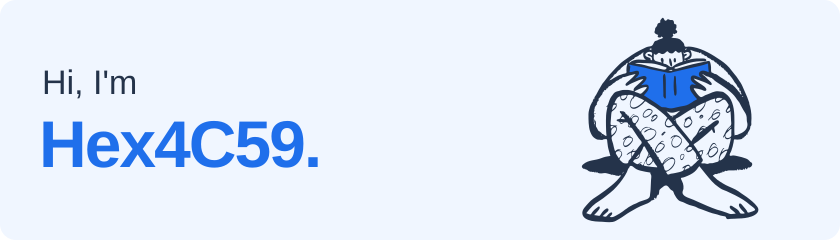

<picture>
  <source media="(prefers-color-scheme: dark)" srcset="./assets/profile/hero-dark.svg" />
  
</picture>

I explore **AI agents**, **audio/video software**, and **rewriting existing software in Rust**.
I write about what I learn along the way, from the first attempt to the lessons that stick.

## Selected projects

<table>
  <tr>
    <td width="50%" valign="top">
      <h3><a href="https://github.com/Hex4C59/pi.nvim">pi.nvim</a></h3>
      
A native Neovim client for Pi Coding Agent. Conversation and coding collaboration, right in the editor.

      
Lua · Neovim · AI agents

    </td>
    <td width="50%" valign="top">
      <h3><a href="https://github.com/Hex4C59/caption-meet">caption-meet</a></h3>
      
LAN video meetings built on RTCPilot. Real-time Chinese subtitles are planned; currently under development.

      
JavaScript · Audio/video · Subtitles

    </td>
  </tr>
</table>

## Languages & tools

  
  
  
  
  

## Writing

[Visit my blog →](https://hex4c59.cc/) for notes on software, experiments, and things I am learning.
Comments and conversations are always welcome.

> 文章本天成，妙手偶得之

Blog maintenance: [development guide](docs/development.md).
