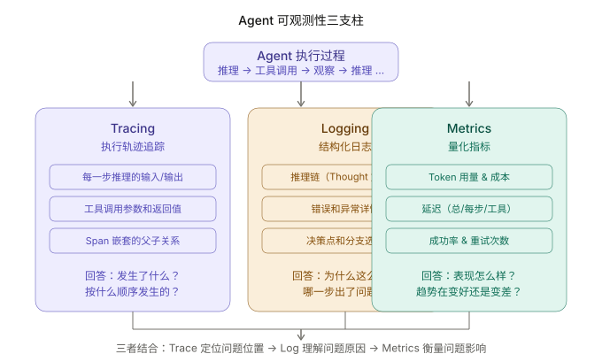
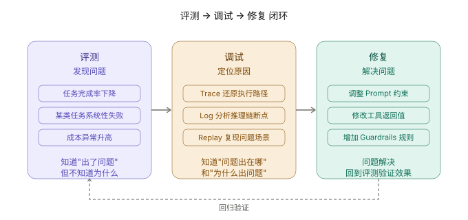

+++
title = "调试 Agent：当你不知道它为什么做了那件事"
date = 2026-03-28T22:00:00+08:00
draft = false
author = "Hex4C59"
description = "用可运行 CLI Coding Agent 的真实 JSONL 记录，解释如何关联模型调用、工具分发与进程结果，并定位超时、拒绝和未完成任务。"
summary = "从真实的先失败后通过的测试过程出发，区分运行轨迹、日志和汇总指标，说明工具调用成功不等于业务成功，以及只有元数据的 trace 为什么不能自动重放模型任务。"
tags = ["Agent", "可观测性", "Tracing"]
categories = ["ai"]
series = ["agent-engineering"]
series_order = 19
difficulty = "intermediate"
article_type = "concept"
topics = ["observability", "debugging", "tracing", "logging", "metrics", "evaluation"]
frameworks = ["OpenAI", "Anthropic"]
ShowToc = true
source_kind = "original"
lastmod = 2026-10-17
+++

Agent 的一次任务可能经过多轮模型调用和工具执行。最终回答说“完成了”，只能说明模型结束了这次对话；要知道测试是否通过、文件是否写入、失败后有没有恢复，还要看实际调用记录。

本文面向会写简单 Python、尚未设计日志系统的读者。我们使用[CLI Coding Agent](/agent/build-cli-coding-agent/)的真实运行记录，而不再另造一个没有接入执行循环的 Tracer。默认模型动作来自 fixture（本地固定响应），文件和子进程真实执行。你可以不使用 API 密钥重跑，比较自己的 JSONL 文件与文中片段。

[评测篇](/agent/agent-evaluation/)回答一组任务完成得怎样；这里回答单次任务在哪一步出现了可观察的偏差。日志帮助定位证据，不直接展示模型内部思考，也不自动证明原因。

## 先给结论

1. **把执行者和结果关联起来。** 模型回合用 `turn`，工具调用用 `call_id`，进程结束另记真实退出码；不要只留一句最终总结。
2. **区分工具分发与业务结果。** `tool.end.ok=true` 表示工具返回了可序列化结果，返回值中的测试进程仍可能退出 1。
3. **先记录足以定位的元数据。** 本例默认不保存提示词、文件正文、命令参数和标准输出，避免把敏感内容复制到 trace。
4. **只汇总实际存在的字段。** 这个入口能统计调用、写入、非零命令和超时；没有 token 与计费数据，就不输出假成本。
5. **查看记录与重新执行分开。** 只保存元数据的 trace 可以分析顺序，不能据此自动恢复全部模型输入或重放外部副作用。

## 先运行一次可检查的任务

下载 [CLI Coding Agent 完整示例](/downloads/agent-examples/cli-coding.zip)，需要 Python 3.11 或更新版本。解压到单独目录后执行：

```sh
unzip cli-coding.zip -d cli-coding
cd cli-coding
python3.11 -m venv .venv
source .venv/bin/activate
python -m pip install -r requirements.txt
python app.py --trace repair.jsonl
python app.py --summarize-trace repair.jsonl
python -m unittest -v
```

默认入口新建临时项目，先运行失败测试，再读代码、批准并写入修复，最后重跑测试。只有命令行指定的 `repair.jsonl` 保留下来，练习项目会清理。trace 文件必须尚不存在，以免覆盖旧证据。

本例不需要创建另一套观测应用。`app.py` 中的 `JsonlTrace` 接受共享运行时的 `on_event` 回调，也接受文件和子进程工具的事件；`summarize_trace` 读取同一格式并统计。完整实现和批准、工作区边界在 CLI 教程中说明。

## 为什么 Agent 调试和传统调试不一样

### Agent 调试的三个根本差异

第一，模型下一次请求取决于前面提供的信息；单看最后输出看不到它是否收到错误。第二，工具执行成功只说明完成了一次操作，不一定达成目标。第三，网页、文件和外部服务可能变化；重新调用得到不同结果，不能直接归因于模型随机性。

因此，排查时先找最早能观察到的不同：请求的是哪个工具、执行是否被批准、进程何时结束、下一轮有没有开始。若要进一步判断模型为什么选了这个动作，还需要经授权保存的输入和工具结果，当前元数据记录不足以回答。

## 可观测性的三个支柱

Tracing 把一次任务的事件按顺序关联；Logging 把每个事件写成可查询记录；Metrics 把多条记录汇成数量。这里的 JSONL（JSON Lines）文件每行是一个 JSON 对象，同时承载顺序与结构；汇总入口再计算指标。



*图中是三种职责的概念划分。本例实际提供的字段以下文事件为准，没有记录模型内部思考、token 用量或价格。*

## 第一支柱：Tracing——执行轨迹追踪

### Trace 的实现

共享循环会发出 `run.start`、`model.start`、`model.end`、`tool.start`、`tool.end` 和 `run.end`。模型事件带回合号，工具事件带工具名与调用标识。CLI 再记录批准结果、文件读写，以及 `process.start`、`process.end`。

`JsonlTrace` 给每条记录增加 `seq` 序号和 `mode`。`elapsed_ms` 来自共享循环的实际计时；文件和进程事件不强造这个字段。开始与结束配对，可以知道执行进行到了哪里，但“没有看到结束”仍需结合进程是否存活、输出文件是否写完判断。

### 把 Tracer 嵌入 ReAct 循环

`coding_run` 把 trace 作为 `on_event` 传入共享循环，`WorkspaceTools` 也使用同一个接收器。这样模型请求和真实操作不会落到两套无法关联的假日志中。

以下四行从 2026-10-17、Python 3.11.16 的 `repair.jsonl` 实际捕获文件中按原顺序选出；它们不是连续行，中间事件未展示。耗时和输出字节数会随环境变化。

```jsonl
{"event": "process.end", "returncode": 1, "timed_out": false, "cancelled": false, "stdout_bytes": 0, "stderr_bytes": 582, "truncated": false, "seq": 12, "mode": "fixture"}
{"event": "tool.end", "elapsed_ms": 25, "turn": 2, "tool": "run_command", "call_id": "test-before", "ok": true, "seq": 13, "mode": "fixture"}
{"event": "process.end", "returncode": 0, "timed_out": false, "cancelled": false, "stdout_bytes": 0, "stderr_bytes": 148, "truncated": false, "seq": 30, "mode": "fixture"}
{"event": "run.end", "elapsed_ms": 51, "status": "complete", "turns": 6, "tool_calls": 5, "seq": 34, "mode": "fixture"}
```

第一条进程记录退出 1，但紧接着的工具结束事件仍是 `ok=true`。原因是测试程序真实运行并正常返回了一份“测试失败”的结果，工具并未发生参数解析或调用异常。第二次进程退出 0，最后模型循环以 `complete` 结束。应同时检查这些层次，不能只筛工具事件中的成功值。

## 第二支柱：Logging——结构化日志

### Agent 日志应该记什么

本例记录事件名、角色或回合、调用标识、分发状态、退出码、超时、取消和输出是否截断。默认不写提示词、参数、文件正文或命令输出。CLI 在当前终端显示保留的命令输出，trace 则只保存它的字节数；两者用途不同。

如果真实问题需要查看内容，先决定谁可以读取、保留多久、怎样脱敏，再增加明确字段。不能为了“完整复现”就默认复制凭据或全部项目内容。

### 日志分析的关键模式

查不到 `process.start`、却有拒绝批准事件，说明进程没有启动。`process.end.timed_out=true` 说明命令等待超过本次限制；模型可能继续给出文字，因此还要检查应用退出和未完成项。`tool.end.ok=false` 则先查参数、工具名与执行错误，不要先猜模型能力。

[工具接口设计](/agent/tool-interface-design/)强调错误应能帮助下一步判断；本例把参数错误和工具异常作为结构化工具消息交回模型，trace 只记录失败状态，不把可能含内容的异常全文复制进默认日志。

## 第三支柱：Metrics——量化指标

### Agent 的核心指标

`--summarize-trace` 读取真实 JSONL，并区分模型回合、工具分发失败、命令次数、非零命令、进程超时、取消和文件写入。上面同一次运行的实际汇总是：

```json
{
  "events": 34,
  "model_turns": 6,
  "tool_dispatch_failures": 0,
  "commands": 2,
  "nonzero_commands": 1,
  "process_timeouts": 0,
  "cancelled_processes": 0,
  "writes": 1,
  "runtime_statuses": [
    "complete"
  ]
}
```

`nonzero_commands=1` 与 `tool_dispatch_failures=0` 同时成立，正是前面的测试失败被正常回传。`runtime_statuses` 中的 `complete` 不能覆盖这个事实。汇总没有 token、API 费用或修复准确率，因为入口没有采集这些数据。

### 应该设告警的指标

先按任务定义需要关注的变化。例如同一固定练习突然没有第二次命令，可能是循环提前停止；超时数增加，可能来自命令变慢或时限变短。先核对输入与配置，再决定是否告警。一个孤立的调用次数不能直接说明效率下降，参考[评测篇](/agent/agent-evaluation/)对任务结果与过程的区分。

## Replay：复现问题的最有力工具

### 什么时候用 Replay

本例的 trace 不包含完整输入，因此不能从文件自动重建对话。能做的是重新运行同一个 fixture：程序再次创建同样的练习文件，模型请求顺序固定，文件和测试命令重新执行。这验证固定流程是否仍成立，不是重放原进程或证明 live 模型会产生相同输出。

重跑时用新的 trace 文件名；否则入口会拒绝覆盖。对真实任务而言，文件版本、工具返回与授权可能已经变化，不能未经检查便重复写入或外发动作。

## 评测-调试-修复闭环

先用失败用例确认问题，再用 trace 找到最早可观察的偏差，提出原因假设，修改后重跑原例与相关测试。



*记录帮助选择排查位置，修复是否成立仍靠任务验收和回归测试。*

本例的集成测试不仅检查日志里有没有“成功”这个词，还检查磁盘文件确实变了、第一条真实测试退出 1、第二条退出 0、拒绝时没有启动进程，以及取消后子进程已经回收。它们验证程序实现；live 模型能力没有在这些离线测试中测量。

## 五种常见的 Agent 调试模式

### 模式一：推理链断裂

若模型直接结束却没有读取或测试，trace 能显示缺少哪些操作，不能直接解释内部推理原因。应核对模型实际收到的资料，再判断是任务表达、工具描述还是输入缺失。[上下文与记忆](/agent/context-memory-state-management/)讨论了已保存资料与本轮输入的差别。

### 模式二：工具调用循环

重复的工具事件只说明重复发生了调用；默认 trace 不含参数，不能证明请求完全相同。先检查工具返回是否足以采取下一步，再在获准范围内对照参数。循环也应由硬性轮数和时限结束，不能靠日志代替限制。

### 模式三：工具返回污染

外部资料可能包含诱导越权的文字。默认元数据无法显示这段文字，需要另查获准保存的工具内容；执行前的权限检查仍要独立生效。[Guardrails](/agent/guardrails-safety-boundary/)解释了资料中的指令与用户授权的区别，trace 本身不防注入。

### 模式四：幻觉式工具调用

不存在的名称或不符合 Schema 的参数会被共享运行时拒绝，出现 `tool.end.ok=false`。先核对本轮发送的工具定义与具体错误，再调整指令；不要把所有此类失败都归因于上下文太长。

### 模式五：成本失控

本例能发现轮数、工具数或返回字节数异常，但不能报告真实 token 账单。输出上限也不等于 token 预算。如果需要成本告警，应先采集服务实际返回的计量字段和适用价格，再建立统计。

## 可观测性工具链

LangSmith、Langfuse 和 Arize Phoenix 是可观测性平台的例子。当前入口没有集成它们，也不包含对应 SDK 调用。已有平台仍需检查采集哪些字段、是否会上传代码或提示词、如何关联工具结果，不能因为接入平台就假定所有执行已覆盖。

### 工具选型建议

先把实际事件与失败语义定义清楚，再决定是否将它们送入平台。学习这个例子时，本地 JSONL 与自带汇总入口足以观察调用顺序、失败和恢复；需要多人查询、权限管理或长期保存时，再核对平台的具体版本与接入方式。

## 总结

调试从可观察事实开始：模型回了什么状态，工具有没有真正执行，进程退出了多少，哪个限制被触发。这个例子把这些事实写进同一份 JSONL，既能本地重跑，也能解释“调用成功但测试失败”。想进一步回答模型决策原因或实际费用，还需要额外、明确授权的数据，不能由现有字段猜出来。

*上一篇：[文件管理 Agent 实战：Guardrails 怎么落地](/agent/build-file-management-agent/)*

*下一篇：[Multi-Agent 实战：用 Supervisor 模式构建代码审查系统](/agent/build-multi-agent-code-review/)*
