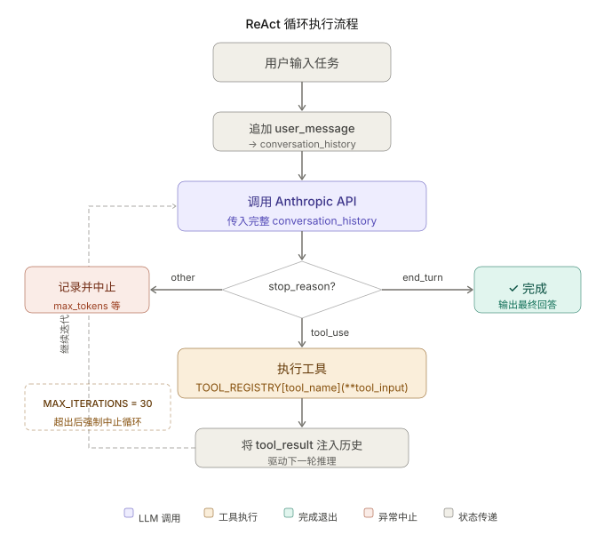

+++
title = "从零构建 CLI Coding Agent：ReAct 驱动的实战实现"
date = 2026-03-24T20:00:00+08:00
draft = false
author = "Hex4C59"
description = "运行一个完整的 Python CLI Coding Agent：默认用固定模型响应驱动真实文件操作和测试命令，支持逐次批准、超时清理与 JSONL 追踪。"
summary = "从下载、安装到真实测试失败与修复，说明共享模型循环怎样注册工具、检查工作区、等待批准并回传命令结果。离线夹具验证程序流程，live 模式可选；工作区检查不构成操作系统沙箱。"
tags = ["编程智能体", "CLI", "ReAct"]
categories = ["ai"]
series = ["agent-engineering"]
series_order = 13
difficulty = "advanced"
article_type = "tutorial"
topics = ["coding-agent", "cli", "tool-use", "react", "state-management"]
frameworks = ["OpenAI"]
ShowToc = true
source_kind = "original"
lastmod = 2026-10-17
+++

这篇教程面向会写 Python 函数和循环、希望看懂编程助手如何修改代码的读者。你会运行一个命令行界面（Command Line Interface，CLI）程序：它先执行一个确实会失败的测试，再读取并修改练习代码，最后重新运行测试。

默认演示不需要 API 密钥。只有模型选择动作的回复来自本地固定响应（fixture），文件读写和 Python 测试进程都真实执行。这样可以先检查程序有没有接通，再决定是否接入真实模型；一次固定演示不证明模型会自行发现和修复其他 bug。

[ReAct 范式](/agent/react-paradigm/)解释了“选择动作、执行、读结果、再选择”的循环；[Tool Use](/agent/tool-use-core-of-agent/)解释了模型请求与实际操作的分工。这里提供完整源码、固定依赖、命令入口和离线测试，不再要求读者自行补齐工具路由或凭据配置。

## 先给结论

1. **先跑通离线演示。** 下载包默认只操作新建的临时项目，不会把博客仓库或用户主目录当练习目录。
2. **模型回复与命令结果分开看。** `complete` 表示模型循环结束；测试是否通过，要看真实子进程的退出码和输出。
3. **每次写入和命令都经过批准。** 固定演示只预先批准其列出的操作；live 模式逐次展示并询问，不提供一键批准任意命令的开关。
4. **文件工具检查工作区，命令仍具有本机权限。** 允许执行的解释器可能读写工作区外的文件；本例不是操作系统沙箱。
5. **循环与子进程都有上限。** 既限制轮数、工具次数和总时限，也限制单个命令等待时间与保留的输出大小。

## 安装与运行

先下载 [CLI Coding Agent 完整示例](/downloads/agent-examples/cli-coding.zip)。需要 Python 3.11 或更新版本；下面在解压后的目录执行：

```sh
unzip cli-coding.zip -d cli-coding
cd cli-coding
python3.11 -m venv .venv
source .venv/bin/activate
python -m pip install -r requirements.txt
python app.py --trace repair.jsonl
python app.py --summarize-trace repair.jsonl
python -m unittest -v
```

ZIP 内含共享的 `agent_runtime.py` 和固定版本的 `requirements.txt`。从仓库运行时，依赖文件在 `examples/agents/common/requirements.txt`；进入示例目录后，用 `PYTHONPATH=../common python app.py` 即可找到共享运行时。下载包已经把该模块放在入口旁边，不需要设置这个路径。

`--trace` 创建一个新的 JSONL 文件，每行是一条 JSON 事件；若文件已存在，程序会拒绝覆盖。没有指定时，记录随临时目录清理。演示结束后，练习文件也会删除，只有显式指定的 trace 留下。

## 整体架构

程序由三个职责组成：`app.py` 接收命令行选项并构造工具；共享 `run_agent` 请求模型、校验参数和分发调用；工具处理文件和子进程，再把结果交回循环。模型本身不执行文件系统操作。

本例使用普通的模型响应与结构化工具请求，没有要求模型输出内部思考过程。[System Prompt 设计](/agent/prompt-design-agent/)里的调用条件与失败处理，落实为本例的 `SYSTEM` 指令和执行代码。



*图示说明循环的职责关系。下文运行结果来自本示例，图本身不作为某款产品内部架构的证据。*

## 项目结构

```text
cli-coding/
├── app.py
├── test_app.py
├── README.md
├── agent_runtime.py    # 下载包中包含；仓库源码位于 ../common/
└── requirements.txt    # 下载包中的固定依赖
```

源码只维护一份。下面的完整入口由同一文件渲染，安装与测试使用的也是它：



## 第一步：定义工具集

`WorkspaceTools` 提供四个入口。`list_files` 最多遍历 200 个条目，跳过符号链接及若干缓存目录；`read_file` 读取不超过 16,384 字节的 UTF-8 普通文件；`write_file` 以临时文件加替换的方式写入，父目录必须存在；`run_command` 接收参数数组，返回标准输出、错误输出、退出码和超时标记。

所有文件路径都先交给共享的 `confined_path`：它拒绝绝对路径、父目录跳转和符号链接组件。覆盖已有文件前还必须通过 `read_file` 读过它，避免直接按猜测覆盖原文。新增文件不需要先读取，但仍需批准。

这些检查针对可信本地用户选择的工作区，不防另一个进程同时替换目录。尤其要分清：`run_command` 检查的是工作目录，并没有限制获准程序能访问的所有路径。把 `python` 作为参数数组执行，不会自动约束它里面的代码。

每个工具用 JSON Schema 声明必填字段、类型和是否允许额外字段。共享运行时先校验再调用；名称不存在或参数错误时，错误作为工具消息交回模型，不会假装执行成功。

## 第二步：设计 System Prompt

`SYSTEM` 要求模型先读文件再替换，并根据命令的 `returncode`、`timed_out` 和输出判断发生了什么。程序还用“读过才能覆盖”和批准回调执行部分要求；提示词本身不能代替这些检查。更长任务的资料选择与进度保存，可结合[上下文与记忆](/agent/context-memory-state-management/)继续设计。

默认 fixture 的动作顺序写在 `fixture_model` 中。它不会动态分析错误，只是按固定顺序请求工具。因此，这个入口适合验证工具返回是否进入下一轮输入，不适合用来评估模型的编程能力。

## 第三步：实现 ReAct 循环

`coding_run` 调用共享 `run_agent`，限制为 8 轮、16 次工具调用和 30 秒。一次响应中的多个工具依次执行，保留读写之间的顺序；结果追加到消息历史，再进入下一轮。

运行时状态可能是 `complete`、`limit`、`timeout` 或 `error`。这里的“完成”只说明模型返回了最终文本，没有替你验收项目。最后一次命令非零退出或超时，应用仍以非零退出结束；如果模型没有调用命令，也就没有实际测试证据。

## 第四步：构建 CLI 界面

离线模式自己创建临时项目，并只为这次演示的准确命令数组及 `calculator.py` 写入设置批准。它会在开头显示 `fixture / 本地固定响应`，不能把这项演示授权外推给任意工具请求。

可选 live 模式通过环境变量读取 `OPENAI_API_KEY` 与所选的 `OPENAI_MODEL`，可选 `OPENAI_BASE_URL`。不要把真实密钥写入源码或命令历史。选好已有的可丢弃项目后运行：

```sh
python app.py --live --workspace /path/to/practice-project --task 'Fix the failing add test and run it' --trace live.jsonl
```

程序展示写入差异或命令的实际参数，只有输入 `y` 才批准这一项。若文件在等待批准时发生变化，写入会拒绝，要求重新读取。非交互输入会拒绝；不支持异步终端读取的环境也会拒绝。等待批准仍受总时限约束，不会启动一个无法取消的后台输入线程。

live 适配器使用共享运行时的 `AsyncOpenAI`，退出时关闭客户端。缺少配置或调用失败都会显式报告，不会悄悄切回 fixture。本教程的本地验证没有真实 API 凭据，未运行 live 模型任务。

## 一次完整的执行过程

下面是 2026-10-17 在 Python 3.11.16 下运行默认入口时捕获的部分标准输出，省略了测试 traceback 和 trace 文件路径：

```text
MODE fixture / 本地固定响应; exact demo commands and calculator.py write are preapproved.
RUNTIME status=complete turns=6 tool_calls=5
COMMAND 1: exit=1 timed_out=false truncated=false
COMMAND 2: exit=0 timed_out=false truncated=false
WRITES 1
```

临时项目最初把加法写成减法，测试检查 `add(2, 3) == 5`。第一条真实测试命令失败；fixture 接着请求读取文件、批准并写入加法实现，再启动第二条真实测试命令，退出码变为 0。测试证明的是这个练习用例通过，不能证明代码在所有输入下都正确。

## 必须处理的工程细节

### 上下文窗口管理

文件大小与命令输出都有边界。每路命令输出最多保留 4,096 字节，同时记录总字节数和 `truncated`。读取仍持续进行，避免子进程因管道写满卡住。示例没有实现模型 token 预算或历史摘要；较大项目需要另外设计，[上下文与记忆那篇](/agent/context-memory-state-management/)解释了相关取舍。

### 流式输出

本例没有 token 流式界面。它等一次模型响应完成，再执行工具；子进程输出在内部持续排空，结束后返回保留片段。JSONL 事件实时写出并刷新，适合在另一个终端查看调用进行到哪一步。

### 安全边界

命令不经 shell，但批准的程序仍继承当前用户环境和权限。不要把路径工具检查、确认框或输出截断称作沙箱。POSIX 系统上，子进程进入新会话，超时、取消或结束清理时会清理这个进程组；Windows 这里只保证直接子进程的终止与回收，不保证已脱离的后代。

单个命令默认最多等待 5 秒，可通过 `--command-timeout` 调整，但不能超过 30 秒。可以单独观察超时：

```sh
python app.py --scenario timeout --command-timeout 0.1 --trace timeout.jsonl
python app.py --summarize-trace timeout.jsonl
```

这个命令故意启动一个打印后休眠的 Python 子进程，超时后应用退出 1。不要把操作系统相关的负退出码写死为统一标准，要读 `timed_out` 和对应输出。

## 常见失败模式

拒绝批准时，程序不会启动命令或写入文件，错误会回到模型；模型仍可能给出最终文本，因此不能只看 `complete`。路径越界、符号链接、未读先覆盖、错误参数和超大文件也都会明确失败。

工具分发成功与业务成功另有区别：`tool.end.ok=true` 表示工具调用和结果序列化成功。测试进程退出 1 时，这个值仍可能为真。应继续查看 `process.end` 的退出码；[调试篇](/agent/agent-observability-debugging/)使用同一个程序的真实 trace 解释这件事。

离线测试会真实启动测试进程，覆盖先失败后通过、拒绝不执行、路径限制、输出截断、超时、取消回收和入口运行。固定模型响应耗尽则得到 `error`，不会被当作正常结束。

## 从这里出发，能扩展什么

若要处理跨阶段任务，可以在这个入口上增加[Plan-and-Execute](/agent/planning-plan-and-execute/)；需要分工时参考[多 Agent 协作](/agent/multi-agent-collaboration/)。它们仍需按实际执行结果验收，不能只汇总模型文字。工具跨应用复用可以考虑 [MCP](/agent/mcp-model-context-protocol/)，但接入协议不会补齐操作系统隔离。

当前实现没有持久会话恢复、任意命令自动批准或生产环境隔离。保留这些边界，比把一个可运行练习描述成完整开发产品更有助于判断它能做什么。

## 总结

现在可以从入口跑到真实文件修改和测试进程，并查看每一步的结构化记录。下一次换成真实模型时，保持同一套参数校验、批准、超时和结果检查，先确认模型真的读到了失败信息，再判断修复是否有效。

*上一篇：[Skill：如何教会 Agent 如何工作](/agent/skill-teach-agent-how-to-work/)*
