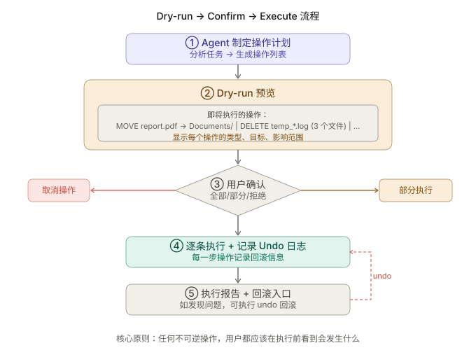

+++
title = "文件管理 Agent 实战：当操作不可逆时，Guardrails 怎么落地"
date = 2026-03-28T20:00:00+08:00
draft = false
author = "Hex4C59"
description = "运行一个带显式审批和持久撤销日志的文件管理 Agent：限制工作区、预览提案、备份删除内容，并通过真实临时文件测试验证跨进程恢复与冲突拒绝。"
summary = "模型只提出移动、复制和带备份删除的方案，用户逐条批准后才执行。用可下载的 Python 示例说明 SQLite 日志如何支持新进程撤销、异常恢复与不覆盖已有文件，并区分离线固定响应验证和真实模型能力。"
tags = ["Agent", "安全护栏", "File Management"]
categories = ["ai"]
series = ["agent-engineering"]
series_order = 18
difficulty = "intermediate"
article_type = "tutorial"
topics = ["file-management", "guardrails", "dry-run", "undo", "permissions", "tool-use"]
frameworks = ["OpenAI"]
ShowToc = true
source_kind = "original"
lastmod = 2026-10-17
+++

前面的 [CLI Coding Agent](/agent/build-cli-coding-agent/) 会读写代码，[Research Agent](/agent/build-research-agent/) 会搜索和整理资料。文件管理要多回答一个问题：模型提出“把它删掉”时，程序怎样在执行前等待人确认，又怎样在执行后保留恢复所需的内容？

本文面向会写简单 Python、了解文件路径的读者。你将运行一个完整的命令行（CLI）示例：先预览移动和删除提案，再批准执行；关闭本次程序后，重新调用它，恢复被移动或删除的合成文件。默认运行使用本地固定模型响应，文件操作和 SQLite 日志是真实的；SQLite 把操作记录保存在本地数据库文件中，不访问模型服务。

这里的 [Guardrails](/agent/guardrails-safety-boundary/) 指程序执行的约束：拒绝越界路径、拒绝覆盖、等待用户批准、核对文件有没有变化。它们写在执行代码里，不依赖模型是否记住提示。

## 先给结论

1. 模型只能列目录、提交提案、查看预览，拿不到执行和批准工具。真实文件变更由另一次 CLI 调用读取用户的完整确认口令后完成。
2. “删除”先保存原始字节，再从业务目录移除文件。因此本例支持带备份删除，不提供永久擦除。
3. 待确认队列和撤销记录保存在工作区内的 SQLite 文件中。新应用进程会读取同一份日志，撤销不再依赖上一个进程的内存。
4. 执行、撤销和恢复都不覆盖已有路径。原路径被重新占用、目标被修改或日志无法确认时，程序明确拒绝，不猜测哪个文件可以丢弃。
5. 验证覆盖临时文件与应用恢复流程。固定响应不证明模型会正确整理你的真实目录；路径检查也不是操作系统沙箱。

## 下载并跑通一次

需要 Python 3.11 或以上版本。先下载 [文件管理 Agent 完整示例](/downloads/agent-examples/file-management.zip)，将 ZIP 放到一个独立目录，再执行：

```bash
unzip file-management.zip -d file-management-demo
cd file-management-demo
python3.11 -m venv .venv
source .venv/bin/activate
python -m pip install -r requirements.txt
python app.py
```

下载包包含 `app.py`、`test_app.py`、README、共享 `agent_runtime.py` 和依赖文件。解压后可以直接运行，不需要修改 Python 导入路径。

以下是本次运行默认演示时捕获的标准输出。`fixture` 表示模型响应由本地脚本固定提供，不是真实模型调用：

```text
[fixture 本地固定响应] model=complete; pending=2
[fixture] dry-run: notes=True; trash=True
[fixture] approved: moved=True; deleted=True
[fixture] reopened journal: delete_undo=True; move_undo=True; bytes_restored=True
[fixture] temporary workspace cleaned on exit; no live model called
```

前两行说明模型只生成了两条提案，两个原文件仍在。演示随后为这两个已知的临时文件提供固定审批口令，执行移动和删除，再重新创建应用对象撤销，检查恢复的字节。退出时临时目录被清理，程序不会把 HOME 或当前仓库当作业务工作区。独立 CLI 进程之间的恢复在后文测试中另外验证。

## 把提案和执行分开

本例把功能分为四个边界明确的部分：

| 部分 | 输入 | 实际行为 |
| --- | --- | --- |
| 共享模型循环 | 任务、工具定义、已有结果 | 请求模型，按顺序调用工具，把结果交回模型 |
| 模型可见工具 | 相对路径和操作类型 | 读目录，或把操作及原始内容快照保存为 `pending` |
| CLI 审批入口 | 操作 ID、用户输入的确认口令 | 再次核对源文件和目标，批准后才执行 |
| 日志与恢复 | SQLite 记录、文件现状 | 撤销已执行操作，或处理上次未完成的执行 |

`pending` 表示“已保存提案，尚未执行”。Dry-run 在这里就是查看这些提案：操作 ID、类型、源路径、目标路径、字节数和内容摘要。程序可能写入自己的日志，但不会移动、复制或删除业务文件。



*图：先预览影响，再选择批准或取消。本实现逐条按 ID 批准；图中的批量项表示多条单文件提案，程序不展开通配符，也没有一键批准全部的入口。删除内容会先保留在日志中。*

所有文件变更都等待批准。目录创建由用户在准备阶段完成，程序不支持删除目录，也不替用户建立一批未记录的父目录。

## 工作区检查具体检查什么

启动时必须明确选择一个已经存在的目录。程序拒绝 HOME、HOME 的祖先和 Git checkout；无参数运行则自行创建临时目录。模型提交的操作路径必须相对这个目录，不能包含 `..`，不能通过符号链接，也不能访问 `.file-agent` 状态目录。

检查不是比较字符串前缀。共享的 `confined_path` 逐段检查路径，执行前还会重新调用它。因此，如果预览后用户把目标父目录换成指向外部的符号链接，本次执行会被拒绝，外部目录不会因此写入文件。为避免路径别名让撤销记录对不上，提案保存规范化后的相对路径，并要求使用目录实际列出的大小写。

文件还必须是普通文件，最多 1 MiB。外部硬链接会让同一份文件内容拥有另一个路径名称，本例拒绝这类文件，也拒绝会影响程序运行身份的 setuid/setgid 特殊权限。目标父目录必须已存在，目标名称必须空闲，源与目标必须处于同一文件系统。重命名可以用“源和目标在同一目录内的移动”表达。

这些检查服务于可信本地用户。它们不能阻止另一个恶意进程在检查后立刻替换目录，也不能限制这个 Python 进程拥有的全部系统权限。不要将它当作沙箱或文件系统权限隔离。

## 在新进程里批准和撤销

下面的命令创建独立临时工作区，并把移动提案的实际 ID 存入变量。它们没有写入当前项目：

```bash
WORKSPACE="$(mktemp -d)"
mkdir "$WORKSPACE/sorted"
printf 'keep this note\n' > "$WORKSPACE/notes.txt"
OP_ID="$(python app.py --workspace "$WORKSPACE" --queue move --source notes.txt --destination sorted/notes.txt | python -c 'import json,sys; print(json.load(sys.stdin)["id"])')"
python app.py --workspace "$WORKSPACE" --status
python app.py --workspace "$WORKSPACE" --apply "$OP_ID"
```

最后一条打印提案，并要求输入 `APPROVE`、一个空格和显示的完整 ID。输入 `y`、`n`、其他 ID 或不完整口令都不会批准。模型的文字回复同样不能替代这次输入。

现在再次运行程序：

```bash
python app.py --workspace "$WORKSPACE" --undo "$OP_ID"
```

这次输入 `UNDO`、一个空格和同一个 ID。它是新的 Python 进程，但会打开原工作区中的日志，把 `sorted/notes.txt` 恢复为 `notes.txt`。如果原路径已存在另一个文件，程序拒绝覆盖。

移动撤销后，可以再试带备份删除：

```bash
DELETE_ID="$(python app.py --workspace "$WORKSPACE" --queue delete --source notes.txt | python -c 'import json,sys; print(json.load(sys.stdin)["id"])')"
python app.py --workspace "$WORKSPACE" --apply "$DELETE_ID"
python app.py --workspace "$WORKSPACE" --undo "$DELETE_ID"
```

两次调用仍分别等待批准。在删除操作执行前，原始字节已经保存在 SQLite 的 `image` 字段中；撤销时从这份备份创建原路径。这里的移动也按备份创建目标、再移除源文件。移动、复制和撤销只保留文件内容和普通权限，不保留原有的底层文件编号、修改时间、附加访问控制规则和扩展元数据。带备份删除因此能恢复内容；它没有执行永久擦除。

撤销采用后进先出：先撤销最后一条成功执行的操作，再撤销更早执行的操作。日志单独保存执行顺序；即使用户倒序批准独立提案，撤销也不按提案创建顺序猜测。若文件先从 A 移到 B，再从 B 移到 C，应先恢复 B，再恢复 A。恢复 B 会创建一个新文件，文件系统给它的编号（inode）会改变。程序会同步更新前一条操作的目标身份记录，否则第二次撤销会把应用自己恢复的文件误判为外部替换。

## 日志不能只在成功后写一行

`.file-agent/journal.sqlite3` 保存队列、操作状态、原始字节及源和目标的身份。身份包括 inode、大小、修改时间、普通权限和内容哈希；它让程序发现预览之后的文件改动。哈希是对内容计算出的摘要，这里用来核对备份和文件是否一致，不是让模型评价可靠性。

执行前，程序先提交 `applying` 记录，再改变业务文件。创建目标时，它先在应用状态目录准备内容，再用硬链接为文件增加目标名称；这个操作遇到已有名称会失败，不会替换已有目标。执行确认后清理暂存链接。两份 SQLite 文件各司其职：一份保存操作，一份在执行区间维持应用互斥锁，防止本例的两个进程同时修改同一工作区。

| 持久状态 | 新进程看到它时做什么 |
| --- | --- |
| `pending` | 保留提案，继续等待用户批准或取消 |
| `applying` | 说明执行没有得到日志确认，按备份回到执行前，记为失败 |
| `applied` | 保留执行结果，允许用户申请撤销 |
| `undoing` | 继续把已批准的撤销做完 |
| `undone`、`cancelled`、`failed` | 保留历史，不自动重做操作 |

打开工作区时也会恢复未结束记录，所以“查看状态”可能先完成上一次已批准操作的恢复。这不是一次新的模型授权。

日志与文件系统是两种不同的存储，不能把一次 SQLite 提交当成二者共同的事务。程序在执行失败时尝试回滚；如果日志不可写、目标被别人修改、原路径被占用或备份校验失败，它会保留现场并返回需要恢复的错误。用户解决具体冲突后，重新打开同一工作区，程序再按日志恢复。

另一个容易误判的情况是：日志已成功提交，之后报告过程发生异常。这时不能又把文件回滚，却让日志仍显示 `applied`。程序先查持久状态；若执行已经确认，就保留结果，提示用户查看状态或明确申请撤销。因此，“命令返回错误”不一律等于“没有改动任何文件”。

## 接入真实模型只改变提案来源

默认的 `ScriptedModel` 按固定顺序返回工具请求，用于确认模型循环与真实工具接得上。可选 live 模式改用共享运行时的异步客户端：

```bash
python app.py --workspace "$WORKSPACE" --live --task '查看目录，为整理 notes.txt 提出移动方案，不执行'
```

运行前需在自己的终端设置 `OPENAI_API_KEY`、`OPENAI_MODEL`，按需设置 `OPENAI_BASE_URL`。代码不内嵌密钥，客户端在 `finally` 中关闭。缺少配置或接口失败会返回错误，不悄悄替换为固定响应。

模型依然只能使用 `list_directory`、`queue_operation` 和 `preview`。共享运行时校验参数，并将工具失败交回模型；规划返回 `complete` 只表示本次模型循环完成，不代表文件执行完成。本轮没有可用的模型凭据，未执行真实模型调用，也没有评测规划质量。

[工具接口设计](/agent/tool-interface-design/)强调返回信息要足以支持下一步判断。在这里，最关键的信息是“待批准”“已执行”“拒绝冲突”这些真实状态，而不是让模型从一句“成功”猜测文件究竟发生了什么。

## 怎样验证这些行为

在下载包目录中执行：

```bash
python -m unittest -v
```

本次在 Python 3.11.16、macOS 的本地临时目录中执行了 30 项测试，全部通过。测试会真实写入带二进制字节的合成文件；断言检查内容，而不只是检查函数返回的成功字段。

覆盖的关键情况包括：

- 预览、错误批准口令和取消均不改变业务文件；模型尝试调用批准工具会收到未知工具错误。
- 移动、复制和带备份删除成功后，新应用对象能撤销；删除和撤销还通过两个独立 CLI 进程执行。
- 绝对路径、`..`、指向工作区内外的符号链接、预览后换入的符号链接以及状态目录访问被拒绝。
- 执行前出现同名目标、撤销时原路径被占用、目标被修改或增加外部硬链接时，不覆盖、不删除冲突文件。
- 注入日志准备或最终写入故障后，检查实际文件和重新读取的状态；备份损坏和数据库损坏都不会触发静默重建。
- 真实子进程在准备、目标创建、源文件移除和撤销写回等阶段直接退出；再次打开后检查回滚或完成撤销，并验证 SQLite 锁已释放。

这些是固定输入下的文件操作证据，不是模型能力、性能或断电恢复证据。备份仍在同一个工作区；整个工作区或硬盘损坏时，本例没有另一份独立备份。历史快照暂未提供清理策略，取消也保留内容，因此用户应在确认不再需要恢复后，明确决定如何归档或清理这个临时工作区。

## 完整源码与后续使用边界

下载包中的 `app.py` 是实现来源，以下代码从同一文件展示；测试和依赖也随包提供：



本例适合在支持 SQLite 锁和硬链接的本地文件系统中理解审批、恢复和冲突处理。目录批处理、跨文件系统迁移、网络盘与云同步竞争、恶意同权限进程和断电硬件故障都没有在本轮验收中得到覆盖。后续扩展前，先为新增文件类型和故障位置写实际文件测试，不能把“增加一个工具”当作恢复协议已经完整。

*上一篇：[Research Agent 实战：从 RAG 到自主研究](/agent/build-research-agent/)*

*下一篇：[Multi-Agent 实战：代码审查系统](/agent/build-multi-agent-code-review/)*
