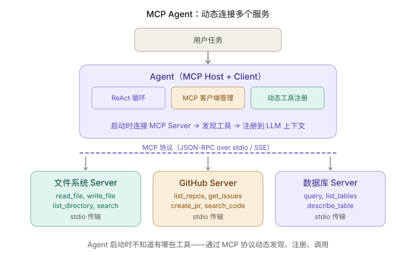
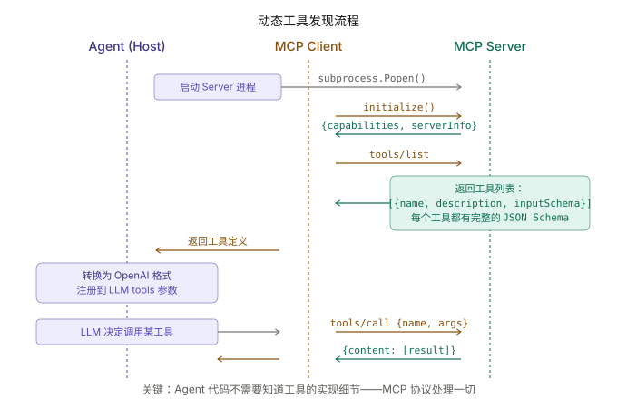

+++
title = "MCP 集成实战：让 Agent 连接真实服务"
date = 2026-03-29T14:00:00+08:00
draft = false
author = "Hex4C59"
description = "用官方 Python MCP SDK 连接两个真实本地 FastMCP 服务，完成初始化、工具发现、命名空间映射和调用，并验证错误处理、超时与取消清理。"
summary = "下载可运行示例，用固定模型响应驱动真实 MCP 子进程读取合成文件。工具定义由服务报告；宿主负责校验、路由和清理。包含固定版本依赖、启动配置、离线演示与协议集成测试，并说明真实模型、认证和隔离的边界。"
tags = ["Agent", "MCP", "工具调用"]
categories = ["ai"]
series = ["agent-engineering"]
series_order = 21
difficulty = "intermediate"
article_type = "tutorial"
topics = ["mcp", "tool-use", "dynamic-tools", "protocol", "integration"]
frameworks = ["OpenAI", "Anthropic"]
ShowToc = true
source_kind = "original"
lastmod = 2026-10-17
+++

前面四篇实战——[Coding Agent](/agent/build-cli-coding-agent/)、[Research Agent](/agent/build-research-agent/)、[文件管理 Agent](/agent/build-file-management-agent/)、[代码审查](/agent/build-multi-agent-code-review/)——都需要把工具实现和定义接入 Agent。这篇把工具移到独立进程：Agent 启动时先问服务“你有哪些工具”，再把模型提出的调用转发过去。

本文面向会写 Python、了解模型工具调用的读者。你将运行两个真实的本地 MCP 服务，读取同一份合成笔记，并看到初始化、发现、调用和关闭的结果。模型部分默认使用 **fixture（本地固定响应）**；协议消息、服务进程和文件读取都是真实的。这个演示验证接入代码，不证明模型会自主选对工具。

## 先运行一个完整例子

下载 [MCP Agent 示例 ZIP](/downloads/agent-examples/mcp.zip)，在空目录执行以下命令。ZIP 内没有额外的目录前缀，解压后入口和依赖文件就在 `mcp-demo` 中。需要 Python 3.11+；命令用于 macOS/Linux shell：

```sh
unzip mcp.zip -d mcp-demo
cd mcp-demo
python3 -m venv .venv
.venv/bin/python -m pip install -r requirements.txt -r requirements-extra.txt
.venv/bin/python app.py
.venv/bin/python -m unittest -v test_app.py
```

下载包包含 `app.py`、`connector.py`、`local_server.py`、`config.json`、测试、说明，以及公共的 `agent_runtime.py` 和依赖文件。MCP SDK 固定为 **`mcp==1.30.0`**，使用同一版本的 `ClientSession`、`stdio_client` 和 FastMCP。安装依赖后，默认演示不需要网络、模型密钥或外部服务。

程序会在临时目录写入 `note.txt`，内容是 `synthetic MCP note`，启动两个服务后各读取一次，最后关闭连接并删除临时目录。它不会把演示数据写入 HOME 或当前仓库。

2026-10-17 的实际输出节选如下；中间两条完整的 `tool-result` JSON 在此略去，运行时会显示。

```text
mode=fixture (local fixed model responses; real MCP subprocesses)
mcp-sdk=1.30.0
local initialize -> protocol=2025-11-25
local tools/list -> read_note
mirror initialize -> protocol=2025-11-25
mirror tools/list -> read_note
model tools -> local__read_note, mirror__read_note
local tools/call read_note -> call.ok
mirror tools/call read_note -> call.ok
agent.status=complete; tool_calls=2
fixture: predetermined calls finished; inspect the real tool results above.
fixture.check=passed
connections=closed
```

`tool-result` 中有真实返回的 `content` 和 `structured_content`，后者包含服务标签、`note.txt` 路径和文件内容。两个服务分别返回 `local`、`mirror` 标签。程序还检查是否收到两次成功的工具结果：找不到文件时会报失败并返回非零，不会只根据 fixture 的结束文本宣称成功。

## 谁负责发现，谁负责执行

[MCP](/agent/mcp-model-context-protocol/) 是 Model Context Protocol（模型上下文协议）。在这个程序里，三个角色分别是：

- **Host**：`app.py` 和连接管理器，决定启动哪些程序、把哪些工具交给模型，以及怎样处理结果。
- **Client**：每个服务对应的官方 `ClientSession`，通过 stdio，也就是子进程的标准输入输出，交换协议消息。
- **Server**：`local_server.py` 启动的 FastMCP 进程，真正检查路径并读取文件。



图 1 表示多个服务汇入同一工具循环的关系。图中的文件系统、GitHub 和数据库是可替换的服务类型；本例实际验证的是两个本地笔记服务，只使用 stdio。

工具发现改变的是注册方式。Host 不再手写 `read_note` 的每个参数，而是读取 Server 报告的名称、说明和 `inputSchema`，再转换为公共运行层的 `Tool`。模型看到这些定义后提出调用；读取文件的代码仍在 Server 中执行。

把工具放进另一个进程，并没有消除宿主的责任：配置是否可信、参数能否接受、工具属于哪个服务、服务失败后怎样退出，都需要明确处理。

## 配置必须能直接启动服务

随包的 `config.json` 是默认演示实际使用的配置：



`$PYTHON` 会替换为运行 `app.py` 的解释器，因此服务使用同一个虚拟环境。`{workspace}` 只有作为一个完整参数时才会替换；相对 `cwd` 从配置文件所在目录解析；带目录的程序路径再从 `cwd` 解析，裸命令名从 PATH 查找。Host 使用命令和参数数组启动程序，不把它们拼成 shell 命令。

启动前，`load_config()` 会校验整个文件：拒绝重复 JSON 键、未知字段、非字符串参数、缺失的可执行程序、无效目录，以及不在 0.05～60 秒范围内的请求期限。`env_from` 可列出明确需要转发的环境变量名；变量缺失时拒绝启动，配置不存储凭据。SDK 另外提供自身定义的基础环境，不会由本连接器把宿主全部环境复制过去。

**配置是一份启动程序的指令，必须来自可信用户。** 参数数组不会让指定程序自动变得安全。不能把模型生成的 JSON 直接当作启动配置。

## 初始化和发现交给官方 SDK

`connector.py` 使用 `AsyncExitStack` 保存已经进入的资源上下文。下面是连接阶段的片段，省略了配置校验、分页循环和工具登记；完整实现随 ZIP 提供，不能只复制此片段运行：

```python
async with AsyncExitStack() as stack:
    errlog = stack.enter_context(tempfile.TemporaryFile(mode="w+t", encoding="utf-8"))
    params = StdioServerParameters(
        command=config.command, args=list(config.args),
        cwd=str(config.cwd), env=config.env,
    )
    read, write = await stack.enter_async_context(stdio_client(params, errlog=errlog))
    session = await stack.enter_async_context(ClientSession(
        read, write,
        read_timeout_seconds=timedelta(seconds=config.timeout_seconds),
    ))
    init = await session.initialize()
    page = await session.list_tools(params=None)
```

`initialize()` 协商协议版本并发送后续的 initialized 通知；程序使用返回的版本和能力，不在请求里写死协议版本。SDK 持续分发响应、通知和请求，应用不再假定“下一行输出就是这次调用的回答”。stderr 写入会被关闭的临时文件，不创建一个无人读取的错误管道。

连接器确认服务声明支持工具后，逐页调用 `list_tools()`。若有下一页，就将游标放进 `PaginatedRequestParams`；重复游标、超过 20 页、没有工具或总数超过 64 都会拒绝，避免不完整地登记一部分结果。



图 2 表示启动、发现、调用的概念顺序。实际程序由 SDK 启动子进程；图中 `subprocess.Popen()` 不是本文入口。初始化还包含版本协商和 initialized 通知，宿主仍负责权限、参数与生命周期，不能把图末“协议处理一切”理解为安全保证。

## 两个服务都有 read_note，怎样避免覆盖

两个服务报告的远端名称都是 `read_note`。直接以它作为字典键，后登记的服务就可能覆盖先登记的服务。本例给模型的名称分别是：

| 模型看到的名称 | 连接中的服务 | 发给服务的名称 |
| --- | --- | --- |
| `local__read_note` | `local` | `read_note` |
| `mirror__read_note` | `mirror` | `read_note` |

连接器保存这份映射，调用时查表，不靠拆字符串猜测远端名称。服务别名不能包含 `__`，组合名称必须满足本适配器的 64 字符规则；不符合就报错，不截短名称后继续注册。

参数也要校验。连接器只接受对象 Schema，禁止额外的顶层参数，输入和输出 Schema 都拒绝文档外的 `$ref`，避免验证参数时额外下载网络资源。公共运行层会在执行工具前检查 JSON 参数，连接器直接调用入口也会检查。MCP 可以传递 Schema，但这不意味着每个服务的 Schema 都适合当前模型接口。

## 服务端做的是真实文件读取

服务使用官方 SDK 的 FastMCP 注册 `read_note`。工具收到相对路径后，先检查路径是否越界、是否经过符号链接、目标是否为普通文件，以及大小是否超过 8192 字节，随后读取 UTF-8 内容并返回标签、路径和文本。完整服务如下：



`delay_seconds` 的范围是 0～5 秒，只为演示请求期限与取消提供可等待的操作。服务的 stdout 专用于 MCP 消息，不能随意 `print()` 调试日志，否则会干扰协议。

这些路径检查适用于用户控制的私有目录，假定没有其他进程同时替换路径。它们不是操作系统沙箱。启动的服务仍有当前用户的权限；接入不可信代码需要另外隔离进程、文件、网络和凭据。

## 把发现的工具交给 Agent 循环

入口通过 `manager.tools()` 获得公共运行层的 `Tool` 列表，再交给 `run_agent()`。工具处理函数调用 `session.call_tool()`，保持远端工具名与对应连接一致。完整入口如下：



默认的 `fixture_model()` 预先规定两次调用。它并没有根据描述学会选择工具，也不会因为你改了 `--task` 就改变行动。若配置里去掉 `local` 或 `mirror`，固定演示就不能完成它原有的两个调用；要测试新任务，需要修改固定响应，或明确选择真实模型。

调用结果有两层错误要区分。服务返回 `isError=true` 时，连接器抛出工具错误，由公共循环生成 `ok=false` 的工具消息；JSON-RPC 层的 `McpError` 则保留错误码与信息。成功结果保留全部内容块和 `structuredContent`，不只提取文本后丢掉其他数据。

`AgentResult.status=complete` 表示模型结束了本轮交互，不能单独证明业务目标已经实现。因此固定演示另行检查两次真实读取都成功。实际模型任务还需要与目标相符的检查，不能用一句“完成了”代替。

手写的本地 `Tool` 也可以与 `manager.tools()` 放进同一列表，交给同一个循环。只需保证名称不冲突；不需要为本地工具再启动 MCP 服务。

## 正常退出、失败和取消都要清理

`connect_servers()` 在同一任务内进入每个传输和会话上下文，退出时由 `AsyncExitStack` 反向关闭。如果第二个服务启动失败，第一个已连接的服务也会退出；如果工具调用被取消，取消会继续向外传播，随后退出上下文。

不要把 `stack.aclose()` 放进另一个 asyncio 任务来“后台清理”。SDK 的 AnyIO 取消作用域必须由进入它们的任务退出。SDK 的 stdio 上下文负责关闭输入、等待进程退出，并在需要时终止进程；宿主不另写一套手工收发和终止逻辑。

测试既运行默认 FastMCP 服务，也用官方低层 SDK 启动会返回协议错误、混合内容或不响应初始化的测试服务。它们覆盖：

- 两个同名工具的发现、路由及合成文件实际内容。
- 工具失败后继续读取、JSON-RPC 错误、非文本与结构化内容保留。
- 分页、配置校验、Schema 限制，以及绝对路径、上级目录、符号链接和大文件拒绝。
- 第二个服务启动或发现失败、请求和 Agent 总期限、初始化及工具调用期间取消。

POSIX 测试读取本次临时 PID 标记，检查退出后服务进程是否已经消失。这是本机进程清理证据，不是操作系统隔离或 Windows 验证。本次测试中，SDK 对一个不响应的测试进程组终止时报权限拒绝，随后退回终止单个进程；该进程的退出检查通过，未据此证明完整后代树已被隔离。

## 换成自己的目录和真实模型

使用已有的私有目录时：

```sh
python app.py --workspace /path/to/private-notes
```

该目录需要已有 `note.txt`。程序不创建或覆盖其中的数据。默认 fixture 仍固定读取两次。

若要调用真实模型，先在本机环境设置 `OPENAI_API_KEY`、`OPENAI_MODEL`；兼容服务还可设置 `OPENAI_BASE_URL`。再运行：

```sh
python app.py --live --workspace /path/to/private-notes --task '读取 note.txt 并说明两次返回的标签'
```

网络请求可能收费，所选模型需要支持工具调用；模型客户端会在 `finally` 中关闭。本轮没有真实模型密钥，未验证模型 API 的运行效果。

这份程序只实现本地 stdio。接入远程服务、真实账户或写入工具时，还需实现相应认证、凭据管理、用户确认和隔离。工具被发现不等于用户已经授权执行，服务返回的说明和文件内容也应当按外部数据对待。

## 来源与复现范围

核对日期为 2026-10-17。本文固定在 SDK v1 API 上，协议版本由双方初始化协商；未把它写成当前所有 SDK 大版本通用的接口。

- [官方 Python SDK v1 文档](https://py.sdk.modelcontextprotocol.io/v1/)及 [v1.30.0 README](https://github.com/modelcontextprotocol/python-sdk/blob/v1.30.0/README.md)：客户端和 FastMCP 用法。
- [ClientSession 源码](https://github.com/modelcontextprotocol/python-sdk/blob/v1.30.0/src/mcp/client/session.py)与 [stdio 传输源码](https://github.com/modelcontextprotocol/python-sdk/blob/v1.30.0/src/mcp/client/stdio/__init__.py)：初始化、分页请求、调用结果和关闭顺序。
- [PyPI：mcp 1.30.0](https://pypi.org/project/mcp/1.30.0/)：本例实际安装并运行的 SDK 版本。
- [MCP 生命周期规范](https://modelcontextprotocol.io/specification/2025-11-25/basic/lifecycle)：版本协商、initialized 通知与关闭。
- [MCP 参考实现仓库](https://github.com/modelcontextprotocol/servers)：继续选择外部服务时，需要分别核对维护状态、固定版本、安装方式和权限，不能把服务名称当作可执行的启动命令。

本机验证使用 Python 3.11.16、MCP SDK 1.30.0，模型为固定响应。演示与测试均使用临时目录和合成文件；没有登录 GitHub、访问真实业务数据，也没有进行延迟或模型质量测量。

*上一篇：[Multi-Agent 实战：代码审查系统](/agent/build-multi-agent-code-review/)*

*下一篇预告：Skill 驱动的专家 Agent——教 Agent 写你风格的博客*
