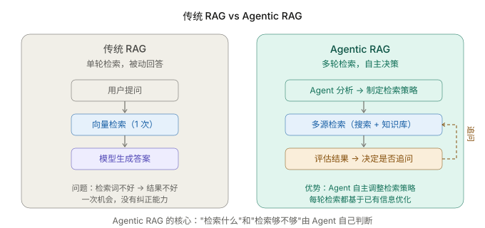
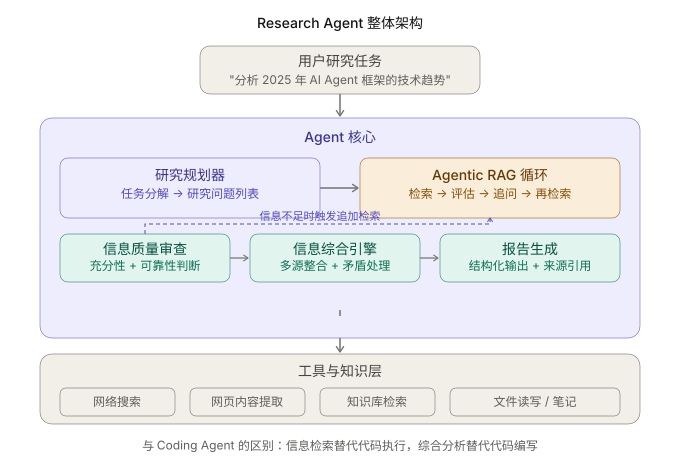
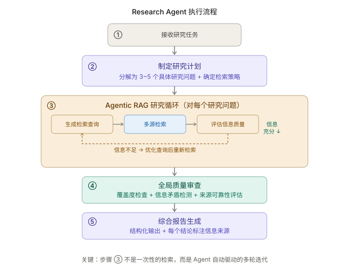

+++
title = "Research Agent 实战：从 RAG 到自主研究"
date = 2026-03-28T18:00:00+08:00
draft = false
author = "Hex4C59"
description = "用可运行的 Python 示例实现研究规划、本地语料搜索与读取、带来源笔记、报告检查和有上限的修订循环，区分固定响应验收与真实模型研究质量。"
summary = "先运行无需密钥的本地固定响应演示：实际读取合成文件，保存原文摘录，拒绝错误引用，再修订并重新检查。随后换入自己的语料，或通过共享异步客户端启用 live 模型；每一步都有来源记录、预算与失败出口。"
tags = ["RAG", "Research Agent", "Agentic RAG"]
categories = ["ai"]
series = ["agent-engineering"]
series_order = 17
difficulty = "advanced"
article_type = "tutorial"
topics = ["research-agent", "agentic-rag", "multi-step-retrieval", "information-synthesis", "tool-use"]
frameworks = ["OpenAI"]
ShowToc = true
source_kind = "original"
lastmod = 2026-10-17
+++

在 [什么是 RAG](/agent/what-is-rag/) 那篇文章之后，这篇实战要回答一个更具体的问题：模型搜索和阅读资料以后，程序怎样保存依据、生成报告，并确认修订稿确实又被检查了一遍？

本文面向会写 Python、了解异步函数的读者。我们从可运行的本地语料开始：搜索、读文件和保存笔记都实际执行，模型决策使用明确标记的固定响应（fixture）。因此，没有 API 密钥也能验证工具与质量门槛之间的交接。换成 live 模型后，能运行同一流程，但真实研究质量仍需另行判断。

这里的 RAG 是 Retrieval-Augmented Generation，检索增强生成：先查资料，再让模型参考资料回答。本文把“一次检索后直接回答”作为简化基线；实际 RAG 系统也可以安排多轮检索与核验。Research Agent 的变化在于，模型收到中间结果后，还能选择下一次搜索、阅读或记笔记，宿主程序负责执行和设定停止条件。

## 先给结论

先让资料与结论能逐项对应，再考虑扩大搜索范围。本例可以完成规划、工具研究、整理报告、审查、修订和再次审查；只有最后一稿通过，才返回 `complete`。搜索为空、来源读取失败、轮数耗尽或整体到期，都不能当成研究完成。

默认演示中的两份“南岚团队规程”是虚构的合成文件。程序确实读取了它们，但固定响应没有进行真实推理，也没有发现新的网络资料。这个运行结果证明流程接通了，不能证明模型的研究能力。

报告中的事实句采用保守规则：必须逐字等于已保存的原文摘录。程序可以检查引用是否存在、摘录来自哪里，却不能由此证明原文真实、来源相互独立或问题已经研究充分。模型审查再检查相关性和误导性概括，仍需人工判断其意见。

## 安装与运行

[下载完整示例 ZIP](/downloads/agent-examples/research.zip)。包内有入口、研究流程、来源工具、固定响应、测试和合成语料，也包含共享的异步运行层与固定版本依赖。

需要 Python 3.11 或更新版本。以下是解压后的 POSIX shell 命令：

```bash
unzip research.zip -d research-demo
cd research-demo
python3.11 -m venv .venv
. .venv/bin/activate
python -m pip install --requirement requirements.txt
python app.py
python -m unittest -v test_app
```

依赖中的 `openai==3.33.0`、`jsonschema==4.26.0` 由共享运行层提供。默认演示不调用模型 API，不需要密钥。入口是 `python app.py`，没有额外安装一个名为 `research-agent` 的命令，也不需要拼接旧教程中的多个零散模块。

<a id="一次完整的执行过程"></a>

2026-10-17，在 Python 3.11.16 下运行默认入口，实际得到以下输出：

```text
mode=fixture (本地固定响应；无联网检索)
corpus=本地合成语料：虚构的南岚团队规程，不代表现实政策
plan.questions=2
tool.search=2 tool.fetch=2 notes=2
check revision=0 passed=false issues=unknown_citation:N999
check revision=1 passed=true issues=none
status=complete
citations=N1:S1,N2:S2
workspace=temporary (已清理；用 --workspace 显式保留)
```

首稿的 `N999` 是固定响应故意写入的错误笔记号。检查器拒绝它，整理步骤收到反馈后改用实际保存的 `N1`、`N2`，第二轮检查通过。日志把“修订”与“修订后复查”分别展示出来。

默认文件位于本次系统临时目录，结束后清理。加上 `--workspace ./research-output`，就会在显式目录下创建一个新的 `run-<随机编号>/`，保留计划、文本快照、笔记、每稿报告、检查结果和最终 Markdown。已有运行不会被覆盖。这些文件可能包含你的原始资料，需要按资料本身的权限保管。

<a id="传统-rag-的局限"></a>

## 为什么需要研究循环

一次查询后直接回答，适合资料范围与问题都很明确的情况。研究型任务常常要先确定比较对象，再寻找某个对象的具体记录，最后补查冲突或缺口。第一轮找到的内容可能改变下一次查询。



*图 1：左边是本文用于比较的一次检索基线；右边允许根据已有结果再次检索。图展示决策方式，不能证明多轮一定更准确。*

<a id="第二步研究规划器"></a>

<a id="为什么先规划再研究"></a>

规划先把任务拆成可回答的问题，并提供初始查询词。这个步骤与 [Planning](/agent/planning-plan-and-execute/) 中的任务分解相同：每个问题需要说明要找什么证据。规划也会漏分问题，本例只限制为 1～4 个问题，并没有把数量当成研究充分的证明。

模型能决定下一步，程序仍要限制它能做多少步。这里每题最多 8 轮模型交互、12 次工具调用；整项研究还有统一截止时间。达到上限只说明必须停止，不表示已经得到答案。

<a id="整体架构"></a>

<a id="项目结构"></a>

## 项目结构与职责

```text
research/
├── app.py                 # 参数、模型创建、结果保存、关闭客户端
├── pipeline.py            # 规划、研究工具循环、整理、检查和修订
├── sources.py             # 真实本地语料搜索与读取
├── fixture_model.py       # 明确标记的固定决策策略
├── fixtures/               # 合成语料清单与两份文本
├── test_app.py             # 包括成功、失败与超时的测试
├── agent_runtime.py        # ZIP 注入的共享异步运行层
└── requirements.txt        # ZIP 生成的固定版本依赖
```



*图 2：用户任务、研究控制和工具执行仍分别负责不同工作。图中的检索工具是概念位置，本例在这个位置接入本地语料，不抓取网页。*

与 [CLI Coding Agent](/agent/build-cli-coding-agent/) 一样，模型只请求工具，宿主执行工具。区别在于这里处理的是资料和证据，不执行代码修改或 Shell 命令。所有阶段共用同一个异步 `model.complete(messages, tools)` 接口；live 模式由共享 `model_from_env()` 创建客户端，并在入口的 `finally` 中关闭，避免把同步调用的返回值放在 `await` 后面。

<a id="第一步定义工具集"></a>

<a id="第三步agentic-rag-研究循环"></a>

## 第一步：准备真实可读的资料

`SourceProvider` 提供两个异步接口：`search(query, limit)` 查找候选来源，`fetch(source_id)` 返回完整的受限文本及来源信息。当前实现是 `CorpusProvider`：按词在用户选定文件的 ID、标题和正文中检索，搜索摘要只用来选文件；真正记笔记前，必须通过读取工具取得正文。

这延续了 [工具接口设计](/agent/tool-interface-design/) 中的分工：工具应提供内容与错误，不能让一个空列表同时表示“没有匹配”和“读取失败”。空搜索会返回空 `hits`；文件缺失、超限或无法解码会返回工具错误。模型可以据此调整行动，没有取得证据时，宿主不会进入报告发布分支。

换入自己的资料时，创建一个目录，放入 UTF-8 纯文本或 Markdown 文件，再写清单：

```json
{
  "label": "我的产品资料",
  "documents": [
    {"id": "Policy1", "title": "产品记录规则", "file": "policy.txt"}
  ]
}
```

这是清单格式示例，`policy.txt` 的内容由你提供，不是假设已经抓取到的网页。`file` 相对于清单目录；可选的 `publisher`、`published_at`、`url` 保存书目信息，其中 URL 不会被抓取或核验。

```bash
python app.py --corpus ./my-corpus/corpus.json \
  --task '整理这份资料对研究记录的要求。' \
  --workspace ./research-output
```

仍使用 fixture 时，固定策略会按前两份资料的 ID 搜索，并从真实读取结果中选首个至少 12 字符的非空行。它能验证自定义资料是否走通接口，不能理解任意研究任务。真实内容是否相关，需要读者自行核对。

<a id="关键工程决策"></a>

## 第二步：从正文保存可追溯的笔记

`save_note` 不接受一个随意填写的 URL。它要求来源已经在本轮被读取，摘录必须真实出现在这份文本中。宿主随后分配笔记号，并记录以下信息：

| 字段 | 它让后续检查器知道什么 |
| --- | --- |
| `source_id` | 摘录属于哪份已读取资料 |
| `source_sha256` | 本次读取的内容版本；摘要不能证明资料权威 |
| `start`、`end` | 摘录在文本中的 Python 字符区间 `[start, end)`，不是字节偏移 |
| `question_id` | 笔记要回答哪个研究问题 |
| `quote` | 后续报告实际引用的原文 |

`Source` 另外保存标题、相对文件名、读取时间和可选书目信息。`sources.json` 中的文本快照、`notes.json` 中的摘录和 `report.md` 中的引用可以相互核对；程序不会把模型自报的“高置信度”当成真实性证据。

<a id="为什么用笔记而不是直接传递原文"></a>

笔记仍然是一种取舍。[上下文管理](/agent/context-memory-state-management/)解释过，把全部原文长期放在对话里会增加开销。这里保留摘录便于整理，但也可能漏掉同段后面的限制条件。因此，模型审查会同时收到来源文本；真实研究仍应回看上下文，而不能只数笔记条数。

<a id="第四步信息综合与报告生成"></a>

<a id="搜索深度不够"></a>

<a id="信息收集多但综合差"></a>

## 第三步：整理、检查、修订，再检查



*图 3：研究得到笔记后进入整理与检查。实现中每次修订都会重新检查；达到修订上限仍失败时，只保存失败草稿，不返回接受的报告。*

整理阶段按研究问题组织 `claims`，每项包含事实文本和笔记号。本例要求事实文本逐字等于对应摘录，引用必须指向本轮笔记。这种摘录式综合限制了表达自由，却能直接检查“报告声称引用的内容是否真的存在”。它不接受给一条新结论贴上旧笔记号。

质量门槛分两层。程序先检查 JSON 格式、问题覆盖、引用号、来源摘要和摘录定位；随后，模型审查收到任务、草稿、笔记、来源文本及机器检查结果，判断内容是否相关、是否遗漏关键方面、是否把资料说得过于确定。只有两层都通过，才接受报告；模型说“通过”不能推翻未知引用等机器错误。

这与 [Reflection](/agent/reflection-agent/) 中的再次审视有关，但控制权在程序里：审查返回失败时，整理器必须收到上一稿及具体反馈，改完还要再审。`--max-revisions 2` 表示首稿之外最多再改两稿，因此最多检查三次；`--max-revisions 0` 也会检查首稿，失败就停止，不会跳过质量门槛。

当前修订只使用已有笔记，不会自动补搜资料。如果发现来源不够，应把问题保留为缺口，或由用户补充语料重新运行。反复改写不能制造证据。

<a id="信息矛盾怎么处理"></a>

<a id="来源同质化"></a>

报告的 Markdown 引用由宿主根据实际笔记生成。标题与“资料局限”仍是模型撰写的文字，需要人工阅读；机器通过只适用于已定义的检查项目。原文可能错误或过时，多个文件可能转述同一来源，摘录也可能与问题不相关，这些都不由内容摘要或逐字匹配自动解决。

<a id="第五步组装完整的-agent"></a>

## 完整入口

以下入口与下载包中的 `app.py` 来自同一文件。`pipeline.py`、`sources.py` 和固定响应模型的完整实现也在 ZIP 中；没有需要读者自行补齐的模型调用或搜索占位函数。



## 使用 live 模型

在自己的终端设置 `OPENAI_API_KEY` 和 `OPENAI_MODEL`；所选服务和模型应支持 Chat Completions 工具调用。兼容服务可另设 `OPENAI_BASE_URL`。不要将凭据写进清单或工作文件。

```bash
python app.py --live --corpus ./my-corpus/corpus.json \
  --task '比较这些资料对记录与复核的要求，指出未覆盖的问题。' \
  --timeout 60 --request-timeout 10 --max-revisions 2 \
  --workspace ./research-output
```

`--live` 必须显式选择语料。它会将任务、目录、读取到的正文和笔记发送给配置的模型服务，使用前应确认你有权这样处理这些资料。来源工具仍只接受本地清单中的 ID，不接受任意 URL，也不会抓取公网、私网或云元数据服务；这是一项工具实现的限制，不是操作系统网络沙箱。

本次环境没有模型或搜索服务密钥，因而没有验证真实模型的规划与研究质量，也没有运行外部搜索。live 客户端的创建入口、异步协议和关闭路径可通过本地测试核对，不能据此声称外部服务一定可用。

<a id="常见失败模式"></a>

<a id="过度搜索不停止"></a>

## 预算、失败与复现证据

研究阶段的总期限覆盖规划、所有问题的工具循环、整理、审查和修订，不会在进入下一阶段时重新获得完整时间。另有单次模型请求与一次来源工具等待的期限。异步取消的行为依据 [Python 的超时与取消文档](https://docs.python.org/3.11/library/asyncio-task.html#timeouts)；它不会强行终止工作线程中已经开始的文件读取。

本例默认使用以下上限：

| 限制 | 默认值 |
| --- | --- |
| 总研究期限 / 单次请求或来源工具等待 | 60 秒 / 10 秒 |
| 每题模型轮数 / 工具调用数 | 8 / 12 |
| 不同已读取来源 / 笔记条数 | 8 / 24 |
| 语料清单 / 每份文本大小 | 32,000 字节 / 24,000 字节 |
| 清单资料数 / 模型响应大小 | 20 份 / 32,000 字符 |
| 修订次数 | 2，另加首稿检查 |

内容过大时直接报错，不会裁剪掉限制条件后假装读完。畸形清单、重复来源号、路径越界、符号链接、空文本、无效 UTF-8 和 NUL 内容都会被拒绝。路径检查面向用户控制、没有其他进程并发改换路径的语料目录；它不提供操作系统隔离，相关边界仍应按 [Guardrails](/agent/guardrails-safety-boundary/) 理解。

`complete` 退出 0；`quality_failed`、`limit`、`error` 退出 1；配置错误退出 2；模型等待或整体超时退出 124。来源工具超时先作为工具错误返回模型，如果始终没有证据，流程失败。失败的最后一稿保存在 `drafts.json`，不会被标成最终通过报告。

本次本地 `unittest` 包含 27 项测试并全部通过，覆盖两种入口、自定义语料、实际搜索与读取、来源与摘录校验、无依据结论、空结果和读取错误、请求与总期限、取消、轮数与修订耗尽，以及 live 客户端关闭。测试也把一组响应交给共享 `ScriptedModel` 回放，确认工具调用确实经过公共循环，而不是直接调用测试用的伪搜索函数。

同一份文件还通过主打包器的清单制作了临时平铺 ZIP：解压后移除 `PYTHONPATH`，`python app.py`、`python -m app`、`python .` 和这 27 项测试均通过。临时包在检查后已清理。

这些测试使用真实文件和合成资料，没有测量检索召回率、模型事实正确率或开放网络研究效果。复现日期为 2026-10-17，Python 版本为 3.11.16；依赖版本由 ZIP 中的 `requirements.txt` 固定。源文件与测试是本文实现行为的依据，异步接口与内容摘要分别参考 [Python asyncio](https://docs.python.org/3.11/library/asyncio-task.html) 和 [hashlib](https://docs.python.org/3.11/library/hashlib.html)，资料核对日期同为 2026-10-17。

<a id="从这里出发能扩展什么"></a>

## 从这里继续扩展

要接入外部检索，可以替换 `SourceProvider` 的搜索和读取实现，但还需要处理真实 HTTP 状态、正文限制、超时、重定向和网络访问范围。本例没有安装一个隐含的网络搜索后端，也不把本地合成结果包装成网络发现。

研究与分析也可以拆成多个执行者，按 [多 Agent 协作](/agent/multi-agent-collaboration/) 的交接方式传递计划和笔记。若把笔记保留为 [长期记忆](/agent/memory-types-and-design/)，下次复用前还需要核对资料是否改变，以及旧摘录是否适用于新问题。文件多、模型多或历史笔记多，都不能替代来源核验。

<a id="总结"></a>

从本例已经能观察到：搜索结果先引导读取，读取结果才能形成笔记，报告引用笔记，检查反馈驱动修订，每次修订后再检查。能沿着这条记录查清每条引用的来处，是扩大研究范围之前值得先完成的工作。

---

*上一篇：[Guardrails：如何约束 Agent 不做错事](/agent/guardrails-safety-boundary/)*

*下一篇：[带 Guardrails 的文件管理 Agent](/agent/build-file-management-agent/)*
