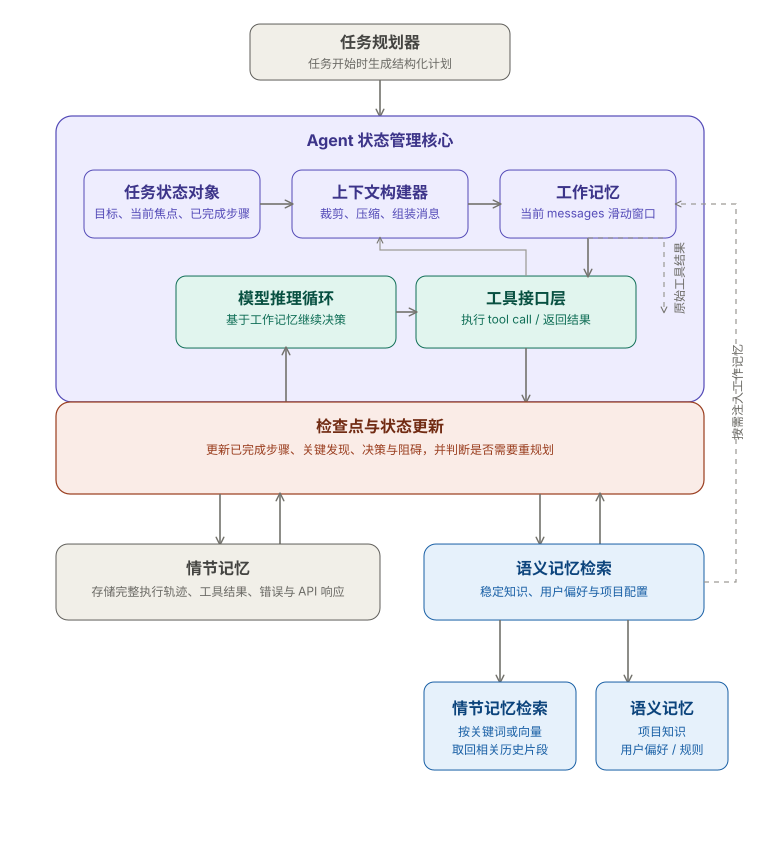

+++
title = "上下文与记忆：Agent 为什么会在长任务中失去方向，以及如何设计状态管理"
date = 2026-03-22T20:30:00+08:00
draft = false
author = "Hex4C59"
description = "解释模型本轮输入与长期记录的区别，用可运行的字符预算包装器保护当前任务、完整工具交换和结构化计划状态。"
summary = "从记忆分层讲到调用前预算检查：保留当前任务和完整工具交换，按整轮裁剪历史，装不下必要输入时拒绝请求；配套异步规划模块提供可验收的步骤状态和截止时间。"
tags = ["记忆", "上下文窗口", "状态管理"]
categories = ["ai"]
series = ["agent-engineering"]
series_order = 3
difficulty = "advanced"
article_type = "concept"
topics = ["context-window", "memory", "state-management", "agent", "long-horizon-tasks"]
frameworks = ["OpenAI", "Anthropic"]
ShowToc = true
source_kind = "original"
lastmod = 2026-10-17
+++

在前两篇文章里，我们把 Agent 的核心结构拆清楚了：它需要目标、上下文、决策能力、执行能力和反馈闭环；而 Tool Use 是让它真正能行动的关键接口。

但有一个问题一直没有正面回答：**当任务变长、工具调用变多、对话轮次增加之后，Agent 为什么开始犯低级错误、忘记之前的结论、甚至原地打转？**

本文面向会写简单代码、了解工具调用的读者，说明程序怎样保存任务进度，并在下一次调用模型前挑选需要的信息。读完后，你应能区分“存过的信息”和“模型这一轮实际看见的信息”。后面的机制模块可以直接运行并测试，使用共享异步模型接口，不依赖未定义的客户端。它实现请求预算和计划状态；长期存储属于另一项职责，见[持久记忆实战](/agent/build-persistent-memory-agent/)。

---

## 先给结论

1. **先检查模型这一轮实际收到了什么。** 目标或证据可能没有进入请求，也可能混在大量无关内容里；这些原因需要与工具本身出错区分。
2. **Context Window（上下文窗口）是模型本轮能接收的信息范围，有容量上限。** 信息放在哪里、是否与当前任务相关，也会影响模型能否利用它，不能只看窗口大小。
3. **本文区分三类记忆：工作记忆（当前上下文）、情节记忆（历史执行记录）、语义记忆（可检索的知识库）。** 按任务需要选择，不能只靠不断追加对话保存全部进展。
4. **状态管理在每轮调用前选择并检查输入。** 当前目标、必要状态和工具协议不能被随意切断；历史信息可以按明确规则裁剪。
5. **状态应来自实际操作和验收。** 保存了一个计划对象，不代表下一次模型请求已经包含它，也不代表被标为完成的步骤确实成功。

---

## 失忆是怎么发生的

先把失忆的机制讲清楚，后面的设计决策才有依据。

### Context Window 的本质

在本文的 messages 调用方式中，应用每次都要准备本轮输入；模型不会因为上一轮处理过某条结果，就自动在下一轮获得它。LLM（Large Language Model，大语言模型）依赖当前提供的内容继续生成。

因此，应用若要让模型参考历史，就要把相关消息重新放进本轮输入。保存在数据库或日志中、却没有传给模型的记录，并不属于这一轮的上下文。

这意味着两件事：

**第一，context window 是有上限的。** 具体容量由所选模型和接口决定。当历史、工具结果、当前输入和工具定义一起超过可接受范围时，请求就可能失败。本例另外执行可复查的字符预算，不把某个窗口参数当成已经生效的长度检查。

**第二，信息放进窗口，不等于模型一定能用好。** “Lost in the Middle”描述的是这类现象：某些实验中，放在长输入中部的信息比开头或结尾更难被模型利用。对状态管理来说，应避免把关键目标和结论埋在大量无关结果中；这不等于“越靠后的信息永远越重要”。

### 工具调用是上下文的主要消耗者

在一个典型的 Agent 执行流里，每次工具调用会往 messages 里追加至少两条消息：

```
[assistant] → tool_call: {name: "search_web", arguments: {...}}
[tool]      → tool_result: {content: "...搜索结果，可能几百到几千 tokens..."}
```

假设一个任务调用工具 20 次，每次结果平均 500 tokens，仅结果就合计 10,000 tokens。这里是按给定条件计算的示例，不是实际测量。再加上系统提示词、用户消息、模型的中间推理，context window 消耗得非常快。

更麻烦的是：**旧工具结果的后续用途会变化**。第 3 次搜索的结果，在第 15 次推理时可能完全不相关，但它仍然占据着宝贵的 context window 空间。

### 失忆的三种典型表现

**1. 重复工具调用**

Agent 忘记了几轮前已经查过某个信息，再次调用相同的工具，拿到同样的结果，形成循环。

**2. 目标漂移**

任务执行到一半，Agent 开始偏离原始目标，被某个工具结果里的细节带跑，忘记最初要做什么。

**3. 前后矛盾**

Agent 在第 5 轮得出了“方案 A 不可行”的结论，但在第 12 轮上下文被稀释后，又重新考虑方案 A，甚至给出相反的建议。

这些表现都可能与必要信息没有进入本轮输入有关，也可能来自工具结果错误或状态更新遗漏。先记录实际请求和操作结果，再缩小原因，不能只凭“失忆”这个名称判断。

---

## 记忆的三个层次

要解决失忆问题，先要搞清楚 Agent 需要什么类型的记忆。

借用认知科学里的分类，Agent 的记忆可以分三层：

### 工作记忆（Working Memory）

对应 context window。这是应用在当前调用中直接提供的信息；外部记录只有被取回并放进请求，才成为本轮可用资料。

特点：**容量有限，需要按每次请求重新组装。**

工作记忆里应该放什么？只放“当前这一步决策需要的信息”，不是“完整的历史记录”。

### 情节记忆（Episodic Memory）

记录 Agent 的历史执行轨迹：做了什么、用了哪些工具、拿到了什么结果、做出了哪些决策。

特点：**体量大、需要外部存储、按需检索。**

情节记忆不住在 context window 里，而是存在外部（数据库、文件、向量存储）。当 Agent 需要回顾历史时，通过检索把相关片段取回来放进工作记忆。

### 语义记忆（Semantic Memory）

存储领域知识、用户偏好、任务相关的结构化信息。比如“这个用户偏好 Python”、“项目使用 PostgreSQL”、“API 的鉴权方式是 Bearer Token”。

特点：**相对稳定、高密度、跨任务复用。**

语义记忆通常以结构化格式存储，可以在任务开始时直接注入 context，也可以按需检索。

### 大多数 Agent 系统只实现了工作记忆

这里讨论的是一种设计问题：开发者只把对话历史追加到 messages，却没有单独维护可回查的执行记录和稳定知识。消息变长后，关键进度更难从中找出。

需要回顾历史、复用知识的长任务，可以让三层协同：程序从执行记录中取回相关步骤，从知识库取回稳定信息，再与当前进度一起放进工作记忆。短任务未必需要全部三层，关键是每类信息有明确去处。

---

## 状态管理的核心设计

有了记忆分层的框架，现在来看具体的设计模式。

### 模式一：任务状态对象（Task State）

与其每次从长对话里推断进度，可以单独保存原目标、待办、已验收步骤和失败原因。配套 `planning.py` 用 `PlanStep` 保存计划内容，用 `StepRecord` 保存执行状态，再通过 `PlanResult` 返回整体状态、当前阶段、尝试次数和修订记录。

更新顺序很关键：开始操作时记为 `running`；先检查工具循环是否正常结束、是否包含失败工具结果，再执行应用的验收函数；通过后才记为 `complete`。超时、失败和限额不能只换成一句说明文字，再走同一个“标记完成”分支。

状态在程序里还不够。规划模块会在下一步的用户消息中传入原目标、完成标准、当前步骤和已验证摘要，再调用模型。这些信息同样要通过预算检查；无法完整装下时应返回失败，不能静默删掉目标。

### 模式二：上下文压缩（Context Compression）

压缩可以指模型生成摘要，也可以指按明确规则移除旧信息。两者改变的内容不同：摘要可能漏掉数字、条件和错误原因；直接删除则让这部分证据完全不在当前请求中。需要回查的原始结果应另行保存，不应把输入裁剪误当成永久存储。

本例实现确定性的整组裁剪，不额外请求模型做摘要。它先移除旧用户轮次，再移除当前轮中较早的完整 assistant／tool 交换；保留 system、developer、当前用户任务，以及当前轮最新消息单元。必要信息仍超预算时，拒绝底层模型调用。

这里不用 `raw_result.split()` 估计 token：中文长字符串可能没有空格，工具定义和 JSON 格式也会占用输入。本例明确测量字符，指标是规范 JSON 中 `messages` 与 `tools` 两部分的 Unicode 码点数，不冒充模型的 token 数或 HTTP 请求字节数。

### 模式三：滑动窗口历史（Sliding Window History）

[下载机制示例 ZIP](/downloads/agent-examples/mechanisms.zip)，解压后在该目录执行。需要 Python 3.11 或更新版本，模型使用本地固定回复，不需要凭据：

```sh
python3.11 -m venv .venv
source .venv/bin/activate
python -m pip install -r requirements.txt
python -c "import asyncio,json,context_budget; print(json.dumps(asyncio.run(context_budget.demo()),ensure_ascii=False,sort_keys=True))"
python -m unittest -v test_context_planning
```

PowerShell 使用 `.venv\Scripts\Activate.ps1` 激活。仓库内工作目录为 `examples/agents/mechanisms`，设置 `PYTHONPATH=../common`；ZIP 根目录已包含共享运行时。

完整实现是 `context_budget.py`。`fit_context` 返回裁剪后的副本和测量报告，不修改原消息；`BudgetedModel` 在每次 `await model.complete(...)` 之前调用它，因此预算不是一个没有参与判断的配置字段。包装器只保留最近 64 份测量报告和总调用次数，完整执行轨迹需要另存，不在这个类里维护一个无限增长的归档列表。



一条 assistant 消息可能同时请求两个工具，随后就需要两条对应的 tool 结果。这个交换单元包含三条消息，不能只按“最近两条”留下两个结果；assistant 的 `content` 也可能是 `None`，不能用它是否可迭代来识别工具调用。

实现检查 `tool_calls` 数组与调用 ID：每次调用恰好有一个结果，整组保留或整组移除。孤立结果、缺少结果、重复 ID 或中间插入用户消息都会在调用模型之前被拒绝。当前任务是最后一条用户消息，也可以通过 `required_task` 再检查内容是否与调用者指定的任务完全相同。

下面是 2026-10-17 运行 `context_budget.demo()` 的实测返回值。固定模型给出调用选择，四次合成资料读取和每次请求前的裁剪检查都实际执行：

```json
{"complete_tool_exchanges": true, "current_task_preserved": true, "dropped_exchanges": 2, "limit_characters": 3700, "max_request_characters": 3019, "mode": "fixture", "model_calls": 4, "ok": true, "status": "complete", "tools_executed": ["one", "two", "three", "four"]}
```

此演示设定 3700 字符上限，实际最大输入为 3019 字符。默认包装器上限为 16000 字符，可由调用者显式选择；换成不同提示或工具说明，测量值也会变。新输入中的任务、工具定义或最新完整交换若装不下，会返回预算错误，底层模型不会被调用。

### 模式四：显式规划 + 检查点（Planning + Checkpoints）

计划状态与上下文预算解决两件事：前者记录哪些目标经过验收，后者决定这一轮能否把必要内容完整传入模型。配套规划器也使用 `BudgetedModel`，因此规划、步骤执行和检查点输入都受到同一字符检查。

规划器在一个总异步截止时间内推进；每步另有等待、工具轮次和调用次数上限。检查点只能替换待执行步骤，不能更改原目标或把已完成证据覆盖掉。重规划次数与实际尝试步数在外层累计，不因新计划对象出现而清零。

完整规划源码和运行结果见 [Planning：提前分解目标](/agent/planning-plan-and-execute/)。这套状态转移比“按摘要文字标完成”多了一道实质判断：只有实际执行状态和验收都通过，才允许下游依赖该步。

## 一个完整的状态管理架构

把上面几个模式组合起来，一个完整的状态管理系统大致是这样的：



*图 1：各类状态的职责关系。规划器提供目标和步骤，状态对象记录操作结果，上下文构建器决定哪些内容进入当前请求；外部事件和知识需要被检索回来才会进入工作记忆。*

各层职责：

**任务规划器**：任务开始时生成结构化计划，中途在检查点评估是否需要调整。

**任务状态对象**：实时记录目标、当前焦点、已完成步骤、关键发现、已确定决策。每轮推理前注入 context，是 Agent 方向感的核心锚点。

**上下文构建器**：在每轮调用前组装任务状态、所需资料和近期历史，再检查消息及工具定义的总量。本例执行实测字符预算；换成 token 预算时需要适配所用模型的计数方法。

**工作记忆（Messages）**：按本轮需要保留消息。本例按完整轮次和工具交换裁剪，原始轨迹如需归档，由调用者另行保存；移出请求不代表已经自动存入数据库。

**情节记忆**：存储完整的历史执行轨迹，支持关键词或向量检索，在需要回溯时按需取回相关片段。

**语义记忆**：稳定的结构化知识，任务开始时注入，或在特定触发条件下更新。

---

## 实际工程中的几个决策点

### 决策点 1：压缩 vs 截断

当 context 快满时，有两种选择：直接截断最老的消息，或者先压缩再保留。

应先判断哪些信息会改变下一步决定。具体数字、错误码和条件可能需要原文；assistant 的解释也不能假定都能从状态重建。本例只删除完整旧单元，并保留任务和最新交换；如果选择摘要，应另外验证摘要保留了哪些字段、原始证据放在哪里。

### 决策点 2：什么时候做检查点

不是每步都需要做检查点，过于频繁的规划重评估会增加延迟和成本。可以按自己的任务约定触发条件，例如：

- 完成一个预定义的“阶段性目标”
- 工具调用失败或返回了意外结果
- 模型的输出里出现了不确定性信号（“我不确定是否应该……”）
- 已完成的步骤数达到计划步骤数的 50%

### 决策点 3：语义记忆放多少进 context

语义记忆是稳定的，但不是无限的。放太多会占用工作记忆空间，放太少又起不到作用。

一个可行策略：把语义记忆分成“核心知识”和“扩展知识”两部分。先挑选本轮必需的知识和状态，完整放入受保护的当前任务；扩展知识按需检索。“核心”只是业务选择，仍要接受总预算检查，不能据此无限追加输入。

### 决策点 4：任务状态对象应该多详细

任务状态对象的粒度需要平衡：太粗糙提供不了足够信息，太细致又会膨胀占用 context 空间。

例如，可以让 `key_findings` 和 `decisions_made` 保存带证据出处的简短结论，把原始数据另存为可回查记录。但一句话也可能遗漏限制；验收状态要由程序根据结果更新，不能只追求文字短。

---

## 常见的状态管理失误

**1. 用日志代替状态**

把所有工具调用结果堆进 context，期望模型自己从中提炼状态。这样会让当前进度依赖模型从原始记录中再次推断。应直接检查请求中是否包含正确目标和已验证状态，而不只检查日志是否完整。

**2. 状态对象和 messages 双轨但不同步**

维护了任务状态对象，但忘记在工具调用完成后更新它，导致状态对象和实际执行历史出现偏差。可以在工具执行后的结果处理步骤中更新状态，也就是 postprocessing 钩子：工具成功、失败或被取消后，由这段程序把实际结果写入状态对象。

**3. 压缩时过度摘要**

压缩工具结果时把具体数据也丢掉了，只保留了高层总结。结果模型后续需要具体数据时找不到，只好再次调用工具。保留具体数字、错误码、关键字段，丢弃的是格式化标记和冗余文字。

**4. 没有“失败记忆”**

任务状态里只记录成功的步骤和发现，不记录失败的尝试和原因。导致 Agent 后续会重复相同的失败路径。`blockers` 和失败记录和成功记录一样重要，甚至更重要。

---

## 总结

程序保存过资料，与模型本轮收到资料，是两件事。状态对象负责记录实际进度；上下文构建器负责选择、组装和检查输入；长期记录需要独立存储并按需取回。

本例把这一区别落实在调用路径上：每次模型调用前都计数，完整工具交换才可进入请求；当前任务不能被裁掉，必要内容装不下就返回失败。规划状态同样需要操作结果与验收，超时或错误不会因为返回了一句自然语言而变成完成。

规划与上下文模块共有 29 项本地测试，检查实际异步截止时间、失败状态、重规划与步骤界限、多工具调用整组保留、原消息不变、当前任务保护和调用前拒绝。夹具是固定回复，没有在线模型质量或 token 上限验收；字符预算也不限制外部归档大小或模型输出。
