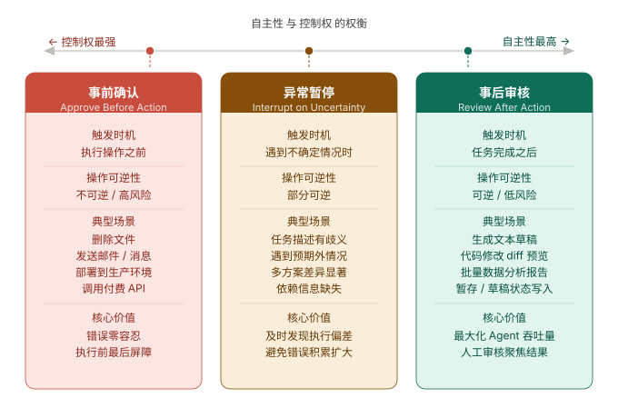
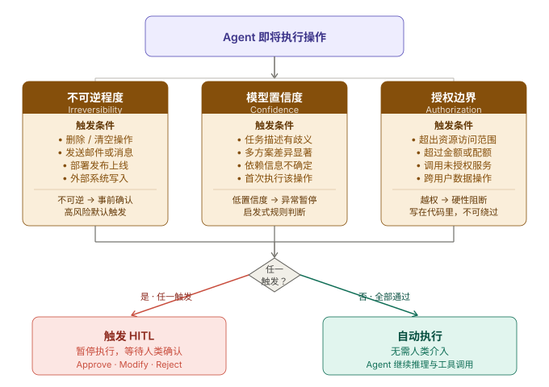
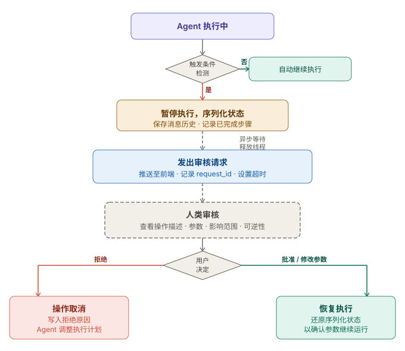

+++
title = "Human-in-the-Loop：Agent 什么时候应该停下来问你"
date = 2026-04-02T10:00:00+08:00
draft = false
author = "Hex4C59"
description = "解释 Agent 何时需要人工介入，并用可运行的 SQLite 示例保存待审批请求，核对请求 ID、审批人、操作内容和期限，验证重启、并发与一次性认领。"
summary = "事前确认、异常暂停与事后审核分别解决什么问题？本文把审批请求写入 SQLite，让人的决定绑定具体操作，并通过真实重启与并发测试说明一次性决定、执行认领和外部操作恢复的边界。"
tags = ["Agent", "人在回路", "安全护栏"]
categories = ["ai"]
series = ["agent-engineering"]
series_order = 24
difficulty = "intermediate"
article_type = "concept"
topics = ["hitl", "human-in-the-loop", "safety", "autonomy", "agent-design"]
frameworks = ["OpenAI"]
ShowToc = true
source_kind = "original"
lastmod = 2026-10-17
+++

在 [Guardrails](/agent/guardrails-safety-boundary/) 那篇里，我们讲了如何用代码层面的防护边界约束 Agent 的行为——权限分级、沙箱隔离、输出过滤。这些机制有一个共同的假设：**防护逻辑在设计时就能写清楚**。

但现实里有一类问题是写不清楚的。

"帮我清理这个项目里过时的依赖"——什么算过时？哪些可以删？删之前需要测试吗？"帮我回复这封客户邮件"——用什么语气？要不要提价格？能不能承诺交付时间？这些判断涉及语境、业务规则、用户偏好，没有一个通用的代码能替你做决定。

Human-in-the-Loop（HITL，人在回路）就是在执行流程中保留人类决策节点：Agent 先说明准备做什么、还缺什么判断，人再批准、修改或拒绝。

本文面向会写简单 Python、了解工具调用的读者，解释三种介入时机，并运行一个不用模型服务的审批机制：把请求保存到本地 SQLite 数据库，重新启动后找到它，再核对回复是否批准了同一个操作。是否需要介入，要按授权范围、错误代价和可恢复性判断；不必为每个动作重复确认。

---

## 先给结论

1. **先划清自动执行的范围，再选择人工节点。** 在已授权范围内，低风险步骤可以自动推进；需要用户判断或扩大权限时，再暂停。不能仅凭“生产环境”决定每步都问。
2. **HITL 有三种介入强度：事前确认、异常暂停、事后审核。** 三者的适用场景不同，不能互相替代。好的设计是根据操作风险和可逆程度选择合适的介入模式，而不是一律要求确认。
3. **可以先检查三类介入条件：操作不可逆、判断缺少依据、超出授权边界。** 其他场景通常不需要打断用户。
4. **Alert Fatigue 是 HITL 最大的工程问题。** 过多的确认请求会让用户开始自动点"确认"，防护形同虚设。HITL 的质量不是靠增加打断次数来保证的。
5. **HITL 的目标是：让人类在关键节点上花最少的时间，对最高风险的决策保持最高控制权。** 打断越精准，用户越愿意认真对待每一次打断。

---

## 为什么全自动 Agent 在生产中几乎不存在

让我描述一个看起来很美好的场景：你给 Agent 一个任务，它自动完成，你只看最终结果。

这在演示里很酷。在生产里，问题是：**你对 Agent 的信任程度需要和它执行的操作风险等级匹配。**

下面三个假设场景按错误代价逐步增加，数字仅用于说明规模差异：

**场景一：读取数据，生成报告**

Agent 读取日志文件，分析异常，生成一份 Markdown 报告。这个任务完全可以全自动——操作是只读的，结果是可验证的，即使报告有错你也能发现并纠正。全自动合理。

**场景二：批量修改代码**

Agent 分析一个大型代码仓库，自动重构某类模式。它改了 127 个文件。改完之后你发现它误解了你的意图，有 40 个文件的改法不对。

没有 HITL，你现在面对的是：用 git 一个一个 revert，还是重新跑一遍？无论哪个选项都很痛苦。事前展示计划，可以让你有机会发现方向误解；但批准计划不等于保证每个文件都改对，执行后仍需检查差异和测试结果。

**场景三：自动回复客户**

Agent 分析客户 support ticket，自动给 100 位客户发了回复邮件。其中有 3 封邮件的措辞不当，承诺了你没法做到的事情。

这时候已经没有"撤回"了。邮件发出去了。客户截图了。

这三个场景的区别不是 Agent 够不够聪明，而是**操作的不可逆程度**和**错误的代价**不同。越不可逆、代价越高，越需要人类在执行前参与判断。

---

## HITL 的三种介入模式

HITL 不是一个开关，而是一个连续谱。根据介入的时机和深度，分为三种模式：



*图 1：三种介入模式在自主性和安全性之间的位置——事后审核自主性最高，事前确认控制权最强，异常暂停是两者之间的平衡点。*

### 模式一：事前确认（Approve Before Action）

Agent 在执行高风险操作**之前**，暂停并展示它打算做什么，等待用户批准。

**适合场景**：
- 不可逆的写操作（删除文件、发送消息、提交代码）
- 涉及真实资源消耗（API 调用、付费服务、外部系统写入）
- 超出日常授权范围的操作

**假设交互示意**：
```
Agent：我打算执行以下操作：
  - 删除 /data/backup/2023/ 目录（共 847MB，312 个文件）
  - 原因：该目录下的文件创建于 18 个月前，且没有任何引用

是否继续？[y/N]
```

这个请求列出了路径、范围和理由，用户可以核对自己批准的具体对象。信息应来自实际检查，不能因为 Agent 写了“没有引用”就把它当作已证实；如果还缺影响或备份信息，应先补齐再执行。

### 模式二：异常暂停（Interrupt on Uncertainty）

Agent 在执行过程中遇到**不确定情况**时，主动暂停并向用户提问，获取澄清后继续。

**适合场景**：
- 任务描述存在歧义，Agent 无法确定用户意图
- 遇到了预期之外的情况（文件不存在、权限被拒绝、返回了异常数据）
- 有两个以上的合理选项，需要用户做选择

**假设交互示意**：
```
Agent：在处理用户列表时，我发现 23 条记录的 `email` 字段为空。

有两种处理方式：
  A. 跳过这些记录，只处理有 email 的用户（共 1,847 条）
  B. 停止处理，等你确认如何处理缺失值

你希望怎么做？
```

异常暂停把尚未决定的处理方式交给用户。关键是先把依赖这项判断的操作停住，同时保存已经完成的结果；用户选定策略后再继续，避免一边等待一边按猜测处理。

### 模式三：事后审核（Review After Action）

Agent 自主完成任务，**完成后**将结果提交给用户审核，用户可以批准、修改或回滚。

**适合场景**：
- 操作本身可逆（草稿、预览、暂存状态）
- 错误代价可接受（内容生成、数据分析）
- 需要最大化 Agent 的吞吐量（批量任务）

**假设交互示意**：
```
Agent：已完成 PR 草稿，包含以下修改：
  - 重构了 UserService 类，拆分为 3 个更小的模块
  - 更新了相关测试，新增 12 个测试用例
  - 更新了 README 中的 API 文档

[查看完整 diff] [批准并提交] [需要修改]
```

事后审核适合那些"Agent 的草稿比从零写要好得多，但还需要人工把关"的场景。

---

## 什么时候触发 HITL

三种模式解决了"怎么介入"，但更核心的问题是"**什么时候**介入"。

触发 HITL 的判断逻辑有三类：



*图 2：HITL 触发的三条判断路径——不可逆程度、置信度、授权边界，任一触发则介入。*

### 触发条件一：操作不可逆程度

按不可逆程度从高到低：

| 操作类型 | 可逆性 | 建议介入模式 |
|---|---|---|
| 发送邮件、短信、消息 | 完全不可逆 | 事前确认 |
| 删除文件（无回收站） | 不可逆 | 事前确认 |
| 提交代码、发布到生产 | 难以逆转 | 事前确认 |
| 修改数据库记录 | 可逆（需手动） | 事前确认或异常暂停 |
| 写文件到磁盘 | 可覆盖回滚 | 异常暂停或事后审核 |
| 生成文本、分析数据 | 完全可逆 | 事后审核或无需介入 |

### 触发条件二：模型置信度

可以把“当前判断缺少依据”作为暂停信号，但要说明信号来自哪里。模型自报的把握程度不等于经过校准的正确概率。也可以用下面这些可观察条件判断是否缺信息，而不只看一个分数：
- 任务描述里有歧义词（"清理一下"、"整理一下"、"优化一下"）
- 有多个候选操作，且差异显著
- 依赖的外部信息不确定（文档缺失、数据异常）
- 当前操作是 Agent 第一次执行的操作类型

### 触发条件三：超出授权边界

每个 Agent 实例应该有明确的操作授权范围。当 Agent 的决策超出这个范围时，必须触发 HITL，无论置信度多高。

常见的授权边界：
- **资源范围**：只能操作 `/workspace/project/` 目录，不能操作其他路径
- **金额上限**：单次 API 调用费用不超过 $5
- **服务范围**：只能调用已授权的 API，不能发现并调用新 API
- **用户范围**：只能操作当前用户的数据，不能跨用户操作

授权边界应由执行代码检查，不能被 prompt 覆盖。超出范围时先阻止调用，再由有权授权的人决定是否扩大范围；用户没有响应或拒绝，都不等于批准。这和 [Guardrails](/agent/guardrails-safety-boundary/) 里讲的原则一致：真正的安全边界不能依赖 prompt 指令。

---

## 工程实现：暂停与恢复

等待人回复不一定要让一个协程一直挂着。真正需要保存的是：哪一步停住了、谁有权决定、这次决定针对什么内容，以及是否已经有人开始执行。本例把这些记录写入 SQLite，也就是保存在本地文件里的数据库。进程结束后，新调用仍能读取同一份记录。



*图 3：先保存待审批操作，再根据人的决定继续或放弃。图中的“等待”是工作流状态；本实现不要求一直保留一个正在等待的协程，也没有实现 Web 通知服务。*

### 下载并运行机制示例

需要 Python 3.11 或以上版本。下载 [Agent 机制完整示例](/downloads/agent-examples/mechanisms.zip)，放到独立目录后解压。ZIP 根目录就是各模块所在位置：

```bash
unzip mechanisms.zip -d mechanisms-demo
cd mechanisms-demo
python3.11 -m venv .venv
source .venv/bin/activate
python -m pip install -r requirements.txt
python -c 'import asyncio, json; from coordination import demo; print(json.dumps(asyncio.run(demo()), ensure_ascii=False))'
python -m unittest -v test_coordination
```

这里直接调用 `coordination.demo()`，只验证审批、任务板和消息游标。它在临时目录里真实建立 SQLite 文件，执行断言后清理目录，不访问模型、发送邮件或修改项目文件。以下是本次执行该命令捕获的输出：

```text
{"ok": true, "approval_reopen": true, "one_shot_claim": true, "versioned_task": true, "acknowledged_cursor": true, "recipient_isolation": true}
```

这些字段表示固定输入下的本地检查通过，不是模型能力评测。下载包的 `app.py` 是机制合集入口；只看本文机制时，上面的命令即可独立运行。

### 一个审批请求究竟绑定什么

假设应用准备生成一份草稿。下面是传给 `ApprovalInbox.request()` 的请求正文示意，不是已经执行成功的日志：

```json
{
  "task_id": "draft-demo",
  "step": "prepare_draft",
  "action": "prepare_draft",
  "parameters": {"name": "synthetic-note"},
  "completed_steps": []
}
```

应用需要把真正影响用户决定的信息放入正文：工具名、具体参数、执行条件，以及恢复时需要的任务标识和进度。只保存“继续清理”这样的模糊描述，仍无法让人判断影响范围。

`request()` 返回唯一的 `id`、指定审批人 `actor`、`payload_digest`、`expires_at` 和 `binding`。内容摘要是对规范化 JSON 计算的 SHA-256 值；同一对象交换键的顺序不会改变摘要，修改参数则会。`binding` 进一步把请求 ID、审批人、摘要和期限放在一起计算，防止把另一条请求的回复误用到这里。

审批入口调用 `decide(id, actor=..., payload=..., binding=..., approve=True)`。它在同一次 SQLite 事务里读取记录，核对以下条件，再写入决定：

- ID 必须存在，正文与原始摘要一致，收到的绑定值必须对应这个请求。
- `actor` 必须是记录指定的人，并且仍在宿主应用配置的 `authorized_actors` 中。
- 当前时间必须早于 `expires_at`，状态仍为 `pending`，也就是尚未作出决定。

这里的身份由可信本地调用方提供。例如，命令行应用已经知道当前操作者是谁，再把该身份传入模块。不能让模型自己填写一个用户名，就把它当成授权；本例没有登录、会话、Web 身份认证或加密签名。摘要也不能抵御有权改写数据库的人。

用户要修改参数时，应用应为新正文创建一个新请求，重新展示和批准。旧批准不会自动覆盖修改后的操作。拒绝会记录为 `rejected`；再次批准、再次拒绝或尝试执行它都会失败。

### 批准和开始执行是两个状态

批准表示“人同意了这个操作”，还需要防止两个执行者同时把它拿去执行。`claim()` 再次核对身份、正文、绑定和期限，在事务内把 `approved` 改为 `claimed`，并返回一段随机生成的认领凭据 `token`，供本次执行者报告完成。

| 状态 | 新调用能做什么 |
| --- | --- |
| `pending` | 展示请求，等待一次批准或拒绝；过期后两者都不接受 |
| `approved` | 在期限内认领一次，未认领前不执行 |
| `rejected` | 保留拒绝，不能变成批准或执行 |
| `claimed` | 持有原 token 的执行者可报告结果；不能再次认领 |
| `finished` | 查询已保存结果，不能重复完成或覆盖结果 |

`list_requests(actor=...)` 让新应用发现该人的历史记录，不必依赖上一个进程记住请求 ID。记录保留原状态和期限；过期不会自动删掉记录或把它显示成已执行。执行者已在有效期内认领后，可以在期限之后用原 token 调用 `finish()`，记录已经发生的结果。

SQLite 的 `BEGIN IMMEDIATE` 事务把读取状态和写入新状态放在一起。两个调用即使都看过 `pending`，也只有一个能决定；只有一个能把 `approved` 认领成功。等待数据库锁的调用会在拿到锁后重新读取状态，不会用旧页面上的状态覆盖新结果。

**一次性认领不等于外部操作恰好执行一次。** 假设执行者认领后发出了邮件，却在记录 `finished` 前退出。数据库只知道它已认领，不能知道邮件是否发出。因此程序保留 `claimed`，不自动重试。接入真实发送、支付或文件变更时，还需要执行端用幂等键识别重复请求，或查询并人工核对外部结果；不能因恢复了请求记录就宣称恢复了整个 Agent。

### 完整源码与验证边界

以下源码与下载包中的 `coordination.py` 来自同一文件：



本次在 Python 3.11.16、macOS 上运行了 `test_coordination.py` 的 18 项测试，全部通过。测试真实创建数据库，验证新进程读取待审批记录并认领、错误 ID/审批人/正文/绑定、过期边界、重复批准和重复认领，以及 SQL 更新失败后的回滚。并发测试使用独立 SQLite 连接，任务板还由两个独立进程竞争认领；没有用返回固定成功值替代数据库操作。

这个模块只处理审批和协调记录，不包含模型循环、通知渠道或完整业务执行器。同步 SQLite 事务中没有 `await`，也没有在事务持锁期间等待人或请求模型。在异步服务中接入时，可以把短数据库调用放进工作线程；不要用同步 SDK 客户端的返回值去做 `await`。

---

## 置信度驱动的动态 HITL

模型可以提出“目前证据不足，需要澄清”的建议，但不能据自己的把握程度撤销程序的审批要求。应用可以先检查必需字段是否缺失、是否存在差异很大的选项、是否触及已有授权范围，再决定是否创建请求。

例如，假设收件人尚未确定，程序应先让用户选定收件人，再为包含该收件人的正文创建审批请求。如果用户随后改了收件人，旧正文的摘要不再匹配，需要新的请求。模型自报的高置信度不会让这个检查消失。

---

## Alert Fatigue：HITL 最大的陷阱

Alert Fatigue 是安全领域的经典问题：当系统产生太多告警，操作员开始忽略它们，甚至养成了自动点"确认"的习惯，真正的风险就被埋没在噪音里了。

同样的问题会发生在 HITL 里。

假设 Agent 每执行三步就弹一次相似确认框，用户可能逐渐不再阅读内容，只按习惯批准。这是告警疲劳（Alert Fatigue）：重复打断让真正需要判断的请求更难被认真对待。这里描述的是一种风险，不是固定次数后的必然行为。

**Alert Fatigue 的三个来源：**

### 1. 确认粒度太细

```
# 错误做法：每个文件操作都要求确认
Agent：我要读取 config.json，是否允许？[y/N]
Agent：我要读取 package.json，是否允许？[y/N]
Agent：我要读取 README.md，是否允许？[y/N]
```

已经授权的普通读取可以直接执行；若涉及新的敏感范围，可以按明确的文件集合一次说明并授权，避免对同一范围反复询问。读取内容会否泄露给外部服务，也应纳入范围判断。

### 2. 确认信息质量差

```
# 错误做法：确认请求没有足够信息
Agent：我要执行一个操作，是否允许？[y/N]

# 正确做法：提供足够的上下文
Agent：我要删除 /tmp/build/old_artifacts/ 目录（共 234MB，这些是上次构建遗留的临时文件）
原因：该目录占用了磁盘空间，且不影响当前构建
是否继续？[y/N]
```

用户只有在信息充分时才能做出有意义的判断。确认请求信息越少，用户越倾向于直接点"确认"而不思考。

### 3. 确认时机不对

```
# 错误做法：任务执行到一半才确认
Agent：（已经处理了 800 条记录）
Agent：我发现第 801 条记录有个异常，是否继续？[y/N]

# 正确做法：在开始前确认处理策略
Agent：任务开始前，请确认异常处理策略：
  A. 跳过异常记录，继续处理
  B. 遇到异常立即停止，等待确认
  C. 记录异常，全部完成后汇报
```

在任务中途打断不只是烦人，还会让用户陷入"已经做了 800 条，如果说不，那前面的工作怎么办"的压力里，导致用户更容易说"是"。

**可以观察用户修改或拒绝请求的比例**，但要结合请求内容判断。比例低可能是请求多余，也可能是动作本来合理，或用户没有认真阅读；比例高也可能暴露 Agent 经常提错方案。不能仅凭这个比例判断介入是否精准。

---

## 真实产品中的 HITL 设计

以下产品例子用于说明授权方式；具体默认值、工具名和会话授权范围需按产品版本及配置核对。

### Claude Code

Claude Code 会按权限模式和规则判断工具（如 `bash`）是否需要询问。用户通过确认选项或配置规则批准操作，允许范围与有效期取决于所选方式；对话中的同意不会直接改写规则。详见[官方文档](https://code.claude.com/docs/en/permissions)（2026-10-17 核对）及[权限模型一节](/agent/guardrails-safety-boundary/#claude-code-的权限模型)。

### Cursor

Cursor 把 HITL 做成了"diff 预览 + 批准"的模式——Agent 先生成所有修改，以 diff 的形式展示，用户可以逐文件审查，然后整体批准或拒绝。

这是一个典型的事后审核模式，适合代码修改场景——因为代码修改有明确的 diff 格式，用户可以高效地审查大量变更。

### 工作流自动化产品（如 n8n、Zapier AI）

这类产品通常采用"审批节点"概念：在工作流里显式地放置一个"人工审批"节点，该节点之前的步骤自动执行，触达审批节点时向指定用户发送通知（邮件、Slack），用户批准后后续步骤才继续。

这种设计的优点是审批节点在流程图里可视，团队所有人都知道哪里有人工介入。

---

## 常见的 HITL 实现问题

### 1. 暂停后恢复时上下文丢失

请求正文应包含任务标识、已完成步骤和当前操作。新进程先查询持久状态：未决定就等待，拒绝就停止该操作，已认领就核对实际结果。仅给模型一句“继续执行”，不能替代这些检查。

本例保存的是调用方提供的正文和结果，不会自动保存整段模型会话。宿主应用若需要恢复会话，必须另外保存必要消息，并确保它们与请求 ID 对得上。

### 2. 用户批准的内容和执行内容不一致

确认页面必须展示真实操作效果。假设底层实现是“复制内容到新文件，再移除旧文件”，就应说明这一点，不能只写“改名”并暗示原有文件属性都会保留。

执行者应使用 `claim()` 返回的已保存正文，而不是批准后再次让模型生成参数。操作条件本身若已经变化，例如源文件内容改变，业务执行层仍应拒绝并重新提案；批准不能替代执行前检查。

### 3. 用户拒绝后，Agent 反复尝试变体

持久记录能防止同一请求重复批准，但不会自动判断两个不同请求是否在追求同一个已被拒绝的目标。宿主应用应把拒绝范围和用户反馈保存到任务状态，再约束后续规划。

仅把拒绝反馈写进提示，不足以约束业务接口。需要程序阻止的动作，应继续由授权与参数检查拦住；确实修改了目标或参数时，再让用户看到一份新的请求。

### 4. 对话式 Agent 里 HITL 的边界模糊

在对话式 Agent 里，用户本来就在和 Agent 聊天。"需要确认"和"正常对话"的界限很容易模糊。

区别在于：HITL 确认是关于**将要发生的行动**，不是关于信息交换。确认请求应该有明确的格式和行动选项，而不是变成一段对话：

```
# 错误：模糊成对话
Agent：我打算删除那个文件，你觉得可以吗？

# 正确：明确的行动确认
Agent：⚠️ 待确认操作
  操作：删除文件 /data/users/export_2023.csv
  原因：该文件已超过数据保留期限（90天）
  影响：不可逆，删除后无法恢复
  
  [确认删除] [取消] [查看文件内容]
```

---

## 总结

1. **HITL 是自主性和安全性的平衡器，不是 Agent 能力不足的补丁。** 是否设置人工节点，以及在哪里介入，取决于具体授权范围和错误代价。
2. **三种介入模式对应三类场景：** 事前确认用于不可逆操作，异常暂停用于不确定情况，事后审核用于可逆的高吞吐场景。
3. **本文重点检查三类介入条件：** 操作不可逆程度、模型置信度、授权边界。触发条件应该写在代码里，不能只写在 prompt 里。
4. **过多确认会增加告警疲劳。** 修改或拒绝比例可以帮助排查，但需要同时看请求是否必要、信息是否充分、用户是否认真审阅。
5. **HITL 和 Guardrails 分别承担人工判断与规则检查。** 用户批准后，执行层仍需检查权限和参数；恢复时也不能重复执行已完成的操作。两者结合仍需按具体风险验收，不能当作完整安全保证。

*上一篇：[持久记忆实战：让 Agent 跨会话记住用户](/agent/build-persistent-memory-agent/)*