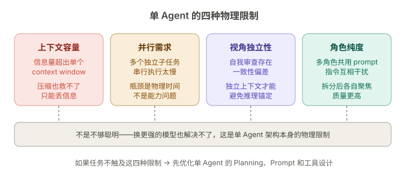
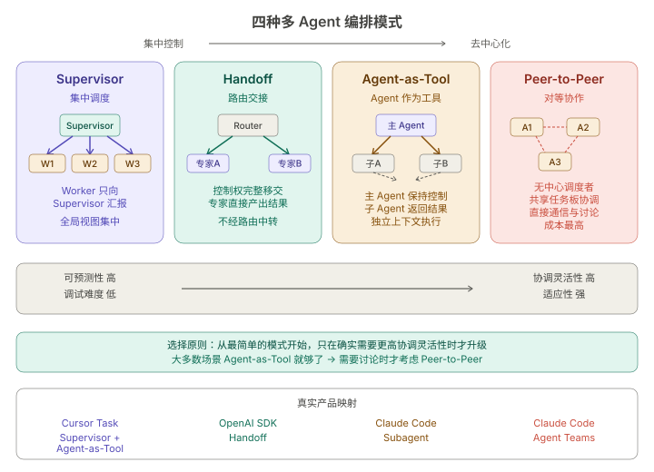
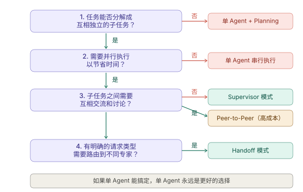

+++
title = "多 Agent 协作：当一个 Agent 不够用时，如何让多个 Agent 分工合作"
date = 2026-03-23T16:00:00+08:00
draft = false
author = "Hex4C59"
description = "解释多 Agent 的四种分工方式，并用可运行的 SQLite 任务板实现原子认领、版本检查和独立消息游标，验证并发工作者不会相互覆盖。"
summary = "先区分集中调度、路由交接、Agent 作为工具与对等协作，再运行真实 SQLite 协调机制：认领绑定执行者、版本和 token，消息按消费者独立确认，避免并发覆盖与游标误跳。"
tags = ["Agent", "多智能体", "任务编排"]
categories = ["ai"]
series = ["agent-engineering"]
series_order = 10
difficulty = "intermediate"
article_type = "concept"
topics = ["multi-agent", "orchestration", "coordination", "supervisor", "handoff"]
frameworks = ["OpenAI", "Anthropic", "LangGraph", "CrewAI"]
ShowToc = true
source_kind = "original"
lastmod = 2026-10-17
+++

前面九篇文章把单 Agent 的能力栈拆得很清楚了：[Tool Use](/agent/tool-use-core-of-agent/) 让它能行动，[上下文管理](/agent/context-memory-state-management/)让它在长任务中保持方向感，[ReAct](/agent/react-paradigm/) 和 [Planning](/agent/planning-plan-and-execute/) 给了它推理和规划能力，[Reflection](/agent/reflection-agent/) 让它能审视自己的输出，[Prompt 设计](/agent/prompt-design-agent/)和[工具接口设计](/agent/tool-interface-design/)是把这些能力组装起来的工程手段，[评测](/agent/agent-evaluation/)告诉你它到底做得怎么样。

但有一类问题，单 Agent 做得再好也不够：**当任务本身需要多个独立视角、多条并行路径、或者超出单个上下文窗口的承载能力时，你需要多个 Agent 协作。**

本文面向会写简单代码、了解单 Agent 工具循环的读者。这里把每个 Agent 看作一份角色指令、一个独立上下文和一段执行循环，再检查三件事：任务交给谁、哪些信息随任务传过去、谁检查并汇总结果。产品名称用于说明模式，具体能力和限制需按所用版本核对。前面三种模式用假设任务说明控制权流向；后面的 SQLite 任务板是完整可运行的机制，用真实数据库验证认领、提交结果与消息进度，不需要模型服务。

---

## 先给结论

1. **多 Agent 的核心价值不是"更多的 Agent"，而是任务分解后的独立执行与结果聚合。** 每个 Agent 有自己的上下文窗口、角色定义和工具集，各自负责一个子问题，最终由编排层把结果组合起来。
2. **四种主流编排模式覆盖了绝大多数场景：Supervisor（集中调度）、Handoff（路由交接）、Agent-as-Tool（Agent 作为工具调用）、Peer-to-Peer（对等协作）。** 它们的复杂度、协调开销和适用场景各不相同。
3. **真实产品已经验证了这些模式。** Claude Code 的 Subagent 和 Agent Teams 分别对应 Agent-as-Tool 和 Peer-to-Peer；Cursor 的 Task 工具是典型的 Supervisor + Agent-as-Tool；OpenAI Agents SDK 原生支持 Handoff 和 Agent-as-Tool 两种模式。
4. **需要核算协调开销。** 拆任务、传背景、等结果和汇总都要花时间与 token；子任务过小时，这些开销可能超过分工带来的收益。
5. **判断是否需要多 Agent 的标准很简单：任务能否自然地分解成互相独立的子任务？** 如果子任务之间强耦合、需要频繁同步上下文，多 Agent 反而比单 Agent 更慢、更贵、更难调试。

---

## 单 Agent 的天花板在哪里

在决定引入多 Agent 之前，先搞清楚单 Agent 到底在哪里不够用。不是所有"复杂任务"都需要多 Agent——很多时候是 Planning 和工具设计没做好。

单 Agent 真正触及天花板的场景有四类：

**1. 上下文窗口物理不够用**

当多个审查方向各自需要大量材料时，单个上下文可能容纳不下全部细节。除了分批读取和外部存储，也可以让不同 Agent 分别处理相关材料，再汇总关键发现。比如同时审查一个 PR 的安全性、性能影响和测试覆盖率——三个维度各自需要阅读大量代码，放在一个上下文里互相挤占。

**2. 任务天然可并行，但串行太慢**

假设前端、后端和测试三个子任务已划清接口，可以互不等待地执行，就可以考虑并行分派。总等待时间仍包括拆分、最慢子任务和汇总，不能直接按 Agent 数量等比例缩短；如果测试依赖代码修改，就要先等修改完成。

**3. 需要独立视角避免偏见**

[Reflection](/agent/reflection-agent/) 那篇讲过自我一致性陷阱——模型倾向于认为自己的输出是合理的。对于竞品分析或代码安全审查，可以给另一个 Agent 不同的检查标准，让它独立阅读必要证据。这样提供了另一轮检查机会；如果双方使用同一模型、同一份不完整资料，仍可能漏掉相同问题，不能仅凭上下文独立就保证效果更好。

**4. 角色差异太大，放在一个 prompt 里互相干扰**

一个 Agent 同时扮演"调研员"和"写作者"两个角色，它的 system prompt 需要同时包含调研规范和写作规范，两套指令会互相干扰。拆成两个 Agent，各自只做一件事，prompt 更清晰，执行质量更高。



*图 1：单 Agent 的天花板不在于"不够聪明"，而在于上下文容量、并行需求、视角独立性和角色纯度四个物理限制。*

如果你的任务不属于这四种情况，先回去优化单 Agent 的 Planning、Prompt 和工具设计。多 Agent 不是单 Agent 做不好的升级方案——它是任务结构本身要求的不同解法。

---

## 四种编排模式

多 Agent 系统的核心问题是：**谁来决定哪个 Agent 做什么？Agent 之间怎么传递信息？最终结果由谁汇总？**

不同的编排模式给出了不同的答案。

### 模式一：Supervisor（集中调度）

一个"主管 Agent"负责接收任务、分解子任务、分配给 Worker Agent 执行，然后收集结果并汇总。所有的协调逻辑集中在 Supervisor 身上。

下面是假设代码审查任务的控制流示意，不是运行输出：

```text
Supervisor 接收“审查这次修改”
  ├─ 安全 Worker：检查权限与输入边界
  └─ 测试 Worker：检查缺少的测试
两个 Worker 分别返回发现与证据
Supervisor 汇总，指出冲突与尚未验证的部分
```

**Supervisor 模式的核心特征：**

- 所有 Worker 只向 Supervisor 汇报，Worker 之间不直接通信
- Supervisor 拥有全局视图，能根据各 Worker 的结果动态调整
- 调试相对简单：所有协调逻辑集中在一个地方

**适用场景：** 任务可以清晰地分解成独立子任务，Worker 之间不需要交流，最终需要一个统一的汇总输出。比如：多维度报告生成、并行代码审查、多源信息调研。

**主要风险：** Supervisor 是单点瓶颈。如果子任务数量多，Supervisor 的上下文窗口也会被各 Worker 的结果撑满。

### 模式二：Handoff（路由交接）

不是一个 Agent 调度多个 Agent，而是一个"路由 Agent"判断当前任务应该交给哪个专家 Agent 处理，然后把对话控制权完整移交。被选中的专家 Agent 直接面对用户（或下游系统），不再经过路由 Agent 中转。

下面是假设客服任务的路由示意，不是运行输出：

```text
路由 Agent 接收问题和必要会话背景
选择“账单专家”
宿主应用把当前问题、授权范围和必要历史交给账单专家
账单专家继续对话并产出最终结果
```

路由只解决“交给谁”，宿主应用还要决定传哪些背景、约束和进度。专家需要看到与本次处理相关的历史，不能把“选中专家”当成“上下文已完整移交”。

**Handoff 与 Supervisor 的关键区别：**

- Supervisor 保持控制权，Worker 把结果交回 Supervisor 汇总
- Handoff 释放控制权，专家 Agent 直接产出最终结果

**适用场景：** 不同类型的请求需要完全不同的处理方式——不同的 prompt、不同的工具集、甚至不同的模型。比如：客服系统根据问题类型路由到不同的专家；开发工具根据任务类型（写代码 / 改配置 / 跑测试）路由到不同的 Agent。

框架可以提供交接接口，但传哪些消息、如何过滤历史以及授权能否继承，仍需按所用框架的实际配置检查。

### 模式三：Agent-as-Tool（Agent 作为工具）

把一个 Agent 包装成 Tool，让主 Agent 像调用普通工具一样调用它。被调用的 Agent 在自己的上下文里独立执行任务，完成后把结果返回给主 Agent。

下面是假设仓库检索任务的调用示意，不是运行输出：

```text
主 Agent 调用“查找调用者”工具，参数为函数名与目录范围
子 Agent 在自己的上下文中检索
子 Agent 返回调用位置、证据和未检查范围
主 Agent 继续决定下一步，不把控制权交出去
```

**Agent-as-Tool 的核心特征：**

- 主 Agent 决定何时、是否调用子 Agent——调用时机由模型的推理决定，不是预先编排的
- 子 Agent 使用独立上下文；主 Agent 不必保存它读过的全部材料
- 返回内容仍会进入主 Agent 的输入，宜包含结果摘要、必要证据和未解决项，避免只给无法核对的结论

**这正是 Claude Code 的 Subagent 和 Cursor 的 Task 工具采用的模式。** 主 Agent 在执行过程中发现某个子任务适合委托出去——可能是因为需要独立上下文、需要并行执行、或者是为了避免当前上下文被无关信息污染——于是把子任务作为一次"工具调用"分发出去。

**适用场景：** 主 Agent 需要保持对整体任务的控制，但某些子任务最好在独立上下文中完成。比如：Coding Agent 在修改代码时，需要一个子 Agent 去独立探索代码库、另一个子 Agent 去跑测试。

### 模式四：Peer-to-Peer（对等协作）

没有中心调度者。多个 Agent 地位对等，通过共享的通信机制（消息队列、共享文件、任务列表）直接交流，自行认领任务、分享发现、挑战彼此的结论。

两个执行者可以同时读到“任务尚未认领”。因此，不能先读一个 Python 列表，再分别把状态改成“处理中”；认领本身必须是数据库检查并写入的一次操作。下面的 `TaskBoard` 用 SQLite 事务实现这个边界。

**Peer-to-Peer 的核心特征：**

- 没有中心调度者，每个 Agent 自主决定做什么
- Agent 之间通过共享状态（任务板、消息、文件系统）协调
- 具体协作顺序由认领和消息反馈逐步形成；任务依赖、认领规则和停止条件仍需事先设计

### 用版本和认领凭据防止结果互相覆盖

`add_task()` 保存任务 ID、说明、依赖和从 0 开始的 `version`。版本表示这条任务记录已经被修改了几次。执行者调用 `claim_task(id, actor=..., version=...)`，必须提交自己看到的版本；事务内同时检查状态仍为 `pending`、依赖任务已经完成，才把任务改为 `claimed`，记录所有者、增加版本并返回随机生成的认领凭据 `token`。

假设 A、B 都读到版本 0。A 先认领后，数据库中的版本变成 1，所有者是 A；B 再提交版本 0 时失败。这个判断在 SQLite 的 `BEGIN IMMEDIATE` 事务中完成，两个进程不能靠最后写入覆盖对方。

完成任务时，`complete_task()` 必须同时提供所有者、当前版本和认领返回的 token。错的人、旧版本或上一轮认领的 token 都不能提交结果；成功完成后再次增加版本，不能重复完成或覆盖已保存结果。认领者需要主动放弃时可调用 `release_task()`，它也检查相同凭据，再增加版本并回到待认领状态。

依赖任务必须先加入任务板，且全部完成后才能认领当前任务。本例不支持后来改写依赖，也没有自动过期的认领租约。工作者退出后，记录仍为 `claimed`；不能因等待时间长就让另一个执行者冒领并重复执行外部操作。保存了原 token 的执行者可以恢复并报告结果，丢失凭据时需要宿主程序核对现场。

### 消息游标按消费者保存，确认后再推进

`post_message()` 给每条消息分配递增 ID；`recipient=None` 表示广播。`poll_messages(consumer, actor=..., limit=...)` 先筛选这个人的定向消息和广播，再按 ID 取一批。`consumer` 是一条独立收件进度的名称；它保存已经确认到哪个消息 ID 的记录，也就是游标，并绑定固定 actor。

例如，假设全局消息顺序是：B 的消息 1、A 的消息 2、B 的消息 3、A 的消息 4、广播 5。A 每次取一条时，应依次收到 2、4、5。不能先截取一批全局消息、再用它们的最大 ID 更新 A 的进度，否则可能跳过尚未交付给 A 的消息。A 的游标也不影响 B，B 仍能收到 1、3、5。

取消息不会立刻确认处理完成。数据库保存这批消息的 ID 和批次 token；进程重启、重复轮询或改变分页大小，都先返回同一份尚未确认的批次。处理成功后，调用 `ack_messages(consumer, actor=..., token=...)`，只把该消费者的游标推进到这批实际消息的末尾。调用方不能任填一个最大 ID 跳过内容。确认两次、拿别人的批次 token 确认，都会失败；批次确认后，新消息仍会按顺序送达。

这是“未确认就重投”的语义。若外部动作已经完成、确认前进程却退出，消息会重来，处理程序仍需用消息 ID 判断是否处理过，或让外部服务通过业务幂等键识别重复请求。不能把这个游标称为外部动作恰好执行一次的保证。

### 下载并运行实际机制

下载 [Agent 机制完整示例](/downloads/agent-examples/mechanisms.zip)，在独立目录解压。需要 Python 3.11 或以上版本：

```bash
unzip mechanisms.zip -d mechanisms-demo
cd mechanisms-demo
python3.11 -m venv .venv
source .venv/bin/activate
python -m pip install -r requirements.txt
python -c 'import asyncio, json; from coordination import demo; print(json.dumps(asyncio.run(demo()), ensure_ascii=False))'
python -m unittest -v test_coordination
```

`demo()` 在临时目录创建真实 SQLite 文件，重建应用对象后检查审批和任务状态，再验证消息分页、确认与收件人隔离。以下是本次运行这条命令捕获的输出；它没有调用真实模型：

```text
{"ok": true, "approval_reopen": true, "one_shot_claim": true, "versioned_task": true, "acknowledged_cursor": true, "recipient_isolation": true}
```

本次在 Python 3.11.16、macOS 上运行了 18 项 `test_coordination.py` 测试，全部通过。除重启外，测试还让两个独立进程竞争同一任务，并用独立 SQLite 连接竞争认领、提交和消息确认；测试检查数据库里只保留一个有效所有者或结果。游标测试覆盖交错收件人、广播、单条分页、空批次、新消息、错误身份、重复确认和未确认批次在重启后重读。

完整的 `coordination.py` 同时包含任务板和[人工审批机制](/agent/human-in-the-loop/)，与下载包使用同一来源：



模块中的 actor 是可信本地宿主传入的工作者身份，token 是宿主保存的认领凭据；不能让模型随意冒充另一个工作者。这个例子不是 Web 登录或多租户权限系统，也不是完整 Agent 服务。它验证同一本地 SQLite 数据库上的协调，不覆盖网络盘、跨机器调度、数据库被恶意改写或外部副作用的自动恢复。

**Claude Code Agent Teams 是文中用于比较的产品例子。** Team Lead 创建任务列表后，Teammate 自行认领任务、互相发消息讨论、挑战彼此的发现。协调通过文件系统上的 JSON 文件进行，不依赖中心化的消息代理。

**适用场景：** 任务需要多个独立视角互相碰撞——竞争性假设调查、对抗性审查、需要讨论和辩论才能收敛的开放性问题。

**主要风险：** 协调开销最高，token 消耗最大，调试最困难。如果任务不真正需要 Agent 之间的交互讨论，这个模式的成本远高于 Supervisor 或 Agent-as-Tool。

---

## 四种模式的对比



*图 2：四种编排模式的核心差异在于控制权的分配方式——从集中控制（Supervisor）到完全去中心（Peer-to-Peer），协调灵活性上升，但可预测性和调试便利性下降。*

|  | Supervisor | Handoff | Agent-as-Tool | Peer-to-Peer |
|--|-----------|---------|---------------|-------------|
| 控制权 | 集中在 Supervisor | 移交给专家 | 主 Agent 保持 | 完全分散 |
| Agent 间通信 | 不通信，只和 Supervisor 交互 | 不通信 | 不通信，只返回结果 | 直接通信 |
| 适合的任务结构 | 可分解的并行子任务 | 类型明确的路由分发 | 主任务中的独立子问题 | 需要讨论和碰撞的开放问题 |
| 协调开销 | 中 | 低 | 低 | 高 |
| Token 消耗 | 中 | 低 | 低~中 | 高 |
| 调试难度 | 低 | 低 | 中 | 高 |

选择的原则很简单：**从最简单的模式开始，只在确实需要更高协调灵活性时才升级。**

大多数场景下，Agent-as-Tool 就够了。只有当子任务之间真正需要互相交流时，才考虑 Peer-to-Peer。

---

## 真实产品中的多 Agent 设计

下面用产品例子辨认控制权和消息流。工具名称、继承规则、数量建议及文件位置都可能随版本变化；判断这些模式能否用于自己的任务时，应核对所用版本和配置。

### Claude Code：Subagent 与 Agent Teams

Claude Code 同时实现了两种多 Agent 机制，分别对应不同的协作需求：

**Subagent（Task 工具）** 是 Agent-as-Tool 模式。主 Agent 在执行过程中通过 Task 工具生成一个子 Agent，子 Agent 在独立的上下文窗口中完成任务，把结果返回给主 Agent。子 Agent 不能生成更多子 Agent，也不能和其他子 Agent 通信。

适用场景是：主 Agent 需要委托一个聚焦的子任务（比如"去搜索一下这个函数的所有调用者"或"在这个文件夹里找到相关的测试文件"），只关心结果，不关心过程。Token 成本低，因为只有结果摘要回到主上下文。

**Agent Teams** 是 Peer-to-Peer 模式。一个 Team Lead 创建团队，生成多个 Teammate，每个 Teammate 是独立的 Claude Code 实例。它们通过共享的任务列表协调工作，通过 Mailbox 机制互相发消息，可以直接挑战彼此的发现。

Agent Teams 的协调架构值得仔细看：

- **任务列表**存储在 `~/.claude/tasks/{team-name}/`，以 JSON 文件形式存在
- **消息投递**是自动的——Teammate 发消息后，接收方自动收到
- **任务认领**使用文件锁防止竞争条件
- 每个 Teammate **加载相同的项目上下文**（CLAUDE.md、MCP 服务器），但**不继承** Team Lead 的对话历史

Anthropic 在文档中明确建议：Agent Teams 的团队规模控制在 3-5 个 Teammate，每个 Teammate 分配 5-6 个任务。超过这个规模，协调开销的增长会超过并行执行的收益。

### Cursor：层级化 Subagent

Cursor 的 Agent 模式采用的是 Supervisor + Agent-as-Tool 的混合模式。主 Agent 拥有一个 `Task` 工具，可以启动不同类型的子 Agent：

- **explore** 子 Agent：快速探索代码库，查找文件和代码模式
- **generalPurpose** 子 Agent：处理复杂的多步任务
- **shell** 子 Agent：执行终端命令
- **best-of-n-runner** 子 Agent：在隔离的 git worktree 中运行实验性修改

每种子 Agent 类型有不同的工具集和能力范围，主 Agent 根据当前需要选择启动哪种子 Agent。这种设计的核心优势在于：

1. **主 Agent 的上下文保持干净。** 代码探索、测试运行这些"脏活"在子 Agent 的独立上下文里完成，只有精炼后的结果回到主上下文。
2. **可以并行启动多个子 Agent。** 主 Agent 在一次响应中可以同时启动多个 Task，它们并行执行。
3. **子 Agent 不能再生成子 Agent。** 这个约束防止了递归嵌套导致的控制链过长和成本失控。

### OpenAI Agents SDK：Handoff 与 Agent-as-Tool

OpenAI Agents SDK 把两种编排模式做成了框架级原语：

**`handoff()`** 声明 Agent 之间的交接关系。一个 Triage Agent 可以把对话完整移交给一个 Specialist Agent，Specialist Agent 带着对话上下文继续处理，不再经过 Triage Agent 中转。

**Agent 作为工具的接口**把一个 Agent 包装成工具。Manager Agent 可以调用多个 Specialist Agent 作为工具，收集它们的结果后自己汇总最终答案。

OpenAI 的建议是：**当你需要一个 Agent 掌控最终输出时用 Agent-as-Tool，当你需要专家直接面对用户时用 Handoff。** 两种模式可以在同一个系统里混用——Triage Agent 通过 Handoff 把对话交给一个 Specialist，这个 Specialist 又可以通过 Agent-as-Tool 调用其他 Agent 做子任务。

---

## 多 Agent 协作的常见失败模式

### 1. 协调开销超过任务复杂度

最常见的失败。开发者把一个单 Agent 能在 10 轮工具调用内完成的任务拆成 3 个 Agent，结果光是 Supervisor 的任务分解、分配、结果汇总就消耗了更多的 token 和时间。

**判断方法：** 列出每个子任务必需的输入，再检查它是否要反复等待其他任务的新结果。如果需要频繁同步大量材料，应先比较单 Agent 或顺序流程的开销，不宜用一个固定共享比例判断。

### 2. 上下文割裂导致信息丢失

子 Agent 有独立的上下文窗口，这是优势也是劣势。主 Agent 知道的背景信息，子 Agent 并不自动知道。如果分配任务时没有把必要的上下文传递给子 Agent，子 Agent 会基于不完整的信息做出错误决策。

Claude Code 的 Agent Teams 文档专门强调了这一点：Teammate 不会继承 Team Lead 的对话历史，你需要在 spawn prompt 中包含所有必要的上下文。

下面是假设审查任务的委派内容示意，不是模型输入输出的实测：

```text
不足的委派：审查 src/auth/ 的代码质量。

更完整的委派：
审查 src/auth/ 的认证边界。
假设项目使用 JWT 与 httpOnly cookie，后端为 Express.js，数据库为 PostgreSQL。
检查 token 过期处理和 CSRF 防护；报告证据、未读文件与未验证项。
```

这些技术栈是假设背景，实际委派应填入当前项目已经核实的信息。

### 3. 文件冲突和状态竞争

当多个 Agent 同时修改同一文件，又没有合并或写入协调机制时，后写入的内容可能覆盖先前修改。可以先按文件划分责任；确实需要重叠时，再隔离工作目录并检查合并结果。

Claude Code 的最佳实践是：**让每个 Teammate 拥有不同的文件集。** 如果无法避免重叠，使用 Git worktree 让每个 Agent 在独立的工作目录中操作，最后再合并。

### 4. 责任扩散

多个 Agent 都"以为"某个子任务会被其他 Agent 处理，结果没有任何 Agent 真正去做。这在 Peer-to-Peer 模式下尤其常见，因为没有中心调度者确保每个任务都有人认领。

解决方案：**显式的任务列表 + 认领机制。** 每个任务必须被一个具名的 Agent 认领后才能开始执行。

### 5. 成本和延迟失控

每个 Agent 的输入、输出和工具循环都要计入总消耗，汇总与审查也会增加调用。具体倍数取决于任务拆分、上下文长度和通信频率，不能只按成员数推算。

例如，假设五个 Agent 在每轮讨论中各调用一次模型，三轮就是十五次调用；这是该假设下的计数。发送或接收一条消息，不一定立刻触发一次模型调用，还取决于运行程序如何批量处理消息。

---

## 什么时候用多 Agent

做一个简单的决策检查：



**多 Agent 不是"更高级"的 Agent 架构。** 它是一种在特定任务结构下才有优势的设计选择。如果单 Agent 已能在目标成本和时间内完成任务，可以先保留简单结构，再用对照任务判断分工是否值得。

---

## 总结

单 Agent 的天花板不在于"不够聪明"，而在于上下文容量、并行需求、视角独立性和角色纯度四个物理限制。当任务触及这些限制时，多 Agent 是结构性的解法，不是单 Agent 的"升级版"。

四种编排模式覆盖了从简单到复杂的协作需求：Agent-as-Tool 最轻量，子 Agent 在独立上下文中完成任务后返回结果；Handoff 把控制权交给专家；Supervisor 集中调度多个 Worker 并汇总结果；Peer-to-Peer 让多个 Agent 自主协调，适合需要讨论和碰撞的开放性问题。

真实产品的选择印证了一个原则：**从最简单的模式开始。** Claude Code 默认用 Subagent（Agent-as-Tool），只有在需要 Agent 间交流时才升级到 Agent Teams。Cursor 用 Supervisor + Agent-as-Tool 混合模式，子 Agent 不能再嵌套。OpenAI Agents SDK 把 Handoff 和 Agent-as-Tool 作为两个正交的原语，让开发者按需组合。

多 Agent 系统最大的风险不是技术实现的复杂度，而是在不需要多 Agent 的场景下引入了多 Agent。协调和通信会增加开销，跨上下文排查问题也更复杂。在引入之前，先确认任务结构真的需要——如果子任务之间高度耦合，多 Agent 不会让事情变好，只会让调试变难。

---

*下一篇：[MCP：让 Agent 的工具生态不再各自为战](/agent/mcp-model-context-protocol/)*
