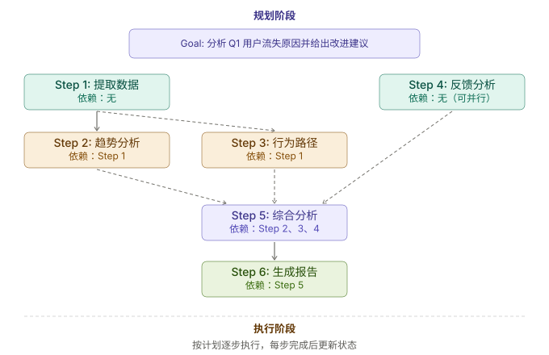

+++
title = "Planning：当 ReAct 不够用时，Agent 如何提前分解目标"
date = 2026-03-22T23:00:00+08:00
draft = false
author = "Hex4C59"
description = "用可运行的异步 Plan-and-Execute 说明任务分解、结果验收、结构化状态，以及总截止时间、步骤和重规划上限如何共同约束执行。"
summary = "显式保存依赖、完成标准和执行状态，通过真实临时文件演示局部重规划；失败、超时和限额不再被标记为完成，每步与整体目标都需要独立验收。"
tags = ["Agent", "规划", "Task Decomposition"]
categories = ["ai"]
series = ["agent-engineering"]
series_order = 5
difficulty = "intermediate"
article_type = "concept"
topics = ["planning", "plan-and-execute", "agent", "task-decomposition", "reflection"]
frameworks = ["OpenAI", "Anthropic"]
ShowToc = true
source_kind = "original"
lastmod = 2026-10-17
+++

[上一篇 ReAct](/agent/react-paradigm/)讨论了模型怎样根据目标、历史和工具结果决定下一步。当任务有多组依赖和验收要求时，还需要一份能单独查看的计划，才能核对哪些要求已满足、哪些步骤仍在等待。

本文面向会写 Python 循环、了解异步调用和工具接口的读者。这里比较“不单独保存全局计划的循环”和“显式维护计划的循环”；ReAct 也能读取历史目标，并非只能看到最近一条结果。后面的机制模块可以直接运行：它会区分完成、失败、超时与限额，限制整个任务的异步等待时间，并用真实临时文件检查重规划后的结果。

---

## 先给结论

1. **只做逐步选择，可能漏掉整体要求。** 如果没有单独保存任务分解和完成标准，执行循环就需要反复从对话中推断进度，长任务更难检查是否覆盖完整。
2. **Planning 的本质是“先想清楚再做”。** 在执行任何动作之前，先生成一份结构化的执行计划，把目标分解成可执行的子任务序列。
3. **Plan-and-Execute 把规划与执行分开。** 规划阶段生成计划，执行阶段按计划推进，检查点阶段评估是否需要调整。三个阶段分工明确。
4. **Planning 不是 ReAct 的替代品，而是它的上层结构。** 好的 Agent 系统里，Planning 负责任务分解和全局协调，ReAct 负责每个子任务内部的推理与工具调用。
5. **需要决定何时允许改计划。** 完全照旧执行，可能沿用已失效的前提；每步都推翻重写，又会增加规划开销并丢失进度。检查点应说明哪些结果会触发调整。

---

## ReAct 在哪里失效

先通过一个具体场景理解 ReAct 的天花板。

假设任务是：**“分析我们产品过去一个季度的用户流失情况，找出主要原因，并给出改进建议。”**

这个任务包含：
- 从数据库查询流失用户数据
- 对数据进行多维度分析（时间趋势、用户分群、行为路径）
- 查询用户反馈和客服记录
- 综合多个来源的信息得出原因假设
- 验证假设
- 生成结构化报告

以下是人为设定的轨迹示意，数字不是实测结果：

```text
Thought: 我需要分析用户流失情况，先查查数据。
Action: query_database("SELECT * FROM churned_users WHERE ...")
Observation: 返回了 5000 条记录...

Thought: 数据量很大，我来看看流失趋势。
Action: analyze_data("按月统计流失率")
Observation: 1月 3.2%，2月 4.1%，3月 5.8%...

Thought: 流失率在上升，我来看看具体原因...
（继续推进；这段假设轨迹没有另外列出完整计划）
```

问题在哪里：

**没有单独维护全局结构。** 上面的记录没有列出必要步骤、依赖和完成标准。开发者因此难以检查：数据查询后是否还会查用户反馈，原因假设是否经过验证。问题在于缺少这份结构化记录，而不是 ReAct 这个名称决定模型一定不知道目标。

**容易迷失在细节里。** 当某个工具返回了有趣的数据，ReAct 很容易被吸引过去深挖，偏离了原始目标。没有全局计划约束，任务路径很难保持连贯。

**无法保证完整性。** 没有计划意味着没有“完成检查表”。任务执行完后，你不知道是否覆盖了所有必要的分析角度，很容易遗漏关键步骤。

**对长任务来说上下文消耗失控。** [上下文与记忆](/agent/context-memory-state-management/)讨论了如何控制每次请求。只追加工具结果会增加输入长度；显式计划有助于提供进度，但它本身也要接受预算检查，不能取代上下文管理。

仅更换模型，不能代替系统对计划、进度和验收标准的保存。显式维护这些信息，可以让执行过程与整体目标逐项对照。

---

## Planning 的核心思想

Planning 的答案直接了当：**在开始执行之前，先生成一份结构化的计划。**

这份计划要回答三个问题：

1. **这个任务可以分解成哪些子任务？**
2. **子任务之间的依赖关系是什么？**（哪些必须先做，哪些可以并行）
3. **每个子任务完成的判断标准是什么？**

有了这份计划，执行阶段就不再是“走一步看一步”，而是在一个明确的框架内推进。

用上面的流失分析任务来对比，有了 Planning 之后：



以前面的假设任务为例，先查询数据才能分析趋势；用户反馈可以作为另一条信息来源；形成原因假设后，还要验证再写报告。把依赖和完成标准写进计划，并在每轮提供相关内容，执行模块就能判断哪些步骤可开始、哪些仍需等待。

---

## Plan-and-Execute 范式

把上面的思路结构化，就是 Plan-and-Execute 范式。它包含三个阶段：

**规划阶段（Plan）**：给定目标，生成结构化执行计划。

**执行阶段（Execute）**：按计划逐步执行，每个子任务内部可以用 ReAct 来处理工具调用。

**检查点阶段（Checkpoint）**：每完成一个子任务，评估结果，判断是否需要调整后续计划。

程序先保存计划，再执行依赖已满足的步骤；到检查点时，把结果与该步的完成标准对照，并判断后续前提是否还成立。若结果改变了判断，就修改尚未执行的步骤。检查点提供复查机会，不保证模型一定能发现所有问题。

---

## 代码实现

[下载机制示例 ZIP](/downloads/agent-examples/mechanisms.zip)，解压后使用 Python 3.11 或更新版本。以下命令在解压目录执行，离线演示不需要模型凭据：

```sh
python3.11 -m venv .venv
source .venv/bin/activate
python -m pip install -r requirements.txt
python -c "import asyncio,json,planning; print(json.dumps(asyncio.run(planning.demo()),ensure_ascii=False,sort_keys=True))"
python -m unittest -v test_context_planning
```

PowerShell 使用 `.venv\Scripts\Activate.ps1` 激活环境。仓库内运行时，工作目录是 `examples/agents/mechanisms`，并设置 `PYTHONPATH=../common`；ZIP 根目录已经包含共享运行时。

### 规划阶段

`run_plan_and_execute` 接收实现 `async complete(messages, tools)` 的模型，以及共享运行时的 `Tool` 列表。规划器只返回结构化 JSON，不得自行给步骤设置“已完成”。程序检查原目标是否保留、字段和类型是否正确、步骤编号是否重复、依赖是否存在或成环、工具是否真的可用。

每个 `PlanStep` 保存描述、依赖、完成标准和需要的工具。`StepRecord` 另存执行状态、实际摘要和工具次数。把计划内容与执行状态分开，能防止模型在计划 JSON 中写一个 `status=complete` 就跳过操作。

完整 `planning.py` 与 ZIP 共用一份源码；它在同一机制包内使用 `context_budget.py`，所有规划、执行和检查点的模型输入也经过调用前字符预算检查。



### 执行阶段

程序只选择依赖都已完成的待执行步骤。开始前把它标为 `running`，再交给共享异步工具循环。执行返回的是 `AgentResult`，因此可以先检查 `status`，不再从返回句子里猜测成功与否。

| 执行结果 | 步骤和整体怎样处理 |
| --- | --- |
| 工具循环达到轮次或调用上限 | 返回 `limit`，不运行依赖该步的后续步骤 |
| 步骤等待超时 | 返回 `timeout`，不标记完成 |
| 模型出错或工具结果含 `ok:false` | 返回失败，即使最后一句声称成功 |
| 工具循环正常结束 | 继续调用 `verify_step(step, result)` 检查应用证据 |
| 验收函数返回严格的布尔真 | 才把步骤标为 `complete`，进入检查点 |

示例演示中的验收会读取实际生成的文件或检查真实工具返回内容。换成报告、数据分析等任务时，调用者需要提供适合自己任务的验收函数；“模型回答结束”与“业务目标已经完成”是两回事。

### 检查点阶段

每步验收通过后，检查点可以保持计划，或者替换尚未执行的步骤。新计划仍要通过依赖和工具检查，不得复用已完成步骤的编号；已验证的摘要保留。整体目标与原完成标准也不会由重规划悄悄改掉。

`max_replans` 限制接受修改的次数，`max_steps` 统计整个任务已经尝试执行的步骤，重规划后不清零。每个步骤内部另有工具循环轮次和工具调用上限，因此反复加新步骤、反复请求工具都会遇到明确的限额状态。

`timeout` 是规划、执行、检查点和验收共同使用的一个异步截止时间，`step_timeout` 另限制单步执行与验收。规划器或检查点一直等待时也会停止。调用者主动取消会传播 `CancelledError`；这些约束针对正常协作的异步等待，不能打断阻塞事件循环的同步代码，也不是操作系统级强制终止。达到工具调用上限时，前面已经执行的动作仍然存在；程序停止后续推进并报告状态，不自动回滚应用副作用。

### 完整执行流程回顾

下面是 2026-10-17 运行上面的 `planning.demo()` 捕获的结果。`mode=fixture` 表示模型回复固定，临时文件工具、依赖调度、重规划、验收和清理则实际执行：

```json
{"attempts": 3, "completed_steps": ["write", "verify", "report"], "files_verified": true, "max_request_characters": 1408, "mode": "fixture", "model_calls": 10, "ok": true, "replans": 1, "status": "complete", "temporary_workspace_removed": true}
```

初始计划是写源文件再写报告。第一步完成后，检查点插入“读回并核对源文件”这一步；程序保留已完成的写入记录，先验证，再生成报告。最后还运行 `verify_goal(plan, records)`，只有整体证据通过才返回 `complete`。



*图 1：规划、执行和检查点的概念流程。图中的“执行”在本实现中包含状态检查与证据验收；整体完成还需要目标验收，不会因为执行函数返回了一段文字就通过。*

## 计划的刚性：最重要的设计决策

前面提到，Planning 设计中最核心的挑战是：**计划应该有多刚性？**

这不是一个有标准答案的问题，需要根据任务性质做权衡。

### 完全刚性计划

计划生成后不接受中途修改，适合路径确定、验收规则稳定的流程。但发现前提失效时仍应停止，不能因为“严格执行”就把失败结果交给后续步骤。

本例可以用 `max_replans=0` 拒绝修改。验收和检查点仍会运行；一旦检查点要求改计划，就返回 `limit/replan_limit`，保留已有证据，让调用者决定是否重新启动任务。

### 完全动态计划

每次得到新结果都重新规划，可能适合任务方向很不确定的场景，但也容易反复推翻待办、忽略之前的执行成本。

无论修改多频繁，已经尝试的步骤和总截止时间都不能随计划对象重建而清零。否则每个小循环看似有上限，组合起来却仍可能一直运行。本实现把次数和截止时间放在外层执行器中，由所有修订共同使用。

### 带检查点的自适应计划（推荐）

这是上面代码实现的方式：计划在执行中保持稳定，但在每个检查点有机会做局部调整。

核心原则：
- 保留已完成步骤的实际执行记录；若后来发现结论有误，另列修正或补做步骤，不把原记录悄悄删掉
- 当前步骤完成后才触发检查点
- 检查点只修改**待执行**的步骤，不推翻整个计划
- 检查点的调整有明确触发条件（结果异常、发现遗漏、可提前完成）

这个设计让执行者能对照稳定的计划推进，同时在新结果改变前提时调整待办。是否适合具体任务，还取决于检查点能否识别异常、调整后是否保留有效依赖。

---

## Planning 与 ReAct 的关系

一个容易产生的误解是：引入 Planning 之后，就不需要 ReAct 了。

不是这样的。两者在 Agent 系统里处于不同的层次，解决不同的问题：

**Planning 解决的是宏观问题**：
- 任务应该分解成哪些子任务？
- 子任务的执行顺序和依赖关系是什么？
- 整体进度如何追踪？

**ReAct 解决的是微观问题**：
- 在执行某个子任务时，应该调用哪个工具？
- 工具返回了意外结果，下一步怎么调整？
- 当前子任务是否已经完成？

在实际的 Agent 系统里，它们是嵌套关系：Planning 负责把大任务分解成子任务，ReAct 负责执行每一个子任务。本例每步调用共享 `run_agent` 处理工具选择和结果反馈，外层执行器负责依赖、进度与验收。

可以用一句话概括它们的分工：**Planning 决定做什么，ReAct 决定怎么做。**

---

## 常见的 Planning 失败模式

**1. 计划太细，失去灵活性**

把每一步都规划得非常具体（“调用 search_web，关键词用 X，过滤条件用 Y”），导致计划成了一个固化的脚本。任何意外都会让计划失效。

好的计划应该在“目标层”描述步骤，而不是在“实现层”。“查找竞品的最新定价信息”是好的步骤描述；“用 Google 搜索‘竞品名称 price 2026’”是实现细节，不应该写进计划。

**2. 计划太粗，无法指导执行**

步骤描述过于抽象，每个步骤都是一个大任务，没有给执行阶段足够的约束。比如“分析用户数据”这个步骤太宽泛，执行阶段不知道从哪里开始，分析什么维度，达到什么程度算完成。

**3. 忽略依赖关系**

所有步骤都写成串行的，没有标注真正的依赖关系。这样就无法发现哪些步骤可以并行，也无法在某步失败时判断哪些后续步骤受影响。

**4. 检查点调整过于激进**

每个检查点都大幅修改计划，导致计划频繁重构，执行进度难以追踪，而且重新规划本身也有成本（时间、token）。检查点的设计应该是“微调”而非“重建”。

**5. 没有完成标准**

步骤没有明确的 `success_criteria`，执行阶段不知道什么时候算完成，容易过度执行或过早停止。每个步骤的完成标准应该是可以客观判断的，而不是“做得差不多”。

---

## 什么时候需要 Planning

不是所有任务都值得引入 Planning。它会增加规划阶段的时间和 token 开销，也会增加系统复杂度。

**适合 Planning 的场景**：

- 任务包含多个有依赖关系的子任务，已经难以靠近期对话检查整体进度
- 任务需要跨越多轮工具调用，且整体结构可以提前预判
- 任务失败的代价较高，需要在执行前做好全局把控
- 任务输出需要保证完整性（如报告、分析文档），不能遗漏关键步骤

**不适合 Planning 的场景**：

- 任务简单，ReAct 或单次工具调用就能完成
- 任务路径完全无法预判，每一步都依赖上一步的结果才能决定方向（这种情况纯 ReAct 反而更合适）
- 对响应时间非常敏感（规划阶段本身需要一次模型调用）

---

## 总结

ReAct 组织每一步的判断、行动和结果反馈；当任务包含多组依赖和验收要求时，还需要一种方式单独保存整体计划。

Planning 不是来取代 ReAct 的，而是在它上面加了一层全局视图：

- 规划阶段把目标分解成结构化的子任务序列
- 执行阶段用 ReAct 处理每个子任务内部的工具调用
- 检查点阶段评估进度，在保持整体稳定的前提下做局部调整

这三层共同提供任务分解、局部执行与进度复查。本例把验收写成明确接口，把 `failed`、`timeout`、`limit` 与 `complete` 分开；没有通过证据检查的步骤不会成为后续依赖。

计划的刚性是最需要根据场景权衡的设计决策。太刚性，遇到意外就崩；太灵活，和没有计划没区别。可以从稳定计划加局部检查点开始，再按任务的不确定性决定调整频率。规划模块和上下文模块共有 29 项本地测试，覆盖真实异步超时、错误状态、重规划与步骤上限、依赖校验、工具失败及当前任务保护；本轮没有在线模型质量验收。

---

