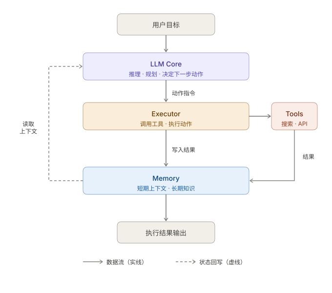

+++
title = "什么是 Agent：从聊天助手到可执行系统"
date = 2026-03-22T16:30:00+08:00
draft = false
author = "Hex4C59"
description = "从目标、工具、状态与执行闭环几个角度理解 Agent，说明它和普通聊天机器人、固定工作流之间的区别。"
summary = "系统解释什么是 Agent，为什么它不只是一个会聊天的模型，以及在什么场景下才值得引入 Agent 设计。"
tags = ["Agent", "AI", "LLM"]
categories = ["ai"]
series = ["agent-engineering"]
series_order = 1
difficulty = "beginner"
article_type = "concept"
topics = ["agent", "workflow", "tools", "planning"]
frameworks = ["OpenAI"]
ShowToc = true
source_kind = "original"
lastmod = 2026-10-17
+++

假设你让一个程序分析报错并修复代码：模型先读文件，执行模块再运行测试；测试失败后，模型根据报错决定下一次修改。本文把这种围绕目标、根据执行结果继续选择动作的系统称为 Agent（智能体）。它既需要模型判断，也需要程序真正执行操作。

本文面向会写简单代码、还不熟悉 Agent 的读者。理解循环、条件判断和函数调用就足够，不需要先学习某个框架。重点是弄清楚目标、工具、任务进度和反馈怎样配合，而不是把所有带工具的聊天程序都归为 Agent。

这篇文章的目标，就是先把这件事讲清楚：**什么是 Agent，它和聊天机器人、工作流分别有什么区别，以及什么时候真的值得引入 Agent 设计。**

## 先给结论

先把我的判断摆在前面。

1. **Agent 不是“更会聊天”的模型，而是“围绕目标执行动作的系统”。**
2. **一个最小可用 Agent，至少要同时具备目标、上下文、决策能力、执行能力和反馈闭环这五个要素。**
3. **并不是所有 AI 应用都需要 Agent。** 如果问题本身很确定、步骤很固定，用简单 workflow 往往更稳定、更便宜。
4. **Agent 的价值，主要体现在任务不确定、步骤需要动态调整、并且中途要调用外部能力的时候。**

换句话说，Agent 的重点不是“回答得像不像人”，而是“能不能把事情做完”。

## 为什么普通聊天机器人不够

单轮对话系统的核心能力是：你提一个问题，它生成一个回答。这个回答可能很流畅，也可能很准确，但很多时候它停在“说”这一步。

问题在于，现实任务通常不是一句回答就能解决的。

例如下面这些需求：

- 帮我查一下这个仓库最近三天有哪些 bug 修复，并总结成一段发布说明
- 帮我比较三个模型的 API 价格，并给出适合个人开发者的选型建议
- 帮我读完一篇长文，提炼结论，再用结构化格式写成笔记
- 帮我分析一个报错，找到可能原因，并尝试修复代码

这些任务都不是“直接回答”就结束了。模型通常需要先理解目标，再决定是否要搜索、是否要读文件、是否要调用工具、是否要拆分步骤，最后还要根据中间结果继续调整动作。也就是说，它不只是“生成文本”，而是在“驱动执行流程”。

这就是 Agent 被引入的原因。

## Agent 和 Workflow 的区别

这一点特别容易混淆，所以值得单独展开。

### Workflow 是什么

Workflow 更像一条预先写好的流程线。

例如：

1. 用户输入问题
2. 系统调用搜索接口
3. 把搜索结果拼进提示词
4. 模型生成总结
5. 返回给用户

这套流程当然也可以很好用，而且在很多场景下它就是最优解，因为它：

- 可预测
- 易测试
- 易调试
- 成本更稳定

如果你的任务边界清晰、步骤固定，其实完全没必要上 Agent。

### Agent 是什么

Agent 更像一个在约束中自主决策的执行者。

它不一定事先知道完整路径，而是会根据目标和中间反馈，动态决定下一步做什么。比如：

- 先搜索，发现结果不够，再换一个关键词继续搜
- 先读文档，发现缺少上下文，再去读相关代码
- 先尝试调用工具，失败后改参数重试
- 先做规划，再按阶段执行，每一步执行后重新判断

所以 Workflow 和 Agent 的差别，不在于有没有模型，而在于：

**下一步由预先写好的规则决定，还是由模型根据当前结果在运行时选择。** 这里的“状态”就是任务进度和已取得的结果，例如哪些文件读过、哪个测试失败。实际系统也可以把两种方式结合：固定步骤之间，允许模型选择某些动作。

## 一个最小可用 Agent 需要什么

我觉得一个最小可用 Agent，至少包含下面五个部分。

### 1. 目标

Agent 必须知道自己要完成什么。

这个目标可以来自用户输入，也可以来自上游系统，但无论如何，它都不能只是“陪聊”。如果没有明确目标，所谓的 Agent 往往会退化成会话系统。

### 2. 上下文

Agent 必须知道当前已经发生了什么。

包括：

- 用户的原始需求
- 历史对话
- 当前任务状态
- 已经拿到的工具结果
- 中间推理所依赖的信息

如果上下文管理不好，Agent 很容易在多步执行中失去方向。

### 3. 决策能力

这是 Agent 和普通脚本最重要的区别之一。

Agent 要能判断：

- 现在应该直接回答，还是继续行动
- 应该调用哪个工具
- 是否需要拆分任务
- 失败后是重试、回退，还是终止

这部分通常由模型承担，但真正决定效果的，不只是模型本身，还有提示词设计、工具描述、状态约束和输出格式。

### 4. 执行能力

如果 Agent 只能“想”，不能“做”，它就仍然只是个聊天模型。

执行能力通常来自工具，例如：

- 搜索工具
- 文件系统工具
- 浏览器工具
- 数据库工具
- 代码执行工具
- 第三方 API

很多时候，Tool Use 才是 Agent 真正和外部世界发生连接的关键。

### 5. 反馈闭环

Agent 不应该只做一步动作就结束，而应该根据执行结果决定下一步。

例如：

- 工具返回空结果，要不要换查询词
- 代码执行报错，要不要重新修复
- 检索到的信息冲突，要不要继续求证
- 当前答案不完整，要不要继续补充

把执行结果交给下一次判断，就构成本文所说的反馈闭环。以前面的假设任务为例，测试失败后，执行模块把报错交给模型；模型再决定修改代码、补读文件或停止。若只是调用一次工具后直接返回结果，就没有经历这个反馈过程。

## Agent 的典型组件构成

知道 Agent 需要具备哪些能力是一回事，但在工程上它由哪些模块组成、这些模块怎么协作，是另一回事。这一节专门拆解组件结构。

一个典型的 Agent 系统，通常由以下五个核心模块构成：

### 1. LLM Core（推理核心）

这里的 LLM 是 Large Language Model，即大语言模型。它根据目标和已有结果决定下一步，输出可由程序读取的决策：调用哪个工具、传什么参数，或直接返回结果。外部操作由执行模块完成。

### 2. Memory（记忆模块）

保存 Agent 后续判断需要的信息。短期记忆包括当前任务的对话和中间结果；只有放进本轮模型输入的部分，模型才能在这一轮使用。长期记忆保存在对话之外，供以后读取；若使用向量数据库，系统会按内容含义查找相关记录，再把结果放进模型输入。

### 3. Tools（工具集）

在本文的结构中，工具是程序提供给模型的操作入口。每个工具有名称、参数和返回值，执行模块据此完成搜索、读文件、执行代码或访问外部服务等操作。

### 4. Planning（规划模块）

负责把复杂目标分成可执行的子任务，并确定先后关系。规划可以单独做一次，也可以在每轮模型判断时根据新结果调整；不一定需要一个独立的软件模块。

### 5. Executor（执行模块）

接收 LLM Core 的决策指令，实际调用对应工具，并把结果回传给 Memory 和 LLM Core，形成反馈闭环。

这五个模块的协作方式，可以用下面这张图来理解：

### 几点补充说明

- **LLM Core 是协调者，不是执行者。** 它只负责推理和出指令，不直接操作任何外部系统。真正"动手"的是 Executor，通过调用 Tools 完成实际操作。
- **Memory 存在两条数据流。** LLM Core 读取 Memory 里的上下文来做决策，Executor 把工具返回的结果写回 Memory，下一轮推理时 LLM Core 再读取更新后的状态。这个读写闭环是 Agent 能"记住自己做了什么"的关键。
- **反馈路径是虚线。** Executor 把执行结果回传给 LLM Core，这条路径在很多实现里是通过追加消息到对话历史间接实现的，而不是一个独立的回调接口——所以在图里用虚线表示，区别于模块之间的直接调用。

## 为什么 Tool Use 是核心能力

很多人讨论 Agent 时，会把重点放在“规划”或者“记忆”上。但如果让我只选一个最关键的能力，我会优先选 Tool Use。

原因很简单：模型本身擅长的是生成和判断，它并不天然拥有外部世界的实时能力。它不会自己访问网页，不会自己读你的本地代码，也不会自己运行命令。让它真正变得“能行动”的关键，是把这些能力通过工具接口接进来。

可以这么理解：

- 模型提供“脑子”
- 工具提供“手脚”
- 状态和反馈机制提供“行动连续性”

只有这三者连起来，Agent 才真正像一个执行系统。

## 什么时候值得使用 Agent

并不是所有问题都要上 Agent。

我更倾向于把它用在下面这些场景：

### 场景 1：步骤不完全固定

比如研究型问题、复杂代码分析、跨文档信息整合。系统需要边做边判断下一步，而不是一条固定流程走到底。

### 场景 2：需要调用多个外部能力

如果任务中要频繁地搜索、读文件、执行代码、访问 API，那么 Agent 模式通常更自然，因为它能把“判断”和“调用”串起来。

### 场景 3：中间结果会影响后续路径

比如第一次检索结果不够，需要改查法；第一次修复失败，需要换方案；第一次规划不合理，需要回退。只要任务路径会动态变化，Agent 就可能带来价值。

## 什么时候不该使用 Agent

有些场景其实更适合简单方案。

### 场景 1：输入输出非常稳定

如果你已经知道问题会怎么来、结果要怎么出，那把流程写死通常比交给 Agent 更稳。

### 场景 2：每一步都必须可控可审计

某些业务流程里，系统不应该自己“决定下一步”，而应该完全按规则执行。这种时候 workflow 往往更合适。

### 场景 3：成本和延迟非常敏感

Agent 往往意味着多轮推理、多次工具调用和更多状态管理。它带来的不是只有能力提升，也有成本和复杂度上升。

## 一个简单的思维模型

如果要用一句尽量直观的话来总结，我会这样说：

> 聊天机器人是在回答问题，Workflow 是在执行预先设计好的步骤，而 Agent 是在围绕目标动态决定并执行下一步动作。

你可以把三者理解成下面这张表：

| 形态 | 核心特点 | 优势 | 局限 |
| --- | --- | --- | --- |
| 聊天机器人 | 生成回答 | 交互自然、实现简单 | 很难完成复杂任务 |
| Workflow | 固定流程执行 | 稳定、可控、易调试 | 面对变化时不灵活 |
| Agent | 动态决策 + 执行 | 更适合复杂任务 | 成本更高、系统更复杂 |

## 为什么现在大家都在做 Agent

从工程设计看，采用 Agent 的前提是：模型在目标任务中能够理解要求、选择工具，并利用执行结果调整下一步。这些能力是否够用，需要在具体任务中检验，不能仅从回答是否流畅来判断。

因此，讨论 Agent 时更需要回答这些问题：

- 什么问题适合 Agent
- 一个可用 Agent 的最小结构是什么
- 怎么设计工具接口
- 怎么管理上下文和记忆
- 怎么评估 Agent 是否真的有效

这些问题，才是 Agent 工程真正的核心。

## 总结

最后用几句话回收一下这篇文章。

1. Agent 的重点不是“更像人”，而是“能围绕目标持续行动”。
2. 一个最小可用 Agent，至少需要目标、上下文、决策能力、执行能力和反馈闭环。
3. Workflow 和 Agent 的核心差别，在于决策权是预先写死，还是在运行时动态生成。
4. Tool Use 是 Agent 最关键的能力之一，因为它决定系统能不能真正和外部世界发生交互。
5. 不是所有任务都需要 Agent，只有当任务路径不确定、需要动态调整、并且依赖外部能力时，它的价值才会真正体现出来。

