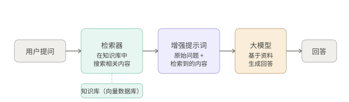
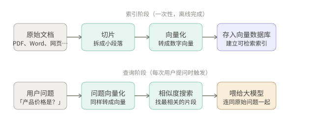

+++
title = "什么是 RAG：让大模型用上你自己的知识库"
date = 2026-03-25T12:00:00+08:00
draft = false
author = "Hex4C59"
description = "从检索增强生成的基本流程出发，说明索引、向量化、混合检索与重排序等关键环节，以及 RAG 与微调、Agent 的关系。"
summary = "解释 RAG 如何在回答前查找外部资料，并把相关片段交给模型使用；梳理切片、向量化、混合检索和重排序的作用与限制。"
tags = ["RAG", "Embedding", "向量检索"]
categories = ["ai"]
series = ["agent-engineering"]
series_order = 14
difficulty = "beginner"
article_type = "concept"
topics = ["rag", "retrieval", "embeddings", "vector-database", "agent"]
frameworks = ["OpenAI", "Anthropic"]
ShowToc = true
source_kind = "original"
lastmod = 2026-10-17
+++

你有没有遇到过这种情况：问大模型一个关于你公司产品的问题，它一本正经地给了你一个错误答案；或者问它最近发生的事，它说「我的知识截止到某某年，无法回答」。

如果没有额外提供资料或工具，模型不能仅凭固定的训练结果获取你公司的内部文档或新发生的事实。它即使生成了一个像样的回答，也不代表已经查过资料。

RAG（Retrieval-Augmented Generation，检索增强生成）的办法是：收到问题后，先从外部资料中查找相关内容，再把内容和问题一起交给模型。本文面向会写简单代码、没有检索系统经验的读者，按建立知识库、查询、生成回答的顺序解释这条流程。

---

## 大模型的知识局限

在讲 RAG 之前，先把问题本身说清楚。

大语言模型的知识来自训练数据。训练完成之后，模型的参数就固定了。它不会自动更新，不能访问互联网，更不知道你公司内部的文档、数据库、产品手册里写了什么。

这带来三类具体问题：

**知识过时**：模型的训练数据有截止日期。例如，若模型训练于 2024 年，又没有获得新资料，就不能仅靠训练数据确认 2025 年实际发生的事。

**缺乏私有知识**：你的内部 Wiki、客户合同、产品规格书从来没有出现在模型的训练数据里。模型对它们一无所知。

**幻觉**：模型可能生成听起来合理、实际却没有依据的内容，这里称为幻觉（Hallucination）。RAG 提供可查阅的资料，能让回答有依据；但资料可能过时、检索可能漏掉关键段落，模型也可能用错资料，因此仍需检查答案与来源是否一致。

解决这些问题有两条路：**微调（Fine-tuning）** 和 **RAG**。它们的本质区别是：

微调使用训练样本调整模型参数，也就是改变模型内部用于生成回答的数值。它可以用于调整回答方式；与 RAG 不同，更新效果依赖训练，而不是每次回答前读取资料。

RAG 是在模型回答之前，先从外部找到相关资料，把资料塞给模型，让模型基于这些资料来回答。就像考试时允许带参考书——模型不需要背下来，只需要知道怎么查和用。

如果主要需求是查阅经常更新的文档，RAG 的直接好处是：更新知识库不需要重新训练模型，也可以把检索到的来源附在答案旁边。检索、存储和模型调用仍有成本，不能仅凭采用 RAG 就判断总成本更低。

---

## RAG 的基本思路

RAG 的全称是 Retrieval-Augmented Generation（检索增强生成）。这三个词本身就说清楚了它的工作方式：

- **Retrieval（检索）**：从知识库里找相关内容
- **Augmented（增强）**：把找到的内容加进模型的输入
- **Generation（生成）**：模型基于这些内容生成回答

一句话概括：**收到用户问题后、生成回答前，先查知识库，再把相关内容和问题一起交给模型。**



*图 1：RAG 查询阶段的数据流*

这是最简单的 RAG 流程。现实中会更复杂，但核心逻辑就是这样。

---

## 知识库是怎么建立的

RAG 的问答流程（查询时）很直观，但在此之前，需要先把知识库建立起来。这个过程叫**索引（Indexing）**，发生在用户提问之前。



*图 2：离线索引与在线查询*

索引阶段通常只做一次（或当文档更新时重做），查询阶段在每次用户提问时都会触发。

### 第一步：切片（Chunking）

原始文档通常很长，无法整段放进模型的上下文。需要先把文档切成小片段，每个片段几百字左右。

切片听起来简单，实际有很多讲究。**切得太短**，每个片段缺少上下文，检索到的内容可能语义不完整；**切得太长**，片段包含太多无关内容，检索精度下降。

一种方式是按固定长度切分，例如每 500 个 token 切一段，并让相邻片段重叠 100 个 token。token 是模型处理文本时使用的计量单位，不等同于汉字数；这里的数字只是切片设置示例。重叠可以保留切割点附近的内容。另一种方式是沿段落、章节或主题变化处切分，尽量保留完整语义。

### 第二步：向量化（Embedding）

切好的文本片段，需要转换成「向量」——一串数字——才能被计算机高效地做相似度计算。

**向量（Embedding）**是语义的数学表示。意思相近的文本，转成向量后在数学空间里距离也更近。比如「猫喜欢睡觉」和「猫爱睡觉」，即使用词不同，它们的向量也会非常接近；而「猫喜欢睡觉」和「股市今天涨了」的向量则距离很远。

向量化通过专门的 Embedding 模型完成。常用的包括 OpenAI 的 `text-embedding-3-small`、Anthropic 推荐的 Voyage AI，以及各种开源模型。

### 第三步：存入向量数据库

向量化后的片段存入**向量数据库**（Vector Database）。向量数据库为「找出与这个向量最接近的 K 个向量」这类查询提供索引；K 表示希望返回的结果数量。常见的有 Pinecone、Weaviate、Qdrant、Chroma，或者用 PostgreSQL + pgvector 扩展。

### 查询时：找相关片段，塞进提示词

用户提问时，问题本身也经过同一个 Embedding 模型转成向量，然后在向量数据库里做**相似度搜索**，找出向量距离最近的几个片段——这些就是「最可能相关的内容」。

最后，把这些片段和用户的原始问题一起塞进提示词里，发给大模型。模型基于这些材料生成回答。

---

## 语义搜索为什么比关键词搜索更好

传统的关键词搜索（比如 Google 早期的方式）是「你搜什么词，我就找包含这些词的文档」。这有一个明显的问题：用词不同，就可能找不到。

比如你问「怎么退款」，知识库里的文档写的是「申请退货流程」。如果只按字面匹配，「退款」和「退货」用词不同，就可能漏掉这份文档；语义搜索则尝试按含义相近程度找到它。两者相关并不代表流程相同，检索后仍需核对内容是否真的回答了退款问题。

语义搜索不匹配词语，匹配的是**意思**。

但语义搜索也有弱点：对精确匹配不擅长。如果用户查询「错误码 TS-999」，语义搜索可能找到一堆关于错误码的通用文档，却偏偏漏掉那篇包含「TS-999」具体说明的文档，因为语义上它们都差不多相关。

因此可以**同时使用两种搜索**：向量相似度搜索按含义找资料，BM25 则根据查询词与文档用词的匹配情况评分，再把两者的结果合并排序。BM25 是一种关键词检索评分方法，适合补充错误码等字面信息。Anthropic 在 2024-09-19 发布的 Contextual Retrieval 实验报告了 49% 的检索失败率降幅，但所测组合还为每个片段补充了上下文，并同时用于向量检索和 BM25 索引，不能把这一数字直接归给普通混合检索。下面解释这个额外步骤与实验条件。

---

## 一个传统 RAG 的常见问题：上下文丢失

传统 RAG 有一个经典的陷阱，值得单独说明。

文档切片后，每个片段是独立的。假设你有一份 SEC 财报，里面有一段话：

> 「公司本季度营收同比增长 3%。」

这句话单独拿出来是没有意义的——哪家公司？哪个季度？读者完全不知道。但在原始文档里，前几段已经说清楚了是 ACME 公司 2023 年第二季度的数据。

**切片把这个上下文关系切断了。** 检索到这个片段时，模型看到的只是「增长了 3%」，无法知道是谁的数据。

Anthropic 提出的 Contextual Retrieval 先用模型结合整份文档，为每个片段生成简短的上下文说明。把说明加在片段开头后，再生成向量和建立 BM25 索引，分别称为 Contextual Embeddings 与 Contextual BM25。下面展示片段补充说明后的样子：

```
[上下文说明] 本段来自 ACME 公司 2023 年第二季度 SEC 财报，
             报告期上一季度营收为 3.14 亿美元。
[原始片段]   公司本季度营收同比增长 3%。
```

这样，单独返回这个片段时，模型也能看到补充的公司和报告期信息。不过，这段说明由模型生成，仍需核对是否准确；它不能代替原始来源。

Anthropic 该实验比较的是取前 20 个片段时的检索失败率。以 5.7% 为基线，Contextual Embeddings 将失败率降到 3.7%，相对降低 35%；结合 Contextual BM25 后降到 2.9%，相对降低 49%；再加重排序（Reranking）后降到 1.9%，相对降低 67%。它测的是“为片段补上下文，再用相应检索与重排”的组合，不是任意知识库采用向量检索加 BM25 都能得到的保证。

---

## 重排序：检索之后的精筛

向量数据库的相似度搜索通常会返回 Top-K 个结果（比如 Top-20、Top-50），但这些结果的排序不一定反映真实的相关度——向量相似度是一种近似，不是精确的相关性判断。

**重排序（Reranking）** 是在初次检索之后，让另一个模型结合问题给候选片段评分，再选出排名靠前的一部分交给生成模型。例如，先取 20 个候选片段，再选前 5 个；这里的 Top-K 就是按分数排列的前 K 项。评分仍是对相关性的估计，并非真实相关度的保证。

这一步希望减少送入模型的无关内容，但也增加了一次计算。如果候选集中根本没有答案，重排也找不回来；输入减少节省的成本和时间，还需与重排本身的开销一起计算。

---

## RAG 和 Fine-tuning 怎么选

这是最常见的问题，一张表说清楚：

| 维度 | RAG | Fine-tuning |
|---|---|---|
| 知识更新 | 随时更新知识库，无需重训练 | 知识更新需要重新训练 |
| 实施成本 | 无需为更新文档重新训练，但有检索与生成开销 | 需要准备训练样本并承担训练开销 |
| 私有数据保护 | 文档存于知识库，检索片段仍会作为模型输入 | 训练数据用于调整模型参数 |
| 可追溯性 | 可以标注答案来源 | 答案来源不透明 |
| 适合场景 | 知识频繁更新、需要引用来源、私有知识问答 | 改变模型风格/语气、高度专业化领域任务 |

简单判断标准：**如果你的问题是「模型不知道某些知识」，用 RAG；如果你的问题是「模型的行为方式不对」，用 Fine-tuning。**

选择前先区分需求：是让模型读到某份新文档，还是让它按特定方式回答？前者适合先考虑 RAG，后者可以考虑微调；两者也可以组合，不能仅凭名称决定效果。

---

## RAG 在 Agent 体系里的位置

讲了这么多，回到这个系列的主线：RAG 和 Agent 是什么关系？

在 Agent 的工具体系里，RAG 本质上是**一个感知类工具**——它让 Agent 能够「读取」存储在外部知识库里的信息。Agent 在执行任务时，可以随时调用 RAG 工具来查阅相关知识，就像人类工作时可以随时查阅文档一样。

```
用户任务：分析我们的竞品定价策略

Agent 执行：
  Step 1 → 调用 RAG 工具：检索「竞品A 产品定价」
           → 返回：内部竞品分析报告中的相关片段

  Step 2 → 调用 RAG 工具：检索「我们的定价历史」
           → 返回：内部价格变动记录中的相关内容

  Step 3 → 基于检索到的内容，生成分析报告
```

这就是为什么这个系列里有「RAG Agent」这个方向——它不只是一个孤立的技术，而是 Agent 工程里知识获取能力的核心组件。下一篇文章会专门讲如何把 RAG 集成进 Agent 系统，构建能够自动检索和利用知识的 Research Agent。

---

## 总结

RAG 解决的是一个根本性的问题：大模型训练后知识就固定了，但世界在变，你的私有数据也不在它的训练集里。

它的工作方式是：收到问题后先查相关资料，再把资料与问题一起交给模型，让模型基于资料回答。

实现上有三个关键环节：

**切片**决定了知识的粒度——切得太粗或太细都会伤害检索精度。要保留语义边界，避免在句子中间硬切。

**向量化和检索**决定了能否找到相关内容。语义搜索和 BM25 关键词搜索可以互补，是否优于单独使用，需要用自己的文档和问题检查。Anthropic 的 Contextual Retrieval 通过给每个片段加上上下文说明，进一步解决了切片导致的上下文丢失问题。

**重排序**是检索后的精筛——从粗糙的 Top-N 结果中挑出真正相关的，减少模型处理无关信息的负担。

这三个环节的质量共同决定了 RAG 系统最终的表现。而 RAG 系统的表现，直接决定了依赖它的 Agent 能否基于正确的信息做出正确的决策。

---

*上一篇：[什么是 Agent：从聊天助手到可执行系统](/agent/what-is-agent/)*

*下一篇预告：Research Agent 实战——用 RAG + Agent 搭建一个能自动检索、分析、汇总信息的研究助手*
