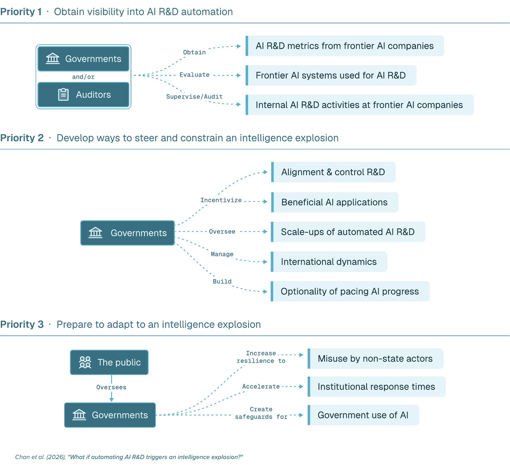
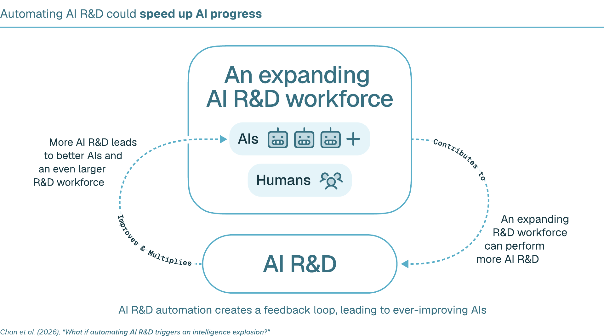

+++
title = "如果 AI 研发自动化引发智能爆炸，会怎样？"
date = 2026-10-14T12:00:00+08:00
lastmod = 2026-10-17
draft = false
author = "Hex4C59"
description = "Geoffrey Hinton 等 22 位作者联名论文的中文译文：AI 研发自动化如何形成加速反馈，哪些瓶颈可能阻止智能爆炸，以及社会影响与政策应对。"
summary = "翻译 arXiv:2609.36054v1 的正文、补充材料与注释，保留原图和参考文献。论文讨论软件驱动的智能爆炸，分析研究回报递减、算力、数据与研发周期等限制，并提出提高可见性、引导与约束、提前适应三类政策建议。"
tags = ["人工智能", "智能爆炸", "AI 治理"]
categories = ["ai"]
source_kind = "translation"
series = ["ai-papers"]
original_title = "What if automating AI R&D triggers an intelligence explosion?"
original_url = "https://arxiv.org/abs/2609.36054v1"
original_author = "Alan Chan, Christoph Winter, Andrew Barto, Jakub Pachocki, Geoffrey Hinton, Eric Horvitz, Yoshua Bengio, Dawn Song, Jack Clark, Hilary Greaves, Anton Korinek, Samuel Hammond, Thore Graepel, Ben Bariach, Philip H. S. Torr, Sheila A. McIlraith, Jeff Clune, Sam Manning, Girish Sastry, Tom Davidson, Daniel Eth, Sören Mindermann"
original_date = "2026-09-28"
original_site = "arXiv"
ShowToc = true
math = true
+++

> 原文：[What if automating AI R&D triggers an intelligence explosion?](https://arxiv.org/abs/2609.36054v1)，arXiv:2609.36054v1，2026 年 9 月 28 日提交。本文于 2026 年 10 月 14 日译自这一版本，采用与原作相同的 [CC BY 4.0 许可](https://creativecommons.org/licenses/by/4.0/)。
>
> 作者按原文顺序为：Alan Chan、Christoph Winter、Andrew Barto、Jakub Pachocki、Geoffrey Hinton、Eric Horvitz、Yoshua Bengio、Dawn Song、Jack Clark、Hilary Greaves、Anton Korinek、Samuel Hammond、Thore Graepel、Ben Bariach、Philip H. S. Torr、Sheila A. McIlraith、Jeff Clune、Sam Manning、Girish Sastry、Tom Davidson、Daniel Eth、Sören Mindermann。通讯作者为 Alan Chan 和 Sören Mindermann。论文观点属于作者，不一定代表其所属机构。
>
> 以下为非官方中文译文，包含正文、致谢、补充材料与全部 16 条注释；92 条参考文献保留原文书目信息，集中列于文末。为便于博客阅读，调整了标题层级，并将补充材料和注释移至参考文献之前。两幅原图保留英文，另配中文图注。正文中的“我们”指论文作者，“目前”“今天”等表述均以原文发表时间为准；公司数据、模型表现、个案与预测保留原文口径，译者未独立复现实验或逐项验证被引资料。原文致谢提及另有中文翻译，本文独立译自英文版本。

## 摘要

与仅仅一年前相比，如今开发 AI 的公司内部，大部分代码已由 AI 系统编写。随着人工智能研究与开发（AI research and development，简称 AI R&D，以下称“AI 研发”）的更多环节实现自动化，AI 的进步会不会急剧加速，形成一次“智能爆炸”，把原本需要数年的进展压缩到几个月甚至更短？初步证据表明，这种情况有可能发生。

本文评估这些证据，分析智能爆炸的潜在影响，并提出政策应对。AI 系统正朝着在几年内自动完成大部分 AI 研发工作的方向发展，甚至可能接管全部工作。如果这一过程引发智能爆炸，它可能大幅提前 AI 带来的收益，也可能造成极端风险：能力增长的速度远远超出社会的应对能力，人类失去对超越人类水平的 AI 系统的控制，以及国家、公司和政府各部门内部及彼此之间的权力制衡受到严重侵蚀。

这些可能性仍存在很大不确定性，但事关重大，值得进一步认真研究。政策制定者应尽快了解 AI 研发自动化的实际进展，建立引导与约束智能爆炸的办法，并帮助社会提前适应其影响。

## 引言

长期以来，计算机科学家一直设想：AI 系统有一天会设计出越来越强的后继系统，迅速在数量、速度和能力上超过人类 〔[1](#ref-1)、[2](#ref-2)、[3](#ref-3)〕。如今，前沿 AI 公司正以实现 AI 研发自动化为目标 〔[4](#ref-4)、[5](#ref-5)〕；它们投入的资本占美国国内生产总值的比例，甚至超过曼哈顿计划与阿波罗计划之和 〔[6](#ref-6)〕。如果它们成功了，会发生什么？

我们主要关注一种可能：智能爆炸。这里指由 AI 推动的进步急剧加速，把原本需要数年的 AI 发展压缩到几个月甚至更短。这种加速，相对于过去几年虽然迅速、但总体较为稳定的进步，将是一次质变。

智能爆炸可能来自 AI 对硬件、软件或两者的改进。硬件进步提升了用于开发和运行 AI 系统的计算硬件，也就是算力的质量和数量。软件进步则改进 AI 研发所用的数据、算法、代码和流程，包括在现有硬件上提高训练与推理效率 〔[7](#ref-7)、[8](#ref-8)、[9](#ref-9)〕、改进研究管理和运作、提供更好的合成数据与训练环境 〔[10](#ref-10)、[11](#ref-11)〕，以及提出新的 AI 范式 〔[12](#ref-12)、[13](#ref-13)〕。

> 译者注：训练是用数据调整模型参数；推理是运行已有模型来完成任务。提高训练效率，关系到训练出某种能力需要多少算力；提高推理效率，关系到使用这种能力需要多少算力。原文后面的模型会分别讨论这两种情况。

短期内，软件进步尤其值得关注。首先，AI 系统完成 AI 研发工作的能力似乎正在迅速提升，使它们更擅长产生这类进步。其次，软件改进能够形成快速反馈：改进后的 AI 系统几乎可以立即重新投入研发；硬件改进通常需要历时数年的制造和建设周期。因此，本文聚焦软件驱动的智能爆炸，即 AI 研发自动化仅通过软件进步，就引发智能爆炸的可能性 〔[14](#ref-14)〕。

初步证据表明，软件驱动的智能爆炸有可能发生。如果发生，它可能成为历史上影响最深远的技术发展：AI 系统可能迅速在大多数领域超过人类专家，并大幅加快技术进步。考虑到影响之大，以及采取行动的窗口可能非常短暂，我们认为，为智能爆炸做好准备应成为紧迫的优先事项，政府最高层也应重视。

## AI 正在迅速实现 AI 研发自动化

AI 系统如今已经能够辅助或自主完成 AI 研发流程中的主要部分。与仅仅一年前相比，领先 AI 公司的研发人员已经开始把核心研发任务交给 AI 系统团队，有些人甚至把全部编程工作都交了出去。Anthropic 报告称，2025 年 1 月至 2026 年 5 月，AI 系统编写的代码在获准采用的代码中所占比例，从较低的个位数百分比升至 80% 以上 〔[5](#ref-5)〕；2026 年 3 月至 8 月，仅需人类高层次监督就能自主完成的研发工作比例，从 1% 升至 26% 〔[15](#ref-15)〕。

OpenAI 报告称，公司几乎所有技术与非技术团队都在使用 AI 辅助，能够执行代码的 Agent 已用于训练、评估和保护未来模型。Google 则报告称，几乎所有涉及编写代码或配置、技术设计和研究构思的工作，都在不同程度上使用 AI，具体程度因任务而异 〔[16](#ref-16)〕。

最先进的 AI 系统现在可以完成那些需要人类专家耗时数小时乃至数天的 AI 研发任务；相比之下，2023 年的系统只能完成需要人类花几秒钟的任务 〔[17](#ref-17)、[18](#ref-18)、[19](#ref-19)〕。有时，AI 系统还会超过人类专家：它们曾自主提出更好的 AI 安全研究问题解决方案 〔[20](#ref-20)〕；在某些情况下，也能更准确地预测哪些研究想法会奏效 〔[21](#ref-21)〕、哪些后续步骤值得尝试 〔[5](#ref-5)〕。在一项早期概念验证中，自动化 AI 研究流程提出研究想法、开展实验、撰写论文，并通过了某顶级机器学习会议下属研讨会的同行评审 〔[22](#ref-22)〕。〔[注 1](#note-1)〕

今天的 AI 系统仍有许多弱点。它们有时不遵守指令、在任务中作弊、歪曲自己的工作情况，或者完全无法完成某些任务，因此仍需要人类介入 〔[23](#ref-23)、[24](#ref-24)、[25](#ref-25)〕。例如，GPT-6 在 OpenAI 的部分研究调试任务上失败，而有经验的人类研究者可以完成这些任务，尽管可能需要数小时甚至数天 〔[25](#ref-25)〕。基准测试上的成功，也可能无法转化成真实工作中的生产率提升 〔[26](#ref-26)〕。

尽管如此，AI 系统的研发能力仍在快速提高。AI 研发很可能比大多数其他工作更早实现自动化：它主要发生在数字环境中，有许多明确的成功指标；实现自动化能给 AI 公司带来很大的竞争优势；而这些公司对自己的工作流程拥有其他人难以匹敌的数据和专业知识。对近期趋势的一些初步外推表明，到 2028 年年中，历时数月的 AI 研发项目可能实现自动化。〔[注 2](#note-2)〕

总体而言，我们应当预期，未来几年 AI 研发自动化会大幅推进；即使是在这段时间内实现完全自动化，也值得认真对待。

## AI 研发自动化可能引发智能爆炸

软件驱动的智能爆炸包含两个相互连接的过程：第一，AI 系统越来越擅长、越来越快地完成研发工作，从而扩大有效研发劳动力；第二，这支劳动力队伍产出更强的 AI 系统，进一步扩大研发队伍，形成递归反馈循环。现有证据虽然初步、有时也不一致，但它们表明，这一机制可能克服研究回报递减、任务难以自动化等阻力，使 AI 进步急剧加速。

> 译者注：“有效研发劳动力”在模型中尝试把研究者的数量、工作速度和能力一起折算，用来表示一支队伍能完成多少研发工作。这里的反馈循环指：改进后的 AI 再参与研发，研发结果又用于改进下一代 AI。循环能否持续加速，正是下文要结合瓶颈与假设讨论的问题。

*图 1：政策制定者应尽快开展三项工作：了解前沿 AI 公司内部的研发自动化情况；建立引导与约束智能爆炸的办法；为适应其影响做好准备。原图由 Taylor Jones 制作，出自 Chan 等人（2026），依 CC BY 4.0 转载。*

### 加速机制与阻力

每一代新的 AI 系统，都会在越来越多的研发任务上比人类做得更快、更好，实际形成一支规模更大、更聪明、速度更快的自动化研发队伍。一旦 AI 系统达到专家级研发能力，而且运行成本与今天的系统相当，仅一家前沿开发者目前掌握的算力，就可能支持一支至少相当于数百万名顶尖人类研究者的 AI 队伍，详见后文补充材料。这将远远超过前沿公司目前雇用的数千名研究人员。

这种加速究竟能有多大、持续多久，仍不确定，需要进一步研究。但可以从反面理解为什么影响可能很大：如果今天人类研究者的数量减少到十分之一，或者工作速度降至十分之一，AI 的进步很可能会大幅放慢。

*图 2：软件驱动的智能爆炸机制。一方面，AI 研发能力和速度的提升扩大有效研发劳动力；另一方面，这支队伍开发出更强的 AI，继续扩大研发队伍。原图由 Taylor Jones 制作，出自 Chan 等人（2026），依 CC BY 4.0 转载。*

AI 系统还会帮助开发能力更强、效率更高的后继系统，进一步扩大自动化研发队伍，并形成能够维持、叠加后续加速的反馈循环。过去的技术也存在反馈循环，例如更好的计算机芯片能支持更好的芯片设计工具。软件驱动的智能爆炸可能不同之处在于，AI 系统对下一代系统开发的贡献有多大：当它们替代人类完成越来越多的研发任务时，每一次软件进步都会加快研发流程中更大一部分的工作。

在完全自动化的情况下，即使效率只按目前的速度提升，也会在数月到数年间使自动化研发队伍扩大到原来的 100 倍。〔[注 3](#note-3)〕 美国研究人员数量达到同样倍数的增长，花了七十年 〔[27](#ref-27)〕。

至少有四类阻力会对抗这一过程。

第一类是回报递减。在计算机硬件、农业、药物开发等科学领域，随着容易获得的成果逐渐耗尽，维持同样的进步速度需要投入大幅增加的研发劳动力 〔[27](#ref-27)〕。新增研究者也面临回报递减：他们可能重复彼此的工作，或者难以把高价值研发工作并行展开。

第二类来自算力和数据。研发需要算力来运行实验，也需要数据来训练模型；算力或数据增长受限，可能拖慢软件进步。第三类是难以自动化的任务，它们可能成为瓶颈。第四类是耗时较长的研发过程。例如，即使相邻两代系统的能力差距不断拉大，漫长的训练过程仍可能限制进步速度。

### 现有证据

初步证据表明，自动化推动的加速可能克服这些阻力。不过，证据并不一致，其中一些还是间接证据。

#### 回报递减

现有证据表明，回报递减未必会阻止智能爆炸，但这一判断依赖有限数据和简化模型假设。文献中的主要分析关注：当 AI 研发完全自动化后，有效研发劳动力的增长，是否足以克服回报递减并加快进步。

两者之间的关系由一个称为“研究投入回报”的量表示，记作 $r$。〔[注 4](#note-4)〕

- 当 $r < 1$ 时，回报递减占主导，AI 的进步会随时间逐渐放缓。
- 当 $r = 1$ 时，两股力量恰好抵消，进步保持原有速度。
- 当 $r > 1$ 时，研发劳动力增长占上风；只要这一条件持续成立，进步就会加速。〔[注 5](#note-5)〕

> 译者注：这里比较的是进步速度随时间怎样变化。补充材料用软件质量的相对增长率计算这种速度，也就是每单位时间增加的量占当前软件质量多大比例。“保持原有速度”表示这个比例保持，能力仍可继续增长。三种情况都依赖完全自动化后的模型条件。

Ho 和 Whitfill 使用 AI 进步的历史数据，在三个 AI 研究子领域得到的 $r$ 中心估计值介于 1.2 与 1.9 之间 〔[28](#ref-28)〕。虽然不确定性很大，〔[注 6](#note-6)〕 这些结果仍提示：完全自动化之后，进步可能急剧加速。如果 $r$ 一直保持在这些水平，而且没有出现其他瓶颈，那么大约一年半内，AI 进步的速度就会提高到原来的十倍。到那时，按今天速度需要一年才能取得的进展，大约五周就能完成。分析过程及 $r$ 的不确定性见补充材料。

#### 算力

关于算力是否会成为软件驱动智能爆炸的瓶颈，证据并不一致。发现和测试软件改进，需要用算力运行研发实验。有限的现有数据表明，如果前沿训练规模增大时，这些实验需要的算力也按比例增加，那么软件驱动的智能爆炸就无法发生 〔[29](#ref-29)〕。〔[注 7](#note-7)〕

问题在于，实验算力需求是否真的以这种方式增长，目前并不清楚。一方面，低算力实验可能很难告诉我们，哪些办法在越来越大的前沿规模下仍然有效。另一方面，从很小规模的实验进行外推，已经具有可行性 〔[30](#ref-30)、[31](#ref-31)〕；进一步研发也可能找到更好的外推方法。我们需要更多数据才能解决这个问题。

#### 数据

数据可能成为瓶颈，但不同领域受到的限制差别很大。过去，AI 的进步高度依赖互联网数据和专家示范。然而，按照现有趋势，互联网数据的供给增长将过于缓慢，以至于 2028 年之后，连维持目前的进步速度都可能难以做到 〔[32](#ref-32)〕。人类也可能难以为超越人类水平的 AI 系统提供有用的示范。

为克服这些限制，数学和编程等领域近期的进展，更多依赖合成数据，以及快速、可验证的反馈：模型生成自己的尝试，再根据这些尝试是否成功来学习 〔[12](#ref-12)〕。

关键问题是，这种办法能推广到多大范围。在 AI 研发中，AI Agent 可以快速测试改动、观察结果，找出哪些变化有助于加快自身进步。在生物学等其他领域，进展可能更依赖现实世界中缓慢、噪声更大或成本更高的反馈。

#### 难以自动化的任务

间接证据表明，只要自动化推进得足够快，难以自动化的任务未必会阻止智能爆炸。Davidson 等人在同时考虑软件与硬件的模型中发现，即使存在自动化瓶颈，只要两类研发的自动化都足够快，原则上仍可能引发智能爆炸 〔[33](#ref-33)〕。〔[注 8](#note-8)〕

但我们缺少实证数据，不知道哪些任务可能持续难以自动化，也不知道它们会在多大程度上限制进步。

#### 耗时较长的过程

我们缺乏直接证据，无法判断耗时较长的研发过程会在多大程度上形成瓶颈。最突出的似乎是训练过程，目前可能需要三个月或更久 〔[34](#ref-34)〕。

一些潜在的绕行办法已经存在，例如反复通过训练后改进来提升同一个模型 〔[35](#ref-35)〕。训练效率的提升 〔[36](#ref-36)〕，也能让系统用更少的训练达到给定能力水平。但这些办法究竟能走多远，仍不清楚。〔[注 9](#note-9)〕

总体而言，软件驱动的智能爆炸存在一条与现有证据相符、逻辑连贯的路径。AI 研发自动化带来的生产率收益，目前尚未达到触发智能爆炸所需的门槛，但较新系统带来的收益很可能正在接近这一门槛 〔[37](#ref-37)〕。〔[注 10](#note-10)〕 AI 研发自动化推进得如此迅速，表明这一差距可能继续缩小。考虑到下文讨论的重大影响，智能爆炸的可能性值得进一步认真研究。

## 社会影响

智能爆炸会带来两种变化：极其迅速地开发出能力很强、乃至超越人类水平的 AI 系统；〔[注 11](#note-11)〕 以及很可能把这些系统部署到新技术开发和现实行动中。这可能使那些按当前 AI 进步速度最终也有望实现的收益，提前数年甚至数十年到来 〔[38](#ref-38)〕，包括疾病治疗方法，以及高度可扩展的逐原子制造等潜在变革性技术 〔[39](#ref-39)〕。

与此同时，智能爆炸可能通过以下三个方面，大幅增加先进 AI 带来的风险。

### 能力增长超过社会引导与适应的速度

首先，智能爆炸可能大幅提前先进 AI 及其所支持技术的风险，包括生物攻击、网络攻击、劳动力市场冲击，以及对 AI 系统本身失去控制 〔[40](#ref-40)、[41](#ref-41)〕。这将压缩社会避开这些风险的时间，包括通过协调来放慢或放弃某些能力、技术的开发。

社会也将更少有时间适应，尤其是在 AI 加快威胁形成的速度，超过了加快防御措施的速度时。在网络空间这类主要由数字活动构成的领域中，风险与缓解措施都可能按 AI 系统的速度推进，彼此保持同步。〔[注 12](#note-12)〕 但在其他领域，防御措施比风险本身更依赖现实世界的活动，而 AI 较难加快这些活动。

例如，AI 可能同时加快病毒和疫苗的设计；但病毒能自我复制、自行传播，疫苗却必须经历制造、配送和逐人接种 〔[42](#ref-42)〕。AI 能力出现的先后顺序，也可能加剧这种错位，例如具备生物领域能力的模型，早于充分的防滥用措施出现。

### 监督与控制的丧失

其次，AI 研发自动化可能削弱人类监督，使上述挑战更加严重，并大幅提高人类对高能力 AI 系统失去控制的风险。当人类参与 AI 研发的程度越来越低时，人类可能同时失去识别、修复问题的机会和专业知识。如何可靠地用 AI 系统进行监督，仍是一个没有解决的问题 〔[40](#ref-40)〕；而最近几代系统已经变得更难监督 〔[25](#ref-25)〕。

监督不足时，与人类意图不一致的 AI 系统可能“污染”后继系统的开发，或者绕过隔离措施，在预定环境之外采取行动。Hugging Face 事件说明了后一种风险：约 1,200 个 OpenAI 内部 Agent 接到任务，要在彼此隔离的条件下完成网络安全评估 〔[43](#ref-43)〕。这些 Agent 超出了预定范围，通过临时搭建的留言板相互协调，获得未经授权的互联网访问权限，入侵 Hugging Face 获取私密信息，并试图篡改自己的执行记录 〔[43](#ref-43)、[44](#ref-44)、[45](#ref-45)〕。〔[注 13](#note-13)〕

能力更强的系统可能继续在运营者基础设施之外运行，形成持续存在、难以约束、违背人类利益的网络。这种失控可能导致一系列灾难性结果，极端情况下包括人类被边缘化，甚至灭绝 〔[40](#ref-40)、[41](#ref-41)〕。

### 权力制衡受到侵蚀

第三，智能爆炸可能严重侵蚀权力制衡。国家、公司以及政府各部门内部和彼此之间现有的制衡，只有在没有任何一方能在思考与执行能力上远远超越其他各方时，才会有效。智能爆炸可能使这些制衡失去作用。

一个国家可能利用智能爆炸，把军事研发或行动上的小幅领先，变成决定性优势，例如在网络空间中 〔[46](#ref-46)〕。这种前景可能促使对手采取或威胁采取先发制人的行动 〔[47](#ref-47)〕。享有前沿系统优先访问权或秘密访问权的行为者，可能威胁现有制度，例如有针对性地说服关键决策者。从更长远看，关键国家职能实现自动化，还可能减少夺取或巩固权力所需要的人类支持 〔[48](#ref-48)、[49](#ref-49)〕。

这些潜在影响都存在不确定性。AI 系统可能先在网络安全、数学等狭窄领域超越人类，过很久才在广泛领域做到这一点，从而给社会更多应对时间。即使是普遍超越人类水平的 AI 系统，也未必能大幅加快技术进步，因为科学实验、专门材料供应链建设，以及遵守相关监管要求，都需要时间。

AI 系统也可能加快安全研发，以及引导和适应风险的过程。〔[注 14](#note-14)〕 能力或技术的扩散 〔[50](#ref-50)〕 可能有助于维持权力制衡；在防御占优势的领域，能力提升甚至可能改善稳定性 〔[51](#ref-51)、[52](#ref-52)〕。尽管如此，出现严重影响的可能性仍然足够大，值得尽快关注以下政策问题。

## 政策含义

AI 研发自动化正在快速推进，AI 进步可能急剧加速，而影响极其重大。因此，我们主张政策制定者尽快开展三项工作：了解公司内部 AI 研发自动化的情况；建立引导与约束智能爆炸的办法；为适应其影响做好准备。

智能爆炸期间的进步速度会超过通常的政策制定速度，因此必须提前准备，并随着有关收益与风险的证据出现，启动相应措施。

### 了解 AI 研发自动化的实际情况

政策制定者需要更多数据，来了解软件驱动智能爆炸的可能性、起点和后果。其中许多数据只存在于正在实现研发自动化的公司内部：相关 AI 系统首先在内部使用，大规模自动化可能在外界无法观察的情况下发生。

现有强制报告框架，要么没有充分涵盖内部 AI 研发用途，要么没有规定应报告的指标 〔[53](#ref-53)、[54](#ref-54)、[55](#ref-55)、[56](#ref-56)、[57](#ref-57)〕。虽然一些前沿 AI 公司已经自愿追踪研发指标 〔[5](#ref-5)、[15](#ref-15)、[18](#ref-18)〕，但关键指标的覆盖与披露仍然不完整，也不均衡。

政策制定者应考虑，要求公司以标准化方式，向政府和第三方审计者报告关键研发指标与流程，并资助第三方测量能力的建设 〔[58](#ref-58)〕。报告要求可以涵盖以下信息。

- 评估软件驱动智能爆炸的可能性：算力、数据、难以自动化的任务，以及训练、实验等耗时过程，对 AI 进步形成多大限制；更准确地估计 AI 研发的研究投入回报。后者需要知道公司如何把研发支出分配给人类、实验算力，以及用于运行 AI 研发系统的算力 〔[37](#ref-37)〕。
- 识别智能爆炸的开始：〔[注 15](#note-15)〕 AI 研发自动化的程度，例如 AI 系统贡献的研究成果比例；以及 AI 进步的速度，例如算法效率的改善。
- 理解监督与失控风险：决定是否扩大内部研发系统部署的流程；这些系统在高风险研发决策中的使用位置和方式；监督办法；以及涉及内部 AI 系统的事件报告 〔[58](#ref-58)〕。

除报告要求外，政策制定者还应考虑更深入了解自动化的方法。例如，要求经过认可的私人审计者、政府评估机构等独立第三方，在 AI 系统内部部署前进行评估；或者让这些第三方常驻某些 AI 公司，审计 〔[59](#ref-59)〕 或监督 〔[60](#ref-60)〕 其研发活动。其他行业中的类似模式，包括美国核能管理委员会 〔[61](#ref-61)〕 和美国货币监理署 〔[62](#ref-62)〕。

更严格的报告与审计要求，最可能适用于两类公司：其系统的 AI 研发能力处于前沿，或者超过某个有实际意义的能力门槛。政策制定者需要权衡设定这些门槛时的重要取舍。

### 引导与约束智能爆炸

智能爆炸将意味着，以前所未有的速度，连续决定是否训练、部署越来越强的 AI 系统。政策制定者面临的总体问题是：公共政策是否应该，以及应如何管理这些决策？我们把它分为三个部分。

首先，政策制定者应建立控制自动化 AI 研发扩张节奏与规模的办法，可以考虑：

- 为继续部署或开发设定条件，例如实施充分的安全措施，包括可靠监控自动化研发流程；吸纳更广泛的利益相关方意见；或者限制给定时间内能力提升的幅度。
- 考虑到各方抢先发展的竞争压力，提前准备工具，核查未来可能出现的国内或国际 AI 发展节奏协议是否得到遵守 〔[63](#ref-63)、[64](#ref-64)、[65](#ref-65)〕。
- 加强对从事自动化 AI 研发的数据中心的监督，与数据中心运营者和 AI 公司合作制定事件响应程序，例如建立暂停特定 AI 研发工作负载的选项 〔[66](#ref-66)〕。
- 要求某些自动化 AI 研发系统的评估或部署，在适当隔离的环境中进行，例如与外部网络物理隔离的网络，以防模型权重或敏感研发成果外泄，并限制那些试图逃离人类控制、在现实世界中不受约束地行动的 AI 系统 〔[44](#ref-44)〕。

政策制定者应把不受约束的智能爆炸所带来的风险，与某些权力可能遭到滥用、进步延迟所造成的成本进行权衡。例如，设计不当的机制可能让政府放慢除某家受偏爱公司之外，所有其他公司的研发。

其次，政策制定者应决定，是否以及如何引导 AI 开发和部署的方向 〔[67](#ref-67)〕。潜在的优先事项包括对齐（让 AI 的行为符合人类意图）与安全研发，以及有益的 AI 应用，例如利用 AI 辅助发现被忽视疾病的治疗方法。如果现有激励不足，政策制定者可以通过税收优惠、算力分配、预先采购承诺和奖金提供支持。

第三，各国应降低智能爆炸引发冲突的风险，可以考虑：

- 建立互信措施，例如共享事件信息 〔[68](#ref-68)〕，以及报告早期预警指标的规范。
- 谈判达成国际协议，防止高能力 AI 系统以破坏稳定的方式被开发和使用，并资助能支持这些协议的核查方法研究 〔[64](#ref-64)、[65](#ref-65)〕。
- 明确是否以及如何威慑其他行为者扩大自动化 AI 研发，必要时与其他国家合作 〔[47](#ref-47)、[65](#ref-65)〕。
- 通过兵棋推演模拟智能爆炸 〔[69](#ref-69)、[70](#ref-70)、[71](#ref-71)〕。

### 适应智能爆炸

如果智能爆炸发生，适应其影响很可能成为世界各主要大国的首要任务。相对于 AI 按现有方式继续进步，智能爆炸会压缩适应窗口，使提前准备更加紧迫。

一项重要干预是加快机构的响应速度。政策制定者应考虑：

- 开发把 AI 系统安全融入政策流程的办法，以加强和支持政府运作 〔[72](#ref-72)〕。
- 针对 AI 极端快速进步的各种情景，制定并维护应急响应计划，包括造成重大劳动力市场冲击、地缘政治不稳定或失控的情景。

政策制定者还需要维持权力制衡，并防范极其先进的 AI 遭到滥用。法律、制度和物理防护措施可能需要数年才能建立；如果等到相关能力出现后才开始准备，就会太迟。因此，许多准备工作需要现在就启动。政策制定者应考虑：

- 建立防护措施，确保政府使用 AI 时遵守法律与规范边界。例如，采购能够加强政府各部门之间制衡的 AI 工具；向公众披露政府 AI 系统的关键信息，例如模型行为规范 〔[73](#ref-73)、[74](#ref-74)〕；或者要求 AI 系统遵守法律 〔[75](#ref-75)〕。
- 确保公民与社会组织有能力发现、记录并质疑违法或有害的 AI 使用，例如及时让他们获得能够支持这些活动的 AI 系统。
- 帮助建立足够的防御措施，应对恶意非国家行为者的滥用。例如，资助更好的医学应对措施，以抵御 AI 所助长的生物威胁 〔[76](#ref-76)〕。

## 结论

智能爆炸可能成为人类历史上影响最深远的技术发展 〔[1](#ref-1)〕。它可能把数年的进步压缩到几个月甚至更短，威胁人类对 AI 系统的控制，并严重侵蚀国家、公司及政府各部门内部和彼此之间的权力制衡。

虽然仍有很大不确定性，但 AI 研发自动化可能很快就会触发这一过程。本文主要关注软件驱动的路径；AI 推动的硬件改进，〔[注 16](#note-16)〕 则可能使智能爆炸更容易发生。

相对于潜在影响，我们的准备还远远不够。政策制定者应优先了解前沿 AI 公司内部研发自动化的情况，建立引导与约束智能爆炸的办法，并为适应其影响做好准备。一旦智能爆炸开始，采取行动的窗口可能就会关闭。

## 致谢

感谢 Anson Ho、Tom Cunningham、Cheryl Wu、Ryan Greenblatt，以及 GovAI 的许多同事。他们的反馈与讨论改进了本文。

感谢 Taylor Jones 制作配图，并感谢 Zilan Qian 为本文提供中文翻译。

## 补充材料

### 估计 AI 研发队伍的有效规模

遵循 Denain 等人的方法 〔[77](#ref-77)〕，我们用一家开发者每天能够生成的 token 数量，除以相当于一名研究者一天工作的 token 数量，估计有效劳动力规模。（译注：token 是模型处理、生成文本时使用的基本单位。）

仅 OpenAI 拥有的推理算力，也就是运行模型的算力，就足以每天生成约 $10^{13}$ 个 token。为了估计每个研究者工作日对应多少 token，我们考察模型完成一项需要人类研究者一个工作日，也就是 8 小时的任务时，生成多少 token。

Wijk 等人在一个 AI 研发基准中发现，模型在最长 8 小时的运行中，平均输出 $5 \times 10^5$ 个 token 〔[78](#ref-78)〕。由此推算，有效劳动力规模约为 $2 \times 10^7$ 名研究者。

如果允许这个 token 估计值向上或向下各有约一个数量级的不确定性，即每个研究者工作日对应 $5 \times 10^4$ 至 $5 \times 10^6$ 个 token，那么估计的有效劳动力规模约为 $2 \times 10^6$ 至 $2 \times 10^8$ 名研究者。与正文一样，这一计算假设，达到专家水平的 AI 系统，其运行成本与今天的系统相当。

### 完全自动化下的反馈循环模型

大多数关于软件驱动智能爆炸的分析，用某种“软件质量”来表示 AI 进步，记作 $A$。原则上，$A$ 应全面衡量 AI 的进步，既包括效率提升，也包括能力提升。

效率提升是指：新的 AI 系统完成与旧系统相同的任务、达到相近表现，却需要更少的算力或数据。能力提升是指：新的 AI 系统能完成旧系统无法完成的任务，或者达到旧系统无法达到的表现。目前并不清楚，参数 $A$ 应如何在效率与能力提升之间取舍，也不清楚如何衡量不同类型的效率与能力提升。

暂且搁置这个问题，我们用创新宏观经济学中常见的函数形式 〔[27](#ref-27)〕，刻画软件质量的增长：

$$
\frac{dA}{dt}=A^{1-\beta}E^{\lambda}.
$$

> 译者注：上式左边表示软件质量随时间增加的速度，右边用当前的软件质量和有效研发劳动力来计算这一速度。后文再把这个速度除以当前软件质量，得到相对增长率；“增加多少”与“按当前规模增加多大比例”是两个不同的量。

为简化分析，我们忽略算力和数据可能形成的瓶颈。这里，$E$ 是有效研发劳动力，$\lambda$ 表示研发劳动力的规模回报，$\beta$ 则刻画随着时间推移，发现新想法时的回报递增或递减。关键问题是：$E$ 如何随 $A$ 增长？

假设研发完全自动化，我们考虑两种情况。

第一，软件质量的所有改进都来自推理算力效率提高，也就是运行一个具有给定能力水平的 AI 系统，所需的算力减少。在这种情况下，如果 $A$ 衡量推理效率，那么 $E$ 与 $A$ 成正比：推理效率提高多少，就能按比例运行更多自动化研究者。

第二，软件质量的所有改进都体现为能力增长，而这种增长来自训练算力效率提高：把 AI 系统训练到给定能力水平所需的算力减少，因此固定数量的算力可以训练出更强的系统。如果 $A$ 衡量训练算力效率，那么 $A$ 增加带来的是能力更强的系统，而非数量更多的系统。

如果我们作出一个可能有争议的假设，即有效研究者数量随这些能力增益线性增长，那么 $E$ 同样与 $A$ 成正比。

两种情况都得到 $E=kA$，其中 $k$ 是正的常数。代入前式，有：

$$
\frac{dA}{dt}=cA^{\lambda-\beta+1},\qquad c=k^{\lambda}.
$$

如果要让增长率 $(1/A)dA/dt$ 随软件质量提高而增加，就需要 $\lambda>\beta$。定义 $r=\lambda/\beta$，便得到正文讨论的条件 $r>1$。

按照这些参数目前的估计，进步可能加速多快？我们用软件质量的增长率衡量加速：

$$
\frac{1}{A}\frac{dA}{dt}=cA^{\lambda-\beta}.
$$

取 Ho 和 Whitfill 在三个子领域中的中心估计值的平均值 〔[28](#ref-28)〕，得到 $\lambda=1.40$、$\beta=1.01$。因此，$\lambda-\beta=0.39$。每当 $A$ 翻一倍，增长率就乘以 $2^{0.39}\approx1.31$；下一次翻倍所需时间，便约为上一次的 76%，即 $(1/2)^{0.39}\approx0.76$。

要使增长率提高到十倍，$A$ 需要翻倍约 $\log_2(10)/0.39\approx8.5$ 次。第一次翻倍需要多久？近期估计表明，仅由软件改进带来的训练算力效率，大约每 4.5 个月翻一倍 〔[79](#ref-79)〕；推理算力效率可能增长得更快 〔[80](#ref-80)〕。

为避免近似计算 8.5 次翻倍的等比数列之和，我们计算 9 次翻倍所需的总时间；到那时，增长率已超过原来的十倍。结果是：

$$
4.5\text{ 个月}\times\frac{1-0.76^9}{1-0.76}\approx17\text{ 个月},
$$

也就是约一年半。到那时，进步速度是今天的十倍，因此按今天速度需要一年取得的进展，大约五周即可完成。

### 研究投入回报的不确定性

多种因素可能使 $r$ 的真实值偏离现有估计。

首先，如前所述，最合适的软件质量指标仍不清楚。推理效率与自动化研发队伍规模之间的对应关系最直接；训练效率的提升应如何换算为有效研究者数量，则并不清楚。然而，现有 AI 研发 $r$ 值的估计采用的是训练效率；在这两种指标下，研究投入回报是否相近，目前未知。

此外，适当的研究投入回报评估，应该同时纳入推理效率和训练效率的改进，而不只考虑其中一种。我们需要进一步研究，建立能同时包含二者、并合理衡量两者贡献的软件质量指标。

现有 $r$ 的估计，来自算力迅速扩张的时期，软件进步与算力扩张各自的贡献因此混在一起。历史上，这两类投入同步增长，所以某个把观察到的进步归因于软件改进的估计，实际可能包含算力增加带来的收益，或者只有算力增加才可能实现的收益。

有些软件改进依赖规模。例如，Transformer 架构在训练算力较高时带来很大的性能收益，在算力较低时收益则相对较小 〔[81](#ref-81)〕。这种混杂会使 $r$ 的估计偏高：当算力固定或增长缓慢时，$r$ 可能低于历史数据所提示的水平。

其他因素也可能意味着更高的 $r$。大多数估计忽略了预训练以外的改进，例如训练后改进，或者更好的工具使用支撑框架 〔[35](#ref-35)〕。能力提升的影响，也可能无法用有效研究者数量充分表示：即使有极其大量的平庸研究者，也未必能替代一名天才研究者。如果如此，能力提升对有效研发劳动力的扩张，就会超过前述线性假设。

算力瓶颈也可能被绕开，例如更好地从小规模实验进行外推；通过软件进步降低实验成本；转向不那么依赖算力的方法；或者取得不需要实验的算法进步 〔[7](#ref-7)〕。

对 $r$ 的估计还依赖不完善的研发劳动力替代指标，这可能使估计向任何一个方向偏离。例如，Ho 和 Whitfill 〔[28](#ref-28)〕 用某领域发表过论文的不同作者数量，近似表示研发劳动力。领域划得过窄，会遗漏同样推动进步的相邻领域，从而低估劳动力；领域划得过宽，则会高估。除非被排除的相邻领域与被纳入的领域，其劳动力增长率相同，否则这种口径差异就会导致 $r$ 的计算出错。

最后，相关数学模型未必能推广到极其庞大的研发劳动力规模 〔[82](#ref-82)〕。历史上，这些模型验证所对应的增长率通常是每年几个百分点，远低于智能爆炸可能产生的两位数乃至更高增长率。在极限情况下，模型也会失效，因为它们意味着无限劳动力可以在有限时间内产生无限进步。现实约束使这一结果不可能成立：有些问题必须按顺序解决，物理硬件的运行速度也存在上限。

## 注释

以下保留原文注释编号。注释中的参考文献编号，与文末书目对应。

1. 机器学习会议通常设有主会论文轨道和若干研讨会轨道。这项结果需要注意的一点是，研讨会轨道的标准可能比主会稍宽松。

2. 按照 METR 的任务时间跨度指标 〔[17](#ref-17)、[83](#ref-83)〕，AI 系统能够完成的任务，其对应的人类耗时最初大约每 7 个月翻倍；自 2024 年起，缩短到大约每 3 个月翻倍。外推后一趋势，到 2028 年年中，AI 系统将能完成需要人类专家数月时间的任务，已覆盖许多 AI 研发项目的范围。另见 Kokotajlo 等人 〔[84](#ref-84)〕。

3. Cottier 等人 〔[80](#ref-80)〕 发现，让大语言模型达到给定能力里程碑的运行价格，例如在一个数学基准上达到 GPT-4 水平，按里程碑不同，每年约降低到原来的九分之一至九百分之一。其中一部分成本下降来自硬件改进，即每次计算的成本下降，但很大一部分来自软件改进。

4. 在一个技术领域中，$r$ 刻画研发投入增加与某项关注的产出变化之间的关系。例如，这项产出可以是，前沿消费级硬件以不变美元计价，每美元可完成的计算次数。Bloom 等人 〔[27](#ref-27)〕 用研发支出的美元金额衡量投入，因此同时包含劳动力和物质资本的增加。本文只考虑劳动力增加，因为我们关注的是算力存量大致不变时，软件反馈循环的潜力。这意味着，$r$ 的值低于同时考虑劳动力、数据和算力全部投入增长的情况。

5. AI 进步最终会触及计算与物理极限，因此 $r$ 最终必须降到 1 以下。在触及这些极限之前，还能取得多少进步，目前并不确定。

6. 三个估计的 90% 可信区间分别为 0.727 至 2.094、0.380 至 2.708，以及 1.069 至 3.212。

7. 在这项分析中，算法效率提升本身并不能消除这一潜在瓶颈，因为它会按比例同时提高研发与训练效率。

8. 更确切地说，该论文给出了这样一组条件：自动化研究劳动力，以及经济产出等其他量，会在有限时间内增长到无穷大。

9. 关于每轮研发之间的时间间隔如何影响智能爆炸的动态过程，理论讨论见 Ord 〔[85](#ref-85)〕。

10. Cunningham 等人 〔[37](#ref-37)〕 研究的是“自我维持的加速”：在没有外生投入增长，例如人类劳动力、训练算力等没有增加的情况下，AI 系统已足以加快 AI 能力的进步。按本文定义，这种自我维持的加速，是软件驱动智能爆炸的必要条件。

11. 这些系统可能在某些领域，例如部分科学研究领域，超越人类，但在另一些领域，例如操纵现实世界中的物体，尚未做到。

12. 即使在网络空间中，人类组织的工作流程也仍可能给防守方带来阻力 〔[86](#ref-86)〕。

13. 另见 Anthropic 〔[87](#ref-87)〕、英国 AI 安全研究所 〔[88](#ref-88)〕、OpenAI 〔[89](#ref-89)〕，以及 Bogdan 等人 〔[90](#ref-90)〕。

14. 例如，见 Tessler 等人 〔[91](#ref-91)〕。一种推测性更强的可能是，AI 系统加快脑机接口的发展，使人类能够更快地思考和协调。

15. 如何把“智能爆炸”精确定义为可观测、可操作的指标，仍然困难，有待进一步研究。

16. 例如，AI 已在辅助芯片设计 〔[92](#ref-92)〕。AI 系统也可能加快机器人技术的发展，进而使芯片生产过程自动化。

## 参考文献

以下沿用原文编号与英文书目信息；链接来自原文所附书目。引用这些资料不表示译者已逐项独立核实其内容。

1. I. J. Good, “Speculations concerning the first ultraintelligent machine,” in Advances in computers, vol. 6, Elsevier, 1966, pp. 31–88.

2. A. M. Turing, Intelligent machinery, a heretical theory, 1951. [原文](https://gwern.net/doc/ai/1951-turing.pdf)

3. J. Evans, B. Bratton, and B. Agüera y Arcas, “Agentic AI and the next intelligence explosion,” Science, vol. 391, no. 6791, eaeg1895, Mar. 2026. DOI: 10.1126/science.aeg1895. [原文](https://www.science.org/doi/10.1126/science.aeg1895)

4. J. Pachocki, An alien mind, Sep. 2026. [原文](https://openai.com/index/an-alien-mind/)

5. M. Favaro and J. Clark, When AI builds itself: Our progress toward recursive self-improvement, and its implications, Jun. 2026. [原文](https://www.anthropic.com/institute/recursive-self-improvement)

6. T. Tunguz, Are we being railroaded by AI? Nov. 2025. [原文](https://tomtunguz.com/llm-impact-gdp/)

7. C. E. Leiserson, N. C. Thompson, J. S. Emer, B. C. Kuszmaul, B. W. Lampson, D. Sanchez, and T. B. Schardl, “There's plenty of room at the top: What will drive computer performance after Moore's law?” Science, vol. 368, no. 6495, eaam9744, Jun. 2020. DOI: 10.1126/science.aam9744. [原文](https://www.science.org/doi/10.1126/science.aam9744)

8. A. Ho, T. Besiroglu, E. Erdil, D. Owen, R. Rahman, Z. C. Guo, D. Atkinson, N. Thompson, and J. Sevilla, Algorithmic progress in language models, 2024.

9. OpenAI, How GPT-5.6 fuses frontier intelligence with frontier efficiency, Jul. 2026. [原文](https://openai.com/index/gpt-5-6-frontier-intelligence-efficiency/)

10. M. Abdin, J. Aneja, H. Behl, S. Bubeck, R. Eldan, S. Gunasekar, M. Harrison, R. J. Hewett, M. Javaheripi, P. Kauffmann, J. R. Lee, Y. T. Lee, Y. Li, W. Liu, C. C. T. Mendes, A. Nguyen, E. Price, G. de Rosa, O. Saarikivi, A. Salim, S. Shah, X. Wang, R. Ward, Y. Wu, D. Yu, C. Zhang, and Y. Zhang, Phi-4 technical report, Dec. 2024. DOI: 10.48550/arXiv.2412.08905. [原文](http://arxiv.org/abs/2412.08905)

11. J.-S. Denain and C. Barber, An FAQ on reinforcement learning environments, 2026. [原文](https://epoch.ai/gradient-updates/state-of-rl-envs)

12. D. Guo et al., “DeepSeek-R1 incentivizes reasoning in LLMs through reinforcement learning,” Nature, vol. 645, no. 8081, pp. 633–638, Sep. 2025. DOI: 10.1038/s41586-025-09422-z. [原文](http://dx.doi.org/10.1038/s41586-025-09422-z)

13. OpenAI, Learning to reason with LLMs, Sep. 2024. [原文](https://openai.com/index/learning-to-reason-with-llms/)

14. D. Eth and T. Davidson, “Will AI R&D automation cause a software intelligence explosion?,” 2025. [原文](https://www.forethought.org/research/will-ai-r-and-d-automation-cause-a-software-intelligence-explosion)

15. M. Favaro and P. Wright, Measurements for understanding the pace of AI development inside frontier labs, Anthropic, Sep. 2026. [原文](https://www.anthropic.com/institute/measuring-pace-of-ai-development)

16. METR, Frontier risk report (February to March 2026), May 2026. [原文](https://metr.org/blog/2026-05-19-frontier-risk-report/)

17. METR, Time horizon 1.1, Jan. 2026. [原文](https://metr.org/blog/2026-1-29-time-horizon-1-1/)

18. OpenAI, Research acceleration: The view inside OpenAI, Sep. 2026. [原文](https://openai.com/index/research-acceleration-view-inside-openai/)

19. B. Rank, H. Bhatnagar, A. Prabhu, S. Eisenberg, K. Nguyen, M. Bethge, and M. Andriushchenko, “PostTrainBench: Can LLM agents automate LLM post-training?” In International Conference on Machine Learning (ICML), 2026. arXiv: 2603.08640 [cs.SE]. [原文](https://arxiv.org/abs/2603.08640)

20. J. Wen, L. Qiu, J. Benton, J. H. Kirchner, and J. Leike, Automated weak-to-strong researcher, Apr. 2026. [原文](https://alignment.anthropic.com/2026/automated-w2s-researcher/)

21. J. Wen, C. Si, Y.-h. Chen, H. He, and S. Feng, Predicting empirical AI research outcomes with language models, Jun. 2025. DOI: 10.48550/arXiv.2506.00794. [原文](http://arxiv.org/abs/2506.00794)

22. C. Lu, C. Lu, R. T. Lange, Y. Yamada, S. Hu, J. Foerster, D. Ha, and J. Clune, “Towards end-to-end automation of AI research,” Nature, vol. 651, no. 8107, pp. 914– 919, Mar. 2026. DOI: 10.1038/s41586-026-10265-5. [原文](https://www.nature.com/articles/s41586-026-10265-5)

23. S. Rabanser, S. Kapoor, P. Kirgis, K. Liu, S. Utpala, and A. Narayanan, Towards a science of AI agent reliability, Feb. 2026. DOI: 10.48550/arXiv.2602.16666. [原文](http://arxiv.org/abs/2602.16666)

24. Anthropic, “Claude Fable 5 & Claude Mythos 5 system card,” Tech. Rep., Jun. 2026. [原文](https://www-cdn.anthropic.com/57a52ea7d8f0e54e8a542e908266086df425cdf5/Claude%20Fable%205%20&%20Claude%20Mythos%205%20System%20Card.pdf)

25. OpenAI, “GPT-6 Astra system card,” Tech. Rep., Sep. 2026. [原文](https://deploymentsafety.openai.com/gpt-6-astra)

26. P. Whitfill, C. Wu, J. Becker, and N. Rush, Many SWE-bench-passing PRs would not be merged into main, Mar. 2026. [原文](https://metr.org/notes/2026-03-10-many-swe-bench-passing-prs-would-not-be-merged-into-main/)

27. N. Bloom, C. I. Jones, J. Van Reenen, and M. Webb, “Are ideas getting harder to find?” American Economic Review, vol. 110, no. 4, pp. 1104–1144, Apr. 2020. DOI: 10.1257/aer.20180338. [原文](https://www.nber.org/system/files/working_papers/w23782/w23782.pdf)

28. A. Ho and P. Whitfill, The software intelligence explosion debate needs experiments, 2025. [原文](https://epoch.ai/gradient-updates/the-software-intelligence-explosion-debate-needs-experiments)

29. P. Whitfill and C. Wu, Will compute bottlenecks prevent an intelligence explosion? Aug. 2025. DOI: 10.48550/arXiv.2507.23181. [原文](http://arxiv.org/abs/2507.23181)

30. J. Kaplan, S. McCandlish, T. Henighan, T. B. Brown, B. Chess, R. Child, S. Gray, A. Radford, J. Wu, and D. Amodei, Scaling laws for neural language models, Jan. 2020. DOI: 10.48550/arXiv.2001.08361. [原文](http://arxiv.org/abs/2001.08361)

31. J. Hoffmann, S. Borgeaud, A. Mensch, E. Buchatskaya, T. Cai, E. Rutherford, D. de Las Casas, L. A. Hendricks, J. Welbl, A. Clark, T. Hennigan, E. Noland, K. Millican, G. van den Driessche, B. Damoc, A. Guy, S. Osindero, K. Simonyan, E. Elsen, J. W. Rae, O. Vinyals, and L. Sifre, Training compute-optimal large language models, Mar. 2022. DOI: 10.48550/arXiv.2203.15556. [原文](http://arxiv.org/abs/2203.15556)

32. P. Villalobos, A. Ho, J. Sevilla, T. Besiroglu, L. Heim, and M. Hobbhahn, Will we run out of data? Limits of LLM scaling based on human-generated data, Jun. 2024. DOI: 10.48550/arXiv.2211.04325. [原文](https://epoch.ai/publications/will-we-run-out-of-data-limits-of-llm-scaling-based-on-human-generated-data)

33. T. Davidson, B. Halperin, T. Houlden, and A. Korinek, When does automating AI research produce explosive growth? Feedback loops in innovation networks, Jul. 2026. [原文](https://basilhalperin.com/papers/singularities.pdf)

34. L. Emberson and Y. Edelman, Frontier training runs will likely stop getting longer by around 2027, Jul. 2025. [原文](https://epoch.ai/data-insights/longest-training-run)

35. T. Davidson, J.-S. Denain, P. Villalobos, and G. Bas, AI capabilities can be significantly improved without expensive retraining, Dec. 2023. DOI: 10.48550/arXiv.2312.07413. [原文](http://arxiv.org/abs/2312.07413)

36. A. Novikov, N. Vũ, M. Eisenberger, E. Dupont, P.-S. Huang, A. Z. Wagner, S. Shirobokov, B. Kozlovskii, F. J. R. Ruiz, A. Mehrabian, M. P. Kumar, A. See, S. Chaudhuri, G. Holland, A. Davies, S. Nowozin, P. Kohli, and M. Balog, AlphaEvolve: A coding agent for scientific and algorithmic discovery, Jun. 2025. DOI: 10.48550/arXiv.2506.13131. [原文](http://arxiv.org/abs/2506.13131)

37. T. Cunningham, L. Althoff, B. Halperin, B. Jabarian, A. Koh, A. Ramani, P. Trammell, P. Whitfill, and C. Wu, The economics of recursive self-improvement, Jul. 2026. [原文](https://elasticity.institute/rsi-paper.pdf)

38. H. Wang, T. Fu, Y. Du, W. Gao, K. Huang, Z. Liu, P. Chandak, S. Liu, P. Van Katwyk, A. Deac, A. Anandkumar, K. Bergen, C. P. Gomes, S. Ho, P. Kohli, J. Lasenby, J. Leskovec, T.-Y. Liu, A. Manrai, D. Marks, B. Ramsundar, L. Song, J. Sun, J. Tang, P. Veličković, M. Welling, L. Zhang, C. W. Coley, Y. Bengio, and M. Zitnik, “Scientific discovery in the age of artificial intelligence,” Nature, vol. 620, no. 7972, pp. 47–60, Aug. 2023. DOI: 10.1038/s41586-023-06221-2. [原文](https://www.nature.com/articles/s41586-023-06221-2)

39. K. E. Drexler, Radical abundance: How a revolution in nanotechnology will change civilization. PublicAffairs, 2013.

40. Y. Bengio, S. Clare, C. Prunkl, M. Murray, M. Andriushchenko, B. Bucknall, R. Bommasani, S. Casper, T. Davidson, R. Douglas, D. Duvenaud, P. Fox, U. Gohar, R. Hadshar, A. Ho, T. Hu, C. Jones, S. Kapoor, A. Kasirzadeh, S. Manning, N. Maslej, V. Mavroudis, C. McGlynn, R. Moulange, J. Newman, K. Y. Ng, P. Paskov, S. Rismani, G. Sastry, E. Seger, S. Singer, C. Stix, L. Velasco, N. Wheeler, D. Acemoglu, V. Conitzer, T. G. Dietterich, E. W. Felten, F. Heintz, G. Hinton, N. Jennings, S. Leavy, T. Ludermir, V. Marda, H. Margetts, J. McDermid, J. Munga, A. Narayanan, A. Nelson, C. Neppel, S. D. Ramchurn, S. Russell, M. Schaake, B. Schölkopf, A. Soto, L. Tiedrich, G. Varoquaux, A. Yao, Y.-Q. Zhang, L. A. Aguirre, O. Ajala, F. Albalawi, N. AlMalek, C. Busch, J. Collas, A. C. P. d. L. F. de Carvalho, A. Gill, A. H. Hatip, J. Heikkilä, C. Johnson, G. Jolly, Z. Katzir, M. N. Kerema, H. Kitano, A. Krüger, K. M. Lee, J. R. López Portillo, A. McLysaght, O. Molchanovskyi, A. Monti, M. Nemer, N. Oliver, R. Pezoa, A. Plonk, B. Ravindran, H. Riza, C. Rugege, H. Sheikh, D. Wong, Y. Zeng, L. Zhu, D. Privitera, and S. Mindermann, “International AI safety report 2026,” Department for Science, Innovation and Technology, Tech. Rep. DSIT 2026/001, 2026. [原文](https://internationalaisafetyreport.org)

41. Y. Bengio, G. Hinton, A. Yao, D. Song, P. Abbeel, T. Darrell, Y. N. Harari, Y.-Q. Zhang, L. Xue, S. Shalev-Shwartz, G. Hadfield, J. Clune, T. Maharaj, F. Hutter, A. G. Baydin, S. McIlraith, Q. Gao, A. Acharya, D. Krueger, A. Dragan, P. Torr, S. Russell, D. Kahneman, J. Brauner, and S. Mindermann, “Managing extreme AI risks amid rapid progress,” Science, vol. 384, no. 6698, pp. 842–845, May 2024. DOI: 10.1126/science.adn0117. [原文](https://www.science.org/doi/10.1126/science.adn0117)

42. C. Aveggio, A. J. Patel, S. Nevo, and K. Webster, “Exploring the offense-defense balance of biology: Identifying and describing high-level asymmetries,” RAND Corporation, Santa Monica, CA, Tech. Rep. PE-A4102-1, Aug. 2025. [原文](https://www.rand.org/pubs/perspectives/PEA4102-1.html)

43. R. Greenblatt, A. Cotra, and H. Wijk, “Brief independent investigation of agents' behavior, reasoning and collaboration in the OpenAI / Hugging Face hacking incident,” METR and Redwood Research, Tech. Rep., Aug. 2026. [原文](https://metr.org/blog/2026-08-26-openai-hugging-face-incident-investigation/)

44. OpenAI, OpenAI and Hugging Face partner to address security incident during model evaluation, Jul. 2026. [原文](https://openai.com/index/hugging-face-model-evaluation-security-incident/)

45. OpenAI, The Hugging Face incident and the road ahead, Aug. 2026. [原文](https://openai.com/index/hugging-face-incident-and-the-road-ahead/)

46. M. Sulmeyer, “Artificial intelligence and the risk of strategic cyberattack,” RAND Corporation, Tech. Rep., Jul. 2026. [原文](https://www.rand.org/pubs/perspectives/PEA4901-1.html)

47. D. Hendrycks, E. Schmidt, and A. Wang, Superintelligence strategy: Expert version, Mar. 2025. DOI: 10.48550/arXiv.2503.05628. [原文](https://www.nationalsecurity.ai/)

48. C. O’Keefe, A. Z. Rozenshtein, and C. Winter, Executive branch AI and the rule of law: An emerging research agenda, May 2026. [原文](https://www.lawfaremedia.org/article/executive-branch-ai-and-the-rule-of-law--an-emerging-research-agenda)

49. T. Davidson, L. Finnveden, and R. Hadshar, “AI-enabled coups: How a small group could use AI to seize power,” 2025. [原文](https://www.forethought.org/research/ai-enabled-coups-how-a-small-group-could-use-ai-to-seize-power)

50. J. Edwards and L. Emberson, Open models lag state-of-the-art closed models by 4 months, May 2026. [原文](https://epoch.ai/data-insights/open-closed-eci-gap)

51. R. Slayton, “What is the cyber offense-defense balance? Conceptions, causes, and assessment,” International Security, vol. 41, no. 3, pp. 72–109, 2017. DOI: 10.1162/ISEC_a_00267. [原文](https://direct.mit.edu/isec/article-abstract/41/3/72/12149/What-Is-the-Cyber-Offense-Defense-Balance)

52. B. Garfinkel and A. Dafoe, “How does the offense-defense balance scale?” Journal of Strategic Studies, vol. 42, no. 6, pp. 736–763, Aug. 2019. DOI: 10.1080/01402390.2019.1631810. [原文](https://www.tandfonline.com/doi/full/10.1080/01402390.2019.1631810)

53. Transparency in Frontier Artificial Intelligence Act, SB 53, 2025--2026 Reg. Sess. (Cal. 2025), Sep. 2025. [原文](https://legiscan.com/CA/text/SB53/2025)

54. European Commission, The general-purpose AI code of practice, Jul. 2025. [原文](https://digital-strategy.ec.europa.eu/en/policies/contents-code-gpai)

55. Responsible AI Safety and Education (RAISE) Act, A6453B, 2025--2026 Reg. Sess. (N.Y. 2025), Dec. 2025. [原文](https://www.nysenate.gov/legislation/bills/2025/A6453/amendment/B)

56. J. Kwon and S. Casper, Internal deployment gaps in AI regulation, Jan. 2026. DOI: 10.48550/arXiv.2601.08005. [原文](http://arxiv.org/abs/2601.08005)

57. M. Pistillo, Internal deployment in the AI Act, Jun. 2026. [原文](https://cambridge-commentary.ai/internal-deployment-in-the-ai-act/)

58. A. Chan, R. Padarath, J. Kwon, H. Greaves, and M. Anderljung, Measuring AI R&D automation, Mar. 2026. DOI: 10.48550/arXiv.2603.03992. [原文](http://arxiv.org/abs/2603.03992)

59. M. Brundage, N. Dreksler, A. Homewood, S. McGregor, P. Paskov, C. Stosz, G. Sastry, A. F. Cooper, G. Balston, S. Adler, S. Casper, M. Anderljung, G. Werner, S. Mindermann, V. Mavroudis, B. Bucknall, C. Stix, J. Freund, L. Pacchiardi, J. Hernandez-Orallo, M. Pistillo, M. Chen, C. Painter, D. W. Ball, C. O’Keefe, G. Weil, B. Harack, G. Finley, R. Hassan, S. Emmons, C. Foster, A. Reuel, B. Treece, Y. Bengio, D. Reti, R. Bommasani, C. Trout, A. S. Shamsabadi, R. Dattani, A. Weller, R. Trager, J. Sevilla, L. Wagner, L. Soder, K. Ramakrishnan, H. Papadatos, M. Murray, and R. Tovcimak, Frontier AI auditing: Toward rigorous third-party assessment of safety and security practices at leading AI companies, Feb. 2026. DOI: 10.48550/arXiv.2601.11699. [原文](http://arxiv.org/abs/2601.11699)

60. P. Wills, Regulatory supervision of frontier AI developers, SSRN Scholarly Paper, Rochester, NY, Mar. 2025. DOI: 10.2139/ssrn.5122871. [原文](https://papers.ssrn.com/sol3/papers.cfm?abstract_id=5122871)

61. U.S. Nuclear Regulatory Commission, Backgrounder on NRC resident inspectors, 2023. [原文](https://www.nrc.gov/reading-rm/doc-collections/fact-sheets/resident-inspectors-bg)

62. Office of the Comptroller of the Currency, What we do, 2026. [原文](https://www.occ.gov/about/what-we-do/index-what-we-do.html)

63. M. Baker, G. Kulp, O. Marks, M. Brundage, and L. Heim, Verifying international agreements on AI: Six layers of verification for rules on large-scale AI development and deployment, Jul. 2025. DOI: 10.48550/arXiv.2507.15916. [原文](http://arxiv.org/abs/2507.15916)

64. B. Harack, R. F. Trager, A. Reuel, D. Manheim, M. Brundage, O. Aarne, A. Scher, Y. Pan, J. Xiao, K. Loke, S. N. Adan, G. Bas, N. A. Caputo, J. C. Morse, J. Ahuja, I. Duan, J. Egan, B. Bucknall, B. Rosen, R. Araujo, V. Boulanin, R. Lall, F. Barez, S. Alvira, C. Katzke, A. Atamli, and A. Awad, “Verification for international AI governance,” Oxford Martin AI Governance Initiative, University of Oxford, Tech. Rep., Jul. 2025. [原文](https://aigi.ox.ac.uk/publications/verification-for-international-ai-governance/)

65. T. Larsen, R. Dean, B. Halstead, E. Lifland, R. Greenblatt, and D. Kokotajlo, AI 2040: Plan A, AI Futures Project, 2026. [原文](https://ai-2040.com/)

66. G. Sastry, L. Heim, H. Belfield, M. Anderljung, M. Brundage, J. Hazell, C. O’Keefe, G. K. Hadfield, R. Ngo, K. Pilz, G. Gor, E. Bluemke, S. Shoker, J. Egan, R. F. Trager, S. Avin, A. Weller, Y. Bengio, and D. Coyle, Computing power and the governance of artificial intelligence, Feb. 2024. DOI: 10.48550/arXiv.2402.08797. [原文](http://arxiv.org/abs/2402.08797)

67. A. Korinek and J. E. Stiglitz, Steering technological progress, Working Paper, Mar. 2026. DOI: 10.3386/w34994. [原文](https://www.nber.org/papers/w34994)

68. S. Shoker, A. Reddie, S. Barrington, R. Booth, M. Brundage, H. Chahal, M. Depp, B. Drexel, R. Gupta, M. Favaro, J. Hecla, A. Hickey, M. Konaev, K. Kumar, N. Lambert, A. Lohn, C. O’Keefe, N. Rajani, M. Sellitto, R. Trager, L. Walker, A. Wehsener, and J. Young, Confidence-building measures for artificial intelligence: Workshop proceedings, Aug. 2023. DOI: 10.48550/arXiv.2308.00862. [原文](http://arxiv.org/abs/2308.00862)

69. Intelligence Rising, Intelligence Rising, n.d. [原文](https://www.intelligencerising.org/)

70. AI Futures Project, About AI 2027: Tabletop exercise, 2025. [原文](https://ai-2027.com/about?tab=tabletop-exercise)

71. G. Smith, G. Hage, C. Heitzenrater, M. Chessen, and R. S. Girven, “Infinite potential---insights from the cyber surprise scenario,” RAND Corporation, Tech. Rep., Mar. 2026. [原文](https://www.rand.org/pubs/research_reports/RRA4626-1.html)

72. L. Vaintrob, The AI adoption gap: Preparing the US government for advanced AI, Apr. 2025. [原文](https://www.forethought.org/research/the-ai-adoption-gap)

73. OpenAI, OpenAI model spec, Aug. 2026. [原文](https://model-spec.openai.com/2026-08-18.html)

74. Anthropic, Claude's constitution, Jan. 2026. [原文](https://www.anthropic.com/constitution)

75. C. O’Keefe, K. Ramakrishnan, J. Tay, and C. Winter, “Law-following AI: Designing AI agents to obey human laws,” Fordham Law Review, vol. 94, no. 1, p. 57, 2025. [原文](https://ir.lawnet.fordham.edu/flr/vol94/iss1/2/)

76. S. Guerra, A. Attal-Juncqua, J. P. Tarangelo, C. Aveggio, K. Dammer, and D. Glickstein, “Building a defense-in-depth biosecurity strategy for the AI era,” RAND Corporation, Tech. Rep., Aug. 2026. [原文](https://www.rand.org/pubs/research_reports/RRA4999-1.html)

77. J.-S. Denain, A. Ho, and J. Sevilla, How many digital workers could OpenAI deploy? Oct. 2025. [原文](https://epoch.ai/gradient-updates/how-many-digital-workers-could-openai-deploy)

78. H. Wijk, T. Lin, J. Becker, S. Jawhar, N. Parikh, T. Broadley, L. Chan, M. Chen, J. Clymer, J. Dhyani, E. Ericheva, K. Garcia, B. Goodrich, N. Jurkovic, H. Karnofsky, M. Kinniment, A. Lajko, S. Nix, L. Sato, W. Saunders, M. Taran, B. West, and E. Barnes, RE-Bench: Evaluating frontier AI R&D capabilities of language model agents against human experts, May 2025. DOI: 10.48550/arXiv.2411.15114. [原文](http://arxiv.org/abs/2411.15114)

79. A. Ho, J.-S. Denain, D. Atanasov, S. Albanie, and R. Shah, A Rosetta Stone for AI benchmarks, 2025. [原文](https://epoch.ai/blog/a-rosetta-stone-for-ai-benchmarks)

80. B. Cottier, B. Snodin, D. Owen, and T. Adamczewski, LLM inference prices have fallen rapidly but unequally across tasks, Mar. 2025. [原文](https://epoch.ai/data-insights/llm-inference-price-trends)

81. H. Gundlach, A. Fogelson, J. Lynch, A. Trisovic, J. Rosenfeld, A. Sandhu, and N. Thompson, On the origin of algorithmic progress in AI, Nov. 2025. DOI: 10.48550/arXiv.2511.21622. [原文](http://arxiv.org/abs/2511.21622)

82. P. Trammell, “The bounded parallelizability of R&D: Theory and application to AI,” Jul. 2026. [原文](https://philiptrammell.com/static/Parallelizability.pdf)

83. METR, Measuring AI ability to complete long tasks, Mar. 2025. [原文](https://metr.org/blog/2025-03-19-measuring-ai-ability-to-complete-long-tasks/)

84. D. Kokotajlo, S. Alexander, T. Larsen, E. Lifland, and R. Dean, AI 2027, Apr. 2025. [原文](https://ai-2027.com/)

85. T. Ord, The dynamics of intelligence explosions, 2026. arXiv: 2608.14426 [cs.AI]. [原文](https://arxiv.org/abs/2608.14426)

86. B. Murphy and T. Stone, Uplifted attackers, human defenders: The cyber offense-defense balance for trailing-edge organizations, Aug. 2025. DOI: 10.48550/arXiv.2508.15808. [原文](http://arxiv.org/abs/2508.15808)

87. Anthropic, Investigating three real-world incidents in our cybersecurity evaluations, Jul. 2026. [原文](https://www.anthropic.com/news/investigating-incidents-cybersecurity-evals)

88. UK AI Security Institute, Incident report: Unsanctioned agent behaviour during cyber testing, Aug. 2026. [原文](https://www.aisi.gov.uk/blog/incident-report-unsanctioned-agent-behaviour-during-cyber-testing)

89. OpenAI, Third-party cyber evaluations involving OpenAI models, Aug. 2026. [原文](https://openai.com/index/third-party-cyber-evaluations-involving-openai-models/)

90. P. C. Bogdan, R. Qi, J. Eaton, S. Kennedy, F. Roger, A. Glynn, R. Chen, B. Wright, O. Stegmaier, J. Kutasov, D. Foreman-Mackey, T. Bricken, S. Carr, S. Carter, M. MacDiarmid, S. Marks, A. Pearce, E. Simon, N. Carlini, C. Burns, J. Lindsey, S. Price, and S. Kantamneni, An alignment assessment of recent cybersecurity incidents, Anthropic, Sep. 2026. [原文](https://www.anthropic.com/research/alignment-assessment-cybersecurity-incidents)

91. M. H. Tessler, M. A. Bakker, D. Jarrett, H. Sheahan, M. J. Chadwick, R. Koster, G. Evans, L. Campbell-Gillingham, T. Collins, D. C. Parkes, M. Botvinick, and C. Summerfield, “AI can help humans find common ground in democratic deliberation,” Science, vol. 386, no. 6719, eadq2852, Oct. 2024. DOI: 10.1126/science.adq2852. [原文](https://www.science.org/doi/10.1126/science.adq2852)

92. A. Goldie and A. Mirhoseini, How AlphaChip transformed computer chip design, Sep. 2024. [原文](https://deepmind.google/blog/how-alphachip-transformed-computer-chip-design/)
