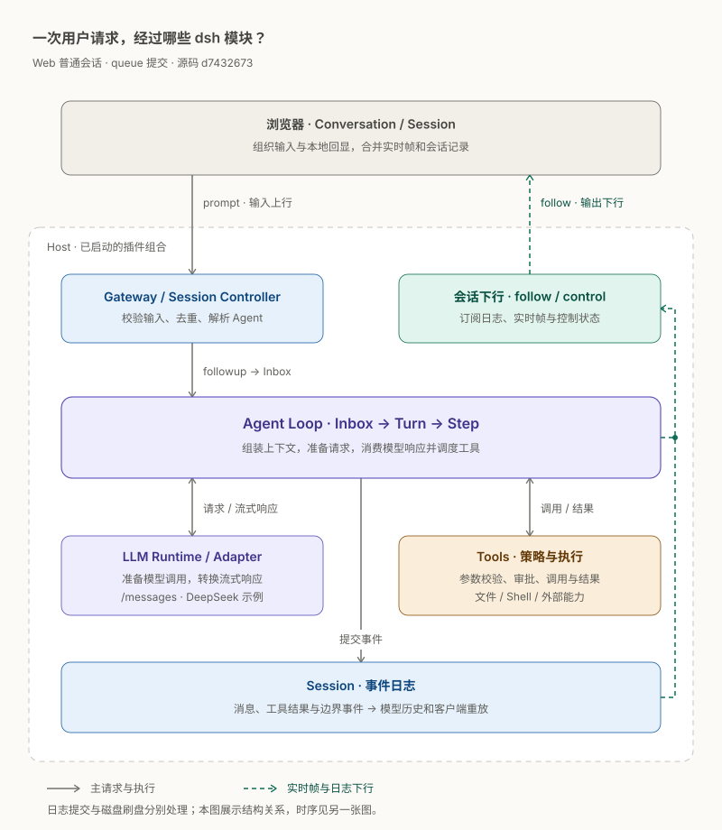
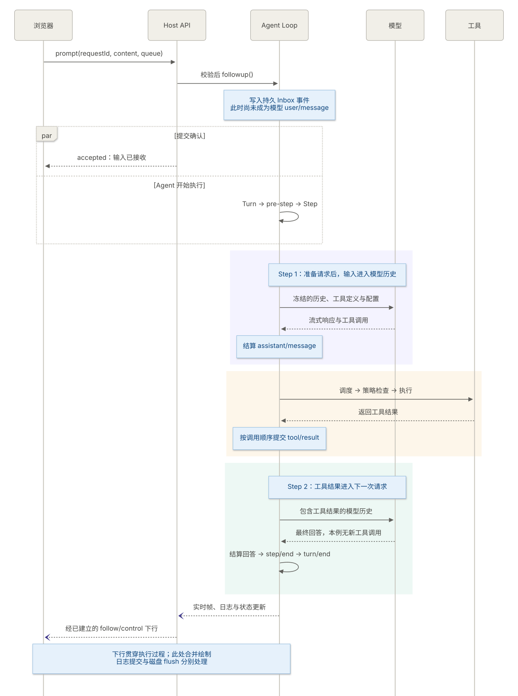

+++
title = "DeepSeek Harness 源码解析（二）：一次用户请求如何经过整个 dsh 系统"
date = 2026-10-14T10:00:00+08:00
lastmod = 2026-10-14
draft = false
author = "Hex4C59"
description = "沿固定版本的源码追踪一次 dsh 请求：从浏览器提交、Host 校验和 Agent 入队，到模型调用、工具执行、会话日志及界面更新，配合可暂停和单步推进的数据流演示。"
summary = "发送消息后，dsh 并不会直接把它转发给模型。输入先经过会话接口和队列，再由 Agent 准备请求、消费流式响应、执行工具，并通过独立的日志与状态订阅更新界面。本文把这条链路完整串起来。"
tags = ["DeepSeek Harness", "智能体", "工具调用"]
categories = ["ai"]
source_kind = "original"
series = ["DeepSeek Harness"]
series_order = 2
difficulty = "intermediate"
article_type = "concept"
topics = ["agent-loop", "session", "tool-use", "streaming"]
frameworks = ["DeepSeek Harness", "Cordis"]
ShowToc = true
disableComment = true
+++

> 本文依据固定版本的源码解析请求链路。源码为 `d743267388641bc76f17c45ce8b4c231aed1d32c`，对应根包版本 `0.2.1-alpha.2`。实现分析依据源码和已有测试定义；动画采用教学时序与演示数据。本轮没有运行 dsh 行为测试或真实模型请求。

## 从“发送”按钮开始

在[开篇](/agent/deepseek-harness-agent-engineering/)里，我们把 Harness 理解为模型周围组织上下文、工具、状态和执行过程的软件层。这个定义还比较抽象。要理解 dsh 的职责，可以沿着一条用户消息走一遍：谁接收它，谁把它放进模型请求，模型提出工具调用以后又由谁执行？

本文面向了解 HTTP、Git 和大语言模型基本概念的开发者，阅读代码时会用到少量 TypeScript。主场景是已经启动的 Web 应用：用户选择一个普通 Session，以 `queue` 模式提交非空文本，模型路由已经配置。Session 是 dsh 保存一段会话记录的对象；这里的 `queue` 表示输入等待后续 Turn 消费。

我们用一个假设任务贯穿全文：**“读取 README.md，并概述这个项目。”** 这个例子选择原生 `read` 工具路径，未启用程序化工具调用（Programmatic Tool Calling，PTC）。图里的文件内容与事件序号都是演示数据，用来观察模块之间传递什么。附件、子 Agent 和不同 preset 的组合留给对应篇章。

## 先看完整链路

一次 Web 提交大致经过以下过程：客户端组织内容，经远程调用交给 Host；Host 校验并解析 Agent，消息进入 Inbox；Agent 消费输入，开启 Turn 和 Step，准备模型请求；模型流式返回内容，工具结果进入后续 Step；会话事件与实时帧再通过独立下行链路更新浏览器。

这里有三条同时值得关注的路径。

| 路径 | 承担的工作 | 不同于另外两条的地方 |
|---|---|---|
| 输入上行 | 浏览器 → 会话接口 → Host → Agent Inbox | `accepted` 确认输入已接收 |
| 核心执行 | Agent → 模型 → 工具 → 下一 Step | 一条用户输入可能触发多次模型调用 |
| 结果下行 | 实时帧、会话事件和状态 → 客户端 | 浏览器持续接收更新，不等待提交接口返回整段回答 |

先沿着这三条路径读下去：前半篇追踪输入如何进入模型，后半篇追踪工具结果与浏览器更新。在“工具结果怎样进入下一次请求”一节，可以逐步播放工具反馈回路，并对照消息历史与事件载荷观察数据变化。

<details>
<summary>查看静态模块图</summary>



</details>

## 输入之前，应用已经完成组合

“消息进入 dsh”有两个不同的起点。应用启动时要选择 Profile、装配插件树、注册服务，并准备模型和会话能力。应用已经运行后，用户每次发送消息主要经过会话接口与 Agent 循环。把启动和提交画在同一条顺序线上，会让人误以为每条消息都重新建立整个运行时。

CLI 的 [`runCli()`](https://github.com/deepseek-ai/deepseek-harness/blob/d743267388641bc76f17c45ce8b4c231aed1d32c/apps/cli/src/bin.ts#L26) 识别调用类型，Profile 路径进入 [`runProfile()`](https://github.com/deepseek-ai/deepseek-harness/blob/d743267388641bc76f17c45ce8b4c231aed1d32c/apps/cli/src/profile-boot.ts#L244)，根据 bundle、profile patch 和用户覆盖装配插件。Web 和 Headless 由不同组合提供外围入口，后面的核心 Agent 循环可以共享。

Web Host 的 Agent 控制器会[复用已经存活的 Agent，或恢复所选 Session](https://github.com/deepseek-ai/deepseek-harness/blob/d743267388641bc76f17c45ce8b4c231aed1d32c/packages/api/session-controller/src/agent.ts#L183)。解析和恢复还涉及身份与所有权检查。本文从运行中的普通会话开始，因此不把创建会话、选择模型或切换 preset 混入最短输入路径。

## 浏览器提交的是会话请求

### 本地回显先于接收确认

用户点击发送时，客户端首先要更新自己的界面。默认输入由 InputHub 路由到 [`conversation.sendSession()`](https://github.com/deepseek-ai/deepseek-harness/blob/d743267388641bc76f17c45ce8b4c231aed1d32c/packages/client/ui-conversation/src/client/service.ts#L229)。它建立带 `requestId` 的本地提交回显，保留草稿与附件的对应关系，给浏览器一次绘制机会，再组织提交内容。

因此，用户看到消息出现在界面里，只能说明客户端已经建立本地提交状态。网络、Host 校验和 Agent 接收仍可能失败。`requestId` 把本地提交与 Host 侧接收关联起来，后面的去重也会使用它。

[`Session.prompt()`](https://github.com/deepseek-ai/deepseek-harness/blob/d743267388641bc76f17c45ce8b4c231aed1d32c/packages/api/session-controller/src/client/sessions/session.ts#L254) 带上 `sessionId`、`requestId`、`mode`、`content` 和客户端时区，调用普通 Session 的远程方法。子 Agent 使用另一条命名空间，并有不同的附件规则，不能套用普通会话的全部细节。

### Gateway 把远程调用送到 Host 方法

远程过程调用（Remote Procedure Call，RPC）让客户端以调用方法的方式请求 Host 服务。客户端 [Gateway](https://github.com/deepseek-ai/deepseek-harness/blob/d743267388641bc76f17c45ce8b4c231aed1d32c/packages/api/gateway/src/client/index.ts#L431) 根据生成的接口描述准备参数，通过 `connection.rpc.call('/api', endpoint, ...)` 发出调用。

[Host Gateway](https://github.com/deepseek-ai/deepseek-harness/blob/d743267388641bc76f17c45ce8b4c231aed1d32c/packages/api/gateway/src/index.ts#L699) 查找描述、校验参数、解析目标服务和作用域，然后在携带调用上下文的服务视图上执行对应方法。这个 RPC 是客户端与 dsh Host 的通信，模型 provider 的网络请求还在后面。

物理连接、重连与逻辑流协议另有实现。本篇先区分它们的位置：RPC 送达会话控制器，模型请求由 Agent 后续驱动。

## Host 接收消息，但回答还没开始

Host 的 [`prompt()`](https://github.com/deepseek-ai/deepseek-harness/blob/d743267388641bc76f17c45ce8b4c231aed1d32c/packages/api/session-controller/src/commands.ts#L311) 检查空白输入和显式客户端时区，解析普通 Agent，再检查 `requestId` 是否已经存在。已在 Inbox 或会话日志中的输入可以直接返回 `{ accepted: true }`，避免重复追加同一条提交。

带附件时还要检查模型图像能力、文件 receipt 和对应存储。前端选中了文件，并不能代替 Host 对附件的校验。这里的纯文本例子省略这些分支。

校验通过后，Host 构造带 `source.kind = 'user'` 和 `rpcId` 的用户消息。普通排队模式调用 `agent.followup()`，`steer` 模式调用 `agent.steer()`。最后返回的 `accepted` 表示提交被接收；模型内容、任务结束原因和磁盘写入结果都不放在这个确认里。

接收确认和驱动唤醒没有“客户端必须先收到确认，Agent 才能执行”的先后约束：`followup()` 已经在 Host 的同步调用路径中唤醒驱动，确认的网络返回可以与后续执行交错。

## Inbox 里的输入何时进入模型历史

### 入队事件已经属于会话日志

[`followup()`](https://github.com/deepseek-ai/deepseek-harness/blob/d743267388641bc76f17c45ce8b4c231aed1d32c/packages/core/agent-loop/src/agent.ts#L163) 将消息送往 `next-turn` 并请求唤醒；`steer()` 面向 `next-step` 并唤醒；`inject()` 也面向 `next-step`，但自身不触发唤醒。

这三个入口体现了输入消费的时机差别。排队消息等待新的 Turn；引导输入或工具附加上下文可以进入后续 Step。它们仍要经过队列和准备流程，才会成为一次模型调用看到的内容。

[`ReactLoopInbox.mutate()`](https://github.com/deepseek-ai/deepseek-harness/blob/d743267388641bc76f17c45ce8b4c231aed1d32c/packages/core/agent-loop/src/inbox.ts#L198) 同步追加 `agent/inbox/spliced`，会话投影据此更新队列，并另外发出实时 `agent/inbox/inserted`。**这里的 `agent/inbox/spliced` 是通过 Session 提交的持久类型事件。** 不能仅凭 `agent/` 前缀把所有事件都归为临时通知。

Inbox 事件携带了输入，却还不是模型对话中的 `user/message`。理解这一区别，才能解释“Host 接收成功，但模型请求尚未发出”的状态。

### Turn 和 Step 分别界定什么

在本文的场景里，Turn 是消费一次排队输入后展开的执行轮次；Step 是其中的一次模型请求阶段及后续工具处理。同一 Step 中还可能存在失败后的请求重试，所以 Step 编号也不能直接当成 provider 调用次数。

驱动先记录 `turn/start`，再进入 `preStep()`。它 claim 下一 Step 的待处理输入，并在新 Turn 开始时消费一条排队输入；随后组装 Prompt，进入 `agent/pre-step` waterfall。Waterfall 指一组按顺序传递和处理结果的插件处理函数，后续函数接收前面形成的提案。

插件最后给出的 `enter` 或 `reject` 决定是否执行该 Step。获准后才追加 `step/start`。如果被拒绝，Turn 可以以 blocked 结束；首批最终为空时也可能结束 Turn 而不消耗一个模型 Step。已经 claim 的批次在默认路径中不会自动重新入队。

这些边界都可以在[Agent 实现](https://github.com/deepseek-ai/deepseek-harness/blob/d743267388641bc76f17c45ce8b4c231aed1d32c/packages/core/agent-loop/src/agent.ts#L163)和[Prompt 组装入口](https://github.com/deepseek-ai/deepseek-harness/blob/d743267388641bc76f17c45ce8b4c231aed1d32c/packages/core/system-prompt/src/index.ts#L610)中定位。后续专篇会拆开 Prompt 节点、上下文来源和各个处理函数的修改规则。

### 先准备调用，再提交模型可见输入

进入 Step 后，`prepareRequest()` 根据实例模型选项和已记录的请求头构造提案，经 `agent/request` 处理，再调用 [`llm.prepareCall()`](https://github.com/deepseek-ai/deepseek-harness/blob/d743267388641bc76f17c45ce8b4c231aed1d32c/packages/llm/llm/src/index.ts#L933)。正常 adapter 路径返回一个绑定模型路由和配置的 prepared call，可以理解为“已经准备好、只允许分派一次的调用能力”。

准备与取消检查通过后，Step 同步处理 system prompt 和获准输入：追加或替换 `system/message`，在首个 attempt 提交用户消息，并处理运行时上下文。然后根据变化记录 `request/header`、`request/context`，必要时记录工具注册变化。

模型历史从 [`session.deriveMessages()`](https://github.com/deepseek-ai/deepseek-harness/blob/d743267388641bc76f17c45ce8b4c231aed1d32c/packages/core/session/src/index.ts#L984) 取得。这里的“投影”指从已提交事件推导出当前消息序列；发送前再冻结消息和请求对象。要回答模型看到了什么，应沿这份日志投影和请求构造追踪，不能仅检查客户端界面。

未注册 adapter 的 `NO_ADAPTER` 还保留中间件接管分支，因此“缺少 adapter 一定在用户消息写日志前结束”也不适合作为所有配置的统一结论。本文的主路径选择已配置 adapter 的正常分派。

## 模型流如何变成回答和工具调用

### Adapter 连接具体 provider

prepared call 的 `stream()` 仍经过 `llm/stream` waterfall，然后进入具体 adapter。统一接口使 Agent 消费相同的流式块结构，provider 的鉴权、消息序列化和传输格式则由适配器处理。

固定版本的 [DeepSeek adapter](https://github.com/deepseek-ai/deepseek-harness/blob/d743267388641bc76f17c45ce8b4c231aed1d32c/packages/llm/llm-deepseek/src/adapter.ts#L77) 在准备图像、授权和文件引用后，将请求 POST 到规范化 API 根路径下的 `/messages`。返回内容通过服务器发送事件（Server-Sent Events，SSE）解析，再转换成统一的 `StreamChunk`。

这说明 provider 端的网络协议应按具体 adapter 分析。这里的 SSE 也不意味着浏览器与 Host 的会话下行使用同一种传输协议。

### 实时片段与结算记录各有用途

Agent 用 `AssistantStreamAttempt` 组装流式块，并发出实时 `agent/assistant-stream`。Attempt 表示本次实际请求尝试；它帮助系统区分成功响应、失败重试和中断后的局部内容。

成功响应会提交 `assistant/message`，包含相应内容、使用量和该 attempt 的流记录。失败或没有表面消息的中断 attempt 使用 `assistant/attempt` 等结算路径。已经产生可见内容的取消还要按相应分支处理，不能把所有中断都归为同一种空失败。

这两类数据回答的问题不同：实时帧说明当前正在生成什么，结算事件支持重放和后续读取。进程若在结算前硬退出，不能保证界面上已经显示的片段都有可恢复记录。上述处理位于[核心 Agent 循环](https://github.com/deepseek-ai/deepseek-harness/blob/d743267388641bc76f17c45ce8b4c231aed1d32c/packages/core/agent-loop/src/agent.ts#L163)。

## 工具结果怎样进入下一次请求

第一次请求发给模型时，消息里有“读取 README.md”的任务，还没有文件内容。模型返回一个 `read` 调用以后，dsh 必须执行工具、保存返回值，再把包含结果的历史组织成下一次请求。下面沿着同一个调用 ID `c1` 追踪这段过程。

图中颜色固定对应模型、Agent、工具运行时和 Session。点击“播放链路”可以经过六个阶段；用左右按钮停在某一步，再切换“消息历史”“事件载荷”或“执行职责”。图内的链接也能切换观察视角。事件序号和文件内容是教学示例，箭头速度只用于演示传递方向。



### 模型提出调用，运行时负责执行

在贯穿全文的假设任务里，第一次模型响应提出 `read` 调用。下面是原生文件工具参数的示意，不是可以直接发送给所有 provider 的完整网络载荷：

```json
{
  "name": "read",
  "arguments": {
    "file_path": "README.md"
  }
}
```

工具名和参数可以在 [`read` 实现](https://github.com/deepseek-ai/deepseek-harness/blob/d743267388641bc76f17c45ce8b4c231aed1d32c/packages/fs/tool-fs/src/read.ts#L78)中核对。实际返回什么，取决于运行工作区、文件状态与工具配置；动画使用合成内容，不代表读取了 dsh 仓库的 README。

Agent 将成功响应中的工具调用交给 [`executeToolCalls()`](https://github.com/deepseek-ai/deepseek-harness/blob/d743267388641bc76f17c45ce8b4c231aed1d32c/packages/core/agent-loop/src/tool-calls.ts#L60)。调度器解析参数，并按 `executionMode` 区分可安全并发和独占调用。独占调用形成执行屏障，可并发调用受最大并发数限制；尚未开始的调用还会重新分类。

开始执行的调用先记录 `tool/call`。运行时负责参数处理、`tools/pre-execute`、审批与 guard 等策略，再通过 `tools/execute` 执行工具主体，之后处理结果。Guard 在这里承担继续执行前的检查，策略组合的完整规则见后续工具与安全篇章。不同错误分支可能跳过部分后置处理，不能只用“调用函数后返回字符串”概括整个工具流水线。

这里有两种关联，容易混在一起。`c1` 是模型给出的调用 ID：`tool/call` 保存为 `callId`，工具消息保存为 `toolCallId`，用来把调用与返回值对上。会话事件序号则标识日志里的某条记录：[`appendToolResult()`](https://github.com/deepseek-ai/deepseek-harness/blob/d743267388641bc76f17c45ce8b4c231aed1d32c/packages/core/agent-loop/src/tool-calls.ts#L270) 把 `tool/call` 的序号放进 `sourceEventSeqs`，保存结果来自哪条调用记录。图里的 `42` 是演示序号，不等于调用 ID，也不是实际运行日志。

### 完成顺序与写入顺序可以不同

工具可以并发完成，但 `tool/result` 仍按模型调用顺序提交，并引用对应的调用事件。附加上下文也按提交顺序进入下一 Step。这样，模型历史中的结果顺序有确定依据，不取决于哪个异步动作更早返回。

图中只演示一次调用。多个工具同时执行时，“哪个先完成”和“哪个先提交”需要分开观察；调度器的结果槽位与连续提交机制会在工具执行篇章中展开。

取消会停止补充新的调用，并等待已经开始的工作收敛，保存可以提交的结果。保存日志不能撤销已经发生的文件修改、进程行为或外部请求。这些调度和策略边界分别位于[工具批次实现](https://github.com/deepseek-ai/deepseek-harness/blob/d743267388641bc76f17c45ce8b4c231aed1d32c/packages/core/agent-loop/src/tool-calls.ts#L60)与[工具运行时](https://github.com/deepseek-ai/deepseek-harness/blob/d743267388641bc76f17c45ce8b4c231aed1d32c/packages/core/tools/src/index.ts#L1499)。

没有工具调用的正常响应可以完成当前 Step。工具结果中的 `concludesTurn`、待处理的 next-step 输入，以及自然停止窗口中的 `agent/turn-stopping` 还会影响是否继续。`step/end`、`turn/end` 和实时 idle 状态因此需要分别观察。

### 下一次请求怎样得到文件内容

在获准继续的正常路径里，下一 Step 的 [`prepareRequest()`](https://github.com/deepseek-ai/deepseek-harness/blob/d743267388641bc76f17c45ce8b4c231aed1d32c/packages/core/agent-loop/src/agent.ts#L687) 调用 `session.deriveMessages()`，从会话表面派生消息历史。历史已包含助手提出的 `read` 调用，以及带 `toolCallId = c1` 的工具消息；文件内容就在工具消息的 `content` 里。

图里的第五阶段展示派生后的消息，第六阶段展示请求边界：dsh 冻结边界消息与请求对象，再把请求交给 [`adapter.stream()`](https://github.com/deepseek-ai/deepseek-harness/blob/d743267388641bc76f17c45ce8b4c231aed1d32c/packages/core/agent-loop/src/agent.ts#L439)。因此，模型的下一次生成能够利用读取结果。图中只展示 `user`、`assistant`、`tool`，实际请求还可能有其他上下文消息与配置。

工具结果已提交，只能说明返回值已进入会话记录。下一次请求是否发出，还要经过后续 Step 的执行判断。图中展开的是正常继续路径。

## 回答经另一条链路到达浏览器

浏览器提交 `prompt()` 以后，主要通过已建立的会话订阅持续接收结果。[`SessionHistoryController.follow()`](https://github.com/deepseek-ai/deepseek-harness/blob/d743267388641bc76f17c45ce8b4c231aed1d32c/packages/api/session-controller/src/history.ts#L120) 先订阅事件和可选的实时帧，再获取 snapshot/baseline，随后按游标发送增量。这样的顺序要处理取快照与接收新事件之间的衔接，日志序号缺口也有对应校验。

这里的 snapshot 是某一时点的记录快照，baseline 是继续接收增量所依据的起点。另一个 [control stream](https://github.com/deepseek-ai/deepseek-harness/blob/d743267388641bc76f17c45ce8b4c231aed1d32c/packages/api/session-controller/src/control.ts#L42) 提供 Host 范围的投影状态，供队列、运行状态等消费者使用。

客户端 Session 应用日志替换、追加和流帧变化，[`ClientAssistantStream`](https://github.com/deepseek-ai/deepseek-harness/blob/d743267388641bc76f17c45ce8b4c231aed1d32c/packages/api/session-controller/src/client/sessions/assistant-stream.ts#L44) 协调实时 attempt、结算结果和 Step 结束。部分已经到达的持久结果会暂存到相应结算边界，以免同一段内容由实时流和最终记录各显示一次。

下图把成功路径按时间展开。为便于阅读，持续下行在图末合并表示，实际更新贯穿执行过程。



[下载可编辑的 Mermaid 时序图](dsh-request-sequence.mmd)。

## 日志提交与刷盘是两个边界

[`Session.commit()`](https://github.com/deepseek-ai/deepseek-harness/blob/d743267388641bc76f17c45ce8b4c231aed1d32c/packages/core/session/src/index.ts#L876) 校验候选事件，将其加入内存日志，再通知 `session/event` 观察者。模型历史投影和客户端增量消费的是已经提交的事件。

[JSONL 持久化 provider](https://github.com/deepseek-ai/deepseek-harness/blob/d743267388641bc76f17c45ce8b4c231aed1d32c/packages/session/session-persistence-jsonl/src/storage.ts#L534) 的观察者把这些事件排入写入链。JSONL 指每行保存一个 JSON 对象的存储格式。缓冲队列中的记录何时写完，还要看 provider 的 drain 与 flush。

因此，排查状态时可以依次核对：Host 是否接收输入，Inbox 是否记录，消息是否进入模型历史，响应是否结算，以及持久化 provider 是否完成相应写入。`sessions.flush(session)` 是另一个需要显式等待的边界。仅观察 `accepted` 或 `session.append()`，无法证明后面的磁盘写入已经完成。

工具反馈图展示调用、会话事件和后续消息，未模拟磁盘刷写的完成时间。

## 同一个任务从 Headless 进入会怎样

Headless 省去了浏览器和 Web RPC。[runner](https://github.com/deepseek-ai/deepseek-harness/blob/d743267388641bc76f17c45ce8b4c231aed1d32c/packages/bundle/headless/src/index.ts#L311) 等待 Loader 完成组合，读取命令行或 stdin 任务，选择模型与工作目录，然后创建 Agent 或恢复指定 Session，直接调用 `followup()`。

| 环节 | Web 场景 | Headless 场景 |
|---|---|---|
| 输入 | 草稿、本地回显、Remote prompt | task 参数或 stdin |
| 获取 Agent | Host 解析或恢复已有会话 | runner 创建或采用会话 |
| 核心执行 | Agent Loop、模型与工具 | 同一套核心循环 |
| 结果观察 | follow/control 与客户端合并 | 实时输出或 JSON 投影、最终文本汇总 |
| 结束 | 浏览器继续保留会话，可提交下一条消息 | 等待相关活动稳定，flush 后汇总并退出 |

Headless 的完成判断还要考虑相关子 Agent，以及子任务结算是否再次唤醒父 Agent。退出码来自汇总的 Turn 结束原因，“当前 idle”不足以单独证明成功。它还会在退出前显式等待 `sessions.flush()`，因此可以清楚看到执行结束和记录刷盘的区别。

## 失败后从哪个位置继续看

成功路径提供系统地图，失败分支说明这张地图的边界。遇到“没有回答”时，先确定输入停在哪个阶段，再去看对应实现。

| 失败位置 | 实现与排查边界 |
|---|---|
| 输入或附件校验 | Host 返回业务错误，正常路径不会把非法输入送进 Agent 队列 |
| Session 解析或所有权检查 | 查看目标身份、恢复与写入冲突，不能默默换成另一会话 |
| pre-step 拒绝或输入最终为空 | Turn 可能没有模型 Step；已 claim 的批次默认不重新入队 |
| 请求准备失败 | 区分路由、配置、取消和中间件接管，核对用户消息是否已提交 |
| provider 的终止失败 | attempt 先结算，再由 `agent/request-error` 决定是否在原 Step 内重试 |
| 中间件或请求消费者抛错 | 与 adapter 的终止 failure 区分，不能假定所有错误都进入同一恢复入口 |
| 工具错误或取消 | 检查调用、策略和结果记录；已经发生的副作用需要单独处理 |
| 持久结算或 flush 失败 | 区分实时可见、内存日志提交和存储写入完成 |
| 客户端增量不连续 | 检查日志游标、流帧序号和 attempt baseline，不能直接叠加内容 |

原 Step 内的重试会重新准备调用和请求上下文，但不会重复 pre-step 与用户消息提交。取消检查还能阻止继续重试。相关断言可以在 [`request-error.spec.ts`](https://github.com/deepseek-ai/deepseek-harness/blob/d743267388641bc76f17c45ce8b4c231aed1d32c/packages/core/agent-loop/tests/request-error.spec.ts) 中阅读。

取消客户端的一次 Remote 提交，与取消已经运行的 Agent 也属于不同入口。若要判断工具是否停止，需要继续观察 Agent 的取消和工具清理路径；客户端连接状态本身无法给出这个答案。

## 如何核对本文，而不把示意当成实测

本文从 2026-10-12 的静态研究继续整理，2026-10-14 整理成文，源码仍固定为同一 commit。已有测试帮助核对实现意图，本轮没有执行这些 dsh 测试。

| 可以复核的问题 | 仓库中的测试入口 |
|---|---|
| 简单 Turn 的边界、工具结果进入后续请求 | [`loop.spec.ts`](https://github.com/deepseek-ai/deepseek-harness/blob/d743267388641bc76f17c45ce8b4c231aed1d32c/packages/core/agent-loop/tests/loop.spec.ts) |
| 同 Step 重试、取消与恢复分支 | [`request-error.spec.ts`](https://github.com/deepseek-ai/deepseek-harness/blob/d743267388641bc76f17c45ce8b4c231aed1d32c/packages/core/agent-loop/tests/request-error.spec.ts) |
| 请求冻结与可取消的 signal | [`request-freeze.spec.ts`](https://github.com/deepseek-ai/deepseek-harness/blob/d743267388641bc76f17c45ce8b4c231aed1d32c/packages/core/agent-loop/tests/request-freeze.spec.ts) |
| 并发、独占屏障与按序结果提交 | [`tool-calls.spec.ts`](https://github.com/deepseek-ai/deepseek-harness/blob/d743267388641bc76f17c45ce8b4c231aed1d32c/packages/core/agent-loop/tests/tool-calls.spec.ts) |
| 实时帧与持久结果在客户端合并 | [`assistant-stream.client.spec.ts`](https://github.com/deepseek-ai/deepseek-harness/blob/d743267388641bc76f17c45ce8b4c231aed1d32c/packages/api/session-controller/tests/assistant-stream.client.spec.ts) |
| Headless 等待、汇总和退出前 flush | [`headless.spec.ts`](https://github.com/deepseek-ai/deepseek-harness/blob/d743267388641bc76f17c45ce8b4c231aed1d32c/packages/bundle/headless/tests/headless.spec.ts) |

`loop.spec.ts` 中已有 MockAdapter 与 `echo` fixture 的往返案例：第一次响应提出工具调用，第二次请求包含对应工具结果。这可以用来复核核心反馈循环。本文的 `read` 例子则是依据实际工具接口编排的教学场景，二者的证据性质不同。

实际 Web 任务还可能触发标题生成、压缩等外围模型调用，不能把一个核心循环例子里的“两次请求”当成整个产品任务的总调用数或成本。真实 provider、重连、磁盘故障、沙箱、跨平台行为、成功率和延迟都需要另外记录运行条件与结果。

## 读完这条链路后

沿一条消息追踪，可以得到几个后续源码阅读的落点：客户端先建立提交状态；Host 接收并入队；请求准备决定输入何时成为模型消息；模型与工具在 Step 之间形成反馈；实时帧和日志通过独立订阅更新界面；磁盘持久化再提供自己的完成边界。

下一步可以从源码地图和应用组合继续阅读，再分别展开 Cordis、Turn/Step、Prompt、Session 与工具流水线。本文负责把它们连起来，各机制的全部配置、类型和边界会在对应篇章继续拆解。

## 延伸阅读

- [系列开篇：从代码补全到仓库级 Agent](/agent/deepseek-harness-agent-engineering/)。
- [DeepSeek Harness 系列总览](/series/deepseek-harness/)。
- [从零构建 CLI Coding Agent](/agent/build-cli-coding-agent/)。
- [固定版本的工具执行流水线](https://github.com/deepseek-ai/deepseek-harness/blob/d743267388641bc76f17c45ce8b4c231aed1d32c/docs/tool-execution-pipeline.md)。
