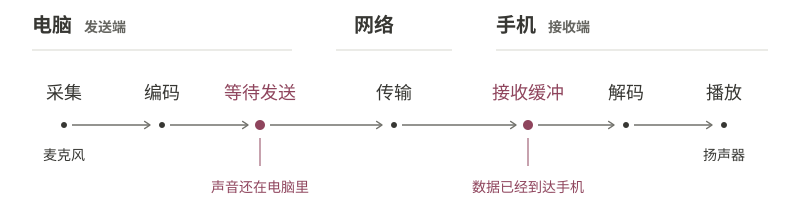
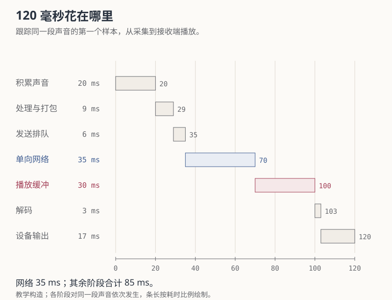
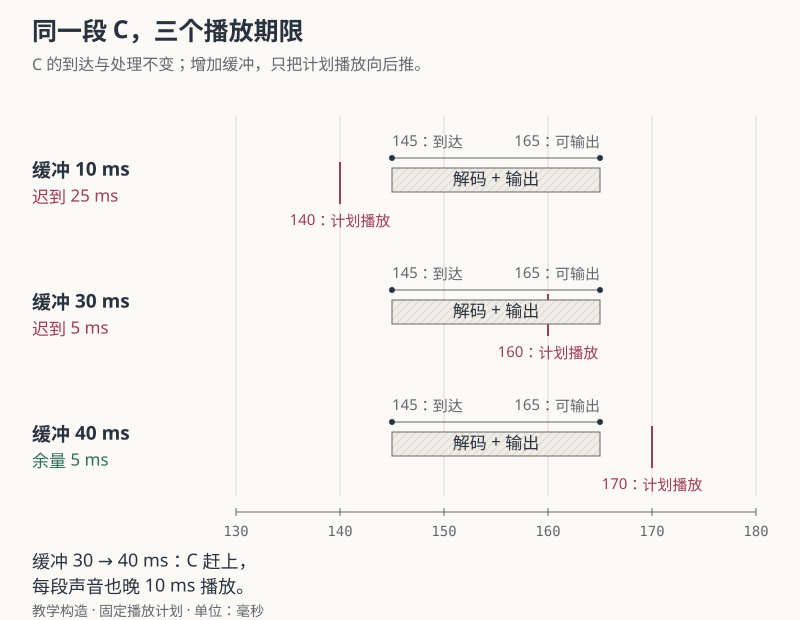
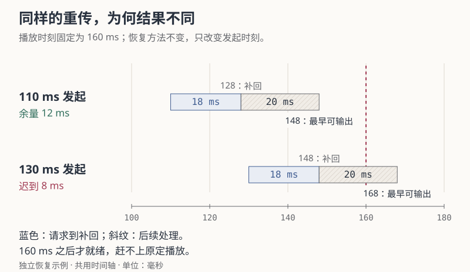

+++
title = "RTC 入门 01：实时通话为什么不能一直等"
date = 2026-10-14
lastmod = 2026-10-15
draft = false
author = "Hex4C59"
description = "从声音的播放期限出发，拆解 120 毫秒的端到端延迟，解释缓冲、迟到与恢复怎样争用同一份时间预算，并用可运行模型比较取舍。"
summary = "多等一会儿，确实可能等到迟来的声音。但每次等待也会推迟对方的回应。沿一条声音路径，算清什么时候值得等、什么时候已经来不及。"
tags = ["RTC", "实时音视频", "延迟"]
categories = ["engineering"]
source_kind = "original"
article_type = "concept"
series = ["rtc-from-zero"]
series_order = 1
series_number = 1
series_role = "chapter"
series_part = "从一通语音电话开始"
series_label = "实时通话为什么不能一直等"
ShowToc = true
+++

声音迟到了，多等一会儿再播放，似乎是一个很稳妥的办法。这样既能保住内容，也能避免播放中断。为什么实时通话不能一直这样等？

因为这段等待会进入下一轮对话。你问完“你到哪了”，对方还没听见问题，你却已经开始怀疑他没听清；于是你又问了一遍，正好撞上他刚传回来的回答。每个字都可以完整，接话的时机却已经错开。

实时通话需要给等待设一个期限。在期限以内，缓冲和恢复可以帮助我们利用晚到的声音；继续延后播放，则会增加对话双方的等待。[^realtime]

RTC 是 Real-Time Communication，即实时通信。这个系列讨论通过网络进行的实时语音和视频交流。本篇先看一个方向的声音：从它被采集，到另一端播放，时间花在哪里？接收端还能等多久？这些问题不要求音视频或编程基础。文末的 Python 实验可以验证计算，但不涉及真实通话测量。

读完本篇，你应该能拿到“包何时到、处理要多久、计划何时播放”三个条件，独立判断这段声音还能不能赶上。正文只用加减法；运行文末实验另外需要 Python，暂时跳过代码也能完成练习。

## 先把一段声音的旅程说清楚

麦克风采集后，程序会得到按时间排列的声音幅度数值。一个时刻记录下的一个数值，称为一个**样本**；很多相邻样本放在一起，就表示一小段声音。采样率和数值格式留到第二篇计算，这里先把样本理解为声音在某个时刻的一次数字记录。[^sampling]

1 秒等于 1000 毫秒，20 毫秒就是 0.020 秒。假设程序每次收齐 20 毫秒声音再交给下一步。这 20 毫秒是声音本身覆盖的时长，不是“处理器忙了 20 毫秒”：一段声音里的第一个样本采到以后，还要等这一段后面的样本。

接下来需要区分几件事：

| 对象或动作 | 在这条路径里做什么 |
| --- | --- |
| 一块声音数据 | 表示一段连续时间里的声音，本篇每块覆盖 20 毫秒 |
| 编码与解码 | 编码把样本变成便于传输的压缩数据；解码把编码数据变回可输出的样本 |
| 网络包 | 传输的数据单位，带着内容及接收端需要的识别信息；本篇简化为一块声音装一包 |
| 队列与缓冲 | 先存放尚未处理的数据，轮到它时再取出；存放的时间也会进入通话等待 |

这里暂不把“一块声音”“一次设备交付”“一个网络包”当作普遍相同的东西。本篇采用一块一包，第二篇再拆开它们的边界。

另一个关键动作是**按计划播放**。把 A、B、C 看成依次相邻的三段声音：A 播完该接 B，B 播完该接 C。即使 C 提前到了，也不能直接插到 B 前面；若 B 没来，一直停在 A 后面等待，后续声音也会一起推迟。

因此接收端通常先收一点声音，再按连续的时间安排播放。这个预先留出的等待给网络波动留了余量，也让整条通话晚了一点。下面就算这份等待究竟花在哪里。

## 一段声音怎样花掉 120 毫秒

想给等待设限，先要确定计时的起点和终点。这里跟踪一段 20 毫秒声音里的第一个样本：从它被采集，直到它对应的声音在接收端播放。声音进入采集设备以前的声学传播不在这次预算里。

它会依次经过下面的路径：

<figure>
  <picture>
    <source media="(max-width: 640px)" srcset="audio-path-mobile.svg" width="360" height="480">
    
  </picture>
  <figcaption>沿同一段声音检查每一处等待。发送队列和播放缓冲位于网络两侧；图中各段长度不代表耗时。</figcaption>
</figure>

编码把采集的数字样本转换成适合传输的数据，解码再把编码数据变成可供音频设备输出的样本。传输前后都可能排队，因此包到达接收端以后，声音还不能立刻被听见。

假设各阶段花费如下。所有时刻使用同一条教学时间轴，第一个样本被采集时记为 0；这些数字是构造参数，没有对应某款设备或编解码器的默认配置。

| 阶段 | 本段耗时 | 完成时刻 |
| --- | --- | --- |
| 积累一段 20 毫秒声音 | 20 毫秒 | 20 毫秒 |
| 预处理、编码与打包 | 9 毫秒 | 29 毫秒 |
| 等待发送 | 6 毫秒 | 35 毫秒 |
| 单向网络传输 | 35 毫秒 | 70 毫秒 |
| 接收端播放缓冲 | 30 毫秒 | 100 毫秒 |
| 解码 | 3 毫秒 | 103 毫秒 |
| 输出队列与设备输出 | 17 毫秒 | 120 毫秒 |

总延迟就是这些相邻阶段的时间之和：

```text
20 + 9 + 6 + 35 + 30 + 3 + 17 = 120 毫秒
```

<figure>
  <picture>
    <source media="(max-width: 640px)" srcset="latency-budget-mobile.svg" width="360" height="720">
    
  </picture>
  <figcaption>同一段声音的累计耗时。条长按毫秒数成比例绘制，条末数字为阶段完成时刻；参数来自正文教学模型。</figcaption>
</figure>

网络只用了 35 毫秒，路径上的其他阶段合计用了 85 毫秒。即使网络完全没有变慢，采集、处理和两端的等待，也足以让“什么时候收到包”与“什么时候听见声音”相差很远。

这里把积累声音也算进去，是因为我们跟踪的是这段声音里的第一个样本。第一个样本要等后面的样本收齐，才能进入下一阶段。如果改为从整段声音采集完成时计时，结果就会少掉这一段等待。

编码还有一个容易漏掉的成本：算法可能需要后续样本才能分析当前声音。编码函数执行了多久，并不能完整反映这类延迟。[^lookahead] 表中的 9 毫秒统一容纳相应等待与处理；实际拆解时，需要按实现找边界，避免漏算或重复计时。

流水线可以同时处理不同声音。例如采集下一段时，编码器正在处理上一段。它让系统持续工作，但跟踪同一段声音时，仍须经过自己的各个阶段。一秒能处理多少段，与一段要多久才能被听见，是两个不同的问题。

## 为什么网络 RTT 不能表示对方多久听见

RTT 是 Round-Trip Time，即往返时间。假设一次网络探测从 A 到 B 用 35 毫秒，B 立即返回，到 A 再用 35 毫秒，网络 RTT 就是 70 毫秒。

前面的声音却要用 120 毫秒，才能完成一个方向的采集到播放。这两个数测量的事件不同：网络探测没有经过声音采集、编码、播放缓冲和设备输出。

用 `RTT ÷ 2` 估计单向网络时间，还需要两个方向耗时相同。实际两个方向可能不对称，探测与媒体的传输路径也需要确认。即使这些条件成立，得到的仍只是网络部分。

对话又把两个方向连在了一起。假设问题末尾和回答开头的传递各用 120 毫秒，对方花 250 毫秒作出反应，从你说完到听见回答开头就是：

```text
问题末尾传过去 + 对方反应 + 回答开头传回来
= 120 + 250 + 120
= 490 毫秒
```

如果两个方向的播放延迟都变成 3 秒，仅传递等待就有 6 秒；人的反应时间还要另算。这解释了为什么双方都在认真说话，却很容易互相打断。[^realtime] 测量一次“多久才回答”，也不能把人的反应全部算到网络头上。

## 播放缓冲怎样换来等待的余量

网络不会让每个包花费完全相同的时间。有的早到，有的晚到，还有的会换一个顺序到达。这种到达时间的波动称为抖动。接收端用播放缓冲暂存声音，让它们按媒体顺序和计划时刻被使用；提前到达的内容先等一等，晚到的内容则有机会赶上。[^buffer]

沿用刚才的模型，把声音连续分成 A、B、C、D、E 五段，每段 20 毫秒。它们的采集起点依次为 0、20、40、60、80 毫秒。

正常情况下，从一段声音开始采集，到接收端收到包，要用：

```text
20 + 9 + 6 + 35 = 70 毫秒
```

现在只让 C 在网络上额外耽误 35 毫秒。到达记录如下：

| 声音段，按媒体顺序排列 | 采集起点 | 到达接收端 | 相对正常到达的额外等待 |
| --- | --- | --- | --- |
| A | 0 毫秒 | 70 毫秒 | 0 毫秒 |
| B | 20 毫秒 | 90 毫秒 | 0 毫秒 |
| C | 40 毫秒 | 145 毫秒 | 35 毫秒 |
| D | 60 毫秒 | 130 毫秒 | 0 毫秒 |
| E | 80 毫秒 | 150 毫秒 | 0 毫秒 |

D 比 C 先到，却仍属于 C 后面的声音。接收顺序没有改变它们在原始声音中的位置，因此不能简单地按收包顺序播放。

### 到了接收端，为什么仍可能赶不上

使用 30 毫秒播放缓冲时，正常总延迟是 120 毫秒。因此 A 计划在 120 毫秒播放，B 在 140 毫秒，C 在 160 毫秒，后面依次增加 20 毫秒。

C 在 145 毫秒就到了，看起来还剩 15 毫秒。问题在于，接收之后还要经过 3 毫秒解码和 17 毫秒输出。它最早能发声的时刻是：

```text
145 + 3 + 17 = 165 毫秒
```

这比计划晚了 5 毫秒。要赶上 160 毫秒的播放，接收端最晚必须在 `160 − 3 − 17 = 140` 毫秒拿到数据。

于是，一段声音能否赶上原定播放，可以写成一个简单条件：

```text
到达时刻 + 后续处理耗时 ≤ 计划播放时刻
```

这里的“迟到”是相对于播放计划而言。包成功到达，与它还能不能用于这次计划播放，是不同的判断。

### 再多等 10 毫秒，改变了什么

保持到达记录不变，只调整播放缓冲：

| 播放缓冲 | 正常采集到播放延迟 | C 的计划播放时刻 | C 的结果 | 赶上原定播放的段数 |
| --- | --- | --- | --- | --- |
| 10 毫秒 | 100 毫秒 | 140 毫秒 | 晚 25 毫秒 | 4 / 5 |
| 30 毫秒 | 120 毫秒 | 160 毫秒 | 晚 5 毫秒 | 4 / 5 |
| 40 毫秒 | 130 毫秒 | 170 毫秒 | 还剩 5 毫秒余量 | 5 / 5 |

<figure>
  <picture>
    <source media="(max-width: 640px)" srcset="playout-deadline-mobile.svg" width="360" height="636">
    
  </picture>
  <figcaption>三种缓冲使用相同的到达与处理时间。播放标线移到最早可输出时刻之后，C 才能赶上；增加的缓冲也增加通话等待。</figcaption>
</figure>

缓冲从 30 增加到 40 毫秒，C 的到达时刻没有改变，解码和输出也没有变快。改变的是播放期限：它从 160 推迟到 170 毫秒，原来来不及处理的声音于是赶上了。

代价是每段声音都晚 10 毫秒播放，这份等待也会进入下一轮回应。把缓冲减到 10 毫秒，则让每段声音提前 20 毫秒播放，同时缩小了容忍网络波动的余量。

所以，缓冲大小要和到达波动、允许的通话延迟一起判断。这五段数据只说明当前取舍，不能给出普遍适用的最佳值。实际抖动缓冲还可能动态调整播放计划。[^buffer]

这个模型也只统计原始声音是否赶上，没有模拟恢复或缺失掩盖。“4 段赶上”不等于另一段一定播放为静音；播放器如何处理缺失，会在后续文章里展开。

到这里，判断原始声音能否赶上的条件已经齐了。下面两节进一步讨论补包和排查延迟；第一次阅读也可以先到[预算实验](#用模型检查预算)，再完成文末的新条件练习。

## 重传也要赶上同一个期限

播放缓冲可以暂存已收到的内容，却不会自动找回没有收到的包。若接收端要请求重传，就得判断补回数据还来不来得及。实时应用中，重传是否有用，需要结合应用允许的延迟。[^retransmission]

仍以 C 的播放时刻 160 毫秒为准，解码和输出仍需要 20 毫秒。另作一个独立的恢复示例：假设从接收端发起恢复请求，到数据补回，需要 18 毫秒。这 18 毫秒包含整个请求到返回的过程，没有沿用前面 35 毫秒的单向网络参数。

| 发起恢复的时刻 | 预计补回时刻 | 最早输出时刻 | 对 160 毫秒的播放计划 |
| --- | --- | --- | --- |
| 110 毫秒 | 128 毫秒 | 148 毫秒 | 还剩 12 毫秒余量 |
| 130 毫秒 | 148 毫秒 | 168 毫秒 | 晚 8 毫秒 |

<figure>
  <picture>
    <source media="(max-width: 640px)" srcset="recovery-window-mobile.svg" width="360" height="484">
    
  </picture>
  <figcaption>两次恢复的成本相同，发起时刻不同。蓝色段为请求到补回，斜纹段为后续处理；虚线是共同的播放期限。</figcaption>
</figure>

同样的恢复方法，提前发起能够赶上，稍晚发起就失去了原定播放的机会。判断条件与前一节相同，只需把“到达时刻”拆开：

```text
当前时刻 + 预计恢复耗时 + 后续处理耗时 ≤ 计划播放时刻
```

在 130 毫秒时，留给数据补回的时间只有 `160 − 130 − 20 = 10` 毫秒。预计需要 18 毫秒的恢复，已经超出这份预算。如果决定延后播放来使用它，增加的等待就要重新计入通话延迟。

实际恢复估计还要包含反馈、发送端处理、排队和返回，不能只填写某一段链路的时间。具体采用什么恢复办法，后续文章会继续比较；这里先建立判断它是否来得及的条件。

## 降低延迟，要先找出声音等在哪里

接收端可用的余量，也取决于声音在到达以前花了多久。发送端多排队几十毫秒，会让声音更晚到达；若保持原定播放时刻，接收端用来应对波动与恢复的时间就会减少。

给前面的模型设一个 150 毫秒教学目标。正常总延迟为 120 毫秒，还有 30 毫秒余量。这里的 150 毫秒只是计算目标，不是所有通话的质量阈值。

现在让发送队列从 6 毫秒涨到 60 毫秒，其他阶段不变：

```text
20 + 9 + 60 + 35 + 30 + 3 + 17 = 174 毫秒
```

针对这条已经超出目标的路径，分别修改一个阶段：

| 单独修改 | 修改后的总延迟 | 减少的等待 |
| --- | --- | --- |
| 预处理、编码与打包：9 → 4 毫秒 | 169 毫秒 | 5 毫秒 |
| 单向网络传输：35 → 25 毫秒 | 164 毫秒 | 10 毫秒 |
| 发送排队：60 → 6 毫秒 | 120 毫秒 | 54 毫秒 |

在这组构造数据里，主要积压位于发送队列。减少编码耗时确实有用，但即使减少 5 毫秒，仍有 169 毫秒的总延迟。预算帮助我们确定值得优先调查的位置；它没有证明排队一定能降回 6 毫秒。

真实排查时，需要沿同一段声音关联相邻事件：

| 事件边界 | 能解释的时间 |
| --- | --- |
| 第一个样本被采集 → 一段声音收齐 | 采集积累 |
| 编码处理开始 → 编码输出产生 | 处理耗时；算法额外等待需另找对应边界 |
| 进入发送队列 → 交给传输 | 本机发送排队 |
| 收到包 → 从播放缓冲取出 | 接收等待 |
| 解码开始 → 输出样本生成 | 解码耗时 |
| 提交输出 → 实际播放 | 输出队列与设备延迟 |

同一台设备上的时间间隔，使用不会因校时而跳变的单调时钟计算。跨设备则需要时钟对齐，不能直接把两台机器各自记录的时间戳相减。

尤其要确认日志的终点。“提交输出”之后，设备仍可能有等待。[^output] 如果日志只记录到解码完成，就不能把缺少的输出阶段当成零；如果一项测量已经覆盖输出队列与设备输出，也不能再把同一段设备等待加一次。

## 用模型检查预算

[下载延迟预算实验 latency_budget.py](latency_budget.py)。脚本使用 Python 3.9 或更新版本，只打印计算结果，不采集声音、不联网，也不进行性能测量。“终端”是输入命令、查看程序输出的窗口。保存脚本后，先在终端输入 `python3 --version` 确认版本，再进入保存脚本的文件夹运行：

```bash
python3 latency_budget.py
```

默认结果对应 30 毫秒播放缓冲：

```text
Baseline delay: 120 ms
Margin to teaching target 150 ms: 30 ms
C: arrival=145 ms; earliest output=165 ms; scheduled=160 ms; late by 5 ms
On-time original blocks: 4/5
```

先别运行下一条命令：如果缓冲从 30 改成 35 毫秒，C 的到达仍是 145 毫秒，后续处理仍需 20 毫秒，能否刚好赶上？先写下它的计划播放时刻，再验证：

```bash
python3 latency_budget.py --buffer-ms 35
```

此时基础延迟为 125 毫秒，C 计划在 165 毫秒播放，最早也在 165 毫秒准备好，5 / 5 段原始声音都能赶上。按本模型的“≤”规则，这算及时；但它没有剩余时间，任何未计入的额外等待都可能改变结论。

接着改变播放缓冲，再增加发送排队：

```bash
python3 latency_budget.py --buffer-ms 10
python3 latency_budget.py --buffer-ms 40
python3 latency_budget.py --sender-queue-ms 60
```

| 修改 | 应看到的结果 |
| --- | --- |
| 缓冲 10 毫秒 | 基础延迟 100 毫秒，C 晚 25 毫秒，4 / 5 段赶上 |
| 缓冲 40 毫秒 | 基础延迟 130 毫秒，C 提前 5 毫秒可输出，5 / 5 段赶上 |
| 发送排队 60 毫秒 | 基础延迟 174 毫秒，超过 150 毫秒目标 24 毫秒 |

模型固定了耗时与播放计划，没有模拟编码器、设备、真实网络或自适应缓冲。它检验的是预算能否相加、期限是否满足；输出的毫秒数不能当作产品测量结果。

## 换一组数字，自己判断

下面是一个独立案例，不沿用 A—E 的到达记录。某段声音计划在本地 180 毫秒播放，拿到数据之后还要准备 12 毫秒。

1. 数据在 172 毫秒到达，能赶上吗？最晚应该在什么时候到？
2. 把整条播放计划延后 10 毫秒，原来的到达条件不变，这段声音能赶上吗？其他声音付出了什么代价？
3. 当前是 145 毫秒，预计请求到补回需要 18 毫秒，再准备 12 毫秒。这次重传来得及吗？

<details>
<summary>展开推导与答案</summary>

1. 最早准备好是 `172 + 12 = 184` 毫秒，比 180 毫秒晚 4 毫秒。最晚可用输入时刻是 `180 − 12 = 168` 毫秒。只比较 172 和 180，会漏掉准备时间。
2. 新计划是 190 毫秒，184 毫秒已经准备好，余量为 6 毫秒。到达没有变快；整个播放计划及其中的其他声音都晚了 10 毫秒。
3. `145 + 18 + 12 = 175` 毫秒，早于原计划 180 毫秒，余量为 5 毫秒。这里的 18 毫秒已经是请求到返回的全程，不能再重复加一次返回网络耗时。

</details>

如果第一题算成“还剩 8 毫秒，所以能播”，回看“到了接收端，为什么仍可能赶不上”；如果第二题认为网络变快了，回看缓冲怎样移动播放期限。

实时通话不能一直等，是因为双方还要依据刚听到的话继续交流。等待让更多内容有机会赶上，也会推迟回应。判断一次等待是否值得，先确定播放时刻，再从当前到播放的间隔里扣掉尚未完成的处理：剩下的时间，才是这段声音还能用于缓冲和恢复的预算。

下一篇会沿着同一条路径看数据本身：20 毫秒声音是多少个样本、多少字节，编码后变成什么，接收端又怎样把它还原成可以播放的声音。

[下一篇：声音从麦克风到扬声器](/articles/rtc-02-audio-path/) · [系列目录](/articles/rtc-from-zero/)

## 参考资料

各条资料的核对日期见引用。正文的阶段耗时、到达记录、反应时间和目标值均为教学构造；各自的计时边界与适用条件见对应段落。

[^realtime]: [RFC 8836 §1：交互式实时媒体的时间约束](https://www.rfc-editor.org/rfc/rfc8836.html#section-1)，2021 年 1 月发布。说明媒体持续产生、持续使用，交付时间受限，晚到内容可能失去原定用途。
[^lookahead]: [libopus 1.6 编码器控制：OPUS_GET_LOOKAHEAD](https://www.opus-codec.org/docs/opus_api-1.6/group__opus__encoderctls.html)，访问于 2026 年 10 月 14 日。该接口查询整个编解码器引入的延迟样本数，文档说明编码端的贡献可能随实现、版本和初始配置变化。正文未将其设为 9 毫秒。
[^buffer]: [RFC 7005 §3：抖动缓冲怎样工作](https://www.rfc-editor.org/rfc/rfc7005.html#section-3)，2013 年 9 月发布。说明到达波动、名义缓冲延迟，以及错过播放时刻时可能丢弃包的情况。
[^retransmission]: [RFC 4588 §1：实时应用中重传的适用条件](https://www.rfc-editor.org/rfc/rfc4588.html#section-1)，2006 年 7 月发布。说明重传适用性需要结合应用允许的延迟；正文的 18 毫秒是独立构造的恢复估计。
[^output]: [W3C Web Audio API 2021 推荐标准：音频输出延迟](https://www.w3.org/TR/2021/REC-webaudio-20210617/#dom-audiocontext-outputlatency)，2021 年 6 月 17 日发布。区分请求主机播放缓冲与输出设备实际处理、发声的时刻。

[^sampling]: [MDN：数字音频的基本概念](https://developer.mozilla.org/en-US/docs/Web/Media/Guides/Formats/Audio_concepts)，2026 年 10 月 15 日核对，说明采样、采样率与样本表示。
