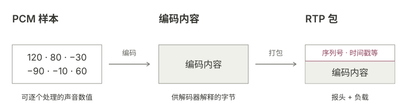
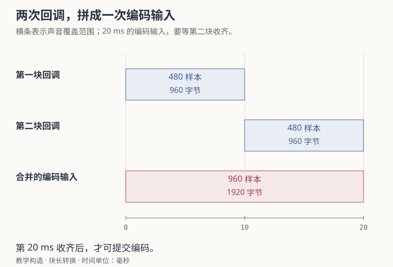
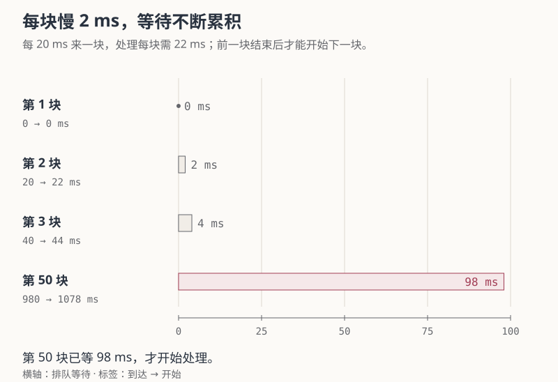

+++
title = "RTC 入门 02：声音从麦克风到扬声器"
date = 2026-10-14
lastmod = 2026-10-14
draft = false
author = "Hex4C59"
description = "沿同一段20毫秒声音，算清PCM样本、回调块、Opus负载与解码输出的变化，用配图和真实编解码实验解释变调、积压及收包后无声。"
summary = "1920字节PCM怎样变成80字节编码负载，又回到可播放的样本？跟踪格式、块长和处理边界，运行一秒合成音实验，再定位声音在哪一步出了问题。"
tags = ["RTC", "实时音视频", "音频"]
categories = ["engineering"]
source_kind = "original"
article_type = "concept"
series = ["rtc-from-zero"]
series_order = 2
series_number = 2
series_role = "chapter"
series_part = "从一通语音电话开始"
series_label = "声音从麦克风到扬声器"
ShowToc = true
+++

一段声音在发送端有 1920 字节，编码后只剩 80 字节；接收端解码，又得到 1920 字节。声音经历了什么变化？接收日志显示包已到达，为什么扬声器仍可能没有声音？

这条链路会多次改变声音的表示。每一步都需要知道自己拿到的是样本、编码数据还是网络包，并按相应的格式和时间顺序处理。收包成功只走完了其中一段，后面还有解码、格式转换和设备输出。

[上一篇](/articles/rtc-01-why-real-time/)计算了声音从采集到播放的等待。本篇沿着同一路径跟踪数据：假设手机采集 48 kHz、单声道、16 位整数声音，每 10 毫秒交给程序一块；程序合并两块，按 20 毫秒送入 Opus 编码器。

正文面向已经读过第一篇的读者。先用这个例子算清单位与处理边界，再生成一秒合成音，检查实际编码和解码结果。基本实验需要 Python 3.9 或更新版本，可选编解码实验还需要支持 libopus 的 FFmpeg 和 ffprobe；实验不采集麦克风，也不实现网络通话。

## 同一段声音，为什么要换三种表示

<figure>
  <picture>
    <source media="(max-width: 640px)" srcset="audio-data-mobile.svg" width="360" height="500">
    
  </picture>
  <figcaption>同一段声音沿链路改变表示。每一次转换，都有自己的输入格式和输出边界。</figcaption>
</figure>

PCM 是 Pulse Code Modulation，即脉冲编码调制。在这里，它是一串按固定间隔记录的声音幅度数值，适合音频处理模块和设备按采样节奏读取。

Opus 编码器接收 PCM，把一段声音表示成压缩字节；解码器再从这些字节生成 PCM。[^opus-api] 这时负载中的字节已不能按“每两个字节一个原始样本”来解释。

传输时还要把编码数据放进包。RTP 是 Real-time Transport Protocol，即实时传输协议；它附上包序、媒体时间和来源等信息，供接收端识别与安排内容。[^rtp] 压缩声音和添加传输信息发生在不同的边界。

| 表示 | 本例中的内容 | 谁主要使用它 |
| --- | --- | --- |
| PCM | 按采样节奏排列的波形数值 | 采集、音频处理、编码输入与设备输出 |
| Opus 数据 | 一段声音的压缩字节 | 编码器与解码器 |
| RTP 包 | RTP 报头与 Opus 负载 | 打包、传输、接收与重排 |

先把这三种对象分开，才知道该用什么单位描述大小，以及失败发生在哪一次转换。

## 20 毫秒声音有多少个样本

采样率 48 kHz 表示每个声道每秒记录 48,000 个样本。20 毫秒是 0.020 秒，因此每声道样本数为：

```text
48,000 样本/秒 × 0.020 秒 = 960 个样本
```

本例使用单声道、16 位整数，每个样本占 2 字节。PCM 的大小才由此确定：

```text
960 个样本/声道 × 1 个声道 × 2 字节/样本 = 1920 字节
```

一秒原始 PCM 的数据量为：

```text
48,000 × 1 × 2 = 96,000 字节/秒
96,000 × 8 = 768,000 bit/s = 768 kbit/s
```

这里计算的只有样本数据，没有文件头或网络头。960 和 1920 分别回答“有多少个每声道样本”和“缓冲里有多少字节”。它们属于同一段声音，单位却不同。

保持 20 毫秒时长不变，再改变格式：

| 格式 | 每声道样本数 | 每样本字节数 | PCM 大小 |
| --- | --- | --- | --- |
| 48 kHz，单声道，16 位整数 | 960 | 2 | 1920 字节 |
| 48 kHz，双声道，16 位整数 | 960 | 2 | 3840 字节 |
| 48 kHz，单声道，32 位浮点数 | 960 | 4 | 3840 字节 |
| 16 kHz，单声道，16 位整数 | 320 | 2 | 640 字节 |

双声道整数和单声道浮点数据恰好一样大，但字节长度没有告诉我们应怎样解释它们。双声道还要区分布局：交错排列写成 `L0, R0, L1, R1, ...`，平面排列则分开存放左右声道。

libopus 的整数编码接口接收交错 PCM，`frame_size` 的单位是每声道样本数。[^opus-api] 所以本例调用 `opus_encode()` 时填 960；改成双声道也仍填 960，输入缓冲则包含 1920 个整数样本、共 3840 字节。把字节数直接填进这个参数，会改变接口理解的输入长度。

### 样本不变，采样率标签却能改变播放节奏

48,000 个样本按 48 kHz 输出，持续 1 秒；若把同一批数据错误标为 16 kHz，持续时间就变成：

```text
48,000 ÷ 16,000 = 3 秒
```

原本 880 Hz 的合成音也会按三分之一速度输出，频率约为 293.33 Hz。样本字节没有变化，设备读取它们的节奏却变了。

真正重采样到 16 kHz，要按目标采样节奏重新生成样本，并处理目标采样率无法表示的频率成分。[^resampling] 因此声音变慢或变调时，应一起检查格式字段、样本计数和实际转换，不能只确认“已经拿到 PCM”。

## 一次采集回调，为什么不一定产生一个包

本例的设备每 10 毫秒交出一块声音，每块包含：

```text
48,000 × 0.010 = 480 个样本/声道
480 × 2 = 960 字节单声道 PCM
```

编码端选择 20 毫秒输入，就需要把两次回调的数据合在一起。第 10 毫秒只有 480 个样本，到第 20 毫秒才收齐 960 个。

<figure>
  <picture>
    <source media="(max-width: 640px)" srcset="callback-batching-mobile.svg" width="360" height="580">
    
  </picture>
  <figcaption>两块回调覆盖相邻的声音区间，合并后成为一次编码输入。横条表示媒体覆盖范围，不表示编码器在这20毫秒内一直执行。</figcaption>
</figure>

采集、音频处理和编码各有自己的块长。WebRTC 的 Audio Processing Module（音频处理模块，APM）接口处理约 10 毫秒的 PCM 块；libopus 在 48 kHz 下支持包括 480 和 960 样本在内的多种输入帧长。[^processing][^opus-api] 应用需要按这些边界拆分或拼接数据，而不是把设备的一次回调直接等同于一个网络包。

### 每块只慢 2 毫秒，等待也会不断累积

现在看一个独立的串行处理模型：任务每 20 毫秒来一块，但处理一块需要 22 毫秒，前一块结束后才能开始下一块。

| 第几块 | 到达时刻 | 开始处理 | 已经等待 |
| --- | --- | --- | --- |
| 1 | 0 毫秒 | 0 毫秒 | 0 毫秒 |
| 2 | 20 毫秒 | 22 毫秒 | 2 毫秒 |
| 3 | 40 毫秒 | 44 毫秒 | 4 毫秒 |
| 50 | 980 毫秒 | 1078 毫秒 | 98 毫秒 |

第 50 块的等待是 `(50 − 1) × (22 − 20) = 98` 毫秒。每次处理都可以成功，处理能力却持续跟不上输入。

<figure>
  <picture>
    <source media="(max-width: 640px)" srcset="processing-backlog-mobile.svg" width="360" height="632">
    
  </picture>
  <figcaption>比较的是开始处理前的排队等待。第50块在980毫秒到达，到1078毫秒才开始；图中未展开第4至49块。</figcaption>
</figure>

扩大队列只能容纳更多等待中的数据。要改变这个模型的积压，需要改变工作量、服务能力或过时数据的处理方式；真实系统还可能有不同的并行与调度安排。这类延迟发生在本机，网络再快也不会消除它。

所以日志除了记录“编码成功”，还应记录进入队列与实际开始处理的时刻。两者的间隔才显示这块声音已经等了多久。

## 编码之前，哪些问题已经进入声音

麦克风记录的信号里，可能同时有人的语音、环境噪声和扬声器的声音。编码器会处理它得到的信号，接收端成功解码并不能自动说明其中只剩下想要的语音。

手机扬声器播放朋友的声音，麦克风若把它录进去并传回，朋友就会听到自己的回声。AEC 是 Acoustic Echo Cancellation，即声学回声消除。它利用正在播放的信号作为参考，估计其重新进入麦克风的成分，并在采集信号中做相应处理。WebRTC 的接口区分采集流和播放参考流，音频规范也讨论了通话设备的回声消除要求。[^processing][^echo]

| 处理 | 针对的信号问题 | 需要观察的边界 |
| --- | --- | --- |
| AEC，回声消除 | 本机播放信号又进入麦克风 | 播放参考、采集信号及两者的时间关系 |
| NS，Noise Suppression，降噪 | 风扇、环境等噪声成分 | 处理前后的噪声与语音变化 |
| 增益控制 | 输入音量过低或变化 | 样本幅度，以及放大后是否削波 |

削波是幅度超出表示或输出范围后被截断。16 位有符号整数的范围是 −32768 到 32767，接近上限的样本放大两倍，就无法继续准确表示。

这些组件是否启用、怎样处理，取决于实现。若问题已出现在编码输入里，正常的网络传输也可能把它带到另一端。对照音频处理前后的样本，才能把回声、噪声和幅度问题与网络缺失区分开。

## 1920 字节怎样变成 80 字节

Opus 编码器读取这 960 个每声道样本，产生编码字节。输出大小受码率、声音内容和配置影响，不能再用 PCM 的“样本数乘字节宽度”计算。[^opus-api]

先做一个固定码率的教学预算：若音频负载为 32 kbit/s，每包对应 20 毫秒，那么：

```text
32,000 × 0.020 ÷ 8 = 80 字节
```

同一段声音因此先是 1920 字节 PCM，再是 80 字节编码负载。24 倍的大小差来自本例给定的格式和码率，不能推广成 Opus 对任意声音的固定压缩比例。

打包器随后添加 RTP 报头，维护来源、包序、媒体时间和格式映射。一个 Opus RTP 负载承载一个完整 Opus 包。[^opus-rtp] 编码字节数与网络包大小也要分开记录：传输信息没有产生新声音，却会增加发送的数据量。

编码输出后，打包、安全处理和发送调度还可能继续发生。“产生编码字节”“进入发送队列”“实际交给传输”是三个不同的事件。数据持续产生而发送速度不足时，发送队列也会积压。

## 收到编码数据以后，怎样重新发声

接收端要先确认来源与格式，取出负载，并按媒体位置安排处理。libopus 的解码器有状态，输入需要按正确顺序串行提供；不同来源使用各自的解码状态。[^decoder] 后到的包怎样安排，将在[第三篇](/articles/rtc-03-sequence-gap/)具体计算。

解码之后，声音又成为 PCM。若解码格式与设备格式不同，还需要转换采样率、声道或样本表示，再按设备要求的块长提交。

例如一次解码得到 20 毫秒、48 kHz、单声道 PCM，共 960 个样本；设备每次取 10 毫秒，就分两次各取 480 个。这里再次出现了块长转换，解码块和设备回调仍不必一样长。

输出系统收到样本之后，队列和设备还可能继续等待。[^output] 播放路由选错、设备静音、样本幅度接近零，或队列没有持续供给，都可能表现为“解码成功但听不见”。反过来，样本持续堆积又会增加等待。检查计数时，需要按各阶段实际的采样率和时间区间对齐。

## 用一秒合成音检查这些转换

[下载音频实验 audio_lab.py](audio_lab.py)。脚本生成 880 Hz、48 kHz、单声道、16 位整数的一秒声音，不使用私人录音。WAV 是方便保存和检查 PCM 的文件容器；实时链路中的样本可以直接在内存缓冲里流动。

### 先检查 PCM 与采样率标签

在脚本所在目录，用 Python 3.9 或更新版本运行：

```bash
python3 audio_lab.py --output-dir audio-lab-pcm
```

脚本没有第三方 Python 依赖，会创建新目录；已有同名目录时拒绝覆盖，重复运行需要换一个 `--output-dir` 名称。关键输出为：

```text
PCM: 48000 Hz; mono; 16-bit; 48000 samples/channel
PCM data: 96000 bytes; WAV file: 96044 bytes
Rate-label demo: same PCM at 16000 Hz lasts 3 s; frequency becomes 293.333 Hz
10 ms callback: 480 samples/channel; 960 bytes
20 ms encoder input: 960 samples/channel; 1920 bytes
```

`tone.wav` 使用正确的采样率；`wrong-rate.wav` 保存相同 PCM 字节，只把采样率标为 16 kHz。它们让前面的变调计算有了实际文件输入。

96,000 字节是样本数据，96,044 字节是这个脚本写出的 WAV 文件大小。WAV 还可以有其他块，因此不能对任意文件都跳过固定的 44 字节。脚本通过 Python `wave` 模块读格式和数据；其中 `getnframes()` 统计采样帧，单声道时等于样本数，不是 20 毫秒编码块数。[^wave]

### 再检查真实 Opus 编解码

这一步需要已有 `ffmpeg`、`ffprobe`，并且 FFmpeg 支持 `libopus`。先检查：

```bash
ffmpeg -version
ffprobe -version
ffmpeg -hide_banner -h encoder=libopus
```

找不到这些工具时，需要先准备它们；纯 PCM 部分不受影响。然后运行：

```bash
python3 audio_lab.py --with-opus --output-dir audio-lab-opus
```

脚本会自动执行下面的编码设置，不必在同一目录再执行一次：

```bash
ffmpeg -hide_banner -loglevel error -n -i audio-lab-opus/tone.wav \
  -c:a libopus -b:a 32k -vbr off -frame_duration 20 audio-lab-opus/tone.opus
```

`-b:a 32k` 设置音频负载目标码率，`-vbr off` 选择固定码率，`-frame_duration 20` 选择 20 毫秒编码帧。[^ffmpeg] `.opus` 文件使用 Ogg 容器；脚本用 ffprobe 检查音频包，再解码为 `decoded.wav`。

2026 年 10 月 14 日，在 macOS arm64、Python 3.9.6、FFmpeg 8.1、libopus 1.6.1 环境下，这一秒合成音的实际结果为：

| 检查对象 | 运行结果 |
| --- | --- |
| 输入 PCM | 96,000 字节，48,000 个每声道样本 |
| Opus 音频包 | 51 个，每个 80 字节 |
| Opus 音频负载合计 | 4080 字节 |
| Ogg Opus 文件整体 | 4322 字节 |
| 解码后的 PCM | 96,000 字节，48,000 个每声道样本 |
| 解码样本是否逐字节等于输入 | 否 |

对应输出为：

```text
Opus audio packets: 51; sizes: [80] bytes
Opus audio payload total: 4080 bytes
Ogg Opus file total: 4322 bytes
Decoded PCM: 48000 samples/channel; 96000 bytes
PCM byte-identical: False
```

4080 与 4322 的差别来自音频负载之外的容器和头信息。这说明检查大小时必须明确边界：文件大小不能直接作为网络音频负载大小。

解码后的样本数和时长与输入相同，样本值却没有逐字节还原。这个实验验证了有损编解码后的数据变化，没有评价真人语音的听感或质量。

51 个离线音频包也不能解释为持续通话每秒固定发送 51 个 RTP 包。Ogg Opus 用开头跳过样本和结尾裁切的信息，映射最终呈现的样本范围；本次文件解码后仍是一秒。[^ogg] 文件包数、编码块数和呈现样本数要分别核对。

具体文件大小和解码样本可能随版本与元数据变化，因此复现实验需要记录参数。这次没有测编码速度、网络带宽或端到端延迟。

## 用边界解释“收到了，却没听见”

假设接收日志中的包数一直增加，扬声器却没有声音。可以沿下面的边界，逐个确认数据走到了哪里：

| 已确认的事件 | 接着检查 | 能缩小到的范围 |
| --- | --- | --- |
| 收包事件持续增加 | 来源、格式，以及是否进入媒体缓冲 | 无关数据，或在验证和分流时被拒绝 |
| 媒体缓冲取出负载 | 解码错误、输出样本数量 | 负载格式、长度、顺序或解码状态 |
| 解码器生成 PCM | 采样率、声道、布局与幅度 | 转换错误，或数据本来接近静音 |
| PCM 进入输出队列 | 是否持续消费和补充 | 输出回调、积压或供给不足 |
| 输出系统接受样本 | 路由、静音与实际输出 | 播放设备及其状态 |

声音变慢或变调，先核对格式与样本计数；延迟随时间增长，检查队列等待；回声和噪声跟着语音传过来，则对照编码前后的信号。这些判断对应不同边界，需要不同证据。

开头的 1920 字节、80 字节和解码后的 1920 字节，描述的是同一段媒体经过不同表示后的大小。让它最终被听见，还需要正确的格式、顺序、持续供给和设备输出。下一篇会把其中的网络包展开，解释接收日志里的序号缺口、乱序和迟到为什么不能合成一个“丢包”数字。

[下一篇：从一段收包记录读懂 RTP](/articles/rtc-03-sequence-gap/)

[回看上一篇：实时通话为什么不能一直等](/articles/rtc-01-why-real-time/) · [系列目录](/articles/rtc-from-zero/)

## 参考资料

资料与接口核对于 2026 年 10 月 14 日。固定队列案例为教学构造；编解码表格是本文合成输入在上述版本下实际运行的结果，未使用通话录音或音质测试集。

[^opus-api]: [libopus 1.6 编码器文档](https://www.opus-codec.org/docs/opus_api-1.6/group__opus__encoder.html)，说明 PCM 输入、交错声道、每声道样本数与编码字节输出。
[^resampling]: [FFmpeg libswresample 文档](https://ffmpeg.org/libswresample.html)，说明重采样、样本格式与声道转换及滤波选项。
[^processing]: [WebRTC 音频处理接口 audio_processing.h](https://webrtc.googlesource.com/src/+/refs/heads/main/api/audio/audio_processing.h)，说明约 10 毫秒 PCM 块、采集与播放参考两路输入，以及音频处理组件。链接指向持续更新的主分支，本文以访问日内容为准。
[^echo]: [RFC 7874 §5：回声消除](https://www.rfc-editor.org/rfc/rfc7874.html#section-5)，2016 年 5 月发布。
[^rtp]: [RFC 3550 §5.1：RTP 报头字段](https://www.rfc-editor.org/rfc/rfc3550.html#section-5.1)，2003 年 7 月发布。
[^opus-rtp]: [RFC 7587 §4.2：Opus RTP 负载结构](https://www.rfc-editor.org/rfc/rfc7587.html#section-4.2)，2015 年 6 月发布，规定一个 RTP 负载承载一个 Opus 包。
[^decoder]: [libopus 1.6 解码器文档](https://www.opus-codec.org/docs/opus_api-1.6/group__opus__decoder.html)，说明解码状态、正确输入顺序与 PCM 输出。
[^output]: [W3C Web Audio API 2021 推荐标准：音频输出延迟](https://www.w3.org/TR/2021/REC-webaudio-20210617/#dom-audiocontext-outputlatency)，2021 年 6 月 17 日发布。
[^wave]: [Python 3.9 wave 文档](https://docs.python.org/3.9/library/wave.html)，说明 WAV 参数、采样帧与数据读写接口。
[^ffmpeg]: [FFmpeg 编码器文档：libopus 参数映射](https://ffmpeg.org/ffmpeg-codecs.html#libopus-1)，说明码率、VBR 模式和帧时长。[ffprobe 文档](https://ffmpeg.org/ffprobe.html)说明音频流和包信息的检查方式。
[^ogg]: [RFC 7845 §4.2 与 §4.4：Ogg Opus 的开头跳过与结尾裁切](https://www.rfc-editor.org/rfc/rfc7845.html#section-4.2)，2016 年 4 月发布，说明如何将编码数据的样本位置映射到最终呈现范围。
