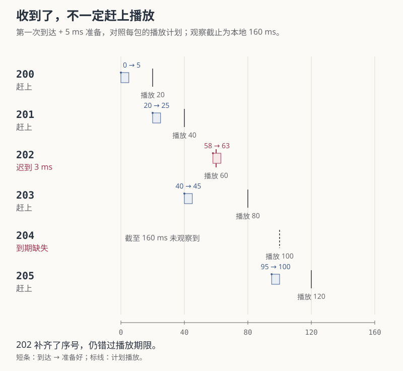
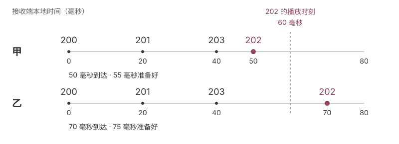
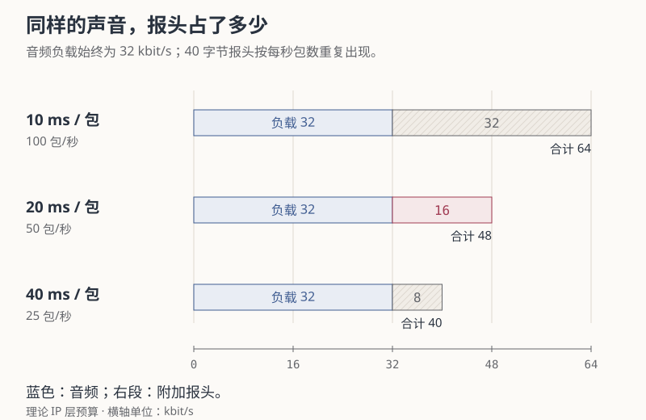
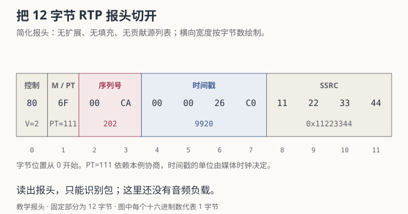

+++
title = "RTC 入门 03：从一段收包记录读懂 RTP"
date = 2026-10-14
lastmod = 2026-10-15
draft = false
author = "Hex4C59"
description = "从乱序的声音引出 RTP 序号与时间戳，先区分重复、乱序、迟到和到期缺失，再读报头，用实验和一段新记录检查播放判断。"
summary = "202后来到了，序号缺口已补齐，声音为什么仍可能播不了？用同一份记录分别计算接收、媒体位置和播放可用性，再比较增加等待与打包时长的代价。"
tags = ["RTC", "实时音视频", "RTP"]
categories = ["engineering"]
source_kind = "original"
article_type = "concept"
series = ["rtc-from-zero"]
series_order = 3
series_number = 3
series_role = "chapter"
series_part = "从一通语音电话开始"
series_label = "从一段收包记录读懂 RTP"
ShowToc = true
+++

接收端先拿到 200、201、203，过了一会儿，202 也到了。序号缺口已经补齐，这段声音就一定能正常播放吗？

还要看它到达时，接收端剩下多少处理时间。一个包可以最终收到，却赶不上原来的播放计划；重复收到旧包，也可以让接收次数增加，而没有带来新的声音。

本篇把这几种情况放进同一段记录：先解释接收端为什么需要包序和媒体位置，再把它们映射到本地播放时刻，分别统计收到和可用的内容，最后回到报头查看这些信息怎样存储。[上一篇](/articles/rtc-02-audio-path/)已经介绍了 PCM、Opus 编码和打包，这里继续跟踪它们产生的网络包。

假设发送端通过 RTP 发送 Opus，每包承载 20 毫秒音频，所有包来自同一个已知来源，没有重启、换源或重传机制。报头字节、到达记录和播放参数均为教学构造。正文只需乘除法；文末的 Python 3.9+ 实验没有第三方依赖，不抓网络包，也不生成声音。

读完本篇，你应该能给一份小型收包记录标出重复、乱序、迟到和到期缺失，并说明每段声音属于哪个播放区间。基础部分只用十进制数和乘除法；报头的十六进制与位运算放在后面，需要读代码时再展开。

## 先把三段声音放回原来的位置

沿用第二篇的链路：每段声音经过 Opus 编码，装成网络包发送。假设相邻的 A、B、C 各覆盖 20 毫秒，接收端却先后收到 A、C、B。按到达顺序播放，就会把 B 和 C 的声音位置颠倒。

接收端需要包里附带说明。只给它一段压缩声音，并不足以让它从网络到达顺序中还原原先的安排：

| 想解决的问题 | 需要随包携带什么 |
| --- | --- |
| C 到了，怎么知道 B 还缺着 | 连续的包序号，例如 A=200、B=201、C=202 |
| B 和 C 各属于声音的哪一段 | 声音起点在媒体时间里的位置 |
| 多个人的包同时进来，能不能放在一起排 | 来源标识，把不同来源的状态分开 |
| 这些字节要交给哪个格式的解码器 | 格式标识，以及事先约定的格式对应关系 |

RTP（Real-time Transport Protocol，实时传输协议）用报头承载这些信息，后面再放编码的媒体负载。报头可以理解成这份数据的说明部分，负载才是本例的压缩声音。RTP 本身不保证送达或按发送顺序到达。[^rtp][^header]

先记住序号和声音位置两个概念就够了。来源标识在 RTP 中叫 SSRC（Synchronization Source，同步源标识）；格式标识叫 PT（Payload Type，负载类型）。它们的字节位置留到后面的报头一节再看。

为什么有序号还要有声音位置？如果每包永远固定 20 毫秒，两者确实容易换算；一旦每包装入的时长改变，“下一个包”就不再等于“向后 20 毫秒”。序号回答包前后关系，媒体时间回答声音放在哪个时间区间。

## 序号给出包序，时间戳给出声音位置

序列号相差 1，说明前进了一个包。要知道声音相隔多久，还需要时间戳之差和对应的时钟频率。

Opus 的 RTP 时间戳统一使用 48 kHz 时钟，每秒 48,000 个刻度；即使编码输入 PCM 为 16 kHz，这个 RTP 时钟也仍然是 48 kHz。[^opus] 因此本例的 20 毫秒对应：

```text
48,000 刻度/秒 × 0.020 秒 = 960 刻度
```

假设包 200 的时间戳为 8000，连续六包的媒体位置如下：

| 序列号 | RTP 时间戳 | 声音起点相对包 200 的位置 |
| --- | --- | --- |
| 200 | 8000 | 0 毫秒 |
| 201 | 8960 | 20 毫秒 |
| 202 | 9920 | 40 毫秒 |
| 203 | 10880 | 60 毫秒 |
| 204 | 11840 | 80 毫秒 |
| 205 | 12800 | 100 毫秒 |

包 202 对应的位置可以算成：

```text
(9920 − 8000) ÷ 48,000 × 1000 = 40 毫秒
```

这个 40 毫秒属于媒体时间。202 在电脑上何时收到，还取决于发送与传输；即使 203 先到，202 对应的声音仍在 203 前面。

本例每包都固定承载 20 毫秒，才有“序号加 1，时间戳加 960”的对应关系。Opus 可以使用其他打包时长，一个 Opus 包也可以包含多个编码帧，一个 RTP 负载承载一个完整 Opus 包。[^opus] 其他媒体格式还可能把一个媒体单元拆进多个共享时间戳的 RTP 包。[^header] 包数不能脱离负载格式，直接转换为声音时长。

## 把收到的包放回播放计划

发送端已知发出了 200—205。接收端的完整记录如下，观察持续到本地 160 毫秒：

| 本地到达时刻 | 序列号 | 序号状态 |
| --- | --- | --- |
| 0 毫秒 | 200 | 从 200 开始记录 |
| 20 毫秒 | 201 | 200、201 连续 |
| 40 毫秒 | 203 | 当前缺少 202 |
| 42 毫秒 | 201 | 201 重复，缺口仍在 |
| 58 毫秒 | 202 | 乱序首次到达，202 的缺口补齐 |
| 95 毫秒 | 205 | 当前又缺少 204 |

到 160 毫秒为止，204 没有出现。这里的到达和后面的播放，都使用接收端同一条本地时间轴；0 毫秒是观察起点。

重复的 201 增加了一次接收事件，没有增加新的媒体内容；Opus RTP 接收端至多把一份重复负载交给解码器。[^opus] 202 在 203 后第一次出现，属于乱序。它补齐了包序，但能否播放还需要另一个判断。

### 202 在 58 毫秒到达，为什么仍然迟到

设定固定播放计划：包 200 的声音在本地 20 毫秒开始播放，后续按媒体位置推进。播放以前预留 5 毫秒，完成排队、解码和向输出端提交数据。

这些值用于教学计算，没有对应产品推荐参数或实际测量。真实抖动缓冲会根据到达变化安排播放，晚于可用时间的包可能被丢弃。[^buffer]

把媒体时间映射到播放时间：

```text
播放时刻 = 起始播放时刻 + (当前 RTP 时间戳 − 基准 RTP 时间戳) / 时钟频率
```

包 202 应在以下时刻播放：

```text
20 + (9920 − 8000) ÷ 48,000 × 1000 = 60 毫秒
```

扣掉 5 毫秒准备时间，它最晚需要在 `60 − 5 = 55` 毫秒到达。实际到达是 58 毫秒，准备完成时刻就是 63 毫秒，比原计划晚了 3 毫秒。

这个判断沿用了第一篇的预算条件：

```text
到达时刻 + 后续处理耗时 ≤ 计划播放时刻
```

不能只比较“到达早于播放”。配套程序使用以下计算；片段中的变量来自报头和到达记录：

```python
playout_ms = 20 + (timestamp - 8000) * 1000 / 48000
ready_ms = arrival_ms + 5
usable_for_scheduled_playout = ready_ms <= playout_ms
```

### 其他包也要接受同样的时间判断

| 序列号 | 第一次到达 | 原定播放时刻 | 计入 5 毫秒准备后的结果 |
| --- | --- | --- | --- |
| 200 | 0 毫秒 | 20 毫秒 | 赶上 |
| 201 | 20 毫秒 | 40 毫秒 | 赶上 |
| 202 | 58 毫秒 | 60 毫秒 | 迟到 |
| 203 | 40 毫秒 | 80 毫秒 | 赶上 |
| 204 | 未观察到 | 100 毫秒 | 到期缺失 |
| 205 | 95 毫秒 | 120 毫秒 | 赶上 |

<figure>
  <picture>
    <source media="(max-width: 640px)" srcset="packet-playout-mobile.svg" width="360" height="932">
    
  </picture>
  <figcaption>短条连接第一次到达与准备完成时刻，标线给出计划播放。这里不画重复的201，因为它没有新增媒体内容；红色同时配有文字结果。</figcaption>
</figure>

203 早在 40 毫秒就到了，却要在 80 毫秒才播放。接收端可以把它放入缓冲，等待较早媒体位置的内容；直接把 203 接在 201 后面，会挤掉 202 所占的那段时间。

到了 202 的播放时刻，若原包仍不可用，就需要处理缺失区间，再继续推进媒体时间。恢复和缺失掩盖可能改变最后听到的声音，但本例没有模拟它们。迟到包也可能影响具体实现的解码状态；这不会使它重新赶上已经过去的播放计划，不能据此断言解码器之后一定怎样处理。

要看清期限的分界，可以只改变 202 的到达时刻：

<figure>
  <picture>
    <source media="(max-width: 640px)" srcset="arrival-timeline-mobile.svg">
    
  </picture>
  <figcaption>独立比较两种到达情况：准备耗时均为 5 毫秒，播放均在 60 毫秒。50 毫秒到达时可以赶上，70 毫秒到达时已经来不及；正文的 58 毫秒到达也会晚 3 毫秒。</figcaption>
</figure>

## 六次接收，为什么只有四段原始声音赶上

截至 160 毫秒，接收事件、不同包和播放可用区间，可以得到不同结果：

| 统计的问题 | 结果 | 计数边界 |
| --- | --- | --- |
| 一共发生几次接收 | 6 次 | 包括第二次收到的 201 |
| 预期的不同包有几个没出现 | 1 / 6，约 16.7% | 去重后只有 204 未观察到 |
| 原包有几个区间赶不上播放 | 2 / 6，约 33.3% | 202 迟到，204 到期缺失 |

收到的次数与新增的内容不同，最终收到与按时可用也不同。所以一份接收日志必须同时保留包序、媒体位置和播放期限，才能解释这几个数字。

33.3% 不代表实际输出中一定有 40 毫秒静音：恢复和缺失掩盖可能改变听感，脚本没有测量声音质量。分母为 6，也依赖“发送端确定发出了 200—205”的教学前提。只有不完整的接收日志，不能自动判断窗口开头和末尾还漏了多少包。

### RTCP 的累计丢包数，为什么又可能是零

这一小节讨论协议统计口径，第一次阅读可以先保留上面的三种计数，稍后再回看。

RTP 通常配合 RTCP（RTP Control Protocol）传递接收统计与控制信息。RFC 3550 的累计丢包定义是预期包数减去实际收到包数，收到的计数包含迟到与重复，重复较多时甚至可以得到负值。[^rtcp]

若统计基准已经固定在 200，且本例六次接收都计入该统计，则有 `6 − 6 = 0`。204 仍未出现，202 也仍错过了播放期限，零值来自这套计数口径。

实际 RTCP 统计还要处理来源验证、区间和序号回绕；配套脚本没有实现 RTCP 报告。看到指标名里有 `loss` 时，应先确认它是否去重、截止在何时，以及分母如何产生。

## 每包 20 毫秒，还会改变什么

固定打包时长让前面的媒体位置容易计算，也决定每秒发多少包。包越短，每秒附加报头的次数就越多。

假设音频负载固定为 32 kbit/s，1 kbit/s 在这里等于每秒 1000 bit。每包 20 毫秒，对应负载为：

```text
32,000 bit/s × 0.020 s ÷ 8 bit/字节 = 80 字节
```

本例通过 IPv4 与 UDP 传输 RTP。IPv4 是互联网协议的一个版本；UDP（User Datagram Protocol，用户数据报协议）在本例中承载 RTP 数据。每层都有自己的报头，因此音频之外还要计算这些说明信息。

再假设 IPv4 没有选项，RTP 没有扩展、填充，也没有加密附加字段。每包另有 20 字节 IPv4 头、8 字节 UDP 头和 12 字节 RTP 固定头，共 40 字节。[^network-headers]

```text
每包：80 字节音频 + 40 字节报头 = 120 字节
每秒：1000 ÷ 20 = 50 包
IP 层码率：120 × 50 × 8 = 48,000 bit/s = 48 kbit/s
```

保持负载码率不变，仅调整每包时长：

| 每包音频 | 每包负载 | 每秒包数 | 每秒报头开销 | IP 层总码率 |
| --- | --- | --- | --- | --- |
| 10 毫秒 | 40 字节 | 100 | 32 kbit/s | 64 kbit/s |
| 20 毫秒 | 80 字节 | 50 | 16 kbit/s | 48 kbit/s |
| 40 毫秒 | 160 字节 | 25 | 8 kbit/s | 40 kbit/s |

<figure>
  <picture>
    <source media="(max-width: 640px)" srcset="packetization-cost-mobile.svg" width="360" height="544">
    
  </picture>
  <figcaption>音频部分保持相同，附加报头随每秒包数变化。条长按IP层码率成比例绘制，数值来自本文固定负载与无扩展报头的预算。</figcaption>
</figure>

较长的包减少了附加报头的频率，却要先积累更长的声音，丢一包也影响更长的媒体区间。在“收齐再打包”的模型中，40 毫秒一包让该段最早采到的样本等待接近 40 毫秒，之后还要编码与发送。

图表计算的是固定负载码率下的预算，没有模拟 Opus。实际负载可以变化，真实通话还要计入头扩展、安全传输、RTCP 控制流量与链路层开销。48 kbit/s 只属于给定假设下的 IP 层数据量，没有对应某款 RTC SDK 的实测带宽。

基础读法到这里已经完整：分清包序、声音位置和本地到达，再按播放期限判断。下面两节进一步查看报头和编号回绕；第一次阅读也可以先到[收包实验](#运行相同记录改变播放计划)。

## 一个报头要回答哪些问题

前面用到的包序、媒体位置、来源和格式，都要写进实际的数据。下面查看它们在报头中的位置；这部分用于理解协议表示，不改变前面的播放判断。

先看一个没有扩展、填充和贡献源列表的固定报头，共 12 字节：[^header]

```text
80 6f 00 ca 00 00 26 c0 11 22 33 44
```

每两个十六进制数字是一字节；例如 `ca` 对应十进制 202。按字段分开，就能看见各部分负责的事情：

<figure>
  <picture>
    <source media="(max-width: 640px)" srcset="rtp-header-map-mobile.svg" width="360" height="552">
    
  </picture>
  <figcaption>从字节位置对应到字段与数值。桌面图的字段宽度按字节数绘制；移动图按字段重新排列，读取顺序与数值保持一致。</figcaption>
</figure>

| 字节位置，从 0 开始 | 字节 | 字段值 |
| --- | --- | --- |
| 0 | `80` | V=2；P=0、X=0、CC=0 |
| 1 | `6f` | M=0；PT=111 |
| 2—3 | `00 ca` | 序列号 202 |
| 4—7 | `00 00 26 c0` | 时间戳 9920 |
| 8—11 | `11 22 33 44` | SSRC=`0x11223344` |

第一个字节可以拆成 `10 | 0 | 0 | 0000`：版本占前两位，随后是填充标志 P、扩展标志 X 和贡献源数量 CC。第二个字节的最高位是标记 M，剩余七位是负载类型 PT。M 的含义由负载格式约定，不能把所有 M=1 都解释成“一帧结束”。[^header]

PT 让接收端结合协商结果解释负载。本例约定 PT=111 对应 Opus；111 不是 Opus 的固定协议编号，它使用动态分配的 PT。这里的“协商”是指通信两端事先交换并确认格式等设置；单凭一个 111，接收端不能凭空知道对应什么编码。[^opus] SSRC（Synchronization Source，同步源标识）用于区分会话中的来源，包序和媒体状态要按来源分别保存。[^header]

序列号按包计数，同一来源每发一个 RTP 数据包增加 1；时间戳标记媒体位置，单位由媒体时钟决定。这两个字段都可能增长，却不能直接互相替代。

多字节整数采用网络字节序，即高位字节在前。[^header] 可以用下面的完整 Python 片段读出数值：

```python
import struct

raw = bytes.fromhex("80 6f 00 ca 00 00 26 c0 11 22 33 44")
first, second, seq, timestamp, ssrc = struct.unpack("!BBHII", raw)
print(seq, timestamp, hex(ssrc))
# 202 9920 0x11223344
```

`!` 指定网络字节序，两个 `B` 各读一字节，`H` 读两字节无符号整数，两个 `I` 各读四字节无符号整数。

这里没有 Opus 负载，读出报头还不能播放声音。完整接收器要根据 CC、X 和 P 处理贡献源列表、头扩展与填充；第 12 字节不一定就是有效负载的起点。配套脚本只接受上述简化报头，遇到其他格式会拒绝。[^header]

## 序号回到零，包并没有回到开头

序列号只有 16 位，持续发包会出现：[^header]

```text
65534 → 65535 → 0 → 1
```

按每 20 毫秒一包、一秒 50 包计算，整个编号周期为：

```text
65,536 ÷ 50 = 1310.72 秒 ≈ 21 分 51 秒
```

初始序号通常不是零，因此通话中的第一次回绕可以更早发生。[^header] 此时用“新号小于旧号”判断乱序，会把正常的 0 和 1 判成旧包。

教学上可以把短序号解释到连续的扩展序号中：

| 收到的 16 位序号 | 扩展序号 | 对应内容 |
| --- | --- | --- |
| 65534 | 65534 | 当前周期 |
| 65535 | 65535 | 当前周期 |
| 0 | 65536 | 下一周期的 0 |
| 1 | 65537 | 下一周期的 1 |
| 又收到 65535 | 65535 | 上一周期的重复包 |

实验把新序号解释到离当前最高扩展序号最近的周期。下面是核心计算片段，完整调用与检查在脚本中：

```python
# highest 是已经确认的最高扩展序列号。
# seq 是新收到的 16 位序列号。
delta = ((seq - (highest & 0xffff) + 32768) % 65536) - 32768
extended = highest + delta
```

最高值为 65535 时收到 0，`delta=1`，扩展为 65536。最高值已到 65537 时再收到 65535，`delta=-2`，指向旧包；乱序和重复都不能把最高值往回改。

这个方法依赖新旧包的距离小于半个编号空间，也就是 32768。恰好相差半个空间时，不能用它决定前后。它也不验证发送端重启、极大跳号或新来源；生产接收器还需要更完整的状态检查，RFC 3550 附录 A.1 给出了相应示例。[^sequence-check]

## 运行相同记录，改变播放计划

[下载配套脚本 rtp_trace.py](rtp_trace.py)，保存后在脚本所在目录运行：

```bash
python3 --version
python3 rtp_trace.py
```

需要 Python 3.9 或更新版本。Windows 上也可使用安装 Python 后提供的 `py -3 rtp_trace.py`。程序没有第三方依赖，使用内置教学报头与记录，不读录音或抓包文件。

报头输出包含 `PT=111 seq=202 timestamp=9920 SSRC=0x11223344`。40 毫秒的 203 打开缺口，42 毫秒的重复 201 没有补上它，58 毫秒的乱序 202 才填补序号缺口。默认结果为：

```text
Arrival events: 6; unique packets: 5; duplicates: 1; reordered first arrivals: 1
Schedule: on time=4, late=1, missing=1, pending=0
```

四种状态分别表示赶上、迟到、到期仍缺失、尚未到播放时刻。最后还有独立的回绕例子，检查 `65535 → 0` 的扩展序号，以及随后到达的旧包。

先预测一个边界值：如果从第 20 毫秒开始播放改为第 23 毫秒，202 的期限会从 60 移到 63 毫秒；它仍在 58 毫秒到，准备需要 5 毫秒，恰好 63 毫秒完成。运行前先判断它应归入哪一类：

```bash
python3 rtp_trace.py --playout-start-ms 23
```

按本模型的规则，刚好赶上也计入及时，结果应为 `on time=5, late=0, missing=1, pending=0`。缺失的 204 仍然不会因为等得更久就自动出现。

接着只把起始播放时刻改成 40 毫秒：

```bash
python3 rtp_trace.py --playout-start-ms 40
```

输入记录、准备成本和观察终点都不变，播放计划整体推迟 20 毫秒：

| 判断项 | 20 毫秒开始 | 40 毫秒开始 |
| --- | --- | --- |
| 202 的播放时刻 | 60 毫秒 | 80 毫秒 |
| 202 的准备完成时刻 | 63 毫秒 | 63 毫秒 |
| 202 是否赶上 | 否 | 是 |
| 赶上的不同包数 | 4 | 5 |
| 迟到的不同包数 | 1 | 0 |
| 到期缺失的不同包数 | 1 | 1 |

第二次结果为：

```text
Schedule: on time=5, late=0, missing=1, pending=0
```

多等 20 毫秒让 202 赶上，也让六段声音都晚 20 毫秒播放。204 仍然没到，缓冲没有产生缺失内容。这里展示的是固定计划的取舍，不能据此推荐所有通话增加同样的缓冲。

再把观察提前结束：

```bash
python3 rtp_trace.py --observe-until-ms 45
```

此时还没轮到 202 的 60 毫秒播放时刻，所以它暂未收到，也不能记为到期缺失：

```text
Schedule: on time=2, late=0, missing=0, pending=4
```

203 虽已到达，也仍属于尚未到期的播放区间。`pending` 按播放计划判断，与接收日志里的序号缺口是不同的状态。

脚本只处理已知来源、小段序号范围和固定播放计划，没有动态抖动缓冲、真实解码、包恢复、安全传输或时间戳回绕。用于实际通话前，还需完整包解析、来源验证和时钟状态。

## 不看原表，再判断一次

下面是一个独立的小记录。已知发送端发出同一来源的 10、11、12 三包，每包 20 毫秒；10 计划在本地 30 毫秒播放，后面依次每隔 20 毫秒播放一包，准备各需 5 毫秒。

| 到达时刻 | 收到的包 |
| --- | --- |
| 0 毫秒 | 10 |
| 25 毫秒 | 12 |
| 28 毫秒 | 10，再来一次 |
| 48 毫秒 | 11 |

观察到本地 100 毫秒。请算：发生几次接收、收到几个不同的包、哪个包乱序、几段原始声音赶上播放？包 12 在 25 毫秒已经到达，是否应该立刻在包 11 前播放？

<details>
<summary>展开分类与推导</summary>

共有 4 次接收、3 个不同的包；28 毫秒的 10 是重复，48 毫秒首次到达的 11 是乱序。11 在最终记录里并未缺失。

三包的播放时刻分别为 30、50、70 毫秒；准备完成时刻分别为 5、53、30 毫秒。因此 10 与 12 赶上，11 晚 3 毫秒，及时原始声音是 2 / 3。

12 的媒体位置在 11 后面，提前到达只能先等待原定安排。把它直接挪到 11 的位置，会改变声音的时间顺序。11 的处理需在到期时另作决定，不能用“最后全收齐了”抹掉它的迟到。

这里最终网络缺失数为零，原始声音及时率仍不是 100%。如果把两个结果算成同一个数字，回看“六次接收，为什么只有四段原始声音赶上”。

</details>

## 一份真实日志还需要哪些证据

真实日志记录在不同处理边界。网卡或 socket 收到数据报、媒体缓冲接受负载、解码器输出样本，各自证明不同的事情。一个包出现在前面的日志里，不一定进入了后面的处理。

| 要关联的信息 | 判断的问题 |
| --- | --- |
| 会话、SSRC 与协商的 PT | 是否同一来源、同一格式 |
| 原始与扩展序列号 | 是否乱序、重复或跨回绕 |
| RTP 时间戳与时钟频率 | 对应哪个媒体位置 |
| 接收时刻及日志所在阶段 | 到达了哪里，是否被过滤或拒绝 |
| 播放计划与准备完成时刻 | 是否赶上，时间花在何处 |
| 恢复、缺失掩盖与实际输出 | 原包不可用后，用户听到了什么 |

看到 200、201、203，先记当前缺口和剩余预算；后来收到 202，分别更新“缺口已补齐”和“是否赶上”；只收到重复的 201，则缺口不变。等媒体时间推进到期限，再记录该区间的最终处理结果。

接收端事件应使用可比较的本地时钟。发送端本地时间不能直接减去接收端本地时间作为网络耗时，还需要处理两端的时钟关系。单靠 `RTP 时间戳=9920`，也算不出电脑上几点播放，必须有本地播放基准。

日志范围本身也需要确认。一个采集点没有记录 204，可能是包没到，也可能是过滤、采集范围或记录遗漏。接收端的一次缺口不能定位内容消失在哪个网络节点，需要结合对应的发送、传输和接收边界取证。

开头的问题因此有了两个独立答案：202 后来收到，所以序号缺口补齐；它准备好时已经超过原定期限，所以这次播放仍不可用。[第四篇](/articles/rtc-04-loss-recovery/)继续比较怎样处理这些区间：重传何时还有时间，冗余恢复付出多少数据成本，以及来不及恢复时怎样继续产生声音。

[回看上一篇：声音从麦克风到扬声器](/articles/rtc-02-audio-path/) · [系列目录](/articles/rtc-from-zero/)

## 参考资料

协议资料核对于 2026 年 10 月 14 日。本文的报头、收包记录、播放参数和带宽预算均为教学构造；百分比只适用于这六个预期包，不是音质测试结果。

[^rtp]: [RFC 3550 §1：RTP 的职责与传输边界](https://www.rfc-editor.org/rfc/rfc3550.html#section-1)，2003 年 7 月发布。
[^header]: [RFC 3550 §4 与 §5.1：字节序及 RTP 报头](https://www.rfc-editor.org/rfc/rfc3550.html#section-5.1)，说明报头字段、序列号、时间戳、SSRC、贡献源、扩展与填充。
[^opus]: [RFC 7587 §4.1 与 §4.2：Opus 的 RTP 用法](https://www.rfc-editor.org/rfc/rfc7587.html#section-4.1)，2015 年 6 月发布。规定动态 PT、重复负载处理、48 kHz RTP 时钟和 Opus 包的承载关系；§3.1.2 讨论可变与固定码率。
[^network-headers]: [RFC 791 §3.1：IPv4 报头](https://www.rfc-editor.org/rfc/rfc791.html#section-3.1)，1981 年 9 月发布；[RFC 768：UDP 报头](https://www.rfc-editor.org/rfc/rfc768.html)，1980 年 8 月发布。预算使用无选项的 IPv4 最小报头，RTP 部分依据 RFC 3550。
[^buffer]: [RFC 7005 §3：抖动缓冲的时延与播放窗口](https://www.rfc-editor.org/rfc/rfc7005.html#section-3)，2013 年 9 月发布，说明到达变化、缓冲和晚于播放时刻的包。
[^rtcp]: [RFC 3550 §6.4.1：累计丢包与收到的计数](https://www.rfc-editor.org/rfc/rfc3550.html#section-6.4.1)。收到的计数包含迟到和重复，因重复包而可能出现负累计丢包值。
[^sequence-check]: [RFC 3550 附录 A.1：RTP 来源与序列号验证](https://www.rfc-editor.org/rfc/rfc3550.html#appendix-A.1)，涉及来源验证、跳号、回绕和重启识别。
