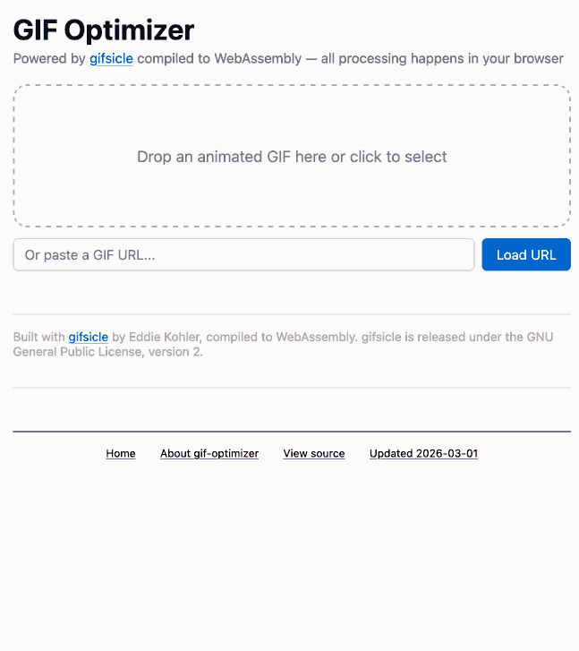
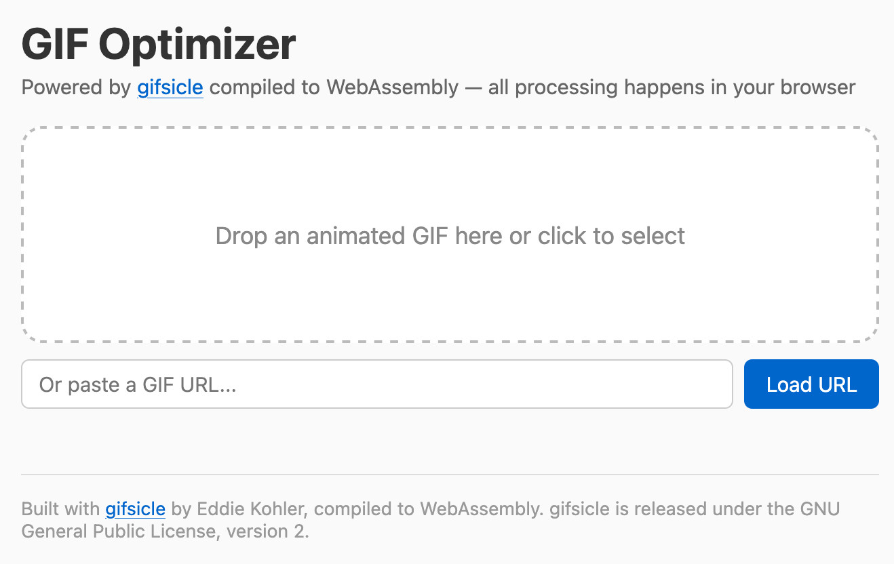
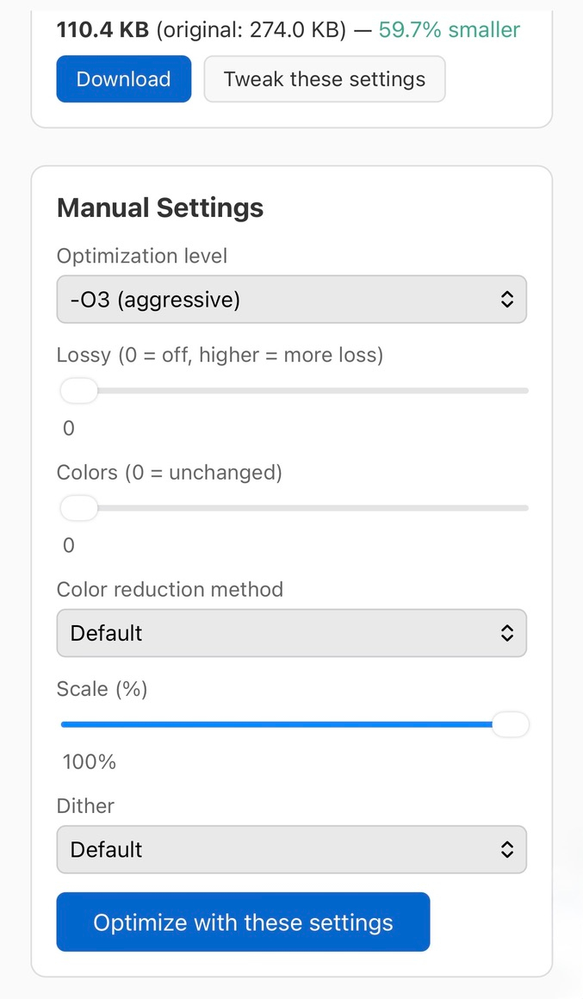

+++
title = "智能体工程模式 14：使用 WebAssembly 和 Gifsicle 构建 GIF 优化工具"
date = 2026-10-11T00:00:00+08:00
draft = false
author = "Hex4C59"
description = "Simon Willison 逐段分析构建 GIF 优化网页的提示词，涵盖 Gifsicle 的 WebAssembly 编译、预览与手动设置、浏览器测试和可复现构建文件。"
summary = "以一个浏览器 GIF 优化工具为例，解释怎样给编程智能体描述目标、利用仓库中的既有模式、提供测试工具，并通过后续提示补齐构建脚本和项目署名。"
tags = ["智能体工程", "WebAssembly", "Gifsicle"]
categories = ["engineering"]
topics = ["agents", "agentic-engineering", "coding-agents", "webassembly", "prompting"]
translation_category = "工程实践"
series = ["智能体工程模式"]
series_order = 15
series_label = "使用 WebAssembly 和 Gifsicle 构建 GIF 优化工具"
series_part = "提示词详解"
series_number = 14
original_title = "GIF optimization tool using WebAssembly and Gifsicle"
original_url = "https://simonwillison.net/guides/agentic-engineering-patterns/gif-optimization/"
original_author = "Simon Willison"
original_date = ""
original_site = "Simon Willison’s Weblog"
ShowToc = true
source_kind = "translation"
lastmod = 2026-10-11T21:22:32+08:00
+++

> **译文信息**
>
> - 原文：[GIF optimization tool using WebAssembly and Gifsicle](https://simonwillison.net/guides/agentic-engineering-patterns/gif-optimization/)
> - 作者：Simon Willison
> - 中文翻译与整理：Hex4C59（AI 辅助）
> - 翻译整理：2026-10-11
>
> 本文为非官方中文译文，依据提供的原文正文翻译。正文中的「我」、项目经历和效果判断均指原作者。截图和演示动图来自原文；译者未构建工具或执行示例提示词。

我喜欢在网上发表的文章中加入 GIF 动图演示，通常用 [LICEcap](https://www.cockos.com/licecap/) 录制。[交互式讲解](https://simonwillison.net/guides/agentic-engineering-patterns/interactive-explanations/)一章就有一个例子。

这些 GIF 的体积可能很大。我尝试过几种优化 GIF 文件大小的工具，最喜欢的是 Eddie Kohler 开发的 [Gifsicle](https://github.com/kohler/gifsicle)。它会找出各帧中没有变化的区域，只保存差异，以此压缩 GIF。为了进一步缩小文件，它还可以减少调色板中的颜色数量，或者采用会明显影响画质的有损压缩。

Gifsicle 用 C 编写，默认通过命令行使用。我想为它做一个网页界面，以便在浏览器中使用，并直观地预览、比较不同设置的效果。

我在 iPhone 上通过 Claude 应用使用网页版 Claude Code，针对自己的 [simonw/tools](https://github.com/simonw/tools) 仓库输入了以下提示词：

> `gif-optimizer.html`
>
> 把 gifsicle 编译为 WASM，然后构建一个网页，让用户可以打开 GIF 动图，或者把它拖放到页面上。接着，用 gifsicle 按多种不同设置压缩这个 GIF，并展示各个版本；每个预览都要显示文件大小，并提供下载按钮。
>
> 还要提供控件，让用户手动调整 gifsicle 选项。每个预览都有一个「微调这些设置」链接，点击后，把手动设置切换为生成该预览时使用的参数，让用户可以继续调整。
>
> 运行「`uvx rodney –help`」，用这个工具测试你的工作。使用这个 GIF 进行测试：[https://static.simonwillison.net/static/2026/animated-word-cloud-demo.gif](https://static.simonwillison.net/static/2026/animated-word-cloud-demo.gif)。

> **译者注：** 原文初始提示词中的 `–help` 使用了长横线，复制运行时应写为 `--help`，即 `uvx rodney --help`。原文还出现了 `tray your work` 和后文的 `wqsm`，这里分别按「测试你的工作」和「WASM」理解并翻译。

这是[它构建出的工具](https://tools.simonwillison.net/gif-optimizer)，下面这段 GIF 演示也用这个工具进行了优化：

*原文演示：[使用 GIF 优化工具调整设置并下载结果](https://static.simonwillison.net/static/2026/demo2-32-colors-lossy.gif)。*

下面逐段分析这条提示词。

> `gif-optimizer.html`

第一行只告诉它我要创建的文件名。这里给出一个文件名就足够了：我知道 Claude 在仓库中运行 `ls` 时，会发现每个文件都是一个独立工具。

我的 [simonw/tools](https://github.com/simonw/tools) 仓库目前没有 `CLAUDE.md` 或 `AGENTS.md` 文件。我发现，智能体只需浏览现有文件树，再查看已有文件中的相关代码，就能充分掌握仓库的大致组织方式。

> 把 gifsicle 编译为 WASM，然后构建一个网页，让用户可以打开 GIF 动图，或者把它拖放到页面上。接着，用 gifsicle 按多种不同设置压缩这个 GIF，并展示各个版本；每个预览都要显示文件大小，并提供下载按钮。

这里，我对 Claude 已有的知识做了不少假设，结果都奏效了。

Gifsicle 如今已有将近 30 年的历史，而且应用广泛。我有把握，只提到它的名字，就足以让 Claude 找到代码。

「把 gifsicle 编译为 WASM」这几个字，实际上包含了不少工作。

WASM 是 [WebAssembly](https://webassembly.org/) 的简称。这项技术让浏览器能够在沙箱中安全地运行编译后的代码。

把 Gifsicle 这样的项目编译为 WASM 并不简单，需要复杂的工具链，通常还会涉及 [Emscripten](https://emscripten.org/) 项目。为了让一切正常工作，往往要反复试错。

编程智能体非常擅长试错！它们常常能不断尝试，最终找到解决方案。而换作我，可能遇到第五个看不懂的编译错误时就已经放弃了。

我此前多次见过 Claude Code 搞定 WASM 构建，因此相当有把握，这次也能成功。

「然后构建一个网页，让用户可以打开 GIF 动图，或者把它拖放到页面上」，描述的是我在许多其他工具中使用过的一种交互方式。

HTML 文件上传控件已经能够完成文件选择，但更好的界面，尤其是在桌面端，是让用户把文件拖放到页面上一个醒目的区域。

实现它需要一点 JavaScript 来处理事件，再用一些 CSS 设置拖放区域的样式。这并不复杂，但额外的工作量足以让我平时可能不会主动添加它。有了提示词，这项工作的成本就几乎为零。

下面是最终界面。Claude 参考了我现有的 [image-resize-quality](https://tools.simonwillison.net/image-resize-quality) 工具，因此界面也受到了它的影响：

*原文截图：[GIF 优化工具的文件选择界面](https://static.simonwillison.net/static/2026/gif-optimizer.jpg)。*

我没有要求加入 GIF URL 输入框，也不太喜欢这个功能，因为它只对提供开放的跨源资源共享（Cross-Origin Resource Sharing，CORS）响应头的 GIF 地址有效。我很可能会在今后的更新中移除它。

「用 gifsicle 按多种不同设置压缩这个 GIF，并展示各个版本；每个预览都要显示文件大小，并提供下载按钮」，描述的是应用的核心功能。

我没有专门列出想要的设置组合。根据我的经验，Claude 选择这些组合的判断力已经足够好。即使它第一次选得不合适，我们也随时可以修改。

显示文件大小很重要，因为这个工具的目标就是缩小文件。

根据过去的经验，我知道，要求添加一个「下载按钮」，会得到一个具备相应 HTML 和 JavaScript 机制的按钮，点击后可以打开文件保存对话框。这比要求用户右键另存为方便得多。

> 还要提供控件，让用户手动调整 gifsicle 选项。每个预览都有一个「微调这些设置」链接，点击后，把手动设置切换为生成该预览时使用的参数，让用户可以继续调整。

这条提示词写得有点笨拙，毕竟我是在手机上输入的。但它已经足够清楚地表达了意图，让 Claude 做出了我想要的东西。

下面是最终工具中的效果，截图展示的是移动端版本。每张图像都有一个「微调这些设置」按钮，点击后会更新这组手动设置和滑块：

*原文截图：[GIF 优化结果与手动设置面板](https://static.simonwillison.net/static/2026/gif-optimizer-tweak.jpg)。*

> 运行「`uvx rodney --help`」，用这个工具测试你的工作。使用这个 GIF 进行测试：https://static.simonwillison.net/static/2026/animated-word-cloud-demo.gif

确保编程智能体能够在工作过程中测试自己的代码，会让它表现好得多。

测试网页界面有很多方式，[Playwright](https://playwright.dev/)、[Selenium](https://www.selenium.dev/) 和 [agent-browser](https://agent-browser.dev/) 都是可靠的选择。

[Rodney](https://github.com/simonw/rodney) 是我自己开发的浏览器自动化工具，安装很快。它的 `--help` 输出经过专门设计，能够教会智能体使用工具所需了解的一切。

这次效果很好。在[会话记录](https://claude.ai/code/session_01C8JpE3yQpwHfBCFni4ZUc4)中，可以看到 Claude 使用 Rodney，并修复了一些测试时发现的小问题，例如：

> CSS 中的 `display: none` 覆盖了对内联样式的重置。我需要显式设置 `display: 'block'`。

## 后续提示词 {#the-follow-up-prompts}

与 Claude Code 协作时，我通常会关注它正在做什么，以便在任务尚未完成时调整方向。它工作时，我也经常想到新点子，然后把这些想法加入待处理队列。

> 把构建脚本和相对于原始 gifsicle 代码的差异补丁，一起提交到合适的子目录中。
>
> 构建脚本应该把 gifsicle 仓库克隆到 `/tmp`，切换到一个确定的提交，再应用补丁。因此，提交里不要包含 gifsicle 的源码副本，但要包含构建 WASM 所需的全部脚本。

我发现它正在花不少精力让 Gifsicle 在 WebAssembly 中工作，包括修改原始源码，于是补充了这条要求。这是它添加到仓库中的[补丁](https://github.com/simonw/tools/blob/main/lib/gifsicle/gifsicle-wasm.patch)和[构建脚本](https://github.com/simonw/tools/blob/main/lib/gifsicle/build.sh)。

我知道，这个仓库已经有放置辅助文件的惯例，但记不清具体是什么。只说「放到合适的子目录中」，就足够让 Claude 找到应该放在哪里。它发现并使用了已有的 [lib/ 目录](https://github.com/simonw/tools/tree/main/lib)。

> 也要包含编译好的 WASM 文件。

这条要求可能没有必要，但我想确保编译后的 WASM 文件确实提交到了仓库。它最终的大小是 [233 KB](https://github.com/simonw/tools/blob/main/lib/gifsicle/gifsicle.wasm)。我通过 GitHub Pages 在 [tools.simonwillison.net](https://tools.simonwillison.net/) 上发布 simonw/tools，因此希望它不需要本地构建就能工作。

> 确保 HTML 页面注明使用了 gifsicle，并链接到它的仓库。

这只是基本的礼貌！我经常为别人的开源项目构建 WebAssembly 封装，也希望确保最终页面注明他们的贡献。

Claude 在工具页脚添加了这段文字：

> 使用 Eddie Kohler 开发的 [gifsicle](https://github.com/kohler/gifsicle) 构建，并编译为 WebAssembly。gifsicle 以 GNU 通用公共许可证第 2 版发布。

---

[上一篇原文：交互式讲解](https://simonwillison.net/guides/agentic-engineering-patterns/interactive-explanations/) · [下一篇原文：为博客转邮件简报工具添加新的内容类型](https://simonwillison.net/guides/agentic-engineering-patterns/adding-a-new-content-type/)
