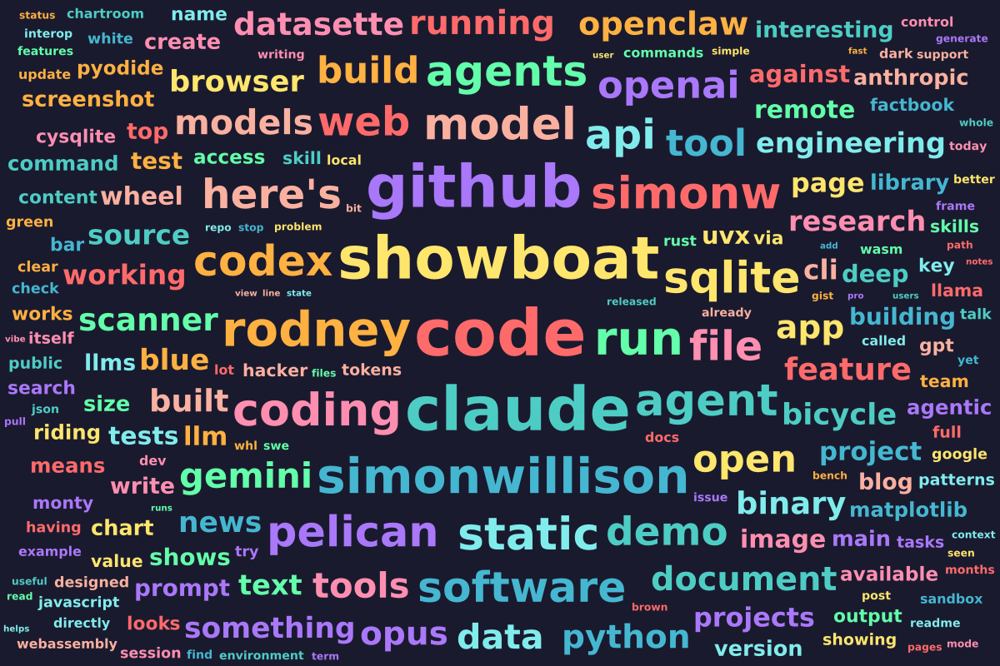
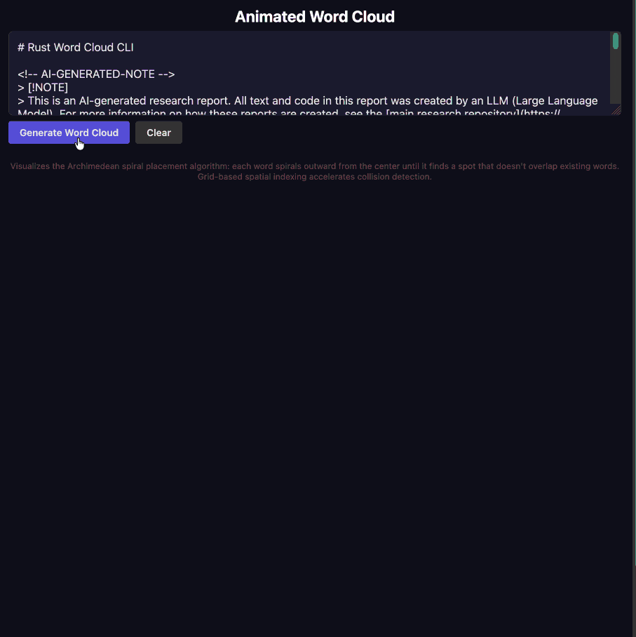

+++
title = "智能体工程模式 13：交互式讲解"
date = 2026-10-11T00:00:00+08:00
draft = false
author = "Hex4C59"
description = "Simon Willison 以词云布局算法为例，介绍如何让编程智能体生成动画和交互式讲解，帮助理解代码并偿还认知债务。"
summary = "代码讲解能说明结构，交互式动画则能把算法的运行过程展现出来。作者通过可暂停、调速和逐帧查看的词云动画，理解了螺线布局与碰撞检测。"
tags = ["Agent", "智能体工程", "编程智能体", "代码理解", "交互式讲解", "词云"]
categories = ["Translations"]
topics = ["agents", "agentic-engineering", "coding-agents", "code-understanding", "visualization"]
translation_category = "工程实践"
series = ["智能体工程模式"]
series_order = 14
series_label = "交互式讲解"
series_part = "理解代码"
series_number = 13
original_title = "Interactive explanations"
original_url = "https://simonwillison.net/guides/agentic-engineering-patterns/interactive-explanations/"
original_author = "Simon Willison"
original_date = ""
original_site = "Simon Willison’s Weblog"
ShowToc = true
+++

> **译文信息**
>
> - 原文：[Interactive explanations](https://simonwillison.net/guides/agentic-engineering-patterns/interactive-explanations/)
> - 作者：Simon Willison
> - 中文翻译与整理：Hex4C59（AI 辅助）
> - 翻译整理：2026-10-11
>
> 本文为非官方中文译文，依据提供的原文正文翻译。正文中的「我」、项目经历和学习效果均指原作者；模型名称保留原文记录。词云图和演示动图来自原文，译者未执行示例提示词或复现算法。

当我们不再清楚智能体写出的代码是怎样工作的，就会背上**认知债务（cognitive debt）**。

很多情况下，这并不是什么问题。如果代码只是从数据库取一些数据，再以 JSON 格式输出，实现细节很可能简单到不需要特别关注。我们试用一下新功能，就能对它如何工作做出相当可靠的判断，再扫一眼代码确认即可。

但很多时候，细节确实很重要。如果应用的核心成了一个我们无法充分理解的黑盒，我们就无法再有把握地推断它的行为。规划新功能因此变得更困难，最终也会像积累的技术债务一样，拖慢我们的进展。

怎样偿还认知债务？加深对代码工作方式的理解。

我最喜欢的方法之一，就是构建**交互式讲解**。

## 理解词云 {#understanding-word-clouds}

在[《一位 AI 智能体编程怀疑者尝试 AI 智能体编程：极其详尽的记录》](https://minimaxir.com/2026/02/ai-agent-coding/)中，Max Woolf 提到，他用下面这条提示词测试 LLM 的 Rust 能力：`Create a Rust app that can create "word cloud" data visualizations given a long input text`，也就是「创建一个 Rust 应用，根据输入的长文本生成词云数据可视化」。

这个想法引起了我的兴趣。我一直想知道词云是怎样生成的，于是启动了一个[异步研究项目](https://simonwillison.net/2025/Nov/6/async-code-research/)来探索这个问题。这里可以查看[初始提示词](https://github.com/simonw/research/pull/91#issue-4002426963)，以及[代码和报告](https://github.com/simonw/research/tree/main/rust-wordcloud)。

效果很好：网页版 Claude Code 为我构建了一个 Rust 命令行工具，能够生成下面这样的图像：

*原文配图：[Rust 词云工具生成的词云](https://raw.githubusercontent.com/simonw/research/refs/heads/main/rust-wordcloud/wordcloud.png)。*

但它到底是怎样工作的？

Claude 的报告说，它使用「**阿基米德螺线布局**，并为每个单词设置随机的角度偏移，让布局看起来更自然」。这对我没多大帮助！

我请求了一份[按顺序展开的代码讲解](https://simonwillison.net/guides/agentic-engineering-patterns/linear-walkthroughs/)，以便更详细地理解 Rust 代码。这里是[那份讲解](https://github.com/simonw/research/blob/main/rust-wordcloud/walkthrough.md)，以及[生成它的提示词](https://github.com/simonw/research/commit/2cb8c62477173ef6a4c2e274be9f712734df6126)。它帮助我理解了 Rust 代码的结构，但我仍然没能直观地理解「阿基米德螺线布局」到底如何工作。

于是，我又请求了一份**动画讲解**。我把现有 `walkthrough.md` 文档的链接粘贴到一个 Claude Code 会话中，同时给出以下指令：

> 使用 `curl` 把 [https://raw.githubusercontent.com/simonw/research/refs/heads/main/rust-wordcloud/walkthrough.md](https://raw.githubusercontent.com/simonw/research/refs/heads/main/rust-wordcloud/walkthrough.md) 下载到 `/tmp`，以便读取完整内容。
>
> 参考这份文档，构建 `animated-word-cloud.html`。页面应允许用户粘贴文本，并把它保存在 URL 的 `#fragment` 中。这样，当页面加载时，如果 URL 的 `#` 部分已有内容，就会把它作为输入，并自动提交。
>
> 用户提交文本后，使用文档中描述的算法生成词云，但要把过程做成动画，让算法尽可能容易理解。为动画提供一个滑块，支持暂停、调整速度，甚至在暂停时逐帧查看。在任何阶段，用户都可以把当前可见、尚在生成中的词云下载为 PNG。

你可以[在这里试用生成的工具](https://tools.simonwillison.net/animated-word-cloud)。下面是一段 GIF 演示：

*原文演示：[词云生成过程的动画 GIF](https://static.simonwillison.net/static/2026/animated-word-cloud-demo.gif)。*

这次使用的是 Claude Opus 4.6。事实证明，它很擅长设计用于解释概念的动画。

仔细观察动画，你会看到：每放置一个单词，算法都会在页面上显示一个矩形框，尝试把单词放在那里，并检查这个框是否与已有单词相交。如果相交，就继续寻找合适的位置，沿着螺线从中心向外移动。

我发现，这段动画确实让我一下子理解了算法的工作方式。

我一直很喜欢用动画和交互式界面解释不同的概念。一个好的编程智能体可以按需生成这样的讲解，帮助我们理解代码，无论代码是它自己写的，还是别人写的。

---

[上一篇原文：按顺序讲解代码](https://simonwillison.net/guides/agentic-engineering-patterns/linear-walkthroughs/) · [下一篇原文：使用 WebAssembly 和 Gifsicle 构建 GIF 优化工具](https://simonwillison.net/guides/agentic-engineering-patterns/gif-optimization/)
