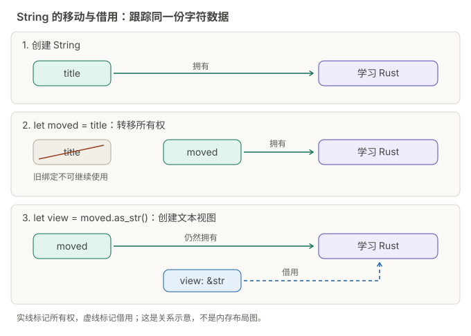

+++
url = "/posts/rust-04-ownership/"
title = "Rust 入门 04：所有权、移动和借用"
date = 2026-10-12T09:00:00+08:00
lastmod = 2026-10-13T09:00:00+08:00
draft = false
author = "Hex4C59"
description = "解释所有权、移动和借用，区分绑定的 mut、引用的 &mut、解引用、再借用和引用复制。"
summary = "解释所有权、移动和借用，区分绑定的 mut、引用的 &mut、解引用、再借用和引用复制。"
tags = ["Rust", "所有权", "借用"]
categories = ["programming"]
series = ["rust-from-zero"]
series_order = 4
series_label = "所有权与借用"
series_part = "理解数据如何使用"
series_number = 4
ShowToc = true
source_kind = "original"
article_type = "tutorial"
series_role = "chapter"
+++

前三章把整数传给函数后，调用方仍可以继续使用这些整数。换成可以增长的文本，你可能第一次遇到“这个值已经被移动”的报错。

本章从这个报错开始，说明一个值归谁管理，以及函数怎样读取或修改调用方的数据。学完后，你应该能让一个函数打印标题，让另一个函数修改标题，并在调用后继续使用原变量。暂时不需要自己写生命周期标注，也不需要背内存布局。

继续使用自己的 `hello-rust` 项目。下面的完整程序可以替换整个 `src/main.rs`，保存后运行 `cargo run`。明确写着“故意无法编译”的例子，改用 `cargo check` 观察错误，完成实验后恢复正常代码。

## String 拥有一段可以增长的文本

第二章中的 `"学习 Rust"` 是字符串字面量。现在用它创建一个 `String`，再追加文字。完整程序：

```rust
fn main() {
    let mut title = String::from("学习 Rust");
    title.push_str("，每天一点");
    title.push('！');

    println!("{title}");
}
```

预期输出：

```text
学习 Rust，每天一点！
```

`String::from(...)` 创建一个拥有文本内容的字符串。`push_str` 追加一段文本，`push` 追加一个 `char`。前者使用双引号，后者使用单引号。`title` 需要声明为 `mut`，因为我们要修改它。

字符串可以增长，它所占用的资源也需要有人管理。Rust 用所有权规则决定谁负责一个值：值可以交给新的所有者；拥有它的变量离开作用域时，值会被丢弃，所持资源按相应规则清理。

先用局部变量观察作用域。完整程序：

```rust
fn main() {
    let title = String::from("学习 Rust");

    {
        let note = String::from("先运行，再修改");
        println!("{title}：{note}");
    }

    println!("标题仍可使用：{title}");
}
```

预期输出：

```text
学习 Rust：先运行，再修改
标题仍可使用：学习 Rust
```

`note` 只在内层花括号中可用。离开那里后，它拥有的字符串被清理。`title` 定义在外层，还能继续使用。

所有权检查主要发生在编译时。下面几个实验会让你看到，编译器怎样拒绝可能继续使用无效数据的写法。

## 移动后，旧绑定不能继续使用

下面是故意无法编译的完整程序：

```rust
fn main() {
    let first = String::from("Rust");
    let second = first;
    println!("{first} {second}");
}
```

运行 `cargo check`，应看到 `E0382`，错误说明中会提到值已经被移动。下载包的 `compile-fail/moved_value.rs` 保存了同一个例子，在解压后的 `rust-course` 目录也可以运行：

```sh
rustc --edition 2024 compile-fail/moved_value.rs
```

关键在 `let second = first;`：这个 `String` 的所有权交给了 `second`，没有自动复制出另一份独立文本。之后通过 `first` 读取整个字符串就不合法了。

“移动”描述值的使用权限发生了转移，不必把它想象成文字在内存里搬到了另一个地址。现在只用新的所有者，程序就能运行。完整修复版本：

```rust
fn main() {
    let first = String::from("Rust");
    let second = first;
    println!("{second}");
}
```

预期输出：

```text
Rust
```

新绑定是否允许修改，由它自己的声明决定。`let mut title = original;` 这类写法，可以接收原本通过不可变绑定持有的字符串，再通过新绑定修改它。原绑定是否写了 `mut`，不影响新绑定的这个选择。

下面这张图跟踪同一份字符数据：先由 `title` 拥有，移动后改由 `moved` 拥有，再从 `moved` 创建 `&str` 视图。三行表示依次发生的状态，不是同时存在的三份字符串。



图中的实线表示所有权，虚线表示借用；文字和线型也标明了关系。它只解释谁管理、谁借用，不表示变量在栈或堆中的实际布局。借用的完整代码见后面的“借用允许临时访问”一节。

## 函数参数和返回值也会转移所有权

第三章说过，调用函数时要把输入交给参数。参数类型如果是 `String`，传入字符串就会转移所有权。下面仍是故意无法编译的完整程序：

```rust
fn print_title(title: String) {
    println!("标题：{title}");
}

fn main() {
    let title = String::from("学习借用");
    print_title(title);
    println!("调用后：{title}");
}
```

`print_title(title)` 把字符串移进函数。函数结束时，参数持有的字符串被丢弃。调用方最后一行仍想访问旧绑定，因此得到 `E0382`。

如果函数需要取得字符串、处理后再交回来，可以返回 `String`。完整程序：

```rust
fn add_note(mut title: String) -> String {
    title.push_str("（已复习）");
    title
}

fn main() {
    let title = String::from("学习所有权");
    let title = add_note(title);
    println!("{title}");
}
```

预期输出：

```text
学习所有权（已复习）
```

调用时，字符串进入 `add_note`；返回时，所有权又交给调用方。第二条 `let title` 建立新绑定，接收返回值，这是第二章讲过的遮蔽。函数体最后的 `title` 没有分号，因为它是返回结果。

参数中的 `mut title` 允许函数修改自己已经取得的字符串。它与下一节的可变借用有区别：这里的参数拥有字符串，而可变借用只是暂时获得修改权限。

## 借用允许临时访问

刚才的打印函数只想看一眼标题，没必要拿走整个字符串。把参数改成共享引用，就能在调用后继续使用原值。完整程序：

```rust
fn show_title(title: &str) {
    println!("标题：{title}");
}

fn main() {
    let title = String::from("学习借用");

    show_title(&title);
    show_title("先从一句固定文本开始");
    println!("调用后：{title}");
}
```

预期输出：

```text
标题：学习借用
标题：先从一句固定文本开始
调用后：学习借用
```

引用让函数访问已有的数据，而不取得这份数据的所有权。`&title` 创建共享借用，字符串仍由 `main` 中的 `title` 管理。

`&str` 是一个文本切片类型，表示借来的文本视图。这里把 `&String` 作为参数传入时，Rust 可以把它转换成函数需要的 `&str`；字符串字面量也能直接传入。第五章会继续比较 `String` 和 `&str`。

对本章的字符串，不能通过共享引用追加文字。只读取标题的函数接收 `&str`，也能让调用者从签名上看出这个意图。

## 可变借用修改的是原来的字符串

需要修改调用方的字符串时，接收 `&mut String`。完整程序：

```rust
fn add_suffix(title: &mut String) {
    title.push_str("（已复习）");
}

fn main() {
    let mut title = String::from("学习 Rust");
    add_suffix(&mut title);
    println!("{title}");
}
```

预期输出：

```text
学习 Rust（已复习）
```

这里没有返回新字符串。`add_suffix` 通过可变引用修改了原来的 `title`，调用结束后，`main` 直接打印修改后的内容。

这几个位置各有作用：

| 写法 | 含义 |
| --- | --- |
| `let mut title` | 这个绑定允许修改其持有的值 |
| 参数 `title: &mut String` | 函数暂时取得字符串的独占修改权限 |
| 调用时 `&mut title` | 把原字符串以可变借用的形式交给函数 |

函数参数不需要写成 `mut title: &mut String` 才能调用 `push_str`。`&mut String` 已经允许修改它指向的字符串；参数绑定本身是否可重新赋值，是另一件事。

把常用签名放在一起比较：

| 参数形式 | 这次调用能做什么 | 调用后调用方是否还能使用原值 |
| --- | --- | --- |
| `String` | 取得所有权，可以自行保留或丢弃 | 原绑定已移动，除非重新取得所有权 |
| `&str` | 查看文本 | 可以 |
| `&mut String` | 修改借来的字符串 | 借用结束后可以 |

选择签名前，先问函数要做什么：保留数据、读取数据，还是修改现有数据。遇到报错时，也先检查函数需要哪种权限，再调整参数。

## 同一份数据不能一边被共享引用使用，一边被修改

下面是故意无法编译的完整程序，下载包中对应 `compile-fail/borrow_conflict.rs`：

```rust
fn main() {
    let mut text = String::from("Rust");
    let borrowed = &text;
    text.push('!');
    println!("{borrowed}");
}
```

运行 `cargo check`，或在 `rust-course` 目录运行 `rustc --edition 2024 compile-fail/borrow_conflict.rs`，可以观察 `E0502`。

最后一行还要使用 `borrowed`，所以共享借用需要跨过 `push` 这一行。`push` 要修改同一个字符串，编译器拒绝了这次重叠的访问。

先用完共享引用，再修改原值，就符合这里的规则。完整修复版本：

```rust
fn main() {
    let mut text = String::from("Rust");
    let borrowed = &text;
    println!("{borrowed}");
    text.push('!');
    println!("{text}");
}
```

预期输出：

```text
Rust
Rust!
```

`borrowed` 最后用在第一个 `println!`。编译器能判断后面不再需要这次共享借用，因此允许修改。不能只看引用变量还在不在同一对花括号里，还要看它之后是否继续使用。

多个共享引用可以一起读同一份数据。可变借用则需要独占访问；下面故意同时保留两次可变借用，也不能通过编译：

```rust
fn main() {
    let mut text = String::from("Rust");
    let first = &mut text;
    let second = &mut text;
    first.push('!');
    second.push('?');
}
```

这里应得到 `E0499`。`first` 还没用完，就创建了同一字符串的 `second` 可变借用。可以先完成第一段修改，再开始第二段。完整修复版本：

```rust
fn main() {
    let mut text = String::from("Rust");
    let first = &mut text;
    first.push('!');

    let second = &mut text;
    second.push('?');
    println!("{text}");
}
```

预期输出：

```text
Rust!?
```

对本章的普通引用，可以记为：同一份数据在引用需要使用的期间，要么有多个共享引用，要么有一个独占的可变引用。同一个函数里的顺序代码也要遵守这条规则。

## Copy 与 clone

为什么第三章可以把整数传给函数，之后还继续使用它？整数实现了 `Copy`，赋值或按值传参时可以复制数值，不使原绑定失效。完整程序：

```rust
fn twice(value: u32) -> u32 {
    value * 2
}

fn main() {
    let count = 3;
    let copied = count;
    let result = twice(count);
    println!("原值：{count}，副本：{copied}，计算结果：{result}");
}
```

预期输出：

```text
原值：3，副本：3，计算结果：6
```

布尔值、`char` 等一些简单类型也具有这个性质。第三章使用的固定长度整数数组同样可以复制。能否复制取决于类型，不能只看变量名，或简单按“内容小不小”判断。

`String` 没有 `Copy`。如果确实需要两份以后可以分别修改的文本，显式调用 `clone()`。完整程序：

```rust
fn main() {
    let mut title = String::from("学习 Rust");
    let backup = title.clone();

    title.push('！');
    println!("当前：{title}");
    println!("备份：{backup}");
}
```

预期输出：

```text
当前：学习 Rust！
备份：学习 Rust
```

`String` 的 `clone()` 创建独立字符串，通常需要分配并复制文本。它适合保存一份独立备份。函数只需要打印或统计时，借用已经足够，不必为了让旧绑定还能用就到处加 `clone()`。

## 引用不能指向已经销毁的数据

下面是故意无法编译的完整程序，下载包中对应 `compile-fail/dangling.rs`：

```rust
fn invalid() -> &'static str {
    let text = String::from("Rust");
    &text
}

fn main() {
    println!("{}", invalid());
}
```

运行 `cargo check`，或运行 `rustc --edition 2024 compile-fail/dangling.rs`，应得到 `E0515`。

函数返回时，局部变量 `text` 拥有的字符串就被清理了。调用方如果只拿到它的引用，将没有有效的文本可读。

`'static` 是一种生命周期标注，这里要求返回的引用指向整个程序运行期间都有效的数据。写上这个标注不会让局部字符串自动活得更久；第九章再解释这类标注的具体写法。

函数自己创建了文本，并希望交给调用方保留时，直接返回 `String`。完整修复版本：

```rust
fn make_title() -> String {
    String::from("学习 Rust")
}

fn main() {
    let title = make_title();
    println!("{title}");
}
```

预期输出：

```text
学习 Rust
```

这里所有权随返回值转移给调用方。函数返回了，字符串仍由 `main` 中的 `title` 管理，直到这个绑定离开作用域。

## 语法细读：mut 改绑定，&mut 提供访问权限 {#syntax-depth}


本章语法细读里的每个 Rust 程序可以分别替换自己项目的 `src/main.rs`：正常例子运行 `cargo run`，故意失败的例子运行 `cargo check`。下载包另保存为独立文件，直接编译的方法见下载包里的 `syntax/README.md`。各个程序相互独立。

`mut` 出现的位置不同，约束的对象也不同。先用普通整数拆开引用，避免把字符串方法调用和引用规则混在一起。

### 变量名可以改绑，与引用能否修改数据是两件事

| 声明 | 能给这个变量换一个引用吗 | 能通过它修改普通整数吗 |
| --- | --- | --- |
| `let view = &number;` | 不能 | 不能 |
| `let mut view = &number;` | 能 | 不能 |
| `let slot = &mut number;` | 不能 | 能 |
| `let mut slot = &mut number;` | 能 | 能 |

表中的“能”仍要求其他借用和类型约束允许，不是绕过检查的承诺。这张表只讨论普通整数的引用；有内部可变性机制的类型还要按自己的接口理解。

完整程序，下载包中为 `syntax/syntax04-binding-mut.rs`：

```rust
fn increment(slot: &mut i32) {
    *slot += 1;
}
fn main() {
    let mut first = 1;
    let mut second = 10;
    increment(&mut first);
    let mut slot = &mut first;
    *slot += 1;
    slot = &mut second;
    *slot += 3;
    println!("{first} / {second}");
    let mut view = &first;
    println!("改绑前：{view}");
    view = &second;
    println!("改绑后：{view}");
}
```

预期输出：

```text
3 / 13
改绑前：3
改绑后：13
```

`increment` 的参数绑定没有 `mut`，但它的类型是 `&mut i32`，已经允许修改所指的整数。`*slot` 是解引用表达式，指向被引用的位置；`*slot += 1` 修改那个位置，`slot = &mut second` 才是在给引用变量重新赋值。

最后的 `view` 有 `mut`，所以能从指向 `first` 改成指向 `second`，但类型一直是共享引用 `&i32`。

以下完整程序故意无法编译，下载包中为 `compile-fail/syntax04-shared-write.rs`：

```rust
fn main() {
    let number = 1;
    let mut view = &number;
    *view = 2;
    println!("{view}");
}
```

预期诊断包含 `E0594`。

给绑定加 `mut` 没有把 `&i32` 改成 `&mut i32`。这次失败发生在对 `*view` 的写入上，不是对变量 `view` 的重新赋值上。

### &mut *slot 是从已有可变引用再借用

完整程序，下载包中为 `syntax/syntax04-reborrow.rs`：

```rust
fn main() {
    let mut number = 10;
    let slot = &mut number;
    *slot += 1;
    let shorter = &mut *slot;
    *shorter += 2;
    *slot += 3;
    println!("{number}");
}
```

预期输出：

```text
16
```

先由 `slot` 借用 `number`，再用 `&mut *slot` 建立较短的可变借用 `shorter`。`shorter` 还要使用时，不能同时通过 `slot` 访问同一数据；最后一次使用结束后，这里可以恢复通过 `slot` 修改。这个过程称为再借用（reborrow），没有复制整数，也没有复制独占权限。

以下完整程序故意无法编译，下载包中为 `compile-fail/syntax04-reference-move.rs`：

```rust
fn main() {
    let mut number = 10;
    let slot = &mut number;
    let later = slot;
    println!("{} / {}", *slot, *later);
}
```

预期诊断包含 `E0382`。

`let later = slot` 在这里移动了 `&mut i32`。可变引用没有 `Copy`，不能把它当作两份可同时使用的独占权限。若需要临时把权限交给下一步，再借用和按值移动要分别判断；函数调用在期望引用类型的位置也可能由编译器进行再借用。

完整程序，下载包中为 `syntax/syntax04-shared-copy.rs`：

```rust
fn main() {
    let text = String::from("Rust");
    let first = &text;
    let second = first;
    println!("{first} / {second} / {text}");
}
```

预期输出：

```text
Rust / Rust / Rust
```

普通共享引用 `&T` 可以复制，复制的是引用本身，所指的 `String` 没有获得独立副本，也没有移出 `text`。读 `*`、`&`、`&mut` 时，先确定正在谈的是变量绑定、引用值，还是被引用的数据。

## 把打印、修改和备份组合起来

下面的完整程序对应下载包的 `basics/examples/ch04_ownership.rs`：

```rust
fn show_title(title: &str) {
    println!("标题：{title}");
}

fn add_suffix(title: &mut String) {
    title.push_str("（已复习）");
}

fn main() {
    let original = String::from("学习 Rust");
    let mut title = original;
    show_title(&title);
    add_suffix(&mut title);
    show_title(&title);

    let backup = title.clone();
    title.push('！');
    println!("当前：{title}");
    println!("备份：{backup}");

    let count = 3;
    let copied = count;
    println!("两个整数：{count}、{copied}");
}
```

预期输出：

```text
标题：学习 Rust
标题：学习 Rust（已复习）
当前：学习 Rust（已复习）！
备份：学习 Rust（已复习）
两个整数：3、3
```

在解压后的 `rust-course` 目录运行：

```sh
cargo run -p rust-basics --example ch04_ownership
```

按执行顺序检查所有权：`original` 移给 `title`；打印函数共享借用；修改函数可变借用；`backup` 获得独立副本；最后复制整数。哪一步之后原绑定不能再用，哪一步只暂时限制访问，应该能从代码中指出来。

## 练习：追加一个感叹号

写 `append_mark`，参数是 `&mut String`，给文本追加 `！`。调用后在 `main` 中打印原变量，确保它仍能使用。再想一想：如果连续调用两次，输出应该是什么？

<details>
<summary>参考答案：先自己完成再展开</summary>

```rust
fn append_mark(text: &mut String) {
    text.push('！');
}

fn main() {
    let mut message = String::from("继续练习");
    append_mark(&mut message);
    println!("{message}");
    assert_eq!(message, "继续练习！");
}
```

预期输出：

```text
继续练习！
```

运行 `cargo run -p rust-basics --example answer04`。连续调用两次时，应得到 `继续练习！！`，检查结果的断言也要相应修改。再把初始字符串改成空字符串，一次调用后应得到 `！`。

如果把参数改成 `String` 并按值调用，函数就取得了所有权。调用方再继续使用原绑定，会遇到移动后的访问错误。观察后改回可变借用，解释两种签名表达的不同意图。

</details>

## 练习：接收所有权，再把字符串返回

写 `reviewed_title`，接收一个 `String`，追加 `（已复习）`，再返回这个 `String`。在 `main` 中用返回值建立新绑定并打印。此次练习不使用 `clone()`。

<details>
<summary>参考答案：先自己完成再展开</summary>

```rust
fn reviewed_title(mut title: String) -> String {
    title.push_str("（已复习）");
    title
}

fn main() {
    let title = String::from("再写一遍");
    let title = reviewed_title(title);
    println!("{title}");
    assert_eq!(title, "再写一遍（已复习）");
}
```

预期输出：

```text
再写一遍（已复习）
```

这份答案在正文中给出，可以替换自己项目的 `src/main.rs` 运行。旧绑定在调用时被移动，新绑定接收返回的所有权；两个绑定同名，不表示移动没有发生。

</details>

## 进入下一章前检查

不看参考答案，写两个函数：一个接收 `&str` 打印标题，一个接收 `&mut String` 追加文字。在 `main` 中创建标题，依次调用两个函数，再打印修改后的结果。最后创建备份，继续修改原字符串，确认备份不变。

你还应能解释：为什么整数赋值后两个变量都能使用？为什么 `String` 默认不会自动复制？共享借用最后一次使用的位置，怎样影响后面的修改？函数创建的新字符串为什么应返回 `String`？

下一章会把这些规则用到中文文本和多条记录上，学习字符串、可增长的列表，以及按名称保存数值的字典。

## 官方延伸阅读

- [Rust Reference：借用和解引用运算](https://doc.rust-lang.org/reference/expressions/operator-expr.html#borrow-operators)
- [Rust Reference：引用类型](https://doc.rust-lang.org/reference/types/pointer.html#references--and-mut)

- [所有权与移动](https://doc.rust-lang.org/book/ch04-01-what-is-ownership.html)
- [引用与借用](https://doc.rust-lang.org/book/ch04-02-references-and-borrowing.html)
- [文本切片](https://doc.rust-lang.org/book/ch04-03-slices.html)

外部文档查阅日期：2026-10-13。代码验证使用 Rust 2024 edition；工具链版本和实际验证范围见[学习指南](/posts/rust-00-learning-guide/#版本与验证范围)。

---

[教材目录与源码下载](/posts/rust-from-zero/) · [上一章：函数与控制流程](/posts/rust-03-functions/) · [下一章：字符串与集合](/posts/rust-05-collections/)
