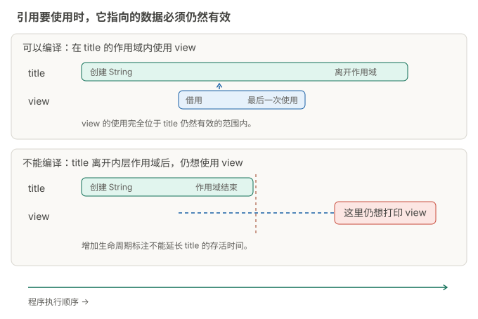

+++
url = "/posts/rust-09-traits/"
title = "Rust 入门 09：读懂泛型、trait 和生命周期"
date = 2026-10-12T09:00:00+08:00
lastmod = 2026-10-17
draft = false
author = "Hex4C59"
description = "学习泛型、trait 和生命周期，解释类型参数关系、impl Trait、Sized、常量泛型及引用约束。"
summary = "学习泛型、trait 和生命周期，解释类型参数关系、impl Trait、Sized、常量泛型及引用约束。"
tags = ["Rust", "trait", "生命周期"]
categories = ["programming"]
series = ["rust-from-zero"]
series_order = 9
series_label = "泛型、trait 与生命周期"
series_part = "写出可维护的程序"
series_number = 9
ShowToc = true
source_kind = "original"
article_type = "tutorial"
series_role = "chapter"
+++

你已经见过 `Vec<i32>`、`Option<&Task>` 和 `Result<u32, String>`。本章解释尖括号里的类型参数，再用一个小例子介绍 trait 和生命周期。目标是能读懂常见接口，并写出简单的复用函数。

在解压后的 `rust-course` 目录运行：

```sh
cargo run -p rust-basics --example ch09_traits
```

完整代码位于 `basics/examples/ch09_traits.rs`。也可以把下面的代码完整替换到自己项目的 `src/main.rs`，再运行 `cargo run`。

```rust
use std::fmt::Display;

struct Pair<T> {
    first: T,
    second: T,
}

trait Summary {
    fn summary(&self) -> String;
}

struct Note {
    title: String,
}

impl Summary for Note {
    fn summary(&self) -> String {
        format!("笔记：{}", self.title)
    }
}

fn print_summary(item: &impl Summary) {
    println!("{}", item.summary());
}

fn print_value<T: Display>(value: T) {
    println!("{value}");
}

fn longer<'a>(left: &'a str, right: &'a str) -> &'a str {
    if left.len() >= right.len() {
        left
    } else {
        right
    }
}

fn main() {
    let pair = Pair {
        first: 3,
        second: 8,
    };
    print_value(pair.first + pair.second);
    let note = Note {
        title: String::from("借用"),
    };
    print_summary(&note);
    let left = String::from("rust");
    let right = String::from("cargo");
    println!("字节更多的是：{}", longer(&left, &right));
}
```

输出：

```text
11
笔记：借用
字节更多的是：cargo
```

## 三个概念各回答一个问题

先分清三个概念各自解决的问题：同一份代码要处理整数或文本时，用泛型让调用方选择类型；函数要调用输入值的某个方法时，用 trait 约定类型必须提供的方法；函数要交回借来的数据时，用生命周期关系检查返回引用在使用期间是否仍然有效。

本章建立在第四、五章的所有权和借用之上。开头的完整程序把三者放在一起供你运行，下面再拆开观察。你暂时不需要设计复杂的泛型库，先能读懂签名，并写出一个带约束的函数和一个返回借用的函数。

## 泛型为类型留下参数

`Pair<T>` 把具体类型留给使用方选择。`first` 和 `second` 都是 `T`，所以它们必须具有同一种类型。示例构造的 `Pair { first: 3, second: 8 }` 可以推断为 `Pair<i32>`。

你也可以写 `Pair { first: "早上", second: "晚上" }`，得到保存两个文本视图的类型。`T` 只是常用的参数名；也可以选择其他有意义的名称。

泛型自身并没有承诺“支持所有操作”。如果在泛型函数中直接把两个任意 `T` 相加，编译器需要知道 `T` 是否支持加法。这就需要通过 trait 约束说明能力。

### 两个字段为什么必须是同一类型

下面是独立的完整程序：

```rust
struct Pair<T> {
    first: T,
    second: T,
}

impl<T> Pair<T> {
    fn first(&self) -> &T {
        &self.first
    }
}

fn main() {
    let words = Pair {
        first: String::from("早上"),
        second: String::from("晚上"),
    };
    println!("{} / {}", words.first(), words.second);
}
```

输出 `早上 / 晚上`。`impl<T>` 先声明类型参数，再为 `Pair<T>` 实现方法。`first()` 返回 `&T`，因此调用它不会把第一个字段移出结构体。

`first()` 只借用字段，不复制文本。同样的结构定义既能保存整数，也能保存 `String`，但某一个 `Pair<T>` 中的两个字段共享同一个 `T`。

下面是**故意不能编译的完整程序**：

```rust
struct Pair<T> {
    first: T,
    second: T,
}

fn main() {
    let _pair = Pair {
        first: 3,
        second: "晚上",
    };
}
```

会得到类型不匹配的 `E0308`。若确实需要两个字段使用不同类型，可以定义 `Pair<A, B>`，分别让字段使用 `A`、`B`。泛型参数表达的限制是你设计接口的一部分。

## trait 约定一种能力

`trait Summary` 要求实现者提供 `summary(&self) -> String`。`Note` 实现它时，明确写出怎样把笔记变成摘要。

`print_summary(item: &impl Summary)` 接收一个借来的、实现了 `Summary` 的值。调用方只要满足这个能力要求，就能传进来。函数内部通过这个约定调用 `item.summary()`。

trait 与结构体的方法实现有关，但职责不同：`impl Note { ... }` 定义 `Note` 自己的关联函数和方法；`impl Summary for Note { ... }` 说明 `Note` 怎样满足名为 `Summary` 的能力约定。

本例使用的是泛型形式的 `impl Trait` 参数，每次调用传入的值仍有一种具体类型。它不能直接让一个 `Vec` 同时存放任意不同类型：共同的方法约定不会自动把不同类型合成同一类型。那涉及枚举或 trait 对象等另外的设计，后者让程序通过统一的 trait 接口访问不同类型，本章先不展开。

### 让两种类型使用同一个打印函数

这是独立的完整程序，包含 trait、两份实现和调用方：

```rust
trait Summary {
    fn summary(&self) -> String;
}

struct Note {
    title: String,
}

struct Course {
    name: String,
    lessons: u32,
}

impl Summary for Note {
    fn summary(&self) -> String {
        format!("笔记：{}", self.title)
    }
}

impl Summary for Course {
    fn summary(&self) -> String {
        format!("课程：{}，共 {} 章", self.name, self.lessons)
    }
}

fn print_summary(item: &impl Summary) {
    println!("{}", item.summary());
}

fn main() {
    let note = Note {
        title: String::from("借用"),
    };
    let course = Course {
        name: String::from("Rust 入门"),
        lessons: 12,
    };
    print_summary(&note);
    print_summary(&course);
    println!("原笔记标题仍在：{}", note.title);
}
```

输出：

```text
笔记：借用
课程：Rust 入门，共 12 章
原笔记标题仍在：借用
```

`print_summary` 不用识别传来的是笔记还是课程，只要求它能生成摘要。参数前的 `&` 则说明打印函数借用原值；实现 trait 不会自动改变所有权规则。

这里的每个 `summary` 都新建并返回一个 `String`。如果只是提供已有标题的视图，返回 `&str` 会更合适，本章的书签练习就采用这种接口。

## trait 约束让泛型函数知道能做什么

`Display` 是标准库的 trait，表示类型支持面向用户的 `{}` 格式化。`print_value<T: Display>` 中，`T: Display` 就是约束。

这个函数对满足约束的多种类型都能工作。`Debug` 对应 `{:?}`，常用于查看内部结构；`Display` 对应 `{}`，更关注给用户看的内容。第六章的 `derive(Debug)` 就是在生成 trait 实现。

约束很多时，可以写在 `where` 子句中。以下是同一个函数的完整替代定义：

```rust
fn print_value<T>(value: T)
where
    T: std::fmt::Display,
{
    println!("{value}");
}
```

泛型约束描述类型能力；它并不保证业务条件。例如 `Display` 不保证数字大于 0，金额和编号仍需要各自检查。

### 类型参数没有自带格式化能力

下面是**故意不能编译的完整程序**：

```rust
fn print_value<T>(value: T) {
    println!("{value}");
}

fn main() {
    print_value(3);
}
```

编译器会报告 `E0277`，因为函数定义没有保证 `T` 实现 `Display`。即使这一次传入的是整数，也不能用调用方的偶然选择替代函数签名中的约束。

独立运行的修正版如下：

```rust
fn print_value<T: std::fmt::Display>(value: T) {
    println!("{value}");
}

fn main() {
    print_value(3);
    print_value("早上");
}
```

输出 `3` 和 `早上`。若想打印一个整数列表，可以用 `println!("{:?}", vec![3, 8])` 查看调试格式；这个列表没有因为元素能显示，就自动支持同一种 `{}` 显示接口。

## 生命周期描述引用之间的关系

第四章说明引用不能指向已被销毁的数据。生命周期是编译器用来检查引用在何时仍然有效的概念。大多数时候可以推断，不必手写。

当函数接收两个文本引用、并可能返回其中任意一个时，编译器需要知道返回值与输入的有效期有什么关系。示例的函数签名是：

```rust
fn longer<'a>(left: &'a str, right: &'a str) -> &'a str
```

这是签名片段，不是独立可运行的函数。`'a` 是生命周期参数：因为函数可能返回任意一个输入，调用方使用返回引用时，两个输入所借用的文本都必须仍然有效。它不要求两个原始字符串同时创建或销毁，也不会延长它们的存活时间；只是限制结果可以用到哪里。

函数内部比较的是 UTF-8 字节长度，所以本例叫“字节更多”。这不是对任意语言文字数量的比较。

如果删掉签名中的生命周期标注，`compile-fail/missing_lifetime.rs` 会报告 `E0106`，因为编译器无法从多个输入引用中自动确定返回引用的关系。

先用作用域看清一件事：引用使用时，它指向的数据必须仍然有效。下面的图对照内层字符串离开作用域前后使用引用的两种情况；蓝色区段标记需要使用引用的范围。



图中下方的程序会在编译阶段被拒绝，不会实际运行出一个有效引用。增加生命周期标注也不能延长局部字符串的存活时间。需要自己重现这个错误时，见[排错指南中的 E0597 案例](/posts/rust-troubleshooting/#lifetime)。

### 运行结果选中了长字符串，也不能跳过引用检查

下面是**故意不能编译的完整程序**，保留正确的生命周期签名，仍然会失败：

```rust
fn longer<'a>(left: &'a str, right: &'a str) -> &'a str {
    if left.len() >= right.len() {
        left
    } else {
        right
    }
}

fn main() {
    let left = String::from("a much longer title");
    let result;
    {
        let right = String::from("rust");
        result = longer(&left, &right);
    }
    println!("{result}");
}
```

编译器会报告 `E0597`，指出 `right` 存活得不够久。它在内层块结束时销毁，而 `result` 在块外仍被使用。函数签名允许返回任意一个输入，调用方不能根据这次输入的文本长度假定它一定来自 `left`。

最直接的修复，是让使用返回引用的位置也留在内层块里。下面是替换上面 `main` 的完整定义，仍与原来的 `longer` 一起使用：

```rust
fn main() {
    let left = String::from("a much longer title");
    {
        let right = String::from("rust");
        let result = longer(&left, &right);
        println!("{result}");
    }
}
```

输出 `a much longer title`。若结果确实需要留到块外，就在引用仍有效时调用 `.to_string()` 得到自己拥有的字符串。这会复制文本；它是改变数据归属的选择，不是给引用延长寿命。

读生命周期报错时，先标出原数据在哪里创建、在哪里销毁，返回引用在哪里使用。标注本身不会使已经销毁的数据重新有效。

## 一个只有输入引用的函数通常不用标注

下面是完整定义，可以放进某个已有程序中使用：

```rust
fn first_word(text: &str) -> &str {
    text.split_whitespace().next().unwrap_or("")
}
```

它只有一个输入引用，返回的文本来自它，编译器可以按生命周期省略规则推断关系。`unwrap_or("")` 在没有词时返回默认空文本，不会像 `unwrap()` 那样在 `None` 时 panic。

对于 `fn label(&self) -> &str`，返回引用的生命周期通常关联到 `self`。这就是第六章里标题视图不能在原任务被销毁后继续使用的原因。

### 把省略规则放回真实调用

这是独立的完整程序：

```rust
fn first_word(text: &str) -> &str {
    text.split_whitespace().next().unwrap_or("")
}

fn main() {
    let title = String::from("Rust ownership");
    let word = first_word(&title);
    println!("第一个词：{word}");
    assert_eq!(first_word("   "), "");
}
```

输出 `第一个词：Rust`。没有手写生命周期参数，并不意味着返回的引用脱离了 `title`。若要使用 `word`，它所借用的内容就必须仍然有效。

`split_whitespace` 返回分词迭代器，`next` 取第一项，结果为 `Option<&str>`。这一行同时用到了借用和 `Option`；下一章会继续拆开迭代器的调用。

## 创建新文本时直接返回 String

如果函数内部新建 `String`，需要把它交给调用方使用，返回 `String`。它带着所有权离开函数。返回引用适用于指向仍由外部拥有的数据；不要用随意增加 `'static` 的方式试图保住局部变量。

初学时可以依次问：这个函数是在借用已有数据，还是创建新数据？返回引用指向谁？调用方使用这个引用时，原数据还存在吗？这些问题比先给每个引用加标注更容易找到错误。

下面是独立的完整程序，函数创建的字符串能够在函数返回后继续使用：

```rust
fn make_title(topic: &str) -> String {
    format!("学习：{topic}")
}

fn main() {
    let title = make_title("生命周期");
    println!("{title}");
}
```

输出 `学习：生命周期`。返回值拥有新文本，调用方接过了它的所有权。

若改成在函数里创建 `String`，再返回对它的引用，增加 `'a` 或 `'static` 都不能解决“局部值将在返回时销毁”的问题。应该返回拥有的数据，或让调用方提供仍然存活的数据供你借用。

## 语法细读：泛型参数、impl Trait 与约束 {#syntax-depth}


本章语法细读里的每个 Rust 程序可以分别替换自己项目的 `src/main.rs`：正常例子运行 `cargo run`，故意失败的例子运行 `cargo check`。下载包另保存为独立文件，直接编译的方法见下载包里的 `syntax/README.md`。各个程序相互独立。

泛型签名既声明参数，也声明它们之间的关系。两个参数各自能打印，不代表它们一定是同一个类型；两个引用都有效，也不代表返回引用必须和两者绑定在一起。

### 同一个 T 必须在一次调用中保持同一种类型

完整程序，下载包中为 `syntax/syntax09-type-parameters.rs`：

```rust
use std::fmt::Display;
fn same<T: Display>(left: T, right: T) {
    println!("同一个 T：{left} / {right}");
}
fn separate(left: impl Display, right: impl Display) {
    println!("独立类型：{left} / {right}");
}
fn with_where<T, U>(left: T, right: U)
where
    T: Display,
    U: Display,
{
    println!("where 写法：{left} / {right}");
}
fn main() {
    same(1, 2);
    separate(1, "two");
    with_where(1, "two");
}
```

预期输出：

```text
同一个 T：1 / 2
独立类型：1 / two
where 写法：1 / two
```

`same` 的两个位置重复使用同一个 `T`，因此本次调用必须选择同一种类型。参数位置的两个 `impl Display` 各自引入独立的类型选择，更接近 `with_where<T, U>`，不是缩写为重复使用一个 `T`。

`T: Display` 与 `where T: Display` 把约束放在不同位置。多种约束用 `+` 组合；`where` 便于书写较长或涉及复杂类型的约束，但它本身不会新增运行时检查。

以下完整程序故意无法编译，下载包中为 `compile-fail/syntax09-same-type.rs`：

```rust
use std::fmt::Display;
fn same<T: Display>(left: T, right: T) {
    println!("{left} / {right}");
}
fn main() {
    same(1, "two");
}
```

预期诊断包含 `E0308`。

两个实参分别可以打印，仍不满足“同一个 `T`”这个关系。若需求允许不同类型，应改签名；若需求本来就要求同一类型，就要改传入的值。

### 返回位置的 impl Trait 仍代表一种具体类型

以下完整程序故意无法编译，下载包中为 `compile-fail/syntax09-return-impl.rs`：

```rust
use std::fmt::Display;
fn choose(first: bool) -> impl Display {
    if first { 1 } else { "two" }
}
fn main() {
    println!("{}", choose(true));
}
```

预期诊断包含 `E0308`。

返回位置的 `impl Display` 允许函数隐藏一种具体返回类型，调用方只依赖承诺的能力。它不表示每次运行可以在任意实现 `Display` 的类型之间切换，所以两个分支仍不能分别返回整数和文本。可以让两边都返回 `String`；需要多种变体时，先考虑本教程已经学过的枚举。

### 生命周期名字写进签名，就建立了检查关系

完整程序，下载包中为 `syntax/syntax09-independent-lifetimes.rs`：

```rust
fn left<'a, 'b>(first: &'a str, _second: &'b str) -> &'a str {
    first
}
fn main() {
    let outer = String::from("外层");
    let result;
    {
        let inner = String::from("内层");
        result = left(&outer, &inner);
    }
    println!("{result}");
}
```

预期输出：

```text
外层
```

签名分别用 `'a`、`'b` 表示两个输入引用的有效范围，返回引用只和第一个输入建立关系。第二个输入对应的局部字符串销毁后，返回值仍可使用，因为它借用外层字符串。

以下完整程序故意无法编译，下载包中为 `compile-fail/syntax09-shared-lifetime.rs`：

```rust
fn left<'a>(first: &'a str, _second: &'a str) -> &'a str {
    first
}
fn main() {
    let outer = String::from("外层");
    let result;
    {
        let inner = String::from("内层");
        result = left(&outer, &inner);
    }
    println!("{result}");
}
```

预期诊断包含 `E0597`。

函数体仍返回第一个输入，但签名把两个输入与返回引用都约束在同一个 `'a` 上。调用方要按这个签名检查，不能因为恰好看到函数体返回 `first` 就自行删掉约束；内层输入的可用范围在这里限制了结果的使用。

同名的 `'a` 不要求两个原始字符串同时创建或同时销毁。它表达这一组引用需要共享一个足以满足使用要求的有效范围。标注既不分配内存，也不延长字符串寿命，过强的关系反而会拒绝原本可以安全实现的用法。

### T 与 const N 分别表示类型和常量值

完整程序，下载包中为 `syntax/syntax09-sized.rs`：

```rust
use std::fmt::Display;
fn show<T: Display + ?Sized>(value: &T) {
    println!("{value}");
}
fn length<const N: usize>(_values: &[u32; N]) -> usize {
    N
}
fn main() {
    show::<str>("Rust");
    println!("{} / {}", length(&[1, 2]), length(&[1, 2, 3]));
}
```

预期输出：

```text
Rust
2 / 3
```

普通类型参数默认要求 `Sized`，即编译器仅根据具体类型就能确定一个值占多少空间。`str` 表示的文本可能有不同字节长度，大小不能仅由类型名确定；`&str` 保存访问这段文本所需的信息，这个引用值本身则有确定大小。`T: Display + ?Sized` 放宽 `T` 的默认大小要求，因此可以让 `T` 直接取 `str`，同时通过 `&T` 访问它。

以下完整程序故意无法编译，下载包中为 `compile-fail/syntax09-implicit-sized.rs`：

```rust
use std::fmt::Display;
fn show<T: Display>(value: &T) {
    println!("{value}");
}
fn main() {
    show::<str>("Rust");
}
```

预期诊断包含 `E0277`。

参数写着 `&T`，也不会自动删除 `T` 默认的 `Sized` 约束。这里的 `?Sized` 不是第七章的错误传播运算符，而是 trait 约束位置的专门语法。

`const N: usize` 声明常量泛型参数；`N` 在 `[u32; N]` 的类型里表示数组长度。长度为 2 和 3 的数组是不同类型，但都可以调用这个泛型函数：编译器分别根据数组类型确定本次使用的长度。`N` 是类型中的常量参数，不是函数运行到这里才从普通参数中读到的任意整数。

## 练习：让书签提供标题

定义 `Label` trait，方法为 `label(&self) -> &str`。定义带 `String` 标题的 `Bookmark`，实现 `Label`，再写一个接受 `&impl Label` 的打印函数。这里不需要显式生命周期标注。

<details>
<summary>参考答案：先自己完成再展开</summary>

```rust
trait Label {
    fn label(&self) -> &str;
}

struct Bookmark {
    title: String,
}

impl Label for Bookmark {
    fn label(&self) -> &str {
        &self.title
    }
}

fn print_label(item: &impl Label) {
    println!("{}", item.label());
}

fn main() {
    let bookmark = Bookmark {
        title: String::from("Rust 官方文档"),
    };
    print_label(&bookmark);
    assert_eq!(bookmark.label(), "Rust 官方文档");
}
```

运行 `cargo run -p rust-basics --example answer09`。返回的是 `Bookmark` 内标题的借用，打印函数没有复制标题，也没有取得书签所有权。

</details>

### 多做一次，判断返回值归谁

给 `Label` 再写一个实现，例如保存标题的 `Video`，用同一个 `print_label` 打印两者。接着写 `owned_label(item: &impl Label) -> String`，让它返回 `item.label().to_string()`。

比较取得标题的两种方式：直接调用书签的标题方法得到借来的文本，或调用新写的函数得到独立字符串。把书签和这两次调用放在内层作用域，再尝试在书签离开作用域后使用所得文本，观察哪种写法能通过检查。判断时要指出文本仍由书签拥有，还是已经由返回值独立拥有。这道练习不需要增加生命周期标注。

## 官方延伸阅读

- [Rust Reference：泛型参数](https://doc.rust-lang.org/reference/items/generics.html)
- [Rust Reference：impl Trait](https://doc.rust-lang.org/reference/types/impl-trait.html)
- [Rust Reference：trait 与生命周期约束](https://doc.rust-lang.org/reference/trait-bounds.html)

- [泛型数据类型](https://doc.rust-lang.org/book/ch10-01-syntax.html)
- [trait 与约束](https://doc.rust-lang.org/book/ch10-02-traits.html)
- [生命周期语法](https://doc.rust-lang.org/book/ch10-03-lifetime-syntax.html)

外部文档查阅日期：2026-10-13。

---

[教材目录与源码下载](/posts/rust-from-zero/) · [上一章：模块与测试](/posts/rust-08-projects/) · [下一章：闭包与迭代器](/posts/rust-10-iterators/)
